# Paper telemetry plugin ("Ledger"): packet cards, index and dependency graph

Status: planning cards, 2026-11-16. No code yet. Governing records: [0350](../../../decisions/0350-telemetry-scope-and-full-capture.md) (telemetry scope, full capture) and [0351](../../../decisions/0351-paper-telemetry-plugin-scope.md) (the Paper plugin: scope, PT-xx numbering, limits). Rollout context: [rollout-plan.md](../rollout-plan.md) phase D. Card shape follows [t06c-content-capture-card.md](../t06c-content-capture-card.md) and the Phase 0 packets, with one addition: a prescriptive step list and a revert-fails test list.

Files in this folder:

| File | Content |
|---|---|
| README.md | This index: modules, loader split, frozen API and names, common rules, card table, graph, start-now set, file overlap, assumptions |
| cards-foundation.md | PT-03a to PT-03l (skeleton, core API, config, rings, guard, redaction, OTel binding, Paper shell, fixtures, scratch-telemetry), PT-02a, PT-02b |
| cards-metrics.md | PT-04a-c (tick, TPS, MSPT, spark), PT-05a-b (world, entities, server), PT-09a-c (JFR, container), PT-10a-b (disk, bridges) |
| cards-events.md | PT-01, PT-06a-d (census), PT-07a-f (curated logs, content, operator audit and RCON), PT-08a-e (players, Velocity) |
| cards-integration.md | PT-11a-e (Geldar-Core seams), PT-12, PT-13/14 (not carded), PT-15, PT-16, PT-17a-b, PT-18a-b |
| scratch-test-plan.md | How every metric and event is verified on `scratch-telemetry`, the overhead A/B method, the live window and its rollback |
| safety-rules.md | The privacy and safety rules S1 to S12, each as a check; every card cites the ones that apply |

## Status 2026-11-17

Waves 1-7 are merged to main (PRs #590, #595, #598, #602, #605, #616, #618, #621, #623, #624). The frozen API above is unchanged. Collectors on by default when the plugin is enabled: tick, world, server, container, connections, snapshots (agents only). Opt-in (`collector.<id>.enabled=true`): census, curated, bridge. JFR mappers are built but not started. The plugin is a no-op without an OpenTelemetry agent and ships disabled; no jar is placed on any server. Pending live proof: see "Rows pending a live scratch run" in [scratch-test-plan.md](scratch-test-plan.md). Current state, held items and owner decisions: [RESUME.md](../RESUME.md).
## 1. Design: a loader-neutral core and a thin Paper adapter

The owner asked whether Fabric or NeoForge could replace Paper later. The plugin is therefore two Gradle modules under `plugin/`:

- `plugin/ledger-core` (package `dev.geldar.ledger.core`): OpenTelemetry binding, allow-list and redaction, metric and event names, config, bounded rings and emitter, budget guard, JFR and cgroup collectors, pure logic (tick statistics, token bucket, duty cycler, ULID). **No Bukkit, Paper, Velocity, Fabric or NeoForge import.** A test (PT-03a) fails the build if one appears. Depends on `opentelemetry-api` only.
- `plugin/ledger` (package `dev.geldar.ledger.paper`): the Paper adapter. `JavaPlugin`, listeners, Bukkit scheduler, Paper tick API, spark bridge, Chunky/BlueMap/CoreProtect bridges. Builds the jar `ledger.jar` (bundles `ledger-core` and `opentelemetry-api` 1.67.0, unrelocated, per 0351 point 1).

The module names and packages carry no telemetry word (0350 point 7). The plugin name is Ledger unless the owner names another.

A Fabric or NeoForge port writes a new thin adapter (about the size of `plugin/ledger`) that implements the four host ports (`HostScheduler`, `HostInfo`, plus its own listeners calling `EventLog.record`) and reuses `ledger-core` as is.

### Which cards are Paper-specific, which carry over

| Loader | Cards |
|---|---|
| **Neutral** (carry over to any loader; touch only `plugin/ledger-core` or repo tooling) | PT-03 api (03b1, 03b2, 03c), 03d, 03e, 03f, 03g, 03i, PT-09a, 09b, 09c, PT-10a, PT-04a (tick statistics), PT-06a (census counters, duty cycler) |
| **Split** (small neutral piece plus Paper piece in the same card; the neutral piece is named in the card) | PT-04a, PT-06a, PT-08a (ULID in core, listener in Paper) |
| **Paper-only** (rewritten for another loader) | PT-03h, PT-04b, 04c, PT-05a, 05b, PT-06b, 06c, 06d, PT-07a to 07f, PT-08a (listener part), 08b, 08c, 08d, PT-10b |
| **Second adapter** (Velocity; proves the core is neutral) | PT-08e |
| **Not loader code** (repo, deploy, gateway, Geldar-Core; no port needed) | PT-01 (throwaway, branch only), PT-02a, 02b, PT-03j, 03k, 03l, PT-11a-e (Geldar-Core is Paper-bound by nature), PT-12, PT-15, PT-16, PT-17, PT-18a, 18b |

PT-18a (forbidden-API scan) has a Paper list (`org.bukkit`, `io.papermc`) and a neutral list; the neutral list is reused as is by a port.

## 2. Path aliases used in the cards

```
CORE   = plugin/ledger-core/src/main/java/dev/geldar/ledger/core/
CORE_T = plugin/ledger-core/src/test/java/dev/geldar/ledger/core/
CORE_F = plugin/ledger-core/src/testFixtures/java/dev/geldar/ledger/core/
PAPER   = plugin/ledger/src/main/java/dev/geldar/ledger/paper/
PAPER_T = plugin/ledger/src/test/java/dev/geldar/ledger/paper/
```

## 3. Frozen API v1 (the contract between parallel cards)

PT-03 api (PT-03b1, 03b2, 03c in one packet) implements exactly this. A card that references a frozen type may start only when the type is on the integration branch. A change to this section is a change to this README, made by the orchestrator session, never by a coder. Only the shapes matter; parameter names are free.

```java
package dev.geldar.ledger.core;

public enum Severity { DEBUG, INFO, WARN, ERROR }

public interface Ledger {                       // the one object a collector holds
  Counter   counter(String name, String unit, String description, String... attrKeys);
  Histogram histogram(String name, String unit, String description, double[] bounds, String... attrKeys);
  void gaugeLong(String name, String unit, String description, LongSupplier reader, String... attrKeys);   // reader runs on the exporter thread
  void gaugeDouble(String name, String unit, String description, DoubleSupplier reader, String... attrKeys);
  EventLog events();
  ContentLog content();
  CollectorGuard guard(String collectorId);
  LedgerConfig config();                        // current snapshot, swapped atomically on reload
}
public interface Counter   { BoundCounter bind(String... attrValues); }   // bind at startup, never per event
public interface BoundCounter { void add(long n); }                      // O(1), no allocation, any thread
public interface Histogram { BoundHistogram bind(String... attrValues); }
public interface BoundHistogram { void record(double v); }                // O(1), no allocation, any thread

public interface EventLog {
  int register(String eventName, Severity s, int ratePerSecond, String... fieldNames);  // startup only; fields: up to 3 longs then 3 strings, in this order
  void record(int id, long a, long b, long c, String s1, String s2, String s3);         // hot path: copies into a preallocated ring slot, no allocation, drops when full or over the token bucket
  void emitMap(String eventName, Severity s, Map<String, Object> attrs);                // rare events and snapshots only; off the hot path; goes through the same bounded queue
}
public interface ContentLog {                    // OWNER-APPROVED full-text capture; the gateway only
  int register(String eventName, String... fieldNames);
  void record(int id, String text, String s1, String s2, String s3);                    // text capped to 32 KiB and redacted on the emitter thread
}
public interface CollectorGuard {
  boolean allowed();                             // false once this collector switched itself off
  long begin();                                  // 0 unless this call is one of the 1-in-1024 timed calls
  void end(long token);                          // over budget: disable, gauge, one log line
}
public interface Collector {                     // loader-neutral lifecycle
  String id();
  void start(CollectorContext ctx);              // must not throw out; the shell catches and disables the collector
  void stop();                                   // idempotent; unregisters everything it registered
}
public interface CollectorContext { Ledger ledger(); HostScheduler scheduler(); HostInfo host(); }
public interface HostScheduler {
  Cancellable everyTicks(int ticks, Runnable r);       // main (server) thread
  Cancellable everyMillis(long ms, Runnable r);        // async thread, never the main thread
}
public interface HostInfo { long serverTick(); boolean isMainThread(); String loaderName(); }
public interface Cancellable { void cancel(); }
public final class Attrs { /* immutable map builder for emitMap: str, lng, dbl, bool */ }
```

Threading rules, binding for every card: main-thread code calls only `BoundCounter.add`, `BoundHistogram.record`, `EventLog.record`, `ContentLog.record` and `CollectorGuard`. Nothing else in the API may be called from the main thread (the neutral code asserts `!HostInfo.isMainThread()` in `emitMap` and gauge readers; the assertion only logs once). Gauge readers must be cheap field reads; they run on the exporter thread.

## 4. Frozen names

Cards use these names verbatim. The registry class `CORE/Names.java` (PT-03 api) holds the strings; collectors reference constants, they do not retype them. Per-player data goes to events only, never to metric attributes (0350 point 1, S7). Prefix `geldar_` for metrics (0351 names `geldar_tps`, `geldar_tick_lag_ms`, `geldar_paper_collector_disabled`), `geldar.<family>.<action>` for events. Names are PROPOSED until PT-15; the coder never invents a name outside this list (add it here first).

Metrics (attributes in braces):

| Metric | Kind, unit | Owner card |
|---|---|---|
| `geldar_tick_lag_ms` | histogram, ms (tick duration, bounds 1,2,5,10,20,30,40,50,75,100,250,1000) | PT-04b |
| `geldar_tick_overruns_total` | counter (tick over 50 ms) | PT-04b |
| `geldar_tick_stalls_total` | counter (main thread silent over the stall threshold) | PT-04b |
| `geldar_tps` {window=1m,5m,15m} | gauge | PT-04b |
| `geldar_tick_rate_target`, `geldar_tick_frozen` | gauges (tick manager getters only) | PT-04b |
| `geldar_spark_tps` {window}, `geldar_spark_mspt_ms` {window,stat=mean,p95,max}, `geldar_spark_cpu_ratio` {scope=process,system, window}, `geldar_spark_gc_ms` {window,gc} | gauges (spark summaries) | PT-04c |
| `geldar_world_loaded_chunks`, `geldar_world_entities`, `geldar_world_players` {world} | gauges | PT-05a |
| `geldar_world_tick_ms` {world} | gauge (NeoForge only: average of the per-dimension tick-time ring, sampled every 20 ticks) | PT-N4a |
| `geldar_players_online`, `geldar_operators_count`, `geldar_plugins_enabled`, `geldar_scheduler_pending_tasks` | gauges | PT-05b |
| `geldar_event_count_total` {event_class, cancelled} | counter | PT-06a, 06c |
| `geldar_event_duty_ratio` {event_class} | gauge | PT-06a |
| `geldar_paper_collector_disabled` {collector} | gauge 0/1 | PT-03e |
| `geldar_ledger_collector_time_us` {collector} | histogram (1-in-1024 sampled) | PT-03e |
| `geldar_ledger_dropped_total` {queue}, `geldar_ledger_queue_depth` {queue} | counter, gauge | PT-03d |
| `geldar_jfr_thread_group_cpu_ratio` {group}, `geldar_jfr_safepoint_ms` histogram, `geldar_jfr_monitor_contention_total` {class_group}, `geldar_jfr_file_io_ms` histogram {op}, `geldar_jfr_exceptions_total` {kind} | JFR-owned. GC and heap metrics are the agent's `jvm.*`; do not duplicate | PT-09b |
| `geldar_container_cpu_periods_total`, `geldar_container_cpu_throttled_periods_total`, `geldar_container_cpu_throttled_seconds_total`, `geldar_container_memory_bytes`, `geldar_container_memory_limit_bytes` | all gauges: the cgroup v2 counters (`periods`, `throttled_periods`, `throttled_seconds`) are exported as monotonic gauges, not OTel counters, because they are read as absolute values from the file; the memory pair are plain gauges (cgroup v2 files) | PT-09c |
| `geldar_disk_bytes` {area=world,plugin_data,logs,bluemap,chunky} | gauge | PT-10a |
| `geldar_bridge_chunky_running`, `geldar_bridge_coreprotect_enabled`, `geldar_bridge_bluemap_enabled` | gauges, guarded by class presence | PT-10b |
| `geldar_publisher_published_total`, `geldar_publisher_failed_total`, `geldar_publisher_dropped_total`, `geldar_publisher_queue_depth` (gauge) | Geldar-Core, own jar, no attributes | PT-11e, PT-11e2 |
| `geldar_hearing_sent_total`, `geldar_hearing_dropped_total` | counters, no attributes (never a life id or speech hash) | PT-11e, PT-11e2 |
| `geldar_blockowner_queries_total`, `geldar_blockowner_cache_hits_total`, `geldar_blockowner_failures_total` | counters, no attributes (failures: lookup queue full, source unavailable, lookup threw; a timeout is not counted) | PT-11e2 |
| `geldar_kino_published_total`, `geldar_kino_dropped_total` | counters, no attributes | PT-11e, PT-11e2 |

Trace seam (PT-11 integration): one `TraceHook` (core-common) carries `traceparent`/`tracestate` for the event publisher, the maintenance subscriber, the block-owner link and the hearing sink; `OtelTraceHook` (core) is the only implementation and `TraceHook.NOOP` the default. The speech hash is a span attribute only (`geldar.speech_hash`), set from `ProximityChatListener`; the text never leaves that class. The block-owner reply is published from the lookup thread after the query handler has returned, so no span is current there. `NatsBlockOwnerLink.handle` therefore captures the extracted context (`TraceHook.capture()`), keeps it by reply inbox (bounded at 1024), and the reply injects from it (`TraceHook.inject(target, captured)`), so the reply carries the query's trace id. The event publisher's `geldar-nats-publisher` worker thread has no span by design (the card says not to store spans in `EventEnvelope`), so exported events carry trace headers only when `publish` is drained on a thread that has one: in practice none. Every hook call site catches `Throwable` (rethrowing only `VirtualMachineError`); `GeldarCore.enable` falls back to `TraceHook.NOOP` and skips metrics if the hook or `CoreMetrics.register` fails, so a telemetry fault never stops the server or disables the plugin. `CoreMetrics.register` returns a `Registration` closed in `onDisable`, so a reload registers the new sinks. Follow-ups needing golem/eventsink changes: none found; the Body side may read `traceparent` from the hearing notice and block-owner reply when it wants to continue the trace.

`geldar_event_count_total` series are disjoint: each counts events whose class is exactly the labelled class (`getClass() == type`). A subclass shares a parent's handler list but is not counted under the parent, and a plugin-defined subclass of a census class is counted under no series (accepted loss; PT-06c).

Events (OTel log records; `event.name` is the attribute):

`geldar.player.join|quit|kick|prelogin|snapshot|advancement|stats`, `geldar.server.slow_tick|stall|config_snapshot|exception|plugin_enabled|plugin_disabled`, `geldar.collector.disabled`, `geldar.block.*`, `geldar.item.*`, `geldar.container.*`, `geldar.sleep.*`, `geldar.animal.*`, `geldar.trade`, `geldar.combat.*`, `geldar.movement.*`, `geldar.chat`, `geldar.sign`, `geldar.book`, `geldar.rcon.command`, `geldar.console.command`, `geldar.broadcast`, `geldar.whitelist.*`, `geldar.raid.*`, `geldar.tabcomplete`, `geldar.velocity.login|disconnect`.

Attribute keys are two separate lists. Source of truth: `AttrKeys` in `plugin/ledger-core`; anything else is dropped by the binding.

1. **Metric attribute keys (bare, no prefix):** `window`, `stat`, `scope`, `gc`, `group`, `class_group`, `op`, `kind`, `area`, `world`, `queue`, `collector`, `event_class`, `cancelled` (the last two are the census counter and duty-ratio attributes in the table above; reconcile with `AttrKeys.metricAllowed` when the merged class lands, and edit this list, not the class, if they differ). These are the keys in the metric table. Per-player and free-text keys are never metric attributes (S7).
2. **Event and log attribute keys (`geldar.*` as listed):** `geldar.life_id`, `minecraft.player.uuid`, `geldar.world`, `geldar.world_tick`, `geldar.server_tick`, `geldar.mc_session`, `geldar.event.class`, `geldar.cancelled`, `geldar.collector`, `geldar.queue`, `geldar.cause`, `geldar.result`, `geldar.x`, `geldar.y`, `geldar.z`, `geldar.item`, `geldar.block`, `geldar.container_type`, `geldar.amount`, `geldar.text` (content only), `geldar.command` (content only), `geldar.exception.class`, `geldar.plugin`, `geldar.duration_ms`, `geldar.tick_overruns` (overrun count on `geldar.server.slow_tick`, added in the T98 fix pass: the event had no allow-listed key for it). `geldar.health`, `geldar.food`, `geldar.xp_level`, `geldar.gamemode`, `geldar.ping_bucket` (player snapshot fields, PT-08b: events only, never metric attributes). `geldar.subtype` (string: enum-like subtype, such as a villager profession key, an animal or killed EntityType, a fish state), `geldar.role` (long: damage role code, 1 victim, 2 attacker, 3 pvp) and `geldar.flag` (long: a 0/1 flag, such as the operator teleport flag) and `geldar.pos` (string: a rounded block position `x,y,z`, a sign, PT-07d) are dedicated event keys (PT-07b, PT-07c), never metric attributes, so `geldar.result` and `geldar.cause` keep their own meaning. `geldar.world`, `geldar.queue` and `geldar.collector` here are event/log keys only; the metrics use the bare `world`, `queue`, `collector`. Resource attributes (set by the agent, PT-02b): `service.namespace=geldar`, `service.name=geldar-paper` (Velocity: `geldar-velocity`), `deployment.environment` is not set.

## 5. Rules every card inherits (not repeated in each card)

1. **Repo rules** from CLAUDE.md: pinned exact versions (Gradle lockfiles regenerated with `./gradlew :<module>:dependencies --write-locks`), LF line endings, files soft cap 500 / hard cap 700 lines, no `utils`/`helpers` files, no secrets, no account names, no IPs (`127.0.0.1` is fine), no edit to `docs/spec.md`. A behaviour change needs a test that fails when the change is reverted; the coder runs the revert and states the failing test in the report.
2. **Safety rules S1 to S12** in [safety-rules.md](safety-rules.md). Each card lists the ones it can break; the coder adds the check named there.
3. **Scope.** One card, one worktree, one branch, `telemetry/pt-<id>`. Edit only the files the card names. A needed edit outside the list stops the work: report it, do not do it. An idea outside the card goes in `docs/ideas.md`.
4. **Checks the coder runs** (targeted; CI is the full check, per the owner's rule): `(cd plugin; ./gradlew :ledger-core:test)` and/or `:ledger:test` for the touched module, `git diff --check`, `git status --short`. A card that touches `tools/`, `docs/`, `deploy/` or `compose/` also runs `pwsh -NoProfile -File ./geldar.ps1 pnpm check:repo`. No `shard up`, no `bench`, no `test:live`, no push, no PR.
5. **Commit** (local, one commit): message `PT-<id> <what> (plugin)` (or `(deploy)`, `(docs)`), body with the tests added and the revert result, then these trailer lines:
   `Co-Authored-By: Claude Sonnet 5.5 <noreply@anthropic.com>` and `Claude-Session: https://claude.ai/code/session_015Wz3WhteqAY1TxqtHKdj82`.
6. **Size.** A card is under about 300 changed lines and 6 files, so a Haiku coder holds it whole. A coder who sees it growing past that stops and reports the split.
7. **Paper API names are unverified until compiled** (0351 open items). Where a card names a Paper or Bukkit method, the coder confirms it compiles against paper-api 26.1.2.build.74-stable; if the name differs, the coder uses the real one that does the same read and records it in the commit body. A class that does not exist stops the card.

## 6. Card table and dependencies

Size: S under 100 changed lines, M 100 to 300. "Existing plugin files" lists edits to files that exist today; everything else is new.

| Card | Title | Loader | Depends on | Size | Existing plugin/ files edited |
|---|---|---|---|---|---|
| PT-03a | Module skeleton and build wiring | repo | none | S | `plugin/settings.gradle.kts`, `plugin/gradle/libs.versions.toml`, `plugin/README.md` |
| PT-03 api (PT-03b1 + PT-03b2 + PT-03c as ONE packet) | Core API interfaces; names, metric and event attribute lists and rules; config schema and 5 s reload. Mutually dependent: `Ledger` declares `LedgerConfig config()`, and `LedgerConfig`/`ConfigWatcher` need `HostScheduler`/`Cancellable`. Done on branch telemetry/t40-pt03b1; integration branch telemetry/t60-paper-int | Neutral | PT-03a | M | none |
| PT-03d | Rings, emitter thread, token bucket, drop counters | Neutral | PT-03 api | M | none |
| PT-03e | Collector guard (budget, auto shut-off) | Neutral | PT-03 api (needs `CollectorGuard` from 03b1 and `LedgerConfig` from 03c) | S | none |
| PT-03f | Redactor and content cap | Neutral | PT-03 api | S | none |
| PT-03g | OpenTelemetry binding (`OtelLedger`) | Neutral | PT-03 api, 03d, 03e, 03f | M | none |
| PT-03h | Paper adapter shell, collector and listener registry | Paper | PT-03 api | M | none |
| PT-03i | Test fixtures (`RecordingLedger`, fakes) | Neutral | PT-03 api (the full frozen API on the integration branch) | S | none |
| PT-03j | scratch.sh: allow `telemetry`, per-run ports | scratch | none | S | none (`deploy/scratch/scratch.sh`, outside plugin/) |
| PT-03k | scratch-telemetry overlay, OTLP sink, verify script | scratch | 03j | M | none |
| PT-03l | CI jar and compose mount (HELD) | deploy | 03h | S | none (`.github/workflows/plugin-jars.yml`, `compose/colo.yml`) |
| PT-02a | Agent lock, fetch, mount, `JAVA_AGENTS`, `otel.javaagent.configuration-file` (HELD) | deploy | none | M | none (`deploy/common.sh`, `compose/colo.yml`) |
| PT-02b | Agent properties, OTLP endpoint, resource attributes | deploy | none | S | none |
| PT-04a | Tick statistics (pure logic) | Split: Neutral | PT-03 api | S | none |
| PT-04b | Tick listener, TPS, tick manager, stall detector | Paper | 03h, 04a | M | none |
| PT-04c | spark bridge (`SparkProvider`); pins `spark-api` with a verified artifact | Paper | 03h | S | none |
| PT-05a | World, chunk, entity, player-count samplers | Paper | 03h | S | none |
| PT-05b | Server samplers, operators alarm, config snapshot | Paper | 03h | S | none |
| PT-06a | Census counters and duty cycler (pure logic) | Split: Neutral | PT-03 api | S | none |
| PT-06b | Census allow-list generator (Gradle task, checked-in list) | Paper | 03a | M | none |
| PT-06c | Census registration and exclusion test | Paper | 03h, 06a, 06b | M | none |
| PT-06d | Duty-cycle defaults from PT-01 rates | Paper | 06c, PT-01 | S | none |
| PT-01 | Census throwaway on scratch (branch only) | Paper | 03k | M | none |
| PT-07a | Curated registry, token bucket use, blocks and items | Paper | 03h, 03d | M | none |
| PT-07b | Containers, sleep, animals and trade | Paper | 07a | M | none |
| PT-07c | Combat, deaths, movement | Paper | 07a | M | none |
| PT-07d | Text content: chat, sign, book | Paper | 07a, 03f | M | none |
| PT-07e | Operator audit and RCON handling | Paper | 07a, 03f | M | none |
| PT-07f | Raids, tab completion, plugin enable/disable, exceptions | Paper | 07a | M | none |
| PT-08a | Connection lifecycle and `mc_session` | Split | 03h | M | none |
| PT-08b | 60 s player snapshots | Paper | 03h | M | none |
| PT-08c | Progress events and stats-file reader | Paper | 03h | M | none |
| PT-08d | Client tick cadence and command-tree audit | Paper | 03h | S | none |
| PT-08e | Velocity login and disconnect (second adapter, OPTIONAL) | Velocity | PT-03 api, 03g | M | none (new module) |
| PT-09a | JFR stream runner | Neutral | PT-03 api | M | none |
| PT-09b | JFR mappers: thread-group CPU, safepoint, contention, file I/O, exceptions | Neutral | 09a | M | none |
| PT-09c | Container CPU throttling and memory (cgroup v2) | Neutral | PT-03 api | S | none |
| PT-10a | On-disk sizes | Neutral | PT-03 api | S | none |
| PT-10b | Chunky, BlueMap, CoreProtect bridges | Paper | 03h | M | none |
| PT-11a | Geldar-Core: OTel API dependency, trace header helper | Paper-bound | 03a | S | `plugin/core/build.gradle.kts`, `plugin/core/gradle.lockfile` |
| PT-11b | Seam: block-owner query and reply | Paper-bound | 11a | S | `blockowner/NatsBlockOwnerLink.java` |
| PT-11c | Seam: hearing notice and speech hash | Paper-bound | 11a | S | `proximity/NatsHearingSink.java` |
| PT-11d | Seams: event export and maintenance notice | Paper-bound | 11a | S | `NatsEventPublisher.java`, `maintenance/NatsMaintenanceSubscriber.java` |
| PT-11e | Geldar-Core counters (publisher, hearing, block-owner, Kino) | Paper-bound | 11a | M | `BoundedEventQueue.java`, `EventExporter.java`, `kino/NatsKinoSink.java` (only if the coder confirms them as the counting points) |
| PT-12 | Gateway collector rules | gateway | T-02 gateway config exists | M | none |
| PT-13, PT-14 | JEP 520 and JEP 509 | not carded | owner yes after PT-15 | | |
| PT-15 | Overhead A/B and results document | scratch | 03k and all collectors to be tested | M | none |
| PT-16 | Colo enablement window request (HELD, owner) | deploy | PT-15 passes, 02a, 02b, 03l, 12 | S | none |
| PT-17a | Paper dashboard | gateway/SigNoz | names (this file) | M | none |
| PT-17b | Paper alerts | gateway/SigNoz | 17a | S | none |
| PT-18a | Forbidden-API and plugin.yml scan | repo check | 03a | M | none |
| PT-18b | Neutral-core purity and agent-text scan | repo check | 03a | S | none |

### Dependency graph

```mermaid
graph TD
  F[frozen API v1 and names, this README] --> B03b[PT-03 api: b1+b2+c]
  F --> C03c[PT-03c config]
  F --> D03d[PT-03d rings]
  F --> E03e[PT-03e guard]
  F --> F03f[PT-03f redactor]
  F --> I03i[PT-03i fixtures]
  A03a[PT-03a skeleton] -.build wiring.-> B03b
  B03b --> G03g[PT-03g OTel binding]
  D03d --> G03g
  E03e --> G03g
  F03f --> G03g
  B03b --> H03h[PT-03h Paper shell]
  C03c --> H03h
  H03h --> P04b[PT-04b tick]
  A04a[PT-04a tick stats] --> P04b
  H03h --> P04c[PT-04c spark]
  H03h --> P05[PT-05a, 05b samplers]
  H03h --> P08[PT-08a-d players]
  H03h --> P10b[PT-10b bridges]
  H03h --> P07a[PT-07a curated registry]
  P07a --> P07b[PT-07b]
  P07a --> P07c[PT-07c]
  P07a --> P07d[PT-07d text]
  P07a --> P07e[PT-07e operator/RCON]
  P07a --> P07f[PT-07f]
  A03a --> P06b[PT-06b allow-list]
  A06a[PT-06a census logic] --> P06c[PT-06c registration]
  P06b --> P06c
  H03h --> P06c
  J03j[PT-03j scratch.sh] --> K03k[PT-03k scratch overlay]
  K03k --> P01[PT-01 census run]
  P01 --> P06d[PT-06d duty defaults]
  P06c --> P06d
  B03b --> P09a[PT-09a JFR runner] --> P09b[PT-09b JFR mappers]
  B03b --> P09c[PT-09c cgroup]
  B03b --> P10a[PT-10a disk]
  A03a --> M11a[PT-11a Core dep] --> M11b[PT-11b] & M11c[PT-11c] & M11d[PT-11d] & M11e[PT-11e]
  A03a --> P18[PT-18a, 18b scans]
  K03k --> P15[PT-15 A/B]
  G03g --> P15
  P04b --> P15
  P06c --> P15
  P07a --> P15
  P08[PT-08a-d] --> P15
  P09b --> P15
  M11a --> P15
  P02b[PT-02b agent props] --> P15
  P15 --> P16[PT-16 live window]
  P02a[PT-02a agent fetch, HELD] --> P16
  H03h --> L03l[PT-03l CI jar and mount, HELD] --> P16
  G12[PT-12 gateway rules] --> P16
  P16 --> P17[PT-17a, 17b dashboards, alerts]
  F --> P17
```



### Waves: what can start immediately and in parallel

The frozen API (section 3) and names (section 4) fix the shapes, but a card that references a frozen type may start only when the type is on the integration branch (telemetry/t60-paper-int). Three cards first listed separately (PT-03b1, PT-03b2, PT-03c) are mutually dependent and ship as ONE packet, "PT-03 api".

- **Wave 0:** PT-03a (merged).
- **Wave 1:** "PT-03 api" (b1 + b2 + c in one packet; done on telemetry/t40-pt03b1). Starting at once, because they need no API type: PT-02b, PT-03j, PT-06b (needs PT-03a only), PT-11a, PT-17a (names are frozen), PT-18a, PT-18b, PT-12 (needs only the gateway config path), and PT-02a (held).
- **Wave 1b (after PT-03 api is on the integration branch; parallel, file-disjoint):** PT-03d, PT-03e, PT-03f, PT-03i, PT-04a, PT-06a, PT-09a, PT-09c, PT-10a.
- **Wave 2 (after PT-03 api and 1b merge or on a branch stacked on them):** PT-03g, PT-03h, PT-09b, PT-03k, PT-11b to 11e.
- **Wave 3 (after PT-03h; all file-disjoint, fully parallel):** PT-04b, PT-04c, PT-05a, PT-05b, PT-06c, PT-07a, PT-08a, PT-08b, PT-08c, PT-08d, PT-10b, PT-08e, PT-03l (held), PT-02a (held; independent, may start in wave 1).
- **Wave 4:** PT-07b to PT-07f (after PT-07a), PT-01 (after PT-03k; branch only), PT-17b.
- **Gate:** PT-15 after wave 3 and 4 have merged to the test branch and the scratch fixture works; PT-06d after PT-01 and PT-15 numbers.
- **Held for the owner:** PT-02a, PT-03l and PT-16 touch `compose/colo.yml` and `deploy/common.sh`. Per the standing merge rule (only docs-only or telemetry-only PRs without a colo-images path file are merged), they stay PR-only until the PT-16 window. PT-13 and PT-14 are not carded until the owner says yes after PT-15.

### Existing `plugin/` files: who edits what (overlap judgement)

Almost every card creates new files in `plugin/ledger-core` or `plugin/ledger` and edits no existing file. The only existing plugin files that more than one card touches:

| Existing file | Cards |
|---|---|
| `plugin/settings.gradle.kts`, `plugin/gradle/libs.versions.toml` | PT-03a alone. It pre-adds the pins later cards need (opentelemetry-api 1.67.0; velocity-api is already pinned). It does NOT add `spark-api`: a `-SNAPSHOT` declaration is not checksum-verified by Gradle (proven), so the first card that uses spark (PT-04c) pins it with a verified artifact (a repository scoped to the exact timestamped file, or a vendored jar with a recorded sha256) and is the only other card allowed to edit these two files for that pin. A card that finds it needs any other pin stops and reports |
| `plugin/core/build.gradle.kts`, `plugin/core/gradle.lockfile` | PT-11a alone |
| `plugin/core/.../NatsBlockOwnerLink.java` | PT-11b alone |
| `plugin/core/.../NatsHearingSink.java` | PT-11c alone |
| `plugin/core/.../NatsEventPublisher.java`, `NatsMaintenanceSubscriber.java` | PT-11d alone |
| `plugin/core/.../BoundedEventQueue.java`, `EventExporter.java`, `NatsKinoSink.java` | PT-11e alone (verify the counting points; do not touch what PT-11b to 11d touch) |
| `plugin/core/src/main/resources/plugin.yml` | **nobody** (Geldar-Core's `plugin.yml` is untouched) |
| `plugin/ledger` and `plugin/ledger-core` shared new files | `PAPER/PaperCollectors.java` (a fixed list of collector class names, created by PT-03h with every planned name, resolved by reflection, missing classes skipped) and `PAPER/curated/CuratedFamilies.java` (same pattern, PT-07a). No collector card edits either file |

PT-11b, 11c, 11d and 11e all depend on the helper from PT-11a and use disjoint files, so they run in parallel with each other. PT-11e must not edit a file in the 11b to 11d rows.

## 7. Assumptions made in writing these cards

1. Module names `ledger-core` and `ledger`, packages `dev.geldar.ledger.core` and `dev.geldar.ledger.paper`, jar `ledger.jar`, plugin name Ledger (0351 default; the owner may rename: a search-and-replace card then).
2. `service.name=geldar-paper` and `geldar-velocity`. The user brief says "service.name" without a value; the node's other services are named `geldar-*` (rollout plan A9).
3. Config is a Java `.properties` file (`plugins/Ledger/ledger.properties`), because the core must not depend on Bukkit's YAML. 0351 says "one config file"; the format is open.
4. PT-04b names the tick histogram `geldar_tick_lag_ms` after 0351 but records the tick duration from Paper's `ServerTickEndEvent`; "lag" in 0351 is read as tick time.
5. The OpenTelemetry agent is the SDK (0351 point 2); the core binds to `GlobalOpenTelemetry` through the API and is a no-op without the agent. The relocated-SDK fallback is not carded (owner's choice after PT-15).
6. Scratch has no real gateway. PT-03k adds a throwaway OTLP/HTTP receiver that answers at `geldar-gateway:4318` on the scratch network and writes JSON lines to a host directory. The real gateway (container `geldar-gateway`, resolving on the geldar-colo and geldar-telemetry networks) at `http://geldar-gateway:4318` is used only in PT-16. Whether the receiver image is the OpenTelemetry Collector contrib image is the PT-03k coder's call; the digest must be at least two weeks old.
7. The scratch overlay builds on `compose/phase0.yml` (as `scratch-a` does), not on `compose/colo.yml`; PT-15's closeness to Colo is limited to load, tick rate, JVM flags and the 15 GiB limit set by the overlay.
8. `deploy/scratch/scratch.sh` accepts a suffix of at most 8 characters, but the owner's project name `scratch-telemetry` has 9. PT-03j raises the limit to 9. This is a finding, not a choice.
9. PT-08e (Velocity) is optional and not in 0351. The brief lists "plugin and Velocity login/disconnect events"; Paper sees joins and quits itself, Velocity sees the proxy side. It needs the owner's nod before merge.
10. IPv4 and IPv6 literals are scrubbed from content text too (S5), which can alter a chat line that contains an address. 0350 approves full-text capture; an address in chat text is the one deliberate exception. The owner may overrule.
11. The bench lane's ability to target the scratch shard (ports, `GELDAR_NATS_URL`) is UNVERIFIED; PT-15 states it as a precondition.
12. `tick query` output (P50, P95, P99 of the last 100 ticks) is assumed to exist in Paper 26.1.2 (rollout plan D2 uses `tick query`).
13. The paths of the gateway collector config, the SigNoz import files and `colo-spark.test.ts` are UNVERIFIED; the coder of PT-12 and PT-17 finds them from [t20-stack-files.md](../t20-stack-files.md).

## 8. Changes after the first coder rounds (2026-11-17)

1. Gateway name: the container is `geldar-gateway` (geldar-colo and geldar-telemetry networks); OTLP/HTTP endpoint `http://geldar-gateway:4318`. `otel-gateway` is wrong everywhere.
2. Metric attributes use the bare keys of the section 4 table; `geldar.*` keys are event and log attributes only; per-player and free-text keys are never metric attributes. Source of truth: `AttrKeys` in `plugin/ledger-core`.
3. Dependency edges: PT-03b1, PT-03b2 and PT-03c ship as one packet `PT-03 api`; PT-03e needs CollectorGuard and LedgerConfig; PT-03i needs the full frozen API; the Waves section is corrected, with the rule that a card referencing a frozen type starts only when the type is on the integration branch.
4. JFR: the agent properties file (PT-02b) carries no JFR-sourced keys (the deprecated `emit-experimental-telemetry` is removed); JFR metrics come from the plugin's own JFR stream (PT-09a, PT-09b). PT-02a must set `otel.javaagent.configuration-file` (or `OTEL_JAVAAGENT_CONFIGURATION_FILE`), because the properties file is read only then and the itzg `JAVA_AGENTS` variable passes a bare `-javaagent`.
5. spark-api is deferred out of PT-03a (a `-SNAPSHOT` declaration is not checksum-verified by Gradle); PT-04c pins it with a verified artifact.
6. PT-09c exports the cgroup counters as monotonic gauges; the metric table and the PT-17a dashboard use gauge panels.
