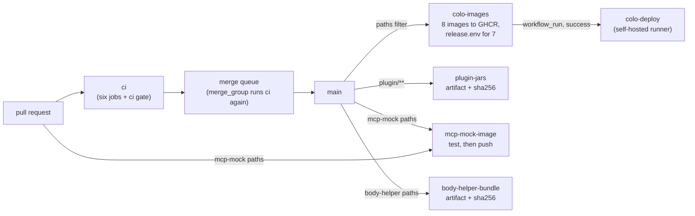

# Build and release

How code becomes something that runs: what CI checks, what it builds and publishes, how every input is pinned, and how a running container can be traced back to the commit it came from. For how a release lands on the node, read [deployment-topology-colo](deployment-topology-colo.md). The per-workflow reference will be [ci-workflows](../reference/ci-workflows.md) (planned, W2).

Facts were read on 2026-11-16 at 1b114276. The repo has six workflows (`git ls-files .github/workflows`).

## The pipeline

| Workflow | Trigger | Produces | Publishes? |
|---|---|---|---|
| `ci.yml` | every PR, every merge-queue entry, push to `main`, manual | the `ci gate` check `main` requires | nothing |
| `colo-images.yml` | push to `main` touching the image sources; manual | images `body`, `mind`, `eventsink`, `mcp`, `admin`, `glass`, `register`, `supervisor`; the `release.env` artifact | GHCR, private packages |
| `plugin-jars.yml` | push to `main` touching `plugin/`; manual | `geldar-core.jar`, `geldar-velocity-identity.jar`, `plugin-jars.sha256` | Actions artifact, 30 days |
| `mcp-mock-image.yml` | PR and push to `main` touching the mock or the contract; manual | the mock MCP image | GHCR, main only, after its image test |
| `body-helper-bundle.yml` | push to `main` touching `body-helper/` or the contract; manual | `main.js` and `main.js.sha256` | Actions artifact, 30 days |
| `colo-deploy.yml` | a successful `colo-images` run on `main`; manual | a deploy | runs on the node |

The jobs of `colo-images`, `plugin-jars` and `body-helper-bundle` run only when `github.repository` is the upstream repository. The mock's `publish` job has no such check; it runs only on a push to `main`, after the PR-safe `image` job, which has no package permission. `colo-deploy` requires that the triggering run came from this repository. None of the publishing jobs runs on `pull_request` (the `if:` lines and headers of each workflow).

## What CI checks

`ci.yml` mirrors `./geldar.ps1 check` (its header; `Invoke-Check` in `geldar.ps1`), with one extra job:

| Job | Checks |
|---|---|
| `typescript` | Biome, typecheck, Vitest, `pnpm check:repo`, contract drift (`pnpm check:generated`), and that `geldar.ps1` runs on Linux |
| `plugin` | `./gradlew build` with the Java version from `plugin/.java-version` (25) |
| `compose` | `docker compose config` on each stack and each overlay merge; `deploy/caddy/validate.sh` |
| `sql` | applies every migration in name order to a pinned pgvector Postgres, then the `sql/test/check-schema*.sql` files (no local `check` counterpart) |
| `images` | builds the eventsink and MCP images without pushing |
| `integration` | Postgres and NATS integration tests with `GELDAR_IT=1`, including the live NATS auth test |
| `ci gate` | passes only when all six passed; the one check `main` requires (decision [0220](../decisions/0220-merge-queue-for-main.md)) |

Generated code is never edited by hand. The contract's JSON Schemas are the source (decision [0001](../decisions/0001-contract-json-schema.md)), and the drift check fails CI when the committed output differs from a fresh run.

## Pins

Every input that could change under us is pinned, and only to versions at least 14 days old (decision [0005](../decisions/0005-pinning-and-security-updates.md); [CLAUDE.md](../../CLAUDE.md), "Pin exact versions").

| Input | How it is pinned | Checked by |
|---|---|---|
| npm packages | exact versions (`saveExact: true`), lockfile from the registry only; `minimumReleaseAge: 20160` minutes | `pnpm-workspace.yaml`; `tools/repo-checks/src/pin-rules.ts` |
| pnpm | `packageManager` with a sha512 in `package.json` | `geldar.ps1 setup` uses that version |
| Node | `.nvmrc` (22.23.2 at 1b114276); the body helper's own runtime is a separate tarball pin checked by sha256 (`deploy/body-helper-node.env`) | `actions/setup-node` reads `.nvmrc`; `body-helper-bundle.yml` checks the tarball |
| GitHub Actions | full commit SHA, version in a comment. 69 `uses:` lines, none unpinned (`grep` on 2026-11-16) | `pin-rules.ts` |
| Container images | by digest in compose and Dockerfiles (Postgres, NATS, Paper, Velocity, Node, Caddy) | `pin-rules.ts`; `deploy/colo-up.sh` refuses an unpinned image |
| Paper and Velocity | `PAPER_BUILD: "74"`, `VELOCITY_BUILD_ID: "615"` in compose | review |
| Gradle | version catalogue, dependency lock files, `verification-metadata.xml` | Gradle itself |
| Third-party plugin jars | `plugins/<name>/<name>.lock.json` with URL and sha256; the deploy downloads and checks | `plugins/*/test/lock.test.ts`; `deploy/common.sh` |
| Release age | each third-party pin needs a publish date at least 14 days old; first-party images are exempt from the date but not from the digest | `tools/repo-checks/src/release-age.ts` |

## Release identity

How to tell which commit a running thing came from.

| Artifact | Identity | Where it is checked |
|---|---|---|
| Colo images | Tags `:main` and `:<12-char commit>` for humans; the OCI label `org.opencontainers.image.revision` set to the full commit; the deploy uses the digest only | `colo-images.yml`; `deploy/colo-cd-verify.sh` refuses an image whose label differs from the release commit or that sits outside the project's registry namespace |
| `release.env` | One `*_IMAGE=<name>@sha256:<digest>` line per image and a comment line naming the commit; also written to the run summary and as a check-run annotation for when the artifact download fails | `colo-images.yml` job `manifest`; `deploy/common.sh` refuses a non-digest line |
| Mock MCP image | Tags `:main` and `:sha-<full commit>`; the pushed image is the one its own test ran against | `mcp-mock-image.yml` job `publish` |
| Plugin jars | `plugin-jars.sha256` names the commit and each jar's sha256 | `deploy/genesis/verify-plugin-jars.sh` |
| Body helper bundle | `main.js.sha256` | `body-helper-bundle.yml` self-check; the install runbook |

The images are unsigned, with no SBOM and no provenance attestation (`colo-images.yml` and `mcp-mock-image.yml` headers, "owner ruling"). The plan's source list names a release-identity document in a sibling infrastructure repo; it is not in this repo and was not read (unverified, from [plan.md](../analysis/docs-library/plan.md) row A06).

## What is not built by CI for the node

- **Plugin jars on the node.** `plugin-jars.yml` publishes an artifact, but the Colo compose file mounts the jars from the checkout on the node. `deploy/README.md` section (b) still describes building them on a trusted machine and copying them over.
- **NATS authorization files.** Generated on a trusted machine by `./geldar.ps1 shard nats-auth`, copied by hand ([nats-topology](nats-topology.md)).
- **Caddy site files.** Installed by `deploy/colo-public.sh`, never by CD.

## Conflicts recorded

Each item gives every account. This page does not pick one.

1. **Signed images.** Spec 6.5 shows the Patron image "signed with cosign; verify before first run", and spec 8.7 covers supply chain. The workflows publish unsigned images with no provenance, citing an owner ruling (`mcp-mock-image.yml` header). No decision record for that ruling was found in this pass; the planned [supply-chain](../security/supply-chain.md) page (W4) should trace it.
2. **Plugin jar delivery.** `deploy/README.md` section (b): "Follow-up: publish the jars as a CI artifact so this copy step goes away." `plugin-jars.yml` already publishes that artifact. The README's step and the workflow both exist; which one the node uses is unverified (D8).
3. **Supervisor in the release.** `colo-images.yml` pushes a `supervisor` image and says "it is not in release.env yet (C7-03b2 adds it)", so the CD cannot deploy it; [system-overview](system-overview.md#conflicts-recorded) records that no compose file runs it.
4. **CI comment.** `ci.yml` says a job "whose part of the repo does not exist yet (plugin/, compose/) says so and passes". Both folders exist at 1b114276, so the skip branches are dead code kept as a guard.
