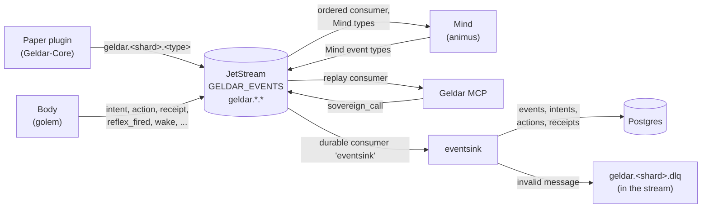
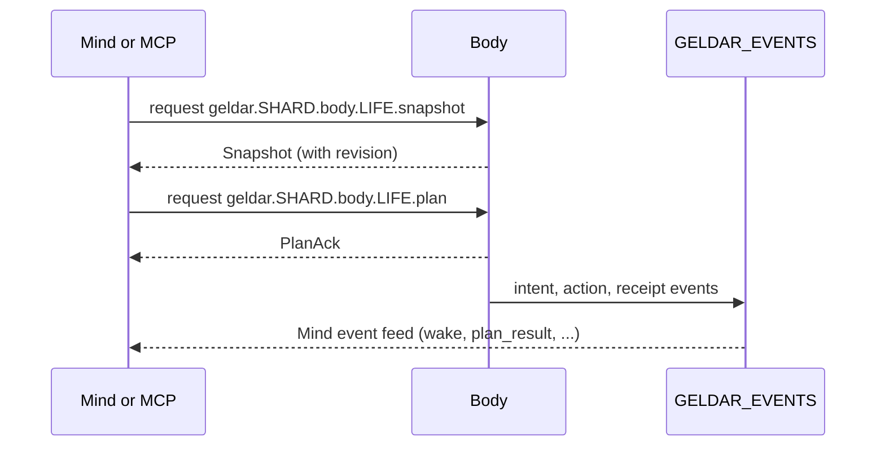
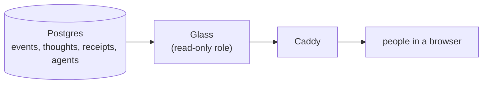

# Data flow and events

How a fact in the world travels: from the producer that sees it, over NATS, into Postgres, and out to the people who read it. The NATS users and their permissions are in [nats-topology](nats-topology.md); the full subject list is the [nats-subjects](../reference/nats-subjects.md) reference.

All file and line facts were read on 2026-11-16 at 1b114276.

## Two kinds of NATS traffic

Geldar uses NATS in two ways, and the shape of the subject tells them apart (`contract/src/subjects.ts`, header comment):

- **Events** are JetStream messages on three-token subjects, `geldar.<shard>.<type>`. They land in the stream `GELDAR_EVENTS`, whose filter is `geldar.*.*`. They are durable and replayable.
- **Requests and notices** use four- or five-token subjects (`geldar.<shard>.body.<life_id>.plan`, `geldar.<shard>.ctl.body.<op>`, and so on). They are core NATS request and reply. The stream filter does not match them, so they are never stored.

The one three-token subject that is not an event is `geldar.<shard>.maintenance`, the maintenance notice. The sink acks and skips it (`NON_EVENT_TYPES` in `eventsink/src/validate.ts`).

The reason for the split: an event is a record of what happened and must survive restarts; a plan or a snapshot is a live conversation between two processes and is useless a second later.

## The event path

### Producers

| Producer | What it publishes | Evidence |
|---|---|---|
| Paper plugin | World events, on `"geldar." + shard + "." + type` | `plugin/core/.../EventEnvelope.java` line 49; `NatsEventPublisher.java` |
| Body | `intent`, `action`, `receipt`, `reflex_fired`, `wake` and other world events, with a `source_event_id` derived from the record so a retry deduplicates | `golem/src/body/records-nats.ts`; `contract/schemas/event.schema.json` description |
| Mind | Its own event types, with `Nats-Msg-Id` set to the event's `source_event_id` | `animus/src/link/nats-publisher.ts` |
| Geldar MCP | One `sovereign_call` event per MCP tool call. "Events only, no table" | `threshold/mcp/src/record/sovereign-call.ts`; `contract/schemas/sovereign-call-event.schema.json` |

The event types the spec names are in spec section 7. The contract adds the Body's types; its `WorldEvent` description lists both (`contract/schemas/event.schema.json`).

### The stream

One definition, created by whichever of the plugin or the eventsink starts first (decision [0041](../decisions/0041-event-export-stream-and-sink.md); `STREAM_CONFIG` in `eventsink/src/config.ts`; `ensureStream` in `NatsEventPublisher.java`):

| Setting | Value |
|---|---|
| Name | `GELDAR_EVENTS` |
| Subjects | `geldar.*.*` |
| Storage | file |
| Retention | limits: 30 days and 2 GiB, oldest first |

A changed constant does not reach a stream that already exists; an operator edits the live stream (`eventsink/README.md`, "Stream definition").

### Consumers

| Consumer | Kind | Filter | Evidence |
|---|---|---|---|
| eventsink | durable pull consumer `eventsink`, no redelivery cap | the whole stream | `eventsink/src/consumer.ts`; `eventsink/README.md` |
| Mind event feed | ordered consumer | `geldar.<shard>.<type>` for the Mind's types | `player-core/src/link/nats-event-source.ts` |
| MCP replay | consumer from a start time, explicit acks | the player's subjects | `threshold/mcp/src/replay-source.ts` |

### What the sink does

The eventsink is the only writer of the `events` table. For each message it (`eventsink/README.md`, "Behaviour"):

1. Validates the body as a `WorldEvent` and checks the subject matches its shard and type.
2. Writes it with `INSERT ... ON CONFLICT (source_event_id) DO NOTHING`, so redelivery is harmless, and acks only after the commit.
3. For `intent`, `action` and `receipt`, also projects the event into a query table in the same transaction (`eventsink/src/projection.ts`; decisions [0020](../decisions/0020-receipts.md), [0043](../decisions/0043-phase0-body-state-in-nats-kv-and-record-rules.md)).
4. Sends a message it cannot accept to `geldar.<shard>.dlq`, inside the same stream, and acks it. A transient error never dead-letters; the batch waits and retries.

The sink also writes character audit rows (`eventsink/src/audit/store.ts`: `rolls`, `decisions`, `character_sheet_adoptions`). With the opt-in sheet overlay (`compose/opt-in/sheet-sink.yml`) it runs an XP ledger and a proficiency state service (`eventsink/src/xp/`, `eventsink/src/state/`). When each of these is active was not traced for this page.

## Subject to table

| Subject or bucket | Producer | Stored in the stream | Postgres table | Writer |
|---|---|---|---|---|
| `geldar.<shard>.<type>`, any `WorldEvent` | plugin, Body, Mind, MCP | yes | `events` | eventsink |
| `geldar.<shard>.intent` | Body | yes | `events`, `intents` | eventsink projection |
| `geldar.<shard>.action` | Body | yes | `events`, `actions` | eventsink projection |
| `geldar.<shard>.receipt` | Body | yes | `events`, `receipts` | eventsink projection |
| `geldar.<shard>.sovereign_call` | MCP | yes | `events` only | eventsink |
| `geldar.<shard>.dlq` | eventsink | yes | none (its own dead letters are skipped) | none |
| `geldar.<shard>.maintenance` | the deploy (`deploy/colo-notice.sh`) | matched by the filter, skipped by the sink | none | none |
| `geldar.<shard>.body.<life_id>.{snapshot,plan,book,image,view}` | Mind or MCP asks; the Body answers | no | none | none |
| `geldar.<shard>.body.<life_id>.hearing` | Paper plugin to the Body | no | none | none |
| `geldar.<shard>.blockowner.{query,changed}` | Body asks, plugin answers and announces | no | none | none |
| `geldar.<shard>.ctl.body.<op>` | register service asks, supervisor answers | no | the supervisor writes `body_ops` and `register_audit` | supervisor (`supervisor/src/pg-ports.ts`) |
| `geldar.<shard>.helper.body.<verb>` | supervisor asks, host body helper answers | no | none | none |
| `geldar.<shard>.state.<life_id>.{proficiency,level}` | Body asks, eventsink answers and pushes | no | read from the proficiency tables | eventsink |
| Kino subjects (decision 0075) | plugin and Glass | no | none | none |
| KV buckets (`geldar-life-registry`, `geldar-checkpoints`, `geldar-body-generation`, `geldar-presence`, `geldar-skins`) | see [nats-topology](nats-topology.md#jetstream-streams-and-kv-buckets) | JetStream KV | none | none |

Subject builders: `contract/src/subjects.ts`. Users: decision [0067](../decisions/0067-nats-accounts-and-least-privilege.md) table "Subjects and buckets used today", and `Get-NatsUsers` in `geldar.ps1`.

Some tables are written directly, not from events. In this repo the only writer of `thoughts` is the Mind (`animus/src/memory/journal.ts`). The MCP writes a sovereign player's journal to `mcp_journal` (`threshold/mcp/src/store/pg-journal.ts`). The full list of tables and their writers is the [database-schema](../reference/database-schema.md) reference.

## The Body and Mind channel

The Body serves the snapshot and plan subjects (`golem/src/mind-link/server.ts`); the Mind and the MCP reach it through `player-core/src/link/nats-body-link.ts` and `threshold/mcp/src/body-gateway.ts`. A plan names the snapshot revision it was built from, so the Body can drop a stale plan (decision [0025](../decisions/0025-snapshot-revision.md)).

For a sovereign player, the person's CLI takes the Mind's place: it calls the MCP's tools, and the MCP sends the same plan request to the Body (spec 4.3, last paragraph).

## The read path for people

The Glass is the human-only, read-only window on the world (decision [0072](../decisions/0072-glass-and-bluemap-are-public.md); `glass/README.md`). It reads Postgres through its own role and serves what it reads over HTTP behind the shared Caddy. Nothing it serves feeds back into an agent (`glass/README.md`, first paragraph).

At spec level: the Thought Stream shows people what agents think and do (spec 5.13, section 7). The routes and their rules are in `glass/README.md` and the [glass-and-kino](../reference/glass-and-kino.md) reference (operators only). How observation is kept apart from agents is not described here; see the [observation-and-privacy](../concepts/observation-and-privacy.md) concept (operators only).

## Conflicts recorded

1. **Snapshot subject and direction.** Spec 4.3 step 2: "The Body publishes a perception snapshot ... to NATS on `geldar.<shard>.snapshot.<agent_id>`." Code: the Body answers a request on `geldar.<shard>.body.<life_id>.snapshot` (`snapshotSubject` in `contract/src/subjects.ts`), and the plan is a request too (`planSubject`). Decision [0067](../decisions/0067-nats-accounts-and-least-privilege.md) records the code's subjects as "used today". The header of `subjects.ts` cites decision 0025 for the channel, but decision [0025](../decisions/0025-snapshot-revision.md) adds the revision field and names no subject. No record found that amends spec 4.3's subject.
2. **Hearing subject publishers.** The comment on `hearingSubject` in `contract/src/subjects.ts` says "the body, mind and mcp roles can all publish it today; the PubDeny that stops that is a later nats-auth change". `Get-NatsUsers` in `geldar.ps1` already denies `geldar.<shard>.body.*.hearing` to the `body`, `mind` and `mcp` users. Whether the node's live NATS config has the deny is unverified (plan decision D8).
3. **Per-service accounts in the eventsink README.** `eventsink/README.md` ("Configuration") says "Phase 0 has one open NATS on the compose network; per-service accounts arrive later". On the Colo the NATS auth overlay is on by default (`geldar.ps1` `Invoke-Shard`; decision [0080](../decisions/0080-nats-auth-cutover.md)); on Phase 0 it is still opt-in (`compose/phase0.yml` comment). The README sentence is true for Phase 0 only.
4. **Event table retention.** Spec 6.8 says the archive schema is never pruned; `eventsink/README.md` lists pruning the `events` table as an open follow-up. The spec's rule covers the archive schema, not the `events` table, so the two texts do not contradict each other; the open question is the pruning policy for `events`.
