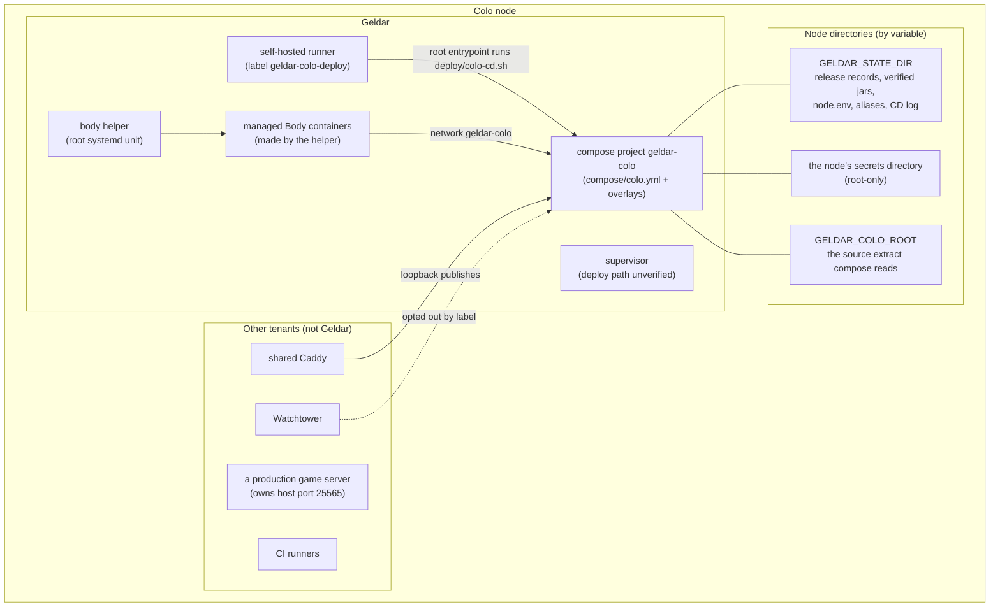
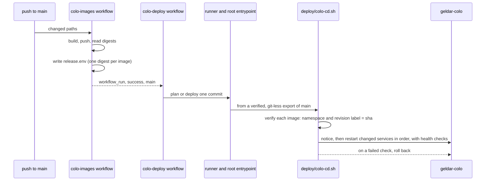

# Deployment topology (Colo)

How the Colo stack sits on its node, how a release gets there, and how it is rolled back. The spec plans separate game, body and record hosts plus DMZ hosts (spec 6.1, 6.2); what runs today is one shared Linux node with one compose project. This page explains that layout and the choices behind it. The steps are in [colo-deploy](../runbooks/colo-deploy.md) and `deploy/README.md`; the script reference is the [deploy-scripts](../reference/deploy-scripts.md).

No host name, address, account or path on the node is written here; directories are named by role, or by the variable that sets them where that variable is not about secrets. Every fact comes from the repo at 1b114276, read on 2026-11-16. Facts about the live node are unverified (plan decision D8); the [node-facts](../operations/node-facts.md) page collects what existing documents say about it.

## What runs on the node

Evidence:

- **Other tenants.** `compose/colo.yml` header ("The node also runs a production game server and CI runners: this file never publishes 25565 or 25566"); the Watchtower opt-out label on every service (`x-labels`, and `deploy/README.md` on Watchtower); the shared Caddy (decision [0096](../decisions/0096-public-topology-as-built.md) item 1).
- **The compose project.** Every compose call names `-p geldar-colo` (decision [0084](../decisions/0084-colo-deploy-by-pull-with-a-project-scoped-script.md) item 2), so no script can reach another tenant's containers. No script runs `down -v` or removes a volume (item 3).
- **The body helper.** A root-owned Node service run as a systemd unit, the only holder of the Docker socket (decision [0260](../decisions/0260-body-container-control-by-host-helper.md) item 2; `deploy/install-body-helper.sh`; [body-helper-node-steps](../runbooks/body-helper-node-steps.md)).
- **The runner.** `.github/workflows/colo-deploy.yml` runs on `[self-hosted, geldar-colo-deploy]`; its only privileged action is a fixed root-owned entrypoint that deploys only commits on `main` (workflow header comment).
- **The supervisor.** The image is built (`colo-images.yml`, job `supervisor`); no compose file in this repo runs it. See [system-overview](system-overview.md#conflicts-recorded).
- **Directories.** `deploy/README.md` ("Prerequisites", "First-deploy runbook", "Public sites"): the state directory holds `current.env`, `previous.env`, the verified BlueMap, Chunky and CoreProtect jars, `node.env` and the alias file; the node's secrets directory is root-only; the scripts check its permissions and file sizes and never read contents.

## The compose file set

Every deploy script calls compose through one wrapper, `dc()` in `deploy/common.sh`, which always merges the same base files and adds two optional ones:

| Order | File | Always? | Why |
|---|---|---|---|
| 1 | `compose/colo.yml` | yes | the standalone Colo stack (decision [0082](../decisions/0082-colo-compose-network-and-limits.md)) |
| 2 | `compose/nats-auth.yml` | yes | NATS authorization is on by default on the Colo (decision [0080](../decisions/0080-nats-auth-cutover.md)) |
| 3 | `deploy/compose.secrets.yml` | yes | points each secret name at the node's secrets directory instead of the repo's ignored folder |
| 4 | `compose/colo-public.yml` | only when both public bind variables are set, and only in the last `up` | the one public Minecraft publish, on the bot ingress ([known gap](#known-gaps)) |
| 5 | an extra overlay (`compose/colo-notice.yml`) | only for `deploy/colo-notice.sh` | the `deploy` NATS password for the admin container |

`compose/colo-kino.yml` and `compose/colo-kino-session.yml` are merged by the owner when Kino is enabled ([kino runbook](../runbooks/kino.md)); the deploy wrapper does not add them.

### Resource budget

Each service has a literal CPU and memory default in `compose/colo.yml` (`${GELDAR_COLO_<SERVICE>_CPUS:-x}`), and `shards/colo.yaml` holds the total. `geldar.ps1` (`Read-ColoConfig`) refuses a total below the sum. Summed by hand from `compose/colo.yml` on 2026-11-16, the 14 services come to 10.6 CPUs and 19968m, which equals `cpu_limit: 10.6` and `memory_limit: 19968m` in `shards/colo.yaml`. The nine default services alone come to 6.85 CPUs and 13184m.

## How a release reaches the node

Images are built in CI and pulled by digest; nothing is built on the node (decision [0084](../decisions/0084-colo-deploy-by-pull-with-a-project-scoped-script.md) item 1). [build-and-release](build-and-release.md) covers the build side.

What `deploy/colo-cd.sh` does and does not do (its header and `deploy/README.md`, the `colo-cd.sh` row):

- It restarts only services whose image digest changed, in the order `eventsink`, `register`, `glass`, `geldar-mcp`, `golem-body` (`ORDER` in `colo-cd.sh`).
- It never restarts Paper, Velocity, Caddy, Postgres or NATS, and never starts the Mind. It restarts `golem-body` only when it is already running (decision [0212](../decisions/0212-golem-body-is-a-profile-adam.md)), and a new Body digest recreates the player hosts.
- It refuses before changing anything when an image is outside the project's registry namespace or its revision label differs from the release commit (`deploy/colo-cd-verify.sh`).
- `deploy/colo-cd.sh` prints `needs manual` for what it cannot apply (`plugin/`, `compose/`, `deploy/caddy/` and NATS config) when that folder's export hash differs from the record written by `--record-applied`. The plan (`deploy/colo-cd-plan.sh`) lists those files as skipped.

The first deploy, and any change the CD cannot apply, uses `deploy/colo-up.sh` by hand. Its order (`deploy/README.md`, "First deploy: the order" and "Public sites on a node"):

1. Checks: Docker and Compose, disk space, secret files, the release manifest, the merged config (no 25565 or 25566, every image digest-pinned, no service that would build on the node), the plugin lock files.
2. Records the previous and current release in the state directory. Nothing deploys without a record.
3. `up -d --wait postgres nats`.
4. In the one-shot `admin` container: migrations, then the login passwords for the `geldar_mcp`, `geldar_glass` and `geldar_register` roles; `ensure-skins-bucket`; `whitelist-house-body` once Paper is healthy.
5. The full `up -d --wait`.
6. Last, and only when configured, the public Minecraft overlay.

Public HTTPS sites are a separate, later step (`deploy/colo-public.sh`), because they proxy to services that must already be up.

## Rollback and stop

- `deploy/colo-rollback.sh` re-applies the recorded previous release with `--pull never` and swaps the two records; running it again goes forward. It removes no volume and does not undo database changes (`deploy/README.md`, "Rollback").
- `colo-cd.sh` rolls back on its own when a post-restart health check fails.
- `deploy/colo-down.sh` stops the project and keeps containers, networks and volumes.
- `deploy/colo-public.sh off <site>` swaps a site for its 503 twin; `remove` takes the Geldar sites out of Caddy.

## Failure modes this layout guards against

| Risk | Guard | Evidence |
|---|---|---|
| Touching another tenant | Project-scoped compose calls; status by project label | decision [0084](../decisions/0084-colo-deploy-by-pull-with-a-project-scoped-script.md) item 2 |
| Taking the other game server's port | 25565 and 25566 refused everywhere | decision [0082](../decisions/0082-colo-compose-network-and-limits.md) |
| Watchtower pulling past the release record | Opt-out label on every service, enforced by a repo check | `deploy/README.md`, Watchtower paragraph |
| A tag that moves | Digest-only manifest; `latest` and bare tags refused | decision [0084](../decisions/0084-colo-deploy-by-pull-with-a-project-scoped-script.md) item 4 |
| An image from a fork or another commit | Namespace and revision-label check before any change | `deploy/colo-cd-verify.sh` |
| A missing bind source becoming a root-owned directory | Stop the project before swapping the source tree; `colo-up.sh` refuses a jar path that is a directory | `deploy/README.md`, "Replacing `src` on a node" |
| Two deploys at once | A lock directory in the state directory; the workflow's concurrency group | `deploy/colo-cd.sh` `acquire_lock`; `colo-deploy.yml` |
| Losing data on rollback | No volume is removed; schema changes are not undone, so decide first | `deploy/README.md`, "Rollback" |

## Known gaps

Known gap, open and **not fixed**: the public overlay against decision [0137](../decisions/0137-public-spectator-proxy-is-separate-and-online.md), recorded in decision [0364](../decisions/0364-known-gap-public-overlay-against-0137.md). `deploy/colo-up.sh` merges the overlay last, and only when both bind variables are set (step 6 above). Node state is unchecked (plan decision D8).

## Conflicts recorded

Each item gives every account. This page does not pick one.

1. **How many images.** `deploy/README.md` ("Not covered yet") says `colo-images` "publishes the five images (`geldar-body`, `geldar-mind`, `geldar-eventsink`, `geldar-mcp`, `geldar-admin`)". `.github/workflows/colo-images.yml` writes seven `*_IMAGE` lines to `release.env` (adding `glass` and `register`) and pushes an eighth image, `supervisor`, that is not in the manifest.
2. **The release commit record.** `deploy/README.md` says `colo-cd.sh` "needs `<state dir>/release.commit`" and records it, and later says "There is no `state/release.commit` record". The first describes `colo-cd.sh`; the second sits in the "Public sites" section about `colo-up.sh`. Both are in one file; the reader cannot tell which script each applies to without reading the code.
3. **The resource model.** Decision [0082](../decisions/0082-colo-compose-network-and-limits.md) (Proposed): "Each service's ceiling is that whole budget, not a split", set from `shards/colo.yaml` through `GELDAR_COLO_CPU_LIMIT`. `compose/colo.yml` at 1b114276: a per-service literal budget per service, with `shards/colo.yaml` as their sum.
4. **The deploy job's timeout.** [colo-deploy](../runbooks/colo-deploy.md) step 3: "The job timeout is 40 minutes." The same runbook, step 5, and `.github/workflows/colo-deploy.yml`: `timeout-minutes: 30`.
5. **The two release manifests.** `colo-cd.sh` keeps its own copy in the state directory because the root-owned copy is not readable by the operator account; `colo-up.sh` and `colo-rollback.sh` read the root-owned copy. `deploy/README.md` says to keep them in step by hand. This is documented drift, not a contradiction, but a missed step leaves rollback pointing at an older release.
