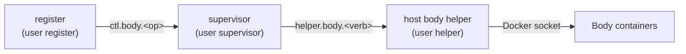
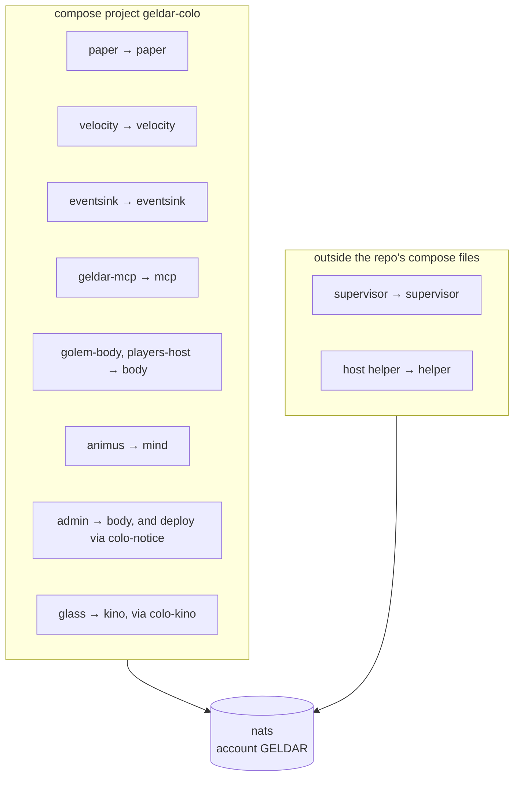

# NATS topology

NATS is Geldar's message bus: every event, every Body request and every control verb crosses it. This page explains how the server is set up, which users exist and why each has the reach it has, and which JetStream streams and KV buckets hold state. It names roles only: no password, no path to a password file and no address.

For what flows on each subject, read [data-flow-events](data-flow-events.md). To change the users on the live node, follow [nats-auth-inplace](../runbooks/nats-auth-inplace.md). All facts were read from the repo on 2026-11-16 at 1b114276; nothing on the node was read (plan decision D8).

## The server

| Setting | Colo | Phase 0 | Evidence |
|---|---|---|---|
| Image | `nats:2.15.1-alpine`, pinned by digest | the same | `compose/colo.yml`, `compose/phase0.yml` |
| JetStream | on, file store in the `nats-data` volume (`-js -sd /data`) | the same | `command:` in both files |
| Client port 4222 | the `geldar-colo` network only | host loopback | `compose/colo.yml` ("No ports"); `compose/phase0.yml` |
| Monitor 8222 | not in the base; with the auth config, inside the container on loopback only | host loopback | `compose/colo.yml` comment ("the monitor lists subjects and subscriptions"); `compose/nats-auth.yml` |
| Health check | TCP probe of 4222 | HTTP `healthz` on the monitor | both files |
| Authorization | on by default | open, unless the auth overlay is merged | `geldar.ps1` `Invoke-Shard`; decision [0080](../decisions/0080-nats-auth-cutover.md) |

## The authorization model

One account, `GELDAR`, with JetStream on. Each component connects as its own user, and each user carries three lists: publish allow, publish deny, subscribe allow. Anything not allowed is refused, and a deny wins over an allow. Every user may answer requests (`allow_responses`) and use its own inbox (decision [0067](../decisions/0067-nats-accounts-and-least-privilege.md); `Initialize-NatsAuth` in `geldar.ps1`).

The config is generated, never committed:

- `Get-NatsUsers` in `geldar.ps1` holds the table of users and subjects. `tools/repo-checks/src/nats-auth.test.ts` runs the real generator and compares it with the table of decision [0087](../decisions/0087-nats-overlay-live-test-and-scoped-subjects.md); `threshold/mcp/test/nats-auth.it.test.ts` proves it against a live `nats-server` (run with `GELDAR_IT=1`).
- `./geldar.ps1 shard nats-auth <shard>` writes one password per user and the server config on a trusted machine. It never overwrites an existing file. Generation is PowerShell-only, so the files are copied to the node by hand (`deploy/README.md`, "Not covered yet").
- Each container reads its own password from a file-based Docker secret and names its user in `GELDAR_NATS_USER` (`contract/src/nats-connect.ts`; `compose/nats-auth.yml` header).
- A permission change on the live node is applied in place with a `SIGHUP` reload, not a restart ([nats-auth-inplace](../runbooks/nats-auth-inplace.md), step 5).

### Why the lists are per shard, not per life

Every subject in the table starts with `geldar.<shard>`. A life is not known when the config is written, so no user is scoped to one life. The Mind and the MCP may address any life of their shard, and each enforces its own life list in code. Decision [0067](../decisions/0067-nats-accounts-and-least-privilege.md) ("Lives scoping") records this as a known gap; decision [0087](../decisions/0087-nats-overlay-live-test-and-scoped-subjects.md) accepts the wider publish for Phase 1 "with the application check as the limit". KV buckets are not shard-scoped either (decision 0087, "KV buckets are not shard-scoped").

## Users by role

The generator defines 11 users for the colo table (`Get-NatsUsers`, counted 2026-11-16). The phase0 table (scratch stack) adds a twelfth, `seed`, which can only create, inspect and update the two identity KV buckets. `<s>` is the shard. "JS" means the JetStream API, ACK and inbox subjects (`$JS.API.>`, `$JS.ACK.>`, `_INBOX.>`).

| User | Role | Connected by (Colo) | May publish | Denied | May subscribe |
|---|---|---|---|---|---|
| `body` | A Body; also the admin container's bucket and RCON steps | `golem-body`, `players-host`, `admin` | `geldar.<s>.>`; JS; KV `geldar-life-registry`, `geldar-checkpoints`, `geldar-body-generation`, `geldar-skins` | Kino subjects, `blockowner.changed`, `ctl.body.>`, `helper.body.>`, `state.*.level`, `body.*.hearing`, `geldar.<s>.provenance.>` | `geldar.<s>.body.>`, `blockowner.changed`, `state.*.level`, `geldar.<s>.provenance.>`, inbox |
| `mind` | The Mind | `animus` (profile `mind`) | its event types (`wake`, `intent`, `action`, `plan_result`, `reflex_fired`, `speech`, `damage`, `death`, `sleep`); `geldar.<s>.body.>`; JS | `body.*.hearing` | inbox |
| `mcp` | The Geldar MCP | `geldar-mcp` | `geldar.<s>.sovereign_call`; `geldar.<s>.body.>`; KV `geldar-presence`; JS | `body.*.hearing` | inbox |
| `eventsink` | The sink and its state service | `eventsink` | `geldar.<s>.dlq`; `geldar.<s>.state.>`; JS | none | `state.*.proficiency`, inbox |
| `paper` | The Geldar-Core plugin | `paper` | `geldar.<s>.>`; JS | Kino subjects, `blockowner.query`, `ctl.body.>`, `helper.body.>`, `state.*.level` | Kino subjects, `maintenance`, `blockowner.query`, inbox |
| `velocity` | The identity gate, read-only | `velocity` | only the JetStream calls a KV watch needs on `geldar-life-registry` and `geldar-skins`; flow control; inbox | none | inbox |
| `kino` | Glass's camera link | `glass`, only with the Kino overlay | Kino subjects | none | Kino subjects, inbox |
| `deploy` | The maintenance notice | `admin`, only through `compose/colo-notice.yml` | `geldar.<s>.maintenance` | none | inbox |
| `supervisor` | Owner body control | not in any compose file in this repo | the four `helper.body.<verb>` subjects; inbox | none | `ctl.body.>`, inbox |
| `register` | The register service's control requests | not wired in `compose/colo.yml` | `ctl.body.>` | none | inbox |
| `helper` | The host body helper (systemd, not compose) | the node's helper unit | inbox | none | the four `helper.body.<verb>` subjects |

Why some lists look the way they do:

- **The denies stop forgery.** A Body may publish almost anything on its shard, so the denies name what only someone else may say: the Kino subjects, a block owner change, a body control verb, a proficiency level, a hearing notice (comments in `Get-NatsUsers`; decisions [0165](../decisions/0165-block-owner-subjects.md), [0199](../decisions/0199-muffled-hearing.md), [0280](../decisions/0280-proficiency-contract-and-state-subjects.md)).
- **Velocity is read-only.** It watches two buckets and writes none, so a compromised proxy cannot admit a username (decision [0137](../decisions/0137-public-spectator-proxy-is-separate-and-online.md) item 3, a correction to the 0087 table). Because Velocity cannot create a bucket, the admin container creates `geldar-skins` as the `body` user before the stack starts (`deploy/README.md`, "Known limits").
- **Body control is a chain of narrow users.** The register service may only ask (`ctl.body.>`); the supervisor may only answer that and ask the helper; the helper may only hear its four verbs. Only the helper touches Docker (decisions [0152](../decisions/0152-programmatic-body-management-for-owners.md), [0260](../decisions/0260-body-container-control-by-host-helper.md)).

## JetStream streams and KV buckets

| Name | Kind | Created by | Written by | Read by | Evidence |
|---|---|---|---|---|---|
| `GELDAR_EVENTS` | stream, `geldar.*.*`, file, 30 days, 2 GiB | the plugin or the eventsink, whichever starts first | plugin, Body, Mind, MCP | eventsink, Mind feed, MCP replay | `eventsink/src/config.ts`; [data-flow-events](data-flow-events.md#the-stream) |
| `geldar-life-registry` | KV | Golem | Golem (`body`) | Velocity identity gate (watch) | `golem/src/registry.ts`; `RegistryClient.java`; decision [0040](../decisions/0040-bot-ingress-registry-in-nats-kv.md) |
| `geldar-checkpoints` | KV | the Body | the Body | the Body | `golem/src/body/checkpoint.ts`, `restart.ts`; decision [0043](../decisions/0043-phase0-body-state-in-nats-kv-and-record-rules.md) |
| `geldar-body-generation` | KV | the Body | the Body | the Body | `golem/src/body/generation.ts` |
| `geldar-presence` | KV | the MCP | the MCP for its players' lives | the player host, `tools/players-cli` | `PRESENCE_BUCKET` in `contract/src/subjects.ts`; `threshold/mcp/src/presence.ts`; `golem/src/players/presence.ts`; `tools/players-cli/src/rangers-presence.ts` |
| `geldar-skins` | KV | the admin container (`ensure-skins-bucket`, as `body`) | `tools/players-cli skin set` | Velocity (`SkinRegistry.java`) | `golem/src/ensure-skins-bucket.ts`; `tools/players-cli/src/skin-store.ts` |

The live gate fails closed: until the registry has synced, and while the bucket is absent, the Velocity gate admits nobody (`plugin/README.md`, `velocity-identity` row).

## Where the users run

The `paper`, `velocity` and `eventsink` users come from `compose/nats-auth.yml`. The `body`, `mind` and `mcp` users are wired in `compose/colo.yml` itself. The `register` user has no compose wiring at 1b114276; [nats-auth-inplace](../runbooks/nats-auth-inplace.md) tracks adding it as a separate step.

## Conflicts and drift recorded

Each item gives every account. This page does not pick one.

1. **The MCP's reach.** Spec 6.4: "NATS (MCP service account, `geldar.*.player.>` subjects only)". Decision [0067](../decisions/0067-nats-accounts-and-least-privilege.md): publish `sovereign_call`, request only `body.<life>.book` for its own players, "NO publish on ... other lives' subjects". Decision [0087](../decisions/0087-nats-overlay-live-test-and-scoped-subjects.md) (status Proposed) and the generator: `mcp` publishes `geldar.<s>.body.>`, any life of its shard, limited by the application check. No `player` subject exists in `contract/src/subjects.ts`.
2. **The `ops` user.** Decision [0067](../decisions/0067-nats-accounts-and-least-privilege.md) lists an `ops` user with full access, "used by hand only". Decision [0087](../decisions/0087-nats-overlay-live-test-and-scoped-subjects.md) removed it from the generator and left "Owner to reconcile 0067". The generator at 1b114276 has no `ops` user.
3. **The live node and the generator.** [nats-auth-inplace](../runbooks/nats-auth-inplace.md) records, as of 2026-11-14, 8 users on the live node and a pending batch for `helper` and `supervisor` "pending the PR #415 merge". The generator at 1b114276 already has both, plus `register`: 11 users in the colo table. The live count is unverified (D8); the runbook's "not merged yet" wording is stale.
4. **Hearing deny.** `contract/src/subjects.ts` (comment on `hearingSubject`) says the deny is "a later nats-auth change"; the generator already has it for `body`, `mind` and `mcp`.
5. **Where the MCP's user is wired.** `compose/nats-auth-mcp.yml` says "Colo does not include the MCP service, so this file is not merged there." `compose/colo.yml` does include `geldar-mcp` and wires its `mcp` user in the base file ("the overlay compose/nats-auth-mcp.yml is not merged on colo, so the wiring is here"). The overlay's comment is out of date; the behaviour agrees.
