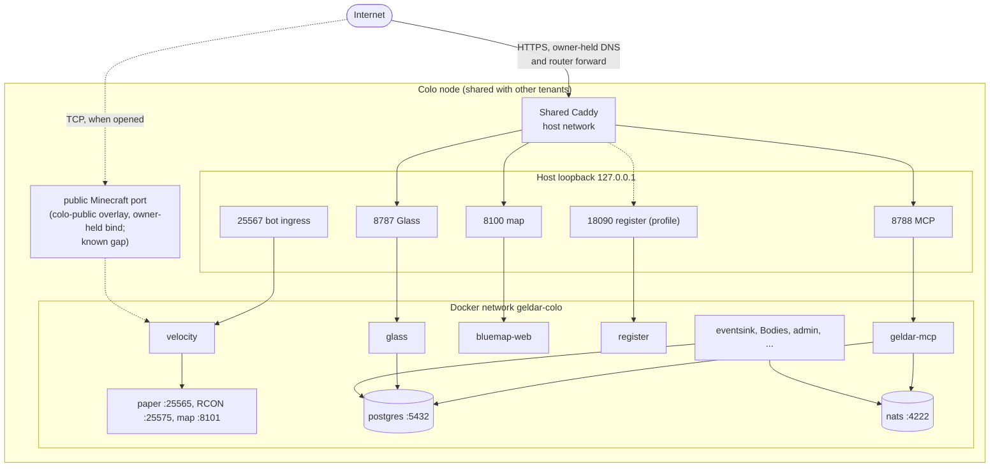

# Network and trust zones

Which parts of Geldar can reach which, and why. The spec designs three network zones on separate hosts (spec 6.4) and lists the actors and trust boundaries (spec 8.1). What runs today is one shared node with one compose network, reached from outside only through the node's shared Caddy and, when the owner opens it, one public Minecraft port. This page sets the two side by side.

No address, host name or domain appears here. Addresses are owner-held values in the node's deploy environment (decision [0096](../decisions/0096-public-topology-as-built.md) (Proposed) item 8; IP policy in decision [0132](../decisions/0132-ipv4-literal-policy.md)). File facts were read on 2026-11-16 at 1b114276. Nothing on the node was read (plan decision D8).

## The design: three zones

Spec 6.4 puts every host in one of three zones, default-deny between them, enforced by the colo firewall and by nftables on every host:

- **Internet.** May reach only TCP 443 on the Gateway, the Geldar MCP and the Observatory edge, and TCP 25565 on the spectator proxy.
- **DMZ.** One job per host. Each DMZ host reaches the internal zone through one narrow path: the Gateway and the MCP through scoped NATS accounts, the Observatory edge through read-only HTTP, the spectator proxy through Paper's forwarding secret.
- **Internal.** Postgres and NATS listen on the internal network only. The Body host has no internet egress.

Spec 8.1 adds the actors and how far each is trusted. An agent has no trust and reaches only the Body API and in-world mechanics: "never a command, a network, or a file". A human never acts in the world (spec section 2, Principle 1).

## As built: one node, one network

### What is published and what is not

The loopback host ports are defaults: each is `127.0.0.1:${GELDAR_PORT_<NAME>:-<default>}:<container port>` in `compose/colo.yml`, so the node may override the host port but not the loopback address.

| Port (host default) | Variable | Where it is reachable | Service | Evidence |
|---|---|---|---|---|
| 8788 | `GELDAR_PORT_MCP` | host loopback | `geldar-mcp` | `compose/colo.yml` `ports:` |
| 8787 | `GELDAR_PORT_GLASS` | host loopback | `glass` | same |
| 8100 | `GELDAR_PORT_BLUEMAP` | host loopback | `bluemap-web` | same |
| 18090 (container 8090) | `GELDAR_PORT_REGISTER` | host loopback, profile `register` only | `register` | same; decision [0150](../decisions/0150-register-loopback-port-18090.md) |
| 25567 (container 25565) | `GELDAR_PORT_BOT` | host loopback | `velocity`, the bot ingress | same; decision [0082](../decisions/0082-colo-compose-network-and-limits.md) (Proposed) |
| owner-held port | `GELDAR_MC_BIND`, `GELDAR_MC_PORT` | the node's own interface, only with the public overlay | `velocity`, the bot ingress ([known gap](#known-gaps)) | `compose/colo-public.yml`; `deploy/common.sh` `public_overlay()` |
| 5432, 4222 | the `geldar-colo` network only | `postgres`, `nats` | `compose/colo.yml` ("No ports") |
| 25565, 25575, 8101 | the `geldar-colo` network only | `paper` (game, RCON, map web) | `compose/colo.yml` ("Velocity is the only game listener") |
| 8102 | the `geldar-colo` network only | `bluemap-alias` | `plugins/bluemap/alias-proxy/alias-proxy.ts` |

Three guards hold this shape:

1. **The loopback rule.** `tools/repo-checks/src/loopback-ports.ts` fails any publish in `compose/*.yml` whose host address is not `127.0.0.1`. The host port must be a literal, or an allowlisted `GELDAR_PORT_<NAME>` variable with its allowlisted default (`PARAM_PORT` in that file); any other interpolation is rejected. The one exception is the `velocity` entry in `compose/colo-public.yml` (`PUBLIC_OVERLAY_PORT`; decision [0096](../decisions/0096-public-topology-as-built.md), ruling R19).
2. **Ports 25565 and 25566 are never published by the Colo.** Another server on the node owns 25565. The loopback rule, `geldar.ps1` and `deploy/colo-up.sh` each refuse them (decision [0082](../decisions/0082-colo-compose-network-and-limits.md); `deploy/README.md`, "What each script refuses").
3. **The public bind is a strict IPv4 literal of the node's own interface**, never `0.0.0.0`, and it is merged only after the stack is healthy (`deploy/common.sh`; decision [0137](../decisions/0137-public-spectator-proxy-is-separate-and-online.md) item 4).

Inside the network, a container reaches a peer by service name only when compose sets `GELDAR_IN_NETWORK_HOSTS=1`, and only for a closed list of names (decision [0131](../decisions/0131-colo-in-container-hosts-and-mind-shard-file.md) item 1). Without it the code accepts loopback only.

### Container hardening

`geldar-mcp`, `register`, `glass`, `bluemap-alias`, `bluemap-web` and `admin` run with a read-only root, a tmpfs `/tmp`, `cap_drop: [ALL]` and `no-new-privileges` (`compose/colo.yml`). Every Colo service carries CPU, memory and pid limits and a log cap (decision [0082](../decisions/0082-colo-compose-network-and-limits.md)). No container mounts the Docker socket; the host body helper alone holds it (decision [0260](../decisions/0260-body-container-control-by-host-helper.md)).

## The HTTPS edge: Caddy sites

The node's Caddy is shared with other services and is not Geldar's. Geldar adds three site files from `deploy/caddy/` and one `import` line (decisions [0071](../decisions/0071-public-endpoints-and-ports.md) item 6, [0094](../decisions/0094-public-sites-read-only-through-caddy.md) (Proposed), [0096](../decisions/0096-public-topology-as-built.md) item 1). Hosts and upstreams are placeholders filled on the node (`{$GELDAR_DOMAIN}`, `{$GELDAR_*_UPSTREAM}`), and each upstream must be a loopback address (`deploy/README.md`, "Public sites").

| Site | Methods | Paths passed on | Body cap | Kill switch |
|---|---|---|---|---|
| `map.<domain>` | GET, HEAD | everything (BlueMap's own tree) | 1 KiB | `map-off.caddy` |
| `glass.<domain>` | GET, HEAD for Glass; GET, HEAD, POST for the register paths | the listed Glass page and API paths; `/register*` and `/roster*` to the register service; Kino paths only when Kino is enabled; all else 404 | 1 KiB (Glass), 8 KiB (register) | `glass-off.caddy` (both) |
| `mcp.<domain>` | POST, GET, DELETE | `/p/<player_id>` only; all else 404 | 64 KiB | `mcp-off.caddy` |

Every site removes any client-sent address header and sets `x-geldar-client-ip` itself; each service trusts that header only from the peer it is configured to trust (`deploy/caddy/README.md`, "Rules every site keeps"; `GELDAR_MCP_TRUSTED_PROXIES`, `GELDAR_GLASS_TRUSTED_PROXIES` and `REGISTER_TRUSTED_PEERS` in `compose/colo.yml`). Core Caddy has no rate limiter; the limits live in the services (decision [0094](../decisions/0094-public-sites-read-only-through-caddy.md) item 6).

## Trust boundaries, design and build

| Spec 8.1 boundary or actor | As built | Evidence |
|---|---|---|
| Internet to DMZ | Internet to the shared Caddy, then loopback publishes; no separate DMZ host | decision [0096](../decisions/0096-public-topology-as-built.md) |
| DMZ to internal | Loopback publish into the `geldar-colo` network; NATS users per service | `compose/colo.yml`; [nats-topology](nats-topology.md) |
| Thinker output to Mind validator | Not reachable from outside: no Gateway; Phase 0 Thinkers use the Mind's loopback socket | `lantern-local/README.md`; decision [0131](../decisions/0131-colo-in-container-hosts-and-mind-shard-file.md) item 3 |
| MCP tool input to validator | The MCP imports the shared validator from `player-core` | `threshold/mcp/src/main.ts` imports `@geldar/player-core/src/validate/index.ts` |
| Sovereign player's human | Static per-player Bearer tokens, not OAuth 2.1 | decisions [0054](../decisions/0054-static-hashed-per-player-bearer-tokens.md), [0071](../decisions/0071-public-endpoints-and-ports.md) item 7 |
| Watcher (human with SSO) | Glass and the map are public and read-only; the register service adds Microsoft sign-in on the Glass host | decisions [0072](../decisions/0072-glass-and-bluemap-are-public.md), [0135](../decisions/0135-self-registration-with-github-and-discord.md) |
| Ghost (spectator) | Design: a separate online-mode spectator proxy. The repo has none yet | decision [0137](../decisions/0137-public-spectator-proxy-is-separate-and-online.md); [known gap](#known-gaps) |
| Operator | Self-hosted runner or the owner's own SSH access; no host or user in the repo | `deploy/README.md`, "Runner or SSH"; decision [0084](../decisions/0084-colo-deploy-by-pull-with-a-project-scoped-script.md) item 10 |
| Agent | Reaches the world only through its Body; Bodies reach Velocity and NATS | `compose/colo.yml` (`GELDAR_MC_HOST: velocity`) |

The outbound tunnel that `compose/mcp.yml` describes (a `cloudflared` service) stays commented out (decision [0053](../decisions/0053-public-mcp-through-an-outbound-tunnel-deferred.md)); `compose/cloudflared/config.example.yml` is an example only.

## Phase 0

Every publish in `compose/phase0.yml` is on `127.0.0.1`: Postgres 5432, NATS 4222 and its monitor 8222, and the bot ingress 25565. Paper publishes nothing; `compose/rcon-host.yml` publishes RCON to loopback for host tools, and `geldar.ps1` refuses that overlay for the Colo. NATS is open on Phase 0 unless the auth overlay is merged (`compose/phase0.yml` comment; decision [0080](../decisions/0080-nats-auth-cutover.md)).

## Known gaps

One place where the repo does not yet match the authoritative design, open and **not fixed**: the public overlay against decision [0137](../decisions/0137-public-spectator-proxy-is-separate-and-online.md) (Accepted, the authoritative design for the public Minecraft path). Decision [0364](../decisions/0364-known-gap-public-overlay-against-0137.md) records it and the stop rule that holds until it closes. Node state is unchecked (plan decision D8).

## Conflicts recorded

Each item gives every account. This page does not pick one.

1. **The public Minecraft path.** Decision [0137](../decisions/0137-public-spectator-proxy-is-separate-and-online.md) is the authoritative design; the repo's divergence from it is the [known gap](#known-gaps), not a conflict between accounts.
2. **The MCP's NATS reach.** Spec 6.4: the MCP reaches the internal zone through "NATS (MCP service account, `geldar.*.player.>` subjects only)". Decision [0067](../decisions/0067-nats-accounts-and-least-privilege.md): the `mcp` user publishes `sovereign_call` and requests only `body.<life>.book` for its own players. Decision [0087](../decisions/0087-nats-overlay-live-test-and-scoped-subjects.md) (Proposed) and `Get-NatsUsers` in `geldar.ps1`: `mcp` may publish `geldar.<shard>.body.>`, limited by the application's own life check. Detail in [nats-topology](nats-topology.md#conflicts-and-drift-recorded).
3. **Caddy changes: reload or restart.** Decision [0071](../decisions/0071-public-endpoints-and-ports.md) item 6 and `deploy/caddy/README.md`: load with `caddy reload`, "never restarted". `deploy/README.md` ("Caddy"): the shared Caddy has its admin API off, so a public-site change "is applied by ONE operator restart of it, never by a deploy step" (owner ruling R39), and `colo-public.sh` has a `restart` mode for that.
4. **Observatory access.** Spec 6.2 and 8.4: the Observatory edge is behind SSO (Cloudflare Access or oauth2-proxy). Decision [0072](../decisions/0072-glass-and-bluemap-are-public.md): Glass and BlueMap are public and read-only. The Caddy sites have no SSO step (`deploy/caddy/glass.caddy`, `map.caddy`).
