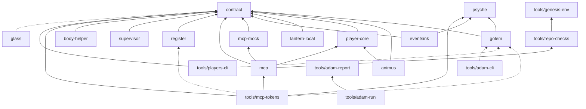

# Repo map and dependencies

Which workspace packages use which, measured from the code rather than guessed, and what that means when you change one. The folder-by-folder table is [repo-layout](../reference/repo-layout.md); the runtime connections (NATS, Postgres, HTTP) are in [system-overview](system-overview.md) and [data-flow-events](data-flow-events.md).

## How this map was measured

On 2026-11-16 at 1b114276:

1. **Declared edges:** the `@geldar/*` entries in `dependencies` and `devDependencies` of every `package.json` listed by `pnpm-workspace.yaml` (13 entries plus `tools/*`).
2. **Import edges:** `git grep` for `from '@geldar/<name>` and for relative imports that leave the package (`from '../../../<other package>/...'`), in `.ts`, `.mjs` and `.js` files.
3. Each import was classed **production** or **test**: a file is test code when its path ends `.test.ts` or sits under `test/`, or is a `fixtures` or `fakes` file.

The map is at package level. An edge means at least one production file of A imports something from B; it does not mean every file of A needs B.

## The production graph

Solid arrows are declared in `package.json` and imported. Dashed arrows are relative imports across a package boundary with no `package.json` entry. Packages with no `@geldar/*` edge at all: `contract`, `psyche` (production), `tools/adam-report`, `tools/genesis-env`, `tools/glass-ctl`, `tools/kino-shot`, `tools/migrate`, `tools/portscan`, `tools/progress-metrics`, `tools/psyche-release`; `tools/admin` has no `package.json`.

## Edge by edge

| Package | Declared `@geldar` deps | Production imports | Test-only imports | Notes |
|---|---|---|---|---|
| `contract` | none | none | none | The source of truth: JSON Schemas and generated code (decision [0001](../decisions/0001-contract-json-schema.md)). |
| `psyche` | `contract` (dev) | none | `contract` | Zero imports outside the package, so the kit can copy `psyche/src` byte for byte (`psyche/README.md`; decision [0281](../decisions/0281-psyche-package-boundary.md)). |
| `player-core` | `contract` | `contract` | none | The live player path (`player-core/README.md`). |
| `golem` | `contract`, `psyche` | `contract`, `psyche` (reflexes, character runtime) | relative `contract/src/subjects.ts` | |
| `animus` | `contract`, `player-core` | `contract`, `player-core` | relative `lantern-local/src` | Frozen: 22 `animus/src` files re-export from `@geldar/player-core/src/...` (counted 2026-11-16). |
| `lantern-local` | `contract` | `contract` (Thinker frame and token) | none | |
| `eventsink` | `contract`, `psyche` | `contract`, `psyche` (XP and state) | relative `contract/src/subjects.ts` | |
| `glass` | none | relative `contract/src/generated/types.ts` from `glass/web/kino/` | relative `tools/migrate`; `golem` and `animus` named as strings in `glass/test/import-graph.test.ts`, a test that keeps Glass from importing them | The browser code takes types from the contract without declaring it. |
| `threshold/mcp-mock` | `contract` | `contract` | none | |
| `threshold/mcp` | `contract`, `player-core`, `mcp-mock`, `repo-checks`; `animus` (dev) | `contract`, `player-core`, `mcp-mock` (prompts, clock, event types), `repo-checks` (`identity-mode.ts`) | `animus`; relative `golem/src`, `tools/migrate` | A production import of a repo-check module (`threshold/mcp/src/main.ts`). |
| `threshold/register` | `contract` | `contract` | relative `glass/src/kino-cookie.ts` | |
| `supervisor` | `contract` | `contract` | none | |
| `body-helper` | `contract` | `contract` | none | |
| `tools/mcp-tokens` | `contract`, `mcp`, `psyche` | `contract`, `psyche`; relative `threshold/mcp/src/store/token-hash.ts`, `golem/src/players/life-removal.ts`, `threshold/register/src/identity.ts` | | `mcp` is declared but reached by relative path; `golem` and `register` are not declared. |
| `tools/players-cli` | `contract` | `contract`; relative `golem/src/players/life-removal.ts` | | `golem` not declared. |
| `tools/adam-cli` | none | relative `golem/src/players/life-removal.ts` | | `golem` not declared. |
| `tools/adam-run` | `adam-report` | `adam-report` | | |
| `tools/adam-report` | none | none | relative `threshold/mcp/test/it/scratch-db.ts` | |
| `tools/repo-checks` | `genesis-env` | `genesis-env` | | |
| `tools/psyche-release` | none | none | relative `psyche/src/version.ts` | Hashes the `psyche/src` tree (`package.json` description). |

## 1, 2 and 3 hops

Computed from the production edges above (solid and dashed). Read a row as "a change in a package in this cell can reach the row's package in this many steps".

| Package | 1 hop | 2 hops | 3 hops |
|---|---|---|---|
| `golem` | contract, psyche | none | none |
| `animus` | contract, player-core | none | none |
| `player-core` | contract | none | none |
| `eventsink` | contract, psyche | none | none |
| `glass` | contract | none | none |
| `threshold/mcp` | contract, mcp-mock, player-core, repo-checks | genesis-env | none |
| `threshold/register`, `supervisor`, `body-helper`, `lantern-local`, `mcp-mock` | contract | none | none |
| `tools/mcp-tokens` | contract, golem, mcp, psyche, register | mcp-mock, player-core, repo-checks | genesis-env |
| `tools/players-cli` | contract, golem | psyche | none |
| `tools/adam-cli` | golem | contract, psyche | none |
| `tools/adam-run` | adam-report | none | none |
| `tools/repo-checks` | genesis-env | none | none |

Fan-in, the other way round: `contract` is imported by 13 packages; `golem` and `psyche` by 3 each; `player-core` by 2 (`animus`, `threshold/mcp`); `mcp-mock`, `repo-checks`, `mcp`, `register`, `adam-report` and `genesis-env` by 1 each.

What this means for a change:

- A change to `contract` can reach almost every TypeScript package, which is why schemas change in `contract/schemas` and the generated code is regenerated, never edited ([CLAUDE.md](../../CLAUDE.md)).
- `tools/mcp-tokens` sits at the top of the deepest chain: it reaches into the MCP, the register service and the Body, so changes in any of them need its tests.
- `psyche` must stay free of imports; three packages depend on it and the kit copies it.

## Edges that are not package imports

Some components depend on each other through files, the bus or the database rather than imports.

| From | To | How | Evidence |
|---|---|---|---|
| Geldar-Core plugin (Java) | NATS stream definition | Creates the same `GELDAR_EVENTS` stream as the eventsink; a test keeps the two equal | `eventsink/src/config.ts`; `eventsink/src/stream-config.test.ts` |
| Geldar-Core plugin | CoreProtect | `compileOnly` API dependency for block owner queries | `plugin/core/build.gradle.kts` |
| Velocity identity plugin | Golem | Reads the `geldar-life-registry` bucket that Golem writes | `plugin/README.md`; [nats-topology](nats-topology.md) |
| `tools/migrate` | `sql/` | Applies the migrations in order | [repo-layout](../reference/repo-layout.md) |
| Many packages | `shards/*.yaml` | Read the shard file at start | [repo-layout](../reference/repo-layout.md) row `shards/` |
| `animus`, `golem` tests | `prompts/` | Read the templates | [repo-layout](../reference/repo-layout.md) row `prompts/` |
| `psyche` | the Mind kit (sibling repo) | Copied byte for byte | `psyche/README.md`; the kit itself not checked here |

## The plan's inferred edges, checked

The documentation plan built a first, second and third degree map from inference and did not commit it ([plan.md](../analysis/docs-library/plan.md) section 8: "That map is inferred (risk R9) and is not repeated here"). That sheet is not in the repo, so its individual edges could not be compared. This table checks the dependency claims the plan did commit, in its component table and risk R9.

| Plan claim | Result | Evidence |
|---|---|---|
| `player-core` is "imported by threshold and animus" | **Corrected:** imported by `threshold/mcp` and `animus` only; not by `threshold/mcp-mock` or `threshold/register` | import scan above |
| Animus is frozen and "stubs forward to player-core" | Confirmed: 22 re-export files (`git grep -l "@geldar/player-core/src" -- animus/src`, 2026-11-16) | `animus/src/**` imports of `@geldar/player-core/src/...` |
| Threshold MCP covers `threshold/mcp` and `threshold/mcp-mock` | Confirmed, and the dependency is one-way in production: `mcp` imports `mcp-mock` (prompts, clock, event types) | `threshold/mcp/src/resources.ts`, `cli.ts` |
| eventsink: "NATS JetStream to Postgres" | Confirmed; **added:** it also depends on `psyche` for XP and proficiency state | `eventsink/src/xp/`, `eventsink/src/state/` |
| supervisor: "Body lifecycle and limits (inferred from file names)" | **Corrected and confirmed from code:** serves the `ctl.body` control subjects, applies start quotas, and reaches Bodies only through the host helper over NATS | `supervisor/src/main.ts`, `service.ts`; [repo-layout](../reference/repo-layout.md#supervisor) |
| body-helper: "Node-side helper for Bodies" | Confirmed: a root-owned host service, the only Docker socket holder | decision [0260](../decisions/0260-body-container-control-by-host-helper.md) |
| Velocity identity: "ingress gate reading the NATS life registry" | Confirmed | `plugin/velocity-identity/.../RegistryClient.java` |
| Psyche "mirrored into the Mind kit" | Confirmed on this side (zero outside imports); the kit side is unverified | `psyche/README.md` |
| Risk R9: "the plugin's use of Postgres" | **Corrected:** Geldar-Core has no JDBC or Postgres reference in `plugin/core/src/main`; it uses NATS and the CoreProtect API | `git grep -il "jdbc\|postgres" -- plugin/core/src/main` returns nothing, 2026-11-16 |
| Workspace packages: 13 entries plus `tools/*` | Confirmed | `pnpm-workspace.yaml` |

## Debt found

1. **Undeclared relative imports across packages** (production): `tools/mcp-tokens` into `golem/src` and `threshold/register/src`; `tools/players-cli` and `tools/adam-cli` into `golem/src`; `glass/web/kino` into `contract/src/generated`. They work because the workspace is one checkout, but pnpm does not know about them. Inferred, not tested: a filtered install (`--filter <pkg>...`) would not pull the undeclared package in. A code-side fix (declare the dependency or move the shared file) is a coder packet, not a doc change.
2. **A tooling package in a production path.** `threshold/mcp/src/main.ts` imports `@geldar/repo-checks/src/identity-mode.ts`, so the MCP image needs the repo-checks package at run time (inferred from the import; the Dockerfile was not traced for this page).
3. **Spec 6.6 layout.** The spec's repository tree names `golem-supervisor/`, `allocator/`, `historian/`, `lantern/`, `threshold/gateway/` and `infra/`; none exists at 1b114276, and `supervisor/`, `body-helper/`, `player-core/`, `psyche/`, `lantern-local/` exist instead. Decision [0004](../decisions/0004-phase0-repo-layout.md) set the Phase 0 layout; the [spec section map](../reference/spec-section-map.md) row 6.6 points here.
