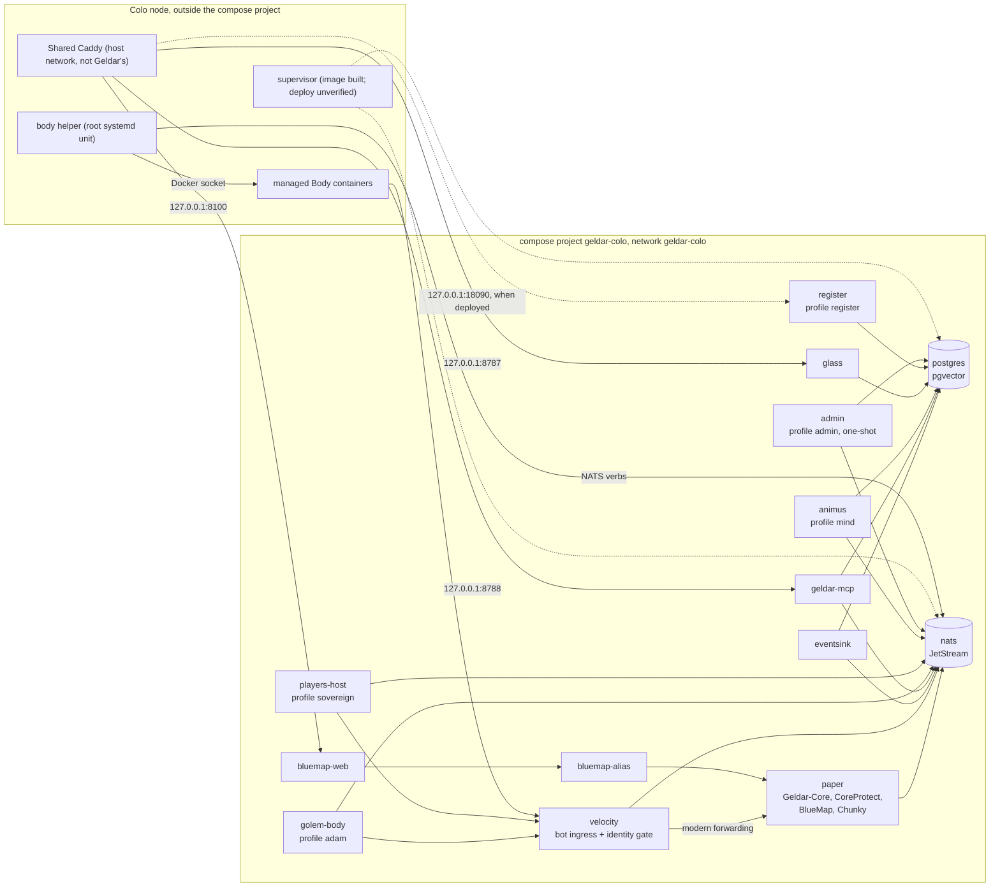
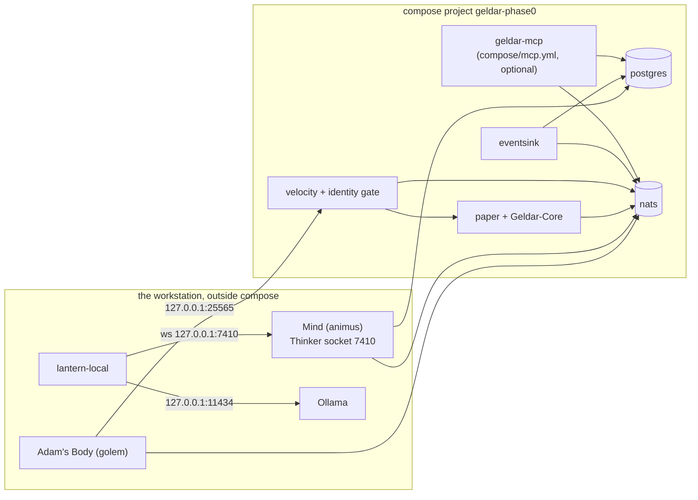

# System overview

What Geldar is made of, as built in this repo, and how that differs from the design in [spec section 4](../spec.md#4-system-overview). The diagrams are drawn from the compose files and the code, not from the spec's picture. For the event and message paths, read [data-flow-events](data-flow-events.md); for zones and ports, [network-and-trust-zones](network-and-trust-zones.md); for the node, [deployment-topology-colo](deployment-topology-colo.md).

Every service list below was read on 2026-11-16 at 1b114276 with `docker compose -f <file> config --services` (offline, no stack started) and checked against the file text.

## The design in one paragraph

The spec splits the system in two (spec 4.1). The Colo runs everything that is cheap and always on: the Minecraft server, the database and event log, the Bodies, the Mind service, the Observatory and an internet-facing Gateway. Patrons run Thinkers that pull built prompts and return text. Sovereign players are a second kind of mind: a person's vendor CLI acts through the Geldar MCP server, and the Colo still owns the Body (spec 4.1, 5.15). No component lets a human act in the world (spec section 2, Principle 1).

## What is built and what is not

| Spec component (spec 4.2, 6.1, 6.2) | As built at 1b114276 | Evidence |
|---|---|---|
| World server: Paper with Geldar-Core, CoreProtect, BlueMap | `paper` service; Geldar-Core jar from `plugin/core`; BlueMap, Chunky and CoreProtect jars mounted read-only from the node state directory | `compose/colo.yml` service `paper` |
| Bot ingress | `velocity` service, offline mode, with the `velocity-identity` plugin reading the life registry | `compose/colo.yml`; `compose/velocity/velocity.toml` (`online-mode = false`); `plugin/README.md` |
| Body layer | `golem-body` (Adam, profile `adam`); `players-host` (one Body per sovereign player, profile `sovereign`); managed Body containers started by the host body helper | `compose/colo.yml`; decisions [0212](../decisions/0212-golem-body-is-a-profile-adam.md), [0260](../decisions/0260-body-container-control-by-host-helper.md); `body-helper/src/managed-template.ts` |
| Supervisor (spec 6.5 "golem-supervisor") | Package `supervisor/`, image built by `colo-images.yml`. **Not a service in any compose file in this repo.** How it runs on the node is unverified | `git grep supervisor -- compose` finds nothing; `.github/workflows/colo-images.yml` job `supervisor` |
| Mind service | `animus` (frozen; live path in `player-core`), profile `mind`, not started by default | decision [0134](../decisions/0134-mind-is-a-profile-until-a-thinker-exists.md); `deploy/README.md` "Known limits" |
| The Record: NATS and Postgres with pgvector | `nats` (JetStream) and `postgres` (`pgvector/pgvector`, pinned by digest) | `compose/colo.yml` |
| Event sink | `eventsink` service | `compose/colo.yml`; [data-flow-events](data-flow-events.md) |
| Gateway and Allocator | Not built. Phase 0 Thinkers dial the Mind's loopback socket; on the Colo the Thinker address is a placeholder | `lantern-local/README.md`; decision [0131](../decisions/0131-colo-in-container-hosts-and-mind-shard-file.md) item 3; [spec section map](../reference/spec-section-map.md) row 4.4 |
| Historian | Not built (spec only) | [spec section map](../reference/spec-section-map.md) row 5.12 |
| Observatory | `glass` (the Thought Stream), `bluemap-web` and `bluemap-alias`; Kino is an overlay, off by default | `compose/colo.yml`; `compose/colo-kino.yml` |
| Geldar MCP | `geldar-mcp` service (`threshold/mcp`) | `compose/colo.yml` |
| Create-player form (spec 6.2) | `register` service (`threshold/register`), profile `register`, kill switch on by default | `compose/colo.yml` service `register` |
| Spectator proxy | Design (0137): a separate online-mode proxy. The repo has one Velocity service, not two; a known gap, see [network-and-trust-zones](network-and-trust-zones.md#known-gaps) | `compose/colo-public.yml`; decision [0137](../decisions/0137-public-spectator-proxy-is-separate-and-online.md) |
| Grafana, Prometheus, embeddings | Not in any compose file. Telemetry is the planned [telemetry-pipeline](telemetry-pipeline.md) | `git grep -l grafana -- compose` finds nothing |
| Operator tools | `admin`, a one-shot container (profile `admin`) running `tools/migrate` and `tools/mcp-tokens` | decision [0133](../decisions/0133-colo-admin-by-one-shot-container.md) |

## The Colo stack

`compose/colo.yml` defines 14 services. A plain `up` starts 9; the other 5 sit behind profiles.

Read the arrows as "connects to". Dotted lines are paths the repo describes but that this page could not confirm as deployed. Evidence for each edge:

- Loopback publishes: the `ports:` entries of `geldar-mcp`, `glass`, `bluemap-web`, `register` and `velocity` in `compose/colo.yml`. Caddy runs on the host network and reaches them on loopback (decision [0096](../decisions/0096-public-topology-as-built.md) items 1 and 2).
- Velocity to Paper: `compose/velocity/velocity.toml` (`[servers] paper = "paper:25565"`, `player-info-forwarding-mode = "modern"`).
- Bodies to Velocity: `GELDAR_MC_HOST: velocity` on `golem-body` and `players-host` ("The Body talks to Velocity, never Paper").
- The map chain: `compose/bluemap-web/Caddyfile` proxies to `bluemap-alias:8102`, which proxies to Paper's map server on `paper:8101` (`plugins/bluemap/alias-proxy/alias-proxy.ts`).
- NATS and Postgres connections: each service's `GELDAR_NATS_URL` and `POSTGRES_HOST` in `compose/colo.yml`. Glass has no NATS connection in the base file; the Kino overlay adds one (`compose/colo-kino.yml`).
- The register service's NATS link exists in code (`threshold/register/src/nats-body.ts`) but `compose/colo.yml` gives the `register` service no NATS variables, so it is not drawn.
- Managed Bodies join the `geldar-colo` network (`DEFAULT_NETWORK` in `body-helper/src/template.ts`, `NetworkMode` in `managed-template.ts`). The helper runs as a systemd unit, not in compose (decision [0260](../decisions/0260-body-container-control-by-host-helper.md) item 2; `deploy/install-body-helper.sh`).
- The supervisor connects to Postgres and NATS (`supervisor/src/main.ts`); no compose file in this repo starts it.

### Profiles

| Profile | Service | Started by | Evidence |
|---|---|---|---|
| none | `postgres`, `nats`, `paper`, `velocity`, `eventsink`, `geldar-mcp`, `glass`, `bluemap-alias`, `bluemap-web` | `deploy/colo-up.sh`, `./geldar.ps1 shard up colo` | `docker compose -f compose/colo.yml config --services`, 2026-11-16 |
| `adam` | `golem-body` (the idle Adam) | By hand: `docker compose --profile adam up -d --wait golem-body`. The CD restarts it only when it already runs | decision [0212](../decisions/0212-golem-body-is-a-profile-adam.md); `deploy/colo-cd.sh` |
| `mind` | `animus` | Nothing by default; it cannot think until a Thinker path exists | decision [0134](../decisions/0134-mind-is-a-profile-until-a-thinker-exists.md) |
| `sovereign` | `players-host` | `deploy/colo-admin.sh player-start <player>`, one container per player | `deploy/README.md` section (f); decision [0169](../decisions/0169-players-host-restart-policy.md) |
| `register` | `register` | Off by default; the owner gate in [open-signup](../runbooks/open-signup.md) sets the order | `compose/colo.yml` comment "OFF BY DEFAULT" |
| `admin` | `admin` | `deploy/colo-admin.sh <subcommand>`, `run --rm` | decision [0133](../decisions/0133-colo-admin-by-one-shot-container.md) |

### Overlays on the Colo stack

| File | Adds | When it is merged | Evidence |
|---|---|---|---|
| `compose/nats-auth.yml` | The NATS server config and the `paper`, `velocity` and `eventsink` NATS users | Always on the Colo (`shard up colo` and every deploy script) | `geldar.ps1` `Invoke-Shard`; `deploy/common.sh` `dc()` |
| `deploy/compose.secrets.yml` | Points each secret name at the node's secrets directory | Every deploy script call | `deploy/common.sh` |
| `compose/colo-public.yml` | One public publish on `velocity` | Only when the node sets both public bind variables; last step of `colo-up.sh` | `deploy/common.sh` `public_overlay()`; decision [0096](../decisions/0096-public-topology-as-built.md) item 5 |
| `compose/colo-notice.yml` | The `deploy` NATS password for the admin container | Only by `deploy/colo-notice.sh`, when that file exists | `compose/colo-notice.yml` header |
| `compose/colo-kino.yml`, `compose/colo-kino-session.yml` | Glass's NATS link for Kino; the shared session key | Only when the owner enables Kino ([kino runbook](../runbooks/kino.md)) | file headers |
| `compose/opt-in/sheet-sink.yml` | Three environment variables for the eventsink | By hand only; outside `compose/*.yml` so CI does not validate it alone | file header |

## The Phase 0 stack

Phase 0 runs a smaller stack on a workstation and keeps the Mind and the Thinker on the host (decision [0050](../decisions/0050-phase0-mind-processes-run-on-the-host.md)).

Evidence: `compose/phase0.yml` (five services, all binds on `127.0.0.1`); `compose/mcp.yml` (run "with the stack"); `lantern-local/README.md` (the socket and Ollama addresses); [CLAUDE.md](../../CLAUDE.md) ("`adam up` holds port 7410, the Thinker socket"). `./geldar.ps1 adam up` starts the three host processes (`lantern-local/README.md`, "Running it").

## Other stacks

| File | Purpose | Evidence |
|---|---|---|
| `compose/signcheck.yml` | A throwaway Paper for sign facts; profiles `core` (Geldar-Core and a private NATS) and `rcon` | file header; [signcheck runbook](../runbooks/signcheck-shard.md) |
| `compose/opt-in/scratch.yml` | A throwaway copy of the Phase 0 stack on high loopback ports, through `deploy/scratch/scratch.sh` | file header; [scratch-stack runbook](../runbooks/scratch-stack.md) |
| `compose/rcon-host.yml` | Publishes Paper's RCON to host loopback for Phase 0 host tools; refused for the Colo | `geldar.ps1` `Invoke-Shard` |

## Conflicts recorded

Each row gives every account. This page does not pick one.

1. **Spectator proxy.** Decision [0137](../decisions/0137-public-spectator-proxy-is-separate-and-online.md) (with spec 6.2 and 8.4) is the authoritative design: two Velocity services, the bot ingress never published. The repo at 1b114276 has one `velocity` service with `online-mode = false`, and `compose/colo-public.yml` publishes it. This is recorded as a known gap, open and not fixed, with node state unchecked: [network-and-trust-zones, known gaps](network-and-trust-zones.md#known-gaps).
2. **Supervisor placement.** Decision [0260](../decisions/0260-body-container-control-by-host-helper.md) item 3 speaks of "the supervisor compose service". No compose file in this repo defines one; `colo-images.yml` pushes its image but leaves it out of `release.env` ("C7-03b2 adds it", workflow header).
3. **Mind placement.** Spec 4.1 puts the Mind service in the Colo, always on. Decision [0134](../decisions/0134-mind-is-a-profile-until-a-thinker-exists.md) keeps it behind a profile until a Thinker path exists. The live Mind path is `player-core`, imported by `threshold/mcp` and `animus` ([repo-map-and-dependencies](repo-map-and-dependencies.md)).

## Where to go next

- One row per component with its owner role and docs: [components](../reference/components.md) (planned, W2).
- Every service, port and variable of each stack: [compose-stacks](../reference/compose-stacks.md) (planned, W2).
- Why the Body and the Mind are split: [body-and-mind](../concepts/body-and-mind.md) (planned, W1).
- Telemetry and vitals: [telemetry-pipeline](telemetry-pipeline.md) (operators only).
