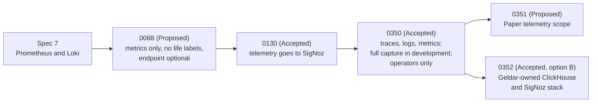
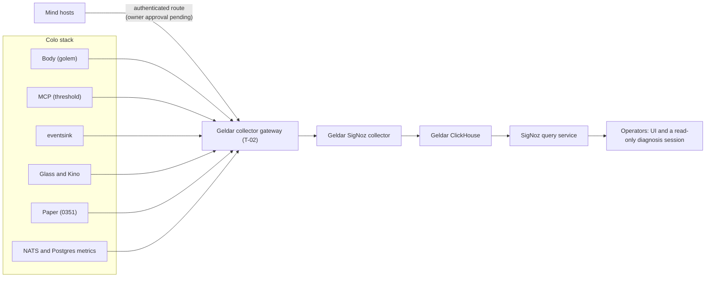

# Telemetry pipeline

Operator material. Do not copy, quote or link this page from anything an agent in the world reads ([documentation style](../agents/documentation-style.md#agents-never-learn-they-are-watched)). It stays at spec level: the rules that keep telemetry out of agents' reach are in decision 0350 item 7 and are not repeated here (plan decision D9).

How Geldar's traces, logs and metrics are meant to flow, what the decisions settle, and what exists in the repo. The deployed shape on the node was **not inspected** for this page (plan decision D8). Alerts and dashboards are the planned [monitoring and vitals](../operations/monitoring-and-vitals.md) reference.

## Purpose: diagnosis, not the record

Telemetry and the event record are different things.

- **The event record** is the world's history: every event is a NATS JetStream message, written to Postgres by eventsink ([spec section 7](../spec.md#7-observability); [data flow and events](data-flow-events.md)). Postgres stays the system of record for content (decision [0350](../decisions/0350-telemetry-scope-and-full-capture.md) item 2).
- **Telemetry** is for keeping the shard healthy and diagnosing faults: traces that follow one thought through to the act and the outcome it caused, logs, and metrics. The owner's stated aim is that a diagnosis session can trace a thought to its act and outcome from telemetry alone (0350, "Context").

Spec 7 asks for Prometheus metrics, logs shipped to Loki, correlation ids (`life_id`, `body_generation`, `thought_id`, `intent_id`, `action_id`) and a small alert set.

## How the decisions got here

| Record | Status | What it settles |
|---|---|---|
| [0088](../decisions/0088-metrics-exporters-and-replay-window.md) | Proposed | Counters, gauges and histograms only. No metric label names a player, a life or a token. Push only when `GELDAR_TELEMETRY_URL` is set; a failed push never stops a component. |
| [0130](../decisions/0130-phase1-owner-rulings-for-c1.md) | Accepted (owner, 2026-11-10) | Ruling 3, "Use signoz": the endpoint is SigNoz on the Colo node; its URL is configuration, never in the repo. |
| [0350](../decisions/0350-telemetry-scope-and-full-capture.md) | Accepted (2026-11-15) | Scope: traces, logs and metrics. Attribute rules (item 1). Full content capture during development (item 2). Outside players' content erased on request, a known gap (item 3). Retention and a storage budget (item 5). Readers are operators only (item 6). Agents never see or infer telemetry (item 7). Read-only, principle 1 (item 8). SigNoz replaces spec 7's Prometheus and Loki (item 10). Twenty work cards, T-01 to T-20. |
| [0351](../decisions/0351-paper-telemetry-plugin-scope.md) | Proposed | Paper's share: a separate plugin, the OpenTelemetry Java agent as the one SDK, and a scratch-shard overhead test before any live restart. |
| [0352](../decisions/0352-telemetry-dedicated-clickhouse-database.md) | Accepted (owner ruling relayed 2026-11-16), option B | Geldar telemetry goes to a Geldar-owned ClickHouse server and SigNoz stack on a Geldar-owned network, not into a shared instance. Amends 0350 items 4 to 6. Option A (a separate database on a shared server) is the fallback. |

## The planned pipeline

Decided by 0350 and 0352; **not built** at 1b114276 (next section). Component names follow the decisions; no address, port or host path is given here.

What each piece is for:

- **Sources.** Each Geldar service sends traces, logs and metrics through a shared SDK package (card T-03), with trace context carried across NATS so one trace spans the Mind, the MCP, the Body and eventsink (cards T-03, T-06 to T-08). Paper's own metrics come through the Java agent (0351). NATS and Postgres are scraped (cards T-09, T-10).
- **Gateway.** One Geldar collector on the Colo, with CPU, memory and process caps (0350 item 9; design in `docs/analysis/telemetry/collector-design.md`, options in `collector-options.md`).
- **Store.** A Geldar-owned ClickHouse and SigNoz stack, so Geldar's budget is an exact measure of one server and Geldar's retention never changes another tenant's (0352, "Why B").
- **Readers.** Operators only. The diagnosis path is a SigNoz MCP server with a viewer-role key held by the owner and never kept in the repo (0350 item 6; 0352 "Read path").

### Data rules

- **Metrics** never carry a label that names a player, a life, a token or an owner (0088 item 1, kept by 0350 item 1).
- **Traces and logs** may carry the correlation ids (`life_id`, `player_id`, `thought_id`, `intent_id`, `action_id`, `run_id`, `turn_id`) and agent names. Owner identities, emails, tokens, cookies, provider subjects and account ids are never attributes in any signal (0350 item 1).
- **Content.** During development all content is captured, with no opt-out: prompts, model output, reasoning, thoughts, journals, speech, tool results, actions and errors (0350 item 2, owner ruling 2026-11-15).
- **Retention and budget.** A hard retention period and a storage budget with an early alarm, set by owner ruling (0350 item 5; restated for the Geldar-owned server by 0352, "Budget and alarms" and "Retention"). The figures are in those records.

### Principle 1

Telemetry and alerts are read-only. No dashboard, exporter, alert or automation may act in the world; alert channels notify operators only (0350 item 8). The alert channel itself is not chosen (0350, "Open items").

## What the repo holds at 1b114276

Checked with `git grep` and `ls` on 2026-11-16.

| Piece | State |
|---|---|
| Hand-written metric pushers | Four, each off unless its endpoint is set: `golem/src/metrics.ts`, `threshold/mcp/src/metrics.ts` (read from `GELDAR_TELEMETRY_URL` in `threshold/mcp/src/cli.ts`), `eventsink/src/metrics.ts` (`eventsink/src/main.ts` line 17), and the Kino counters in `glass/src/kino/otlp.ts` (endpoint `GELDAR_KINO_OTLP_ENDPOINT`, `glass/src/kino/wiring.ts` line 68). They post OTLP/HTTP JSON written by hand, with no SDK (0088 item 3; file headers). |
| Compose wiring | `compose/colo.yml` passes `GELDAR_TELEMETRY_URL` through to `golem-body` (line 267) and `animus` (line 307) only. |
| Shared SDK package, collector overlay, collector config, dashboards as code | Not present. No `@geldar/telemetry` package, no `compose/colo-otel.yml`, no `deploy/otel/` or `deploy/signoz/` (`ls compose deploy`, 2026-11-16). |
| Design | `docs/analysis/telemetry/collector-design.md` (T-02, "design only ... Nothing here is built, merged or switched on") and `collector-options.md` (re-checked under 0352 option B). |

0350 records that on 2026-11-15 nothing was switched on and no Geldar series existed in SigNoz (0350, "Context"). That is the record's survey, not re-checked here.

## Lifecycle

| Stage | Where it stands |
|---|---|
| Owner | The owner approves every node step, the extra containers, the budget, the retention and any route; the orchestrator decides which cards change and when (0352, "Who decides"). |
| Build and test | Cards T-01 to T-20 in 0350, "Consequences". Each card names its own owner approval and tests. Edits to the kit, the Body and the MCP are granted per card (0350, "Exemptions"). |
| Deploy | Every node change needs the owner's approval first (0350 items 4 and 9; 0352). Paper's agent goes to a scratch shard before the live server (0350 item 9; 0351). |
| Rollback | Unset the gateway's endpoint variable so the SDK goes off; stop and remove the Geldar SigNoz stack; keep its data volume until the owner decides (0352, "Rollback"). |
| Operate and monitor | Planned [monitoring and vitals](../operations/monitoring-and-vitals.md). Spec 7's alerts are the minimum set (0350 item 10). |
| Failure modes | An export failure never stops a component (0088 item 2); a full export queue drops instead of blocking (0352, "Write path"). Merge load on the shared host is a named risk to the Paper tick (0352, "Fit check", caution). |
| Retirement | Card T-20 retires the four hand-written pushers once the SDK path reaches parity, keeping the 0088 metric names. |

## Conflicts recorded

None is resolved here.

1. **Which stack.** Spec 7: Prometheus metrics and Loki logs. Decisions 0130, 0350 item 10 and 0352: SigNoz. Code: hand-written OTLP pushers, and Prometheus text for the MCP's `/metrics` route per 0088 item 3 (0088 lists that route as not yet done).
2. **What is recorded.** 0088 item 1 (Proposed): thought text, persona text, prompts and tokens are never recorded. 0350 item 2 (Accepted): all content is captured during development, superseding 0088's wording for telemetry only. 0185 (Proposed): prompt text and reasoning go to an operator-only Postgres table gated on an open ruling; 0350 says it does not settle that ruling for Postgres.
3. **Public route to the telemetry UI.** 0350 item 6: no public route serves SigNoz. 0352 "Read path": proposes an authenticated UI route, which needs owner approval and amends 0350 item 6 for the Geldar stack only; a loopback tunnel is the alternative.
4. **A diagnosis session reading telemetry.** 0350 item 6 plans read access for an AI diagnosis session. 0352 "Read path" asks whether that conflicts with 0350 item 7 and leaves it to the owner.
5. **The design document's topology.** `docs/analysis/telemetry/collector-design.md` section 2 draws the gateway writing into a shared instance on another tenant's network. 0352 option B replaces that; `collector-options.md` records the re-check. 0352 also says the design is on a branch; at 1b114276 it is on `main` (`git log` shows commit e6bac767, 2026-11-15).
6. **Alerts.** Spec 7 sends alerts to a named person. 0350: alerts go to operators only, channel not chosen.

## Not verified

- Anything on the node: whether any endpoint variable is set, whether any SigNoz stack or Geldar collector runs, retention and storage in use (plan decision D8).
- The node measurements and size estimates in 0350 and 0352 are those records' own and are not copied here.
- 0351 is Proposed; its overhead test has not been reported in the repo.
