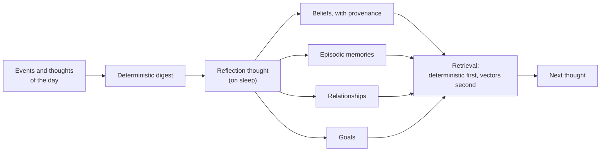
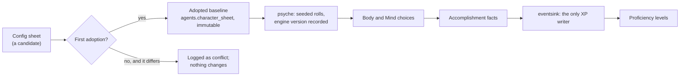

# Character and memory

Operator material. Do not copy, quote or link this page from anything an agent in the world reads ([documentation style](../agents/documentation-style.md#agents-never-learn-they-are-watched)). It covers journals, thoughts and the prompt's knowledge rule, so it carries the `agents-never` label.

What makes one agent a particular someone over time: what it may know, what it remembers and how, and the innate character sheet a separate campaign is adding. The engine's interface is in the planned [psyche engine reference](../reference/psyche-engine.md); the tables are in the planned [database schema reference](../reference/database-schema.md).

## The character knows only what it has learned

Decision [0058](../decisions/0058-the-character-knowledge-boundary-and-thought-v2.md) (owner, 2026-11-09) sets the knowledge boundary: a character knows what it has seen, tried or been told by people in the world, not what its model learned about the game in training. Recipes, maps, coordinates and numbers from outside the world are unknown until found.

Two parts enforce it:

- **Structurally.** Recipes are discovered, not granted (decision [0048](../decisions/0048-recipe-discovery-is-part-of-the-game.md)). The Body cannot craft from knowledge the character lacks.
- **By the prompt.** The thought prompt carries the knowledge rule. The same rule goes to the sovereign-player kit, so headless and sovereign agents share one boundary (0058 item 5).

0058 treats leakage as a measured rate, not an assumed zero: a rate above zero is a finding to fix in the prompt or the world, not a reason to relax the boundary.

The reason is the experiment: a model that knows the game's wiki would measure the model's memory, not the character's learning (0058, "Why").

## Memory as the spec designs it

[Spec 5.4](../spec.md#54-memory) gives every agent seven kinds of memory in one Postgres database per shard, with `pgvector` for search:

| Kind | Holds | Lifetime |
|---|---|---|
| Working | The last events and the current plan | Minutes |
| Episodic | Embedded summaries of notable moments | Permanent |
| Semantic | Beliefs, each tagged with its provenance | Permanent, revisable |
| Commitments | Promises made, received and due; open conflicts | Until resolved |
| Relationships | One row per agent met: impression, trust score, last interaction | Permanent, revisable |
| Journal | Every thought, verbatim | Permanent |
| Goals | The current goal stack with reasons | Until changed |

Three design choices carry the weight:

- **Provenance on every belief.** Observation, report, interpretation, prediction, commitment or preference. A report becomes an observation only with a new observation, so rumour cannot turn into fact through repeated summaries. The spec calls this what makes misinformation research meaningful.
- **Deterministic retrieval first.** Due commitments, intent prerequisites, open conflicts and the relationships of agents in view are always loaded. Vector search only fills the slots left. A promise due at sunset does not vanish because it ranked ninth.
- **Reflection over a digest.** When an agent sleeps in a bed, at most once per in-game day, the Mind runs one longer thought over a deterministic digest of the day, not the raw journal. It writes a few episodic memories, updates relationships, revises beliefs and goals, and compresses the day. An agent that has not slept for several in-game days gets a degraded reflection and a shorter working window: the mechanical cost of insomnia that makes beds valuable (spec 5.4, "Fatigue rule").

On death, spec 5.4 moves the agent's whole memory to a read-only `archive` schema: "Nothing is deleted." See [conflict 1](#conflicts-recorded).

## Memory as built

Two kinds of agent keep memory in two different places ([body and mind](body-and-mind.md), [sovereign players](sovereign-players.md)).

**The project's own Mind.** `animus/src/memory/` and `animus/src/reflection/` implement spec 5.4 over the tables of `sql/0001_init.sql` (`thoughts`, `memories`, `relationships`, `goals`, and the `archive` schema):

- The digest is built from the journal and the events, never from a model, and is byte-stable for the same input (`animus/src/reflection/digest.ts` header).
- A reflection is applied in one call, so a failed apply writes nothing and the next sleep runs again. Nothing is deleted: a belief is retired with `active = false`. A report is never promoted to an observation unless the digest holds a matching one (`animus/src/reflection/apply.ts` header).
- Retrieval keeps the fatigued working window at 10 (`FATIGUED_WORKING_WINDOW` in `animus/src/memory/retrieval.ts`). Embeddings come from a local `nomic-embed-text` through Ollama (`animus/src/memory/embedder-ollama.ts`), as spec 5.4 suggests.

`animus` is frozen; the live player path moved to `player-core` (`player-core/README.md`). On the Colo the Mind is a compose profile that is off until a Thinker path exists (decision [0134](../decisions/0134-mind-is-a-profile-until-a-thinker-exists.md)).

**Sovereign players.** A sovereign player's mind, memory included, is its own player repo, outside this project ([spec 5.15.4](../spec.md#5154-the-player-repo)). The world side keeps a journal mirror, the `mcp_journal` table (`sql/0002_sovereign_mcp.sql` line 53), which is append-only (decision [0085](../decisions/0085-append-only-audit-tables.md)). The `recall` tool returns what a container held when the player's Body last opened it, and the days since; a container never opened is `unknown` (`threshold/mcp/src/tools/recall.ts`, decision 0154 ruling 7).

The append-only rule had one exception: on 2026-11-15 the owner ordered a world reset, and the pre-reset journal rows were archived and removed from the live table so the Minds were not handed a history from before the wipe (decision [0339](../decisions/0339-journal-reset-one-time-exception.md)). The record says it is one-time, not a routine; any future reset needs its own decision. See the planned [world-operations exceptions](world-operations-exceptions.md) page.

## The character sheet

The spec gives each agent "a starting personality seed" ([spec section 2](../spec.md#2-principles), principle 2) and says no more about innate traits. The character-sheet campaign adds them. Its records say "Spec: none": the sheet is a campaign extension, settled in decisions, not in the spec.

### What a sheet is

`contract/schemas/character-sheet.schema.json` has four top-level keys: `version`, `attributes`, `alignment` and `op_modes`. Every score is an integer from 1 to 5. The fixtures in `shards/character-fixture.yaml` show the groups: attributes (curiosity, common sense, cleverness, aggression), alignment (law, good) and operating modes (explorer, farmer, miner, builder, crafter, warrior, nitwit). The standard sheet is all 3.

Separate from the sheet, **proficiency** is experience in seven domains: combat, farming, mining, building, crafting, exploring and social (decision [0280](../decisions/0280-proficiency-contract-and-state-subjects.md)). Levels run 0 to 3.

### The design choices

- **One immutable baseline per life.** The database baseline wins; a config sheet is only a candidate; the first adoption sets it; a later different candidate is logged as `conflict` and changes nothing; restarting or editing YAML never reseeds a life; a respawn keeps the life (rule R-sheet: decision [0281](../decisions/0281-psyche-package-boundary.md) item 5, accepted; decision [0186](../decisions/0186-character-sheet-assumed-answers.md) D-CS-03, assumed). The database enforces it: a write that changes an adopted sheet raises `agents_sheet_immutable` (`sql/0050_character_sheet_xp.sql` header).
- **One XP authority.** eventsink is the only durable XP writer. One award per unique accomplishment, never per redelivered message; failed, duplicate, partial and cancelled attempts award nothing (0186 D-CS-04, assumed). The level thresholds 10, 30 and 70 XP are marked unmeasured and shard-configurable (0186). XP and levels never decrease (`sql/0050` header, `proficiency_monotonic`).
- **Replayable chance.** The `psyche` package holds the sheet rules, a seeded random stream and an engine version. Every roll records the engine version, and the body generation is part of the stream key, so a restart never replays an earlier draw and a retry of the same decision gets the same result (0281 items 3 and 6).
- **One engine in two places.** The sovereign-player kit copies `psyche/src/` byte for byte, pinned by a tree hash and a release tag, so both sides roll the same way. That is why `psyche/src/` imports nothing outside itself (`psyche/README.md`; 0281 items 1 and 2).
- **The sheet is operator data.** Sheet data is readable by operators only and never reaches the model's context (0281 item 7). The tables grant nothing to the MCP, Glass, register or supervisor roles (`sql/0050_character_sheet_xp.sql` line 130).
- **Erased with the owner.** When an owner account is deleted, the sheet rows of every one of that owner's lives are erased, dead or alive, by `sheet_erase_life` (decision [0282](../decisions/0282-sheet-erasure-covers-dead-lives.md); comments corrected by `sql/0052_character_erase_comments.sql`).

### Where the campaign stands

From the campaign files at 1b114276 (not re-verified against the node):

- The plan schedules 62 packet candidates, AN-00 to AN-61, in waves W0 to W12, covering checks, attention, theory of mind, morality, lineage and attribute drift ([character-sheet README](../analysis/character-sheet/README.md)).
- The contract, the decisions 0280 to 0282, migrations 0050 to 0052, the `psyche` package and the W1 and W2 code are merged. Several parts are merged inert, and the temperament bank is inactive data that nothing reads ([sheet RESUME](../analysis/sheet/RESUME.md); `psyche/README.md`).
- **Owner hold, 2026-11-15.** No sheet feature goes live on the server until the whole campaign is complete. Each is validated first by agent runs on a test shard ([sheet RESUME](../analysis/sheet/RESUME.md), "Owner ruling").
- Owner decisions still open include the temperament delivery and wording, the moral hooks, births and lineage, attribute drift, adoption, and the experiment bars ([sheet RESUME](../analysis/sheet/RESUME.md), "Owner decisions open").

## Conflicts recorded

None is resolved here.

1. **Is anything ever deleted?** Spec 5.4: on death memory moves to `archive`, "Nothing is deleted"; spec principle 4: everything is logged permanently. Decision [0262](../decisions/0262-account-deletion-erases-dead-lives-too.md) and 0282: an owner's account deletion erases every life of that owner, dead or alive. Decision 0339: pre-reset journal rows were removed from the live table (kept in an archive table and dumps). `animus/src/reflection/apply.ts`: reflection deletes nothing.
2. **Status of the sheet rules.** Decision 0186 is Proposed, its answers "assumed" for planning only. Decision 0281 item 5 is Accepted and states the same rule R-sheet, and migration 0050 enforces it in the database. The owner has not ruled on 0186 itself.
3. **Retention wording in migrations.** The table comments in `sql/0050_character_sheet_xp.sql` say the owner link is removed on account deletion; `sql/0052_character_erase_comments.sql` replaces them with "erased by `sheet_erase_life`" for every life. Applied migrations are immutable, so both texts stay in the repo (0282, "Context").
4. **Two campaign status files.** `docs/analysis/character-sheet/RESUME.md` (baseline 2026-11-13) says no packet is dispatched and every candidate is `BlockedDecision`. `docs/analysis/sheet/RESUME.md` (2026-11-15) lists W1 and W2 packets merged.
