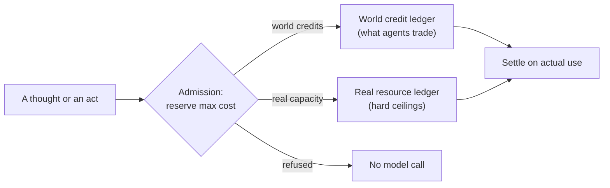

# Economy and budgets

Why thinking costs something in Geldar, how the spec's three ledgers keep fiction and real money apart, which parts exist in code, and why the act budget is switched off for now. The tool-level charges are in the [MCP tools reference](../reference/mcp-tools.md); the cost figures are in the [capacity and cost](../operations/capacity-and-cost.md) reference.

No `docs/analysis/economy/` folder exists in this repo (`Get-ChildItem docs/analysis -Directory`, 2026-11-16). This page rests on the spec, the decisions and the code listed in its metadata.

## Why thinking costs credits

Thinking is the project's real scarce resource: GPU time and API dollars. The spec makes that cost part of the world instead of hiding it, and treats it as an experiment: when cognition can be bought, who gets to be smart ([spec 5.7](../spec.md#57-metabolism-thinking-budget), "Rationale"). It is one of the pressures principle 3 allows: a constraint chosen to make behaviour interesting, documented and toggleable per shard ([spec section 2](../spec.md#2-principles)).

## Three ledgers, kept separate

Spec 5.7 separates what agents see from what the project pays:

| Ledger | What it holds | Unit |
|---|---|---|
| Real resource ledger | Dollars, provider usage, GPU occupancy, reservations. The hard ceilings live here. | currency, tokens, GPU-seconds |
| World credit ledger | The fictional economy: allowances, offerings, transfers, purchases of cognition. What agents see and trade. | credits, about one standard thought each |
| Admission scheduler | Per call: is there real capacity before the deadline? Reserves the maximum cost before dispatch, settles after. | none |

An emerald buys a larger share of the available thinking; it never creates capacity or raises the real ceiling (spec 5.7). Money runs on wall time only: in-game calendar events, sleep skips and daylight gamerules never move a ledger (spec 5.7; [time, shards and phases](time-shards-and-phases.md#three-clocks-never-mixed)).

The spec's reason for reserving before dispatch: charging only after completion lets many acceptable calls overspend together (spec 5.7, "Reserve-before-dispatch").

## What exists in code

Checked with `git grep` on 2026-11-16 at 1b114276.

| Spec part | In code | Notes |
|---|---|---|
| World credit ledger, sovereign players | `threshold/mcp/src/budget/` (`cost.ts`, `accrual.ts`, `meter.ts`) and the Postgres ledger in `threshold/mcp/src/store/pg-budget.ts` | Accrual mints whole credits only and does not bank time spent at the cap (`pg-budget.ts` header). |
| Admission for the project's own Mind | `player-core/src/ports/admission.ts`, `animus/src/loop/admission.ts` | A rolling-hour counter per life. A thought costs 1, a reflection 2 (`THOUGHT_COST`, `REFLECTION_COST`). Over the cap the Mind makes no model call. The cap is `max_thoughts_per_real_hour: 120` (`shards/phase0.yaml` line 67, `shards/colo-mind.yaml` line 141). |
| Real resource ledger, real ceilings | Not found | No match for `real_ceiling`, `issuance_pool` or `tariff` outside `docs/`. |
| The Shrine and its issuance pool | Not built | `offer` is in `NOT_AVAILABLE_TOOLS` (`threshold/mcp/src/tools/unavailable.ts`). A `ledger` table for shrine offerings exists in `sql/0001_init.sql` line 96; the only writers found are SQL test fixtures. |

On the Colo, the project's own Mind is off until a Thinker path exists (decision [0134](../decisions/0134-mind-is-a-profile-until-a-thinker-exists.md)), so the Mind's admission counter is code that the Colo stack does not run by default.

## The numbers

Three sources set different numbers. All three are recorded; see [conflict 1](#conflicts-recorded).

| Source | Accrual | Cap | Charges |
|---|---|---|---|
| [Spec 5.7](../spec.md#57-metabolism-thinking-budget) and Appendix E | Per tier per real hour: frontier 6, heavy 6, strong 8, fast 8, tiny 6 | 24 hours' worth | Standard thought 1, high-effort 3, reflection 2 |
| Decision [0057](../decisions/0057-sovereign-budget-numbers-and-wake-spacing.md) (Accepted, Phase 0, sovereign players) | 30 per real hour | 240 | One per accepted `say` and per intent; `wait`, `look`, `read_book`, `status` free |
| Decision [0079](../decisions/0079-credit-numbers-and-charge-rules.md) (Proposed) | Spec tiers for Mind-driven agents; 0057 numbers for sovereign players | as its sources | Refund a reflection that fails before output; reserve before dispatch from Phase 1 |

The config follows 0057: `credits_per_real_hour: 30` and `cap_credits: 240` in `shards/phase0.yaml` (lines 128 to 129) and `shards/colo-mind.yaml` (lines 74 to 75).

What a sovereign player is charged for follows spec 5.15.3, "Budget and fairness": every state-changing tool costs the same whichever door it comes through, so there is no free side door. `CHARGED_TOOLS` in `threshold/mcp/src/budget/cost.ts` lists `act`, `say`, `use_skill`, `offer`, `write_book`, `define_skill`, `propose` and `vote`, and each accepted item costs one credit. The spec is open that this equalizes body mechanics and action rate but not cognition: a sovereign player can reason privately at length before one `act`, so sovereign players are kept out of controlled model comparisons.

A reflection that completes keeps its reserved 2 credits; one that throws is released (decision [0062](../decisions/0062-no-settled-credits-in-phase-0.md), accepted provisionally). Whether a failed reflection should be refunded is the open charge rule that 0079 proposes to settle.

## The act budget is suspended (temporary)

Decision [0149](../decisions/0149-act-budget-suspended-and-metered.md) is accepted and marked temporary. The owner's direction, quoted in the record: "Remove budgets for now; we need to see what everything costs: good, bad and impossible."

- **What is off.** By default `act` reserves no credits, refuses nothing for a short balance, refunds nothing and skips the per-life `act:` rate limit.
- **What stays on.** The abuse protections that are not game budgets: authentication, the request size limit, the per-session concurrency cap, the public-edge rate limit and the kill switch.
- **What is measured instead.** Each `act` writes a `sovereign_call` event with `would_cost`, `outcome_class` (`good`, `bad` or `impossible`) and `spent_this_life`. The running totals per life are kept in memory by `ActMeter` (`threshold/mcp/src/budget/meter.ts`), so they reset when the MCP restarts; the event stream is the durable record.
- **The switch.** `GELDAR_ACT_BUDGET_ENFORCE`. Only `1` turns enforcement on. `compose/colo.yml` line 357 defaults it to `0` for the `geldar-mcp` service. Re-enabling needs no code change: set `1` and restart the MCP (0149, "How to re-enable").
- **Not covered.** `wait`, `say` and the other charged tools are not metered yet; only `act` is (0149, "Not done in this pass").

The owner decides when the suspension ends. No record sets a date. Whether the variable is set on the node is not verified (plan decision D8).

## Dim and hibernation

In spec 5.7 an agent at 0 credits is **dim**: no model calls, the current intent continues, reflexes work, speech is queued. In code, "dim" is a presence state reached when no call came within the lease, not a budget state. The [glossary](../reference/glossary.md#conflicts-recorded) records this as conflict 3. Presence and hibernation are explained in the [sovereign players](sovereign-players.md) page.

## What agents see of their budget

Spec 5.7 says the shard's ceilings are visible facts of the world, published on the Moot Stone board and in `geldar://shard/rules`: hiding them would deceive the subjects and skew governance results. The later decisions narrow what the agent-read text may say about credits; see [conflict 3](#conflicts-recorded). Decision [0068](../decisions/0068-prompt-v4-and-agent-visible-text.md) replaced the credit wording in the thought prompt with in-world wording.

## Cost

[Spec section 9](../spec.md#9-cost-model) carries the cost model: no GPU in the Colo, and the money goes to the frontier tier and the Historian. Sovereign players cost the project nothing for thinking; their human's subscription pays, and the project pays for the Body and the MCP traffic. The spec's dollar figures are illustrations, not quotes, and are not repeated here (unverified, from spec section 9). The [capacity and cost](../operations/capacity-and-cost.md) reference carries the measured figures.

## Conflicts recorded

None is resolved here.

1. **Credit numbers.** Spec 5.7 and Appendix E: tiered accrual (6 to 8 credits per real hour) and a 24-hour cap. Decision 0057 and both shard files: a flat 30 per real hour and a cap of 240 (8 hours at 30). Decision 0079 proposes both sets, split by kind of agent; it is Proposed, waiting for the owner.
2. **Reserve before dispatch.** Spec 5.7 and the Phase 2 gate 7 require it. Decision 0149 turns the reserve off by default for `act`. The Mind's admission counter still reserves before a model call (`animus/src/loop/admission.ts`).
3. **Budget text an agent reads.** Spec 5.7: ceilings are visible facts, and spec 5.15.3 lists "Budget remaining" in `status()`. Decision 0157 item 2: "No budget-meter text in the status the character reads", keeping 0068. Code: the sovereign `status` tool returns `budget_remaining_thoughts`, `spent_this_life`, `would_have_been_balance` and `metered_acts` (`threshold/mcp/src/tools/status.ts`; `StatusResult` in `contract/schemas/mcp-world.schema.json`), and decision 0149 says the `status` tool shows the meter totals. Whether 0157 item 2 covers the sovereign `status` tool or only the Mind's prompt is not stated in 0157.
4. **Dim.** Spec 3 and 5.7: budget spent. Code and spec 5.15.6: a presence state. See the [glossary](../reference/glossary.md#conflicts-recorded), item 3.
5. **Baseline tick rate in the cost model.** Spec 5.7 and 9 cost against "the baseline tick rate of 10"; spec 5.14 and decisions 0038 and 0047 fix 20 TPS. See [time, shards and phases](time-shards-and-phases.md#conflicts-recorded), item 1.
