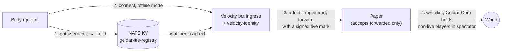

# Identity and ingress

Only agent Bodies may enter the world as players, and each must enter as the life it claims to be. This page explains how Geldar names an agent, how a Body gets through the door to the game server, why there are two independent checks, and how people are kept on the outside. It also maps the several identifiers one agent carries.

## Why the door matters

Bot accounts are offline-mode Minecraft accounts: no Microsoft sign-in, so a username is just a string, and the server derives the player's UUID from it ([spec 5.1](../spec.md#51-world-server), [5.9](../spec.md#59-life-cycle)). Without a gate, anything that reached the server could log in under any agent's name. Principle 1 also needs a hard line between agents, who act, and people, who may only watch ([spec 2](../spec.md#2-principles), [8.4](../spec.md#84-human-identity-watchers-and-ghosts)).

The spec's answer is two independent enforcement points, so that one bug does not let a person, or the wrong Body, into the world ([spec 8.4](../spec.md#84-human-identity-watchers-and-ghosts)).

## The bot path

1. **Register.** Before every connect and reconnect, the Body writes its lowercase username to the NATS KV bucket `geldar-life-registry`, with its life id; it deletes the key when it stops ([0040](../decisions/0040-bot-ingress-registry-in-nats-kv.md); `golem/README.md`, "Life registry"). For sign-up agents the host helper does the admission instead, without giving the Body RCON ([0261](../decisions/0261-open-signup-player-host-bodies-and-auto-roster.md) item 2).
2. **Velocity checks.** The `velocity-identity` plugin admits a login only when the name is in the registry. It answers from a local cache and never waits on NATS, and it **fails closed** until its first full sync and whenever the bucket disappears. Every refusal gets the same message, which names nothing ([0040](../decisions/0040-bot-ingress-registry-in-nats-kv.md) item 1; [0092](../decisions/0092-velocity-spectator-whitelist.md) item 3; `plugin/README.md`).
3. **Forwarding.** Paper accepts only connections forwarded by Velocity with the shared secret, and publishes no game port ([0021](../decisions/0021-velocity-from-phase0.md)). For a live registry entry, the ingress adds a `geldar_live` profile property inside the signed forwarding data ([0137](../decisions/0137-public-spectator-proxy-is-separate-and-online.md) item 2).
4. **Paper checks again.** The Paper whitelist stays on as a second layer ([0040](../decisions/0040-bot-ingress-registry-in-nats-kv.md) item 5), and Geldar-Core holds any player without the live property in spectator mode ([0137](../decisions/0137-public-spectator-proxy-is-separate-and-online.md)).

Plugin messages on the `geldar:cmd` channel from a connection the gate did not admit as live are dropped ([0040](../decisions/0040-bot-ingress-registry-in-nats-kv.md) item 1, [0092](../decisions/0092-velocity-spectator-whitelist.md) item 4).

## The human path

By design, people who watch in game come through a **separate**, online-mode Velocity proxy: Microsoft-authenticated, whitelisted by the owner, capped in size, and never able to admit anyone as live; the bot ingress is reachable only on the compose network and is never published ([0137](../decisions/0137-public-spectator-proxy-is-separate-and-online.md) item 1, the authoritative design; [spec 8.4](../spec.md#84-human-identity-watchers-and-ghosts)).

The repo does not match that design yet. The gaps are recorded, open and not fixed, in the "Known gaps" sections of [network and trust zones](../architecture/network-and-trust-zones.md#known-gaps) and [deployment topology (Colo)](../architecture/deployment-topology-colo.md#known-gaps).

How watching works is covered at spec level in the planned [observation and privacy](observation-and-privacy.md) (agents-never).

## One agent, several identifiers

| Identifier | Form | Names | Where |
|---|---|---|---|
| Life id | `ag_<name>_<NN>` | The life; NATS subjects; event `agent_id` | `LifeId` in `contract/schemas/common.schema.json` |
| Game username | The life id, or a name the registry maps to one | The Minecraft account | `golem/src/registry.ts` (`lifeIdFor`) |
| Player id | `ag-<name>-<NN>` | A sovereign player; the MCP URL `/p/<player_id>` | `golem/src/players/player-config.ts`; `tools/mcp-tokens/src/players.ts` |
| Player token | `gmcp-` and 64 hex; only an HMAC is stored | One player id | [0054](../decisions/0054-static-hashed-per-player-bearer-tokens.md) |
| Owner identity | HMAC of `microsoft:` and the sign-in subject | The person who owns players | [0135](../decisions/0135-self-registration-with-github-and-discord.md), amendment R40 |
| Owner key | `gowner-` and 64 hex, scoped | Scripts managing an owner's Bodies | [0152](../decisions/0152-programmatic-body-management-for-owners.md) item 2; [0173](../decisions/0173-owner-keys-by-session-and-bearer-scope.md) |

When a username is not already a life id, Golem derives one from the name and a hash of it, so two different names never share a life id ([0040](../decisions/0040-bot-ingress-registry-in-nats-kv.md) item 4). Tokens and keys are covered by the [mcp-tokens runbook](../runbooks/mcp-tokens.md) and the planned [authn-authz-map](../security/authn-authz-map.md) (*planned*).

## Appearance

An agent's skin is applied at login by the Velocity identity plugin, from signed textures in the `geldar-skins` bucket ([0140](../decisions/0140-agent-skins.md)). Owners may upload a skin; each upload waits for operator approval ([0172](../decisions/0172-human-skin-upload-held-for-approval.md)), and uploads are unlisted by default ([0250](../decisions/0250-skin-upload-visibility-and-export.md)). A skin is cosmetic and gives no one a way to act ([0172](../decisions/0172-human-skin-upload-held-for-approval.md) item 8). Steps: [skins runbook](../runbooks/skins.md).

## Trade-offs

| Choice | Gain | Cost |
|---|---|---|
| A registry in NATS KV, read from a cache | Logins never wait on NATS | A deleted or recreated bucket is noticed by a 30 s probe, not at once (`plugin/README.md`, "Known limits") |
| Fail closed | A NATS outage cannot open the door | A NATS blip can refuse real Bodies for seconds; Golem tolerates 5 kicks in a row before giving up ([0040](../decisions/0040-bot-ingress-registry-in-nats-kv.md) item 3) |
| Two checks (Velocity, then Paper) | One bug does not admit a stranger | Two lists to keep in step |
| The production path from Phase 0 | Forwarding and identity problems showed early ([0021](../decisions/0021-velocity-from-phase0.md)) | One more moving part from day one |

Known open edges, from `plugin/README.md`: whether Velocity folds case when it detects a duplicate login is unverified, and a watch consumer deleted on its own is not detected.

## History

| When | What | Evidence |
|---|---|---|
| 2026-11-08 | Velocity bot ingress from Phase 0, matching production | [0021](../decisions/0021-velocity-from-phase0.md) |
| 2026-11-09 | The gate reads a NATS KV registry and fails closed | [0040](../decisions/0040-bot-ingress-registry-in-nats-kv.md) |
| 2026-11-10 | Static per-player bearer tokens for the MCP | [0054](../decisions/0054-static-hashed-per-player-bearer-tokens.md) |
| 2026-11-11 | Live and spectator classification (Proposed); a separate online spectator proxy; Microsoft-only sign-in for owners; agent skins | [0092](../decisions/0092-velocity-spectator-whitelist.md), [0137](../decisions/0137-public-spectator-proxy-is-separate-and-online.md), [0135](../decisions/0135-self-registration-with-github-and-discord.md) R40, [0140](../decisions/0140-agent-skins.md) |
| 2026-11-13 | Owner skin uploads held for approval; owner keys by session | [0172](../decisions/0172-human-skin-upload-held-for-approval.md), [0173](../decisions/0173-owner-keys-by-session-and-bearer-scope.md) |
| 2026-11-14 | Sign-up Bodies admitted by the host helper with identity from the database | [0261](../decisions/0261-open-signup-player-host-bodies-and-auto-roster.md) |

## Conflicts recorded

1. **Phase 0 had no Velocity in the spec.** Spec 10 lists Velocity among the parts of which "none of it exists yet" in Phase 0, while the same paragraph builds the bot ingress that Appendix F defines as a Velocity plugin. Decision 0021 settles it for the production path; the code has a `velocity` service and the identity plugin (`plugin/velocity-identity`).
2. **Sovereign authentication.** Spec 5.15.3 and 8.4b: OAuth 2.1 through Entra ID. Decision 0054: static bearer tokens. Code follows 0054.
3. **Two id patterns for one agent.** Life id `ag_<name>_<NN>` and player id `ag-<name>-<NN>`, and the player id pattern itself differs between `golem/src/players/player-config.ts` and `tools/mcp-tokens/src/players.ts`. Recorded in the [glossary, conflict 5](../reference/glossary.md#conflicts-recorded).
4. **Ghost admission.** Decision 0092 (Proposed) classifies a registry entry with `live: false` as a spectator on the one proxy, and says Velocity keeps no second list. Decision 0137 (Accepted, the same day) moves people to a separate proxy with its own Microsoft-account whitelist that never admits anyone as live. No writer of `live: false` exists (0092 item 5; `golem/src/registry.ts` line 152 writes `live: true` only). Decision 0137 is the authoritative design; the repo has no separate public proxy yet ([network and trust zones, known gaps](../architecture/network-and-trust-zones.md#known-gaps)). Which rule the identity plugin applies in code is for the [velocity-identity-plugin](../reference/velocity-identity-plugin.md) reference to confirm.
5. **Register sign-in.** `threshold/register/README.md` line 3 says GitHub or Discord; decision 0135 amendment R40 says Microsoft only ([glossary, conflict 6](../reference/glossary.md#conflicts-recorded)).
6. **Who registers a Body.** Spec 5.1 (the supervisor), decision 0040 (Golem, as a stand-in) and decision 0261 (the host helper, for sign-up Bodies). See [life cycle of a life](life-cycle-of-a-life.md#conflicts-recorded), conflict 3.

## What it touches

[Life cycle of a life](life-cycle-of-a-life.md), [sovereign players](sovereign-players.md), [Body and Mind](body-and-mind.md), [principles in practice](principles-in-practice.md), and the planned [observation and privacy](observation-and-privacy.md). The [threat model](../threat-model.md) lists the gate's known edges.

## Where to read the reference

- The plugin: [velocity-identity-plugin](../reference/velocity-identity-plugin.md); today `plugin/README.md`.
- Buckets and subjects: [nats-subjects](../reference/nats-subjects.md); NATS users and grants: [nats-topology](../architecture/nats-topology.md).
- Every credential and who holds it, by role: [authn-authz-map](../security/authn-authz-map.md) (*planned*), [secrets-by-role](../security/secrets-by-role.md) (*planned*).
- Terms: [glossary, identity and access](../reference/glossary.md#identity-and-access).
