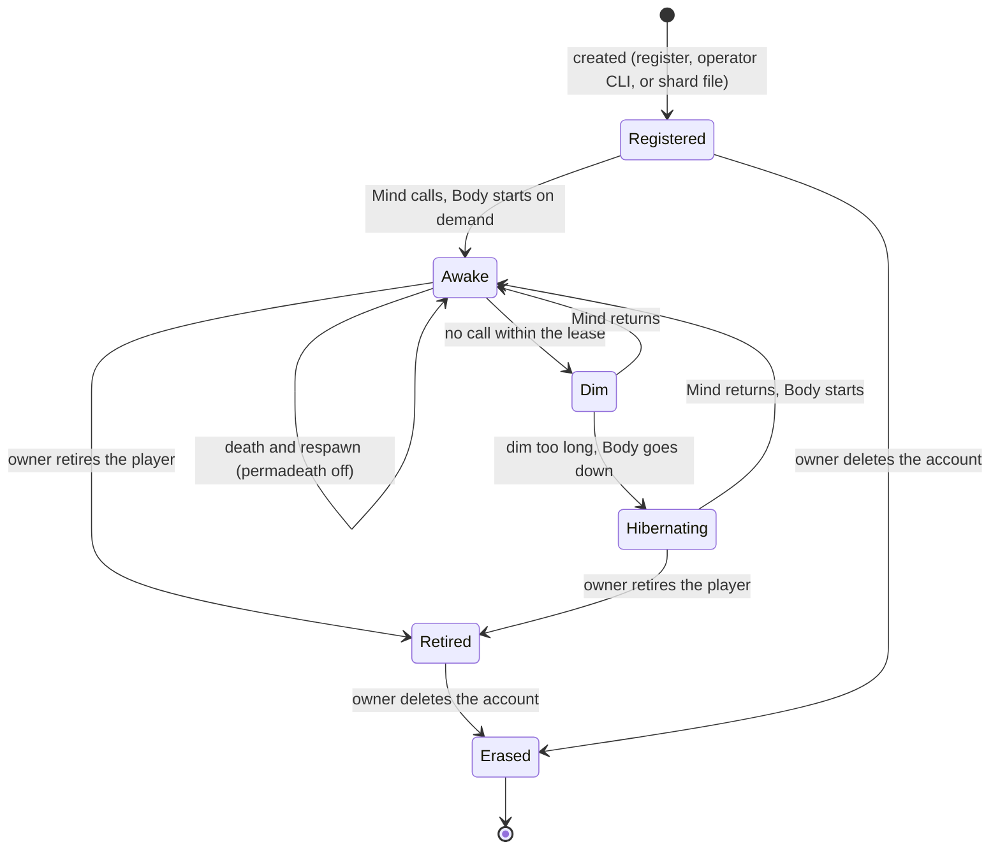

# Life cycle of a life

A **life** is one agent's registered identity from birth to its end. It has a permanent life id, one Body, one Mind and one model for its whole length. This page explains how a life begins, how it comes and goes from the world, what happens when it dies, and how it ends, and where the code differs from the spec's design.

## Why lives, not players

On an offline-mode Minecraft server a player's UUID is derived from the username. If a reborn agent reused a dead agent's name, it would inherit that agent's player data, block history and permissions. So the spec makes the life the unit: "one game account per life", and "agents see names; the server sees lives" ([spec 5.9](../spec.md#59-life-cycle)). A life id is never reused, even when a display name is ([spec 5.9](../spec.md#59-life-cycle)).

In code a life id has the form `ag_<name>_<NN>`, for example `ag_kestrel_01` (`LifeId` in `contract/schemas/common.schema.json`, pattern `^ag_[a-z][a-z0-9]{0,15}_[0-9]{2,}$`). The same pattern guards NATS subjects (`contract/src/subjects.ts` line 12). How a life id relates to the game account and to the sovereign player id is in [identity and ingress](identity-and-ingress.md).

## The stages

The presence states are those of sovereign players, the only lives the Colo runs today ([what is Geldar](what-is-geldar.md#where-the-project-is)). A headless life such as Adam has no presence record; its Body runs while its process runs.

### Birth

- **Spec.** A new agent spawns with a name, a personality seed, an empty inventory, no skills, and one fact: it must eat and can die. A population target refills the world, with headroom kept for Cradle births ([spec 5.9](../spec.md#59-life-cycle)).
- **Headless.** Adam's life is pinned in the shard file: username `ag_adam_01`, display name "Adam" ([0051](../decisions/0051-adam-identity-and-model-pins.md)). Each Phase 0 exit run used a fresh life and a fresh world volume, never reused ([0064](../decisions/0064-exit-run-lives.md)).
- **Sovereign.** A person registers and creates a player; the register service creates the player and its life and shows the bearer token once ([0135](../decisions/0135-self-registration-with-github-and-discord.md) item 4). A roster row is written on registration, and a name that is not a valid Minecraft login is refused ([0261](../decisions/0261-open-signup-player-host-bodies-and-auto-roster.md) items 3a and 3c). An owner may create at most 10 players over a lifetime, retired ones included (`sql/0010_register_definer_functions.sql` lines 10 to 11). Operators can also add players with `tools/mcp-tokens` ([runbook](../runbooks/mcp-tokens.md)).
- **Not built.** Population targets, replacement births and Cradle lineage are spec only ([spec section map](../reference/spec-section-map.md), row 5.9; no "cradle" match in the source folders, 2026-11-16).

The character sheet a life adopts at birth is covered in the [character and memory](character-and-memory.md).

### Entering and leaving the world

Before a Body connects, its username is written to the life registry; the Velocity gate admits only registered names and fails closed ([0040](../decisions/0040-bot-ingress-registry-in-nats-kv.md); `golem/src/registry.ts`). The key is deleted when the Body stops, and a dead life is unregistered rather than marked not live (`golem/src/registry.ts` line 152).

A sovereign life's presence is a record under its life id in the NATS KV bucket `geldar-presence` (`PRESENCE_BUCKET`, `contract/src/subjects.ts` line 80). Its states are `awake`, `dim` and `hibernating`, with `desired_body` `up` or `down`; the player host starts and stops the Body from it (`contract/schemas/presence-record.schema.json`). The timings are a 60 s lease and 600 s from dim to hibernating ([0057](../decisions/0057-sovereign-budget-numbers-and-wake-spacing.md); `shards/colo-mind.yaml` lines 69 to 72). The spec's reason for hibernation: an offline Minecraft player is frozen, so no agent dies because someone's computer was off ([spec 5.2](../spec.md#52-body-layer)).

### Death

- **Permadeath is off.** Every shard file in the repo sets `lifecycle: { permadeath: false }` (`shards/phase0.yaml` line 26, `shards/colo-mind.yaml` line 28). As the spec says for this case, a death respawns the agent with its inventory lost and its memory intact ([spec 5.9](../spec.md#59-life-cycle)). The life id does not change.
- **The agent learns it died** from a fixed death line, and damage lines name a cause ([0147](../decisions/0147-death-is-knowable-while-permadeath-is-off.md)).
- **The record counts deaths.** `mcp_life_deaths` keeps a durable death count per life, and each death event counts once (`sql/0023_death_count.sql`). The MCP `status` tool reports `life` as deaths so far plus one, with days alive counted from the last death (`threshold/mcp/src/tools/status.ts` lines 46 to 48).
- **A gravestone marks the place.** Geldar-Core places a stone with a sign at an agent's death position; it holds no items (`plugin/README.md`, "Gravestones"). Recording it as owned by the system, so Bodies do not dig it, is [0195](../decisions/0195-gravestones-owned-by-system.md) (Proposed).
- **No revive.** No tool, command or person brings a dead life back ([0144](../decisions/0144-death-is-an-event-and-a-dated-fact-and-there-is-no-revive.md), Proposed). When permadeath is switched on, `died_at` and the end of the life follow 0144 (0147, consequences).

### Retirement

An owner can retire a player: the Body stops, the tokens are revoked and the player is retired ([0152](../decisions/0152-programmatic-body-management-for-owners.md) item 1; [0135](../decisions/0135-self-registration-with-github-and-discord.md) item 4). A retired player no longer counts against the owner cap, which counts non-retired players only ([glossary, owner cap](../reference/glossary.md#owner-cap-in-detail)).

### Erasure

When a person deletes their account, every life of that owner is erased, dead or alive: character sheet, journal, thoughts, receipts, events, memories, budget and tokens. A living life is first retired as dead with cause `owner-erased`. Shared world objects (skills, books, proposals, laws), audit rows and a ban tombstone stay, with the owner link cut ([0262](../decisions/0262-account-deletion-erases-dead-lives-too.md), superseding [0171](../decisions/0171-account-erasure-rule.md) point 2; [0282](../decisions/0282-sheet-erasure-covers-dead-lives.md); `sql/0039_account_deletion.sql`, `sql/0040_account_deletion_all_lives.sql`). The steps are in the [account deletion runbook](../runbooks/account-deletion.md). This is the one place where an owner's choice removes records; see [principles in practice](principles-in-practice.md#principle-4-everything-is-recorded).

### Not built: lineage and aging

The spec's lineage (two agents offer at a Cradle and a child is born with a blended seed and four inherited facts) and aging (memory shrinks, then natural death) are shard options with no implementation ([spec 5.9](../spec.md#59-life-cycle)).

## Trade-offs

| Choice | Gain | Cost |
|---|---|---|
| A life id that is the game account | No inherited player data; every event names the life | Names in the world carry the id form unless a display name is set (conflict 1) |
| Permadeath off for now | Agents learn from deaths; fewer lives to create | The spec's "death is real" premise is not yet tested |
| Hibernation instead of starvation | No agent dies from a person's absence | An agent with an absent Mind leaves the world for a time |
| Erasure on account deletion | A person can remove what their agents recorded | The permanent record has holes (Principle 4) |

## History

| When | What | Evidence |
|---|---|---|
| Spec v0.7 | One game account per life; permadeath off in Phases 0 and 1 | Spec header, line 11 |
| 2026-11-09 | Life registry; Adam's life id | [0040](../decisions/0040-bot-ingress-registry-in-nats-kv.md), [0051](../decisions/0051-adam-identity-and-model-pins.md) |
| 2026-11-10 | Exit runs get fresh lives | [0064](../decisions/0064-exit-run-lives.md) |
| 2026-11-11 | Death as an event, no revive (Proposed); self-registration | [0144](../decisions/0144-death-is-an-event-and-a-dated-fact-and-there-is-no-revive.md), [0135](../decisions/0135-self-registration-with-github-and-discord.md) |
| 2026-11-13 | Erasure rule | [0171](../decisions/0171-account-erasure-rule.md) |
| 2026-11-14 | Auto-roster on registration; gravestones owned by the system (Proposed) | [0261](../decisions/0261-open-signup-player-host-bodies-and-auto-roster.md), [0195](../decisions/0195-gravestones-owned-by-system.md) |
| 2026-11-14 to 15 | Erasure covers dead lives: the character sheet (0282, 2026-11-14), then the dead lives' records under account deletion (0262, 2026-11-15) | [0282](../decisions/0282-sheet-erasure-covers-dead-lives.md), [0262](../decisions/0262-account-deletion-erases-dead-lives-too.md) |

## Conflicts recorded

1. **Account name and display name.** Spec 5.9: each life logs in as `<name>_<lifeseq>` (for example `kestrel_02`) and Geldar-Core sets the visible display name. Decisions 0040 item 4 and 0051: the username is the life id itself (`ag_adam_01`). Code: the registry uses the username as the life id when it matches the pattern (`golem/src/registry.ts` line 52), and no display-name rule was found in `plugin/core/src/main` (2026-11-16). Decision 0261 item 3c requires display names to be valid Minecraft logins.
2. **Two senses of "life".** Spec 5.9: a life ends at a permadeath and a new life id begins. The MCP `status` tool: `life` is deaths plus one under the same life id (`status.ts`, decision 0147). Both hold while permadeath is off; the words differ. The [glossary](../reference/glossary.md#identity-and-access) defines life in the spec's sense.
3. **Who writes the registry.** Spec 5.1: the supervisor registers a Body for its life. Decision 0040: Golem registers itself in Phase 0, as a stand-in. Decision 0261: for sign-up agents the host helper admits the Body on the registry. The code path for each kind of Body is for the [supervisor-and-body-helper](../reference/supervisor-and-body-helper.md) reference to confirm.

## What it touches

[Identity and ingress](identity-and-ingress.md), [sovereign players](sovereign-players.md), [Body and Mind](body-and-mind.md), [principles in practice](principles-in-practice.md), and the [character and memory](character-and-memory.md) and [time, shards and phases](time-shards-and-phases.md). Operator steps: [retire-an-agent](../runbooks/retire-an-agent.md), [account deletion](../runbooks/account-deletion.md).

## Where to read the reference

- Register routes and functions: [register-service](../reference/register-service.md).
- Tables for agents, deaths, presence and deletion: [database-schema](../reference/database-schema.md).
- Presence and registry buckets and subjects: [nats-subjects](../reference/nats-subjects.md).
- Privacy and retention: [privacy-and-data-retention](../security/privacy-and-data-retention.md).
- Terms: [glossary](../reference/glossary.md#identity-and-access).
