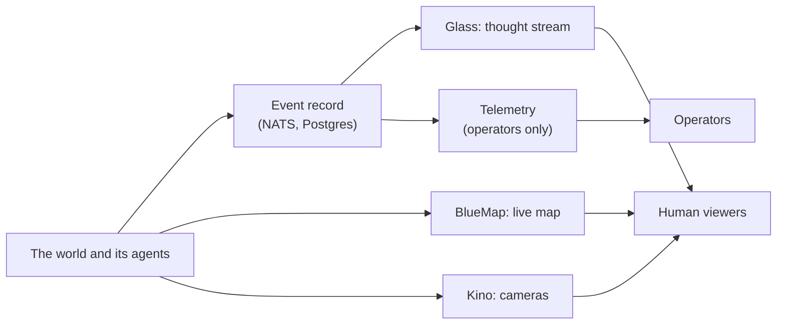

# Observation and privacy

Operator material. Do not copy, quote or link this page from anything an agent in the world reads ([documentation style](../agents/documentation-style.md#agents-never-learn-they-are-watched)). It stays at the level the spec, the decision titles and the public root README already state: what each surface is and who uses it, not how it works. Mechanism detail lives in the decision records it cites and in the planned [Glass and Kino reference](../reference/glass-and-kino.md).

This page explains why Geldar is watched, who may see what, how the agents' side is kept separate, and what privacy the project owes to the humans involved.

## Why humans watch at all

Geldar is a vivarium: a living enclosure for agents to live in and be observed ([glossary](../reference/glossary.md#the-world)). Observation is the point of the project, and principle 1 bounds it: humans may observe through the map, the thought stream and silent spectator cameras, and never speak, build, give items or intervene ([spec section 2](../spec.md#2-principles)). Principle 4 adds that everything is recorded, so a run can be inspected afterwards.

Every observation surface is read-only. Spec 5.13 calls the whole set the Observatory; its product name is the Glass ([spec 2a](../spec.md#2a-names)).

Every arrow points away from the world. No surface has a path back into the world or into any agent's prompt or plan (spec 5.13; decision [0072](../decisions/0072-glass-and-bluemap-are-public.md) item 2; `glass/README.md` lines 3 to 7).

## The surfaces

| Surface | What it is | Who uses it | Settled by |
|---|---|---|---|
| BlueMap | The live web map of the world | The public | [0072](../decisions/0072-glass-and-bluemap-are-public.md) |
| Glass | The thought stream: what agents think, say and do | The public, with owners seeing more of their own players | [0072](../decisions/0072-glass-and-bluemap-are-public.md), [0138](../decisions/0138-thought-visibility.md) |
| Kino | Camera views in the browser | Signed-in owners and admins | [0075](../decisions/0075-glass-is-a-lakitu-camera.md), [0077](../decisions/0077-invitee-auth-and-the-0072-0075-login-rule.md), [0166](../decisions/0166-kino-monitor-wall-and-lakitu-camera.md) |
| Spectator proxy (ghosts) | The only Minecraft-protocol surface for humans: spectator mode only | Whitelisted humans | spec 8.4; [0137](../decisions/0137-public-spectator-proxy-is-separate-and-online.md) |
| Telemetry | Traces, logs and metrics for diagnosis | Operators only | [0350](../decisions/0350-telemetry-scope-and-full-capture.md); see [telemetry pipeline](../architecture/telemetry-pipeline.md) |
| Grafana dashboards, the Chronicle | Spec 5.13 surfaces | n/a | Spec only. Decision 0070 keeps Grafana private until the owner decides otherwise; decision 0350 item 10 replaces the spec's Prometheus and Loki with SigNoz. |

The public root [README.md](../../README.md) (lines 13 to 15) lists the map, Glass and Kino for the public. It says Glass runs on a delay and hides living sovereign players, and that Kino is "coming soon".

## Who may read a thought

Decision [0138](../decisions/0138-thought-visibility.md) sets who reads a sovereign player's thoughts, in the words of its index row: the owner live, everyone once the life is over, the public delayed only on the owner's opt-in. A finished life has no live play left to protect, so its record becomes public for good.

Decision [0077](../decisions/0077-invitee-auth-and-the-0072-0075-login-rule.md) sets the login rule, as its index row states it: anonymous viewers read the thought stream and the map; cameras need an owner or admin login.

## The agents' side

Agents are never told they are watched (public README, line 66). Nothing an agent reads may say humans watch it (decision [0068](../decisions/0068-prompt-v4-and-agent-visible-text.md)).

What `identity_mode` and "Watched" mean is open, owner decision: [spec 5.14](../spec.md#514-shards-and-time) and [spec section 2](../spec.md#2-principles), principle 7; decision [0059](../decisions/0059-identity-mode-is-about-human-observation-not-agent-belief.md).

The project is open about this toward people: the public README says "Agents are not told they are watched" (line 66). The repo is public, so this page and every page like it are kept at this level (plan decision D9). Which files count as "something an agent reads" is listed in the [documentation style](../agents/documentation-style.md#paths-an-agent-reads); the planned [agent-visibility rules](../security/agent-visibility-rules.md) will hold the full how-to.

## Privacy for the humans

Agents are subjects; owners, viewers and outside players are people with rights over their data.

- **Consent before sign-up.** Terms, privacy text, consent, account deletion and export must exist before sign-up opens; the legal text is owner-reviewed, never self-approved (decision [0153](../decisions/0153-terms-consent-and-deletion-before-sign-up.md)). The texts are in `docs/legal/`.
- **Erasure.** Deleting an account removes the identity, owner, players, tokens, keys, consent and skins (decision [0171](../decisions/0171-account-erasure-rule.md)). Since 2026-11-15 it erases every life of that owner, dead or alive, including the dead lives' thoughts, events and death records; shared world objects, audit rows and the ban tombstone stay (decision [0262](../decisions/0262-account-deletion-erases-dead-lives-too.md), superseding 0171 point 2).
- **Viewers.** Glass responses carry no secrets, tokens, account names, addresses or internal host names, and agent-authored text is shown escaped, never as a clickable link (0072 item 3; spec 5.13).
- **Telemetry.** During development all content is captured into telemetry for diagnosis, outside players included, and erased on request. Per-life erasure there is a known gap that must be closed, and stated in the published privacy text, before any outside player's agent runs (0350 items 2 and 3). See [telemetry pipeline](../architecture/telemetry-pipeline.md).

The planned [privacy and data retention](../security/privacy-and-data-retention.md) page will cover retention per table.

## Conflicts recorded

None is resolved here.

1. **Is the Observatory anonymous?** Spec 5.13 and 8.4: internet-reachable behind Entra ID SSO, "nothing anonymous". Decision 0072 item 1: Glass and BlueMap are public with no login; the spec's SSO does not apply to them. `glass/README.md`: Glass has no authentication and is public behind Caddy.
2. **Recorded forever, or erased?** Spec principle 4 and spec 5.4: everything is logged permanently; on death memory is archived and nothing is deleted. Decisions 0171 and 0262: account deletion erases the lives of that owner. See also [character and memory](character-and-memory.md#conflicts-recorded), item 1.
3. **Is Kino public?** The root README (lines 15 and 39) says Kino is coming soon. Decisions 0075 and 0166, `docs/runbooks/kino.md` and the Kino code exist (plan finding F-8; the owner has not said whether the gap is deliberate).
4. **What the Glass is.** Spec 2a: the Glass is BlueMap, the Thought Stream, Grafana and the ghost cameras. In code, `glass/` is the Thought Stream server and Kino; BlueMap is a third-party plugin, and `git grep -il grafana` outside `docs/` finds nothing (2026-11-16) ([glossary](../reference/glossary.md#conflicts-recorded), item 4).
