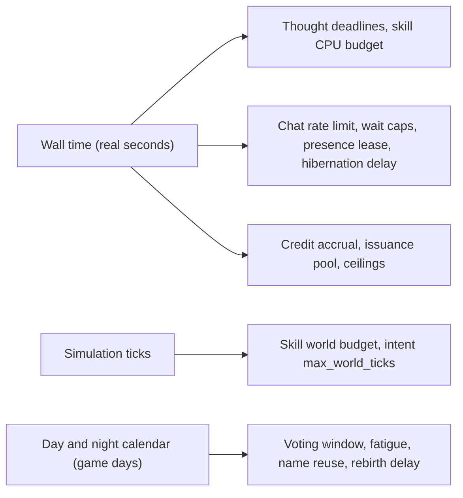
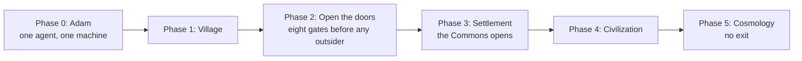

# Time, shards and phases

Why Geldar splits its worlds into shards, why every shard runs at one fixed tick rate with three separate clocks, and why the rollout is cut into phases whose exits are system tests. It also records how the phases have actually gone so far, which differs from the spec's plan.

The keys of a shard file are described in the [shard-config reference](../reference/shard-config.md). The budget clock is explained in [economy and budgets](economy-and-budgets.md). Whether humans may watch a shard is explained in [observation and privacy](observation-and-privacy.md) (operator material).

## Shards: one world per experiment

A shard is one complete world: the Paper server, its plugin configuration, its agents, its database and, in the spec, its Historian ([spec 5.14](../spec.md#514-shards-and-time); [glossary](../reference/glossary.md#the-world)). Shards run side by side as separate experiments.

Each shard has its own Postgres database. Decision [0026](../decisions/0026-one-database-per-shard.md) settles this for Phase 0: the `events` table has no `shard` column, because a database serves one shard. A database that ever serves two shards needs a new migration that adds the column (0026, "Consequences").

The spec keeps two kinds of shard apart, and never mixes them ([spec section 2](../spec.md#2-principles), principle 7; spec 5.14):

| Kind | Purpose | Spec rule |
|---|---|---|
| Research shard | Findings. Pure headless, pinned models, pre-registered hypotheses, one variable changed against a control | Never admits sovereign players |
| The Commons | Stories. The exhibition shard, open to sovereign players and their humans | Watched by construction |

Spec 5.14 lists planned shards (Commons, Control, Unwatched, Watched, Monoculture, Scarcity, Eden, Alchemy, and a research-economy option). None of them exists in this repo; the [glossary](../reference/glossary.md#the-world) marks the research shard and the Commons as spec only.

### The shard files in this repo

Listed with `git ls-files shards envs` on 2026-11-16 at 1b114276. Each role comes from the file's own header comment.

| File | Role |
|---|---|
| `shards/phase0.yaml` | The Phase 0 shard, `shard: phase0`. Started from `compose/phase0.yml` ([glossary](../reference/glossary.md#the-world)). |
| `shards/colo.yaml` | The flat key file that `compose/colo.yml` and `geldar.ps1` read: CPU and memory totals for the Colo stack. `geldar.ps1` refuses unknown keys in it. |
| `shards/colo-mind.yaml` | The Colo shard's Body, Mind and MCP blocks, `shard: colo`. Derived from `phase0.yaml`, with the `sovereign` block added (decision [0131](../decisions/0131-colo-in-container-hosts-and-mind-shard-file.md)). |
| `shards/character-fixture.yaml` | Disposable fixtures for the character-sheet campaign. Its header says nothing starts from it unless a scratch stack is pointed at it ([character and memory](character-and-memory.md)). |
| `envs/environment.schema.json`, `envs/test.example.yaml` | A whole environment described as a value. Decision [0188](../decisions/0188-genesis-environment-stamp.md) is Proposed. |

Both runnable shard files set `seed: 8675309`, `tick_rate: 20`, `identity_mode: watched` and `lifecycle: { permadeath: false }` (`shards/phase0.yaml` lines 4, 5, 12, 26; `shards/colo-mind.yaml` lines 8, 9, 15, 28). The seed is the one in the spec's Appendix E baseline.

What `identity_mode` and "Watched" mean is open, owner decision: spec 5.14; [spec section 2](../spec.md#2-principles), principle 7; decision [0059](../decisions/0059-identity-mode-is-about-human-observation-not-agent-belief.md).

The Colo shard's world border is `world_border_radius: 9500`, moved on 2026-11-15 at the spawn-town cutover (`shards/colo-mind.yaml` line 10). The spec's Phase 1 plan says "world border at 1,500" ([spec section 10](../spec.md#10-rollout-plan)). The cutover is treated as a world-operations exception in [world-operations exceptions](world-operations-exceptions.md); no decision record covers the border change.

## Time: one tick rate, three clocks

### Shards run at 20 ticks per second

Spec 5.14 says shards run at 20 TPS and that agents get thinking time from intents, waits, wake conditions and reflexes, not from slowing the world. Two decisions set this:

- [0038](../decisions/0038-tick-rate-does-not-slow-a-client-driven-body.md) (measured on the live shard): `/tick rate` does not slow a Mineflayer Body, because the bot runs its physics on its own 50 ms client timer. A 12-block `goto` took about 2.0 s at both 5 and 20 TPS (0038, "Why"). The world clock the Body sees moves in steps of 20 ticks.
- [0047](../decisions/0047-thinking-time-comes-from-intents-and-waits-not-dilation.md) (owner): time dilation is no longer a mechanism for giving agents time to think. The Mind plans while a long intent runs in the Body; reflexes keep the Body safe meanwhile. `/tick rate` may still be used for server-load experiments, labelled as such.

So the Body benchmark's gate is the 20 TPS row. The 10 and 5 TPS rows are findings only ([spec section 10](../spec.md#10-rollout-plan), Phase 2 gate 6; 0038; 0047).

### Three clocks, never mixed

Spec 5.14 keeps three clocks apart in every log line and declares every timer against one of them:

The reason, in the spec's words: money never follows the calendar. An earlier spec draft priced thoughts per in-game day, which at the tick rate of that time gave each agent 36 times the intended budget ([spec 5.7](../spec.md#57-metabolism-thinking-budget), "The unit-of-time error we fixed"). Money now runs on wall time only; see [economy and budgets](economy-and-budgets.md).

Alerts measure achieved tick duration against target and actions per real second, never raw TPS, because TPS cannot exceed the configured rate (spec 5.14).

## Phases: a living agent first, then a village, then the doors

[Spec section 10](../spec.md#10-rollout-plan) cuts the rollout into six phases and keeps two kinds of exit criteria apart:

- **System acceptance** proves a mechanism works, with isolated test agents and scripted goals. Phases exit on this.
- **Social observation** records whether the real population uses the mechanism. It is never an exit condition, because requiring an organic trade or law would tempt the team to tune prompts until the story appears.

### How the phases have actually gone

| Phase | Spec plan | What the decisions record |
|---|---|---|
| 0 | One weekend, one machine. Exit: five in-game days survived, 24 real hours, three durable intents, receipts, a checkpoint resume, a model floor. | Closed on 2026-11-10 as **proof of life** (decision [0066](../decisions/0066-phase0-closed-as-proof-of-life.md)). The exit criteria are waived by the owner, not met; the long exit runs were not performed; no model floor is set. |
| 1 | Village, LAN only, nothing on the internet until Phase 2. | Redefined on 2026-11-10 as **the colo-first shard**: the final Colo environment, reachable without a VPN, invite-only and not announced (decision [0070](../decisions/0070-phase1-is-the-colo-first-shard.md)). The public MCP, the spectator proxy, Glass, BlueMap, backups and the Colo deployment were pulled forward from Phase 2. The spec's own Phase 1 content (chat, books, reflection, hibernation, credits, the Shrine, a population of 10 to 15, the 7-day soak) moved to later waves. Invitees wait for the spec's eight Phase 2 gates. |
| 2 to 5 | Security build, Commons, governance and lineage, code proposals. | No phase record yet. |

Decision [0130](../decisions/0130-phase1-owner-rulings-for-c1.md) (owner, 2026-11-10) also shapes Phase 1: backups are deferred, telemetry goes to SigNoz, and the long tests (the 7-day soak, the chaos day, the long benchmarks, the restore tests) run once at the end of the phase. Until a backup exists, the running Colo shard has no restore path (0130, "Consequences and risks").

On the Colo, the project's own Mind (`animus`) is a compose profile that stays off until a Thinker path exists (decision [0134](../decisions/0134-mind-is-a-profile-until-a-thinker-exists.md)). The root [README.md](../../README.md) says the same and that "Phase 1 is in progress" (lines 57 to 59); whether that still matches the node is not verified here.

The phase summaries are [Phase 0 summary](../history/phase0-summary.md) and [Phase 1 summary](../history/phase1-summary.md).

## Conflicts recorded

None is resolved here.

1. **Baseline tick rate.** Spec 5.7 and [spec section 9](../spec.md#9-cost-model) say "40 at the baseline tick rate of 10" and cost the economy against it. Spec 5.14 and section 10 say shards and all phases run at 20 TPS; Appendix E sets `tick_rate: 20`; decisions 0038 and 0047 make 20 TPS the rule; both runnable shard files set 20.
2. **Which phase is current.** [CLAUDE.md](../../CLAUDE.md) line 3 says "Current work is Phase 0 ('Adam')". Decision 0066 closes Phase 0; the root README (line 57) says "Phase 1 is in progress"; `docs/analysis/phase1/RESUME.md` describes Phase 1 as the current campaign.
3. **Phase 1 exposure.** Spec section 10: nothing is exposed to the internet until Phase 2. Decision 0070: Phase 1 is reachable from the internet, invite-only. The decision says it amends the spec's sequencing only.
4. **World border.** Spec section 10 (Phase 1): 1,500. `shards/colo-mind.yaml`: radius 9500. The spec number belongs to a phase plan that decision 0070 rescheduled.

## Not verified

- What runs on the Colo node now. No live read was made (plan decision D8).
- The spec's planned shards and the Allocator that would route Thinkers between them: no implementation found by `git grep` over the source folders on 2026-11-16 (the [spec section map](../reference/spec-section-map.md) marks 4.4 spec only).
