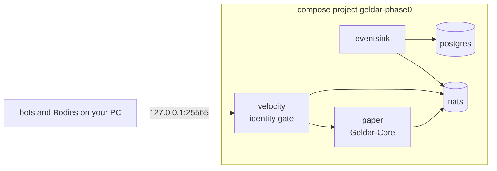

# Your first shard on your machine

In this tutorial you start the Phase 0 shard on your own PC, watch it come up healthy, see the first events reach the database, and take it down again without losing anything.

It assumes you finished [your first hour](first-hour-contributor.md): the workspace is installed and the fast checks pass.

**Untested.** The read-only commands were run on 2026-11-16 at `db33805c` and their output is quoted. The later commits up to `283d5d2d` add documents only and change no file cited here (`git diff --name-status db33805c 283d5d2d`). Every step that builds the plugins, starts Docker containers or touches a shard was **not** run: the documentation freeze in force that day forbids starting anything. The expected output of those steps is read from the code that prints it (`geldar.ps1`, the plugins) and from the [bring-up runbook](../runbooks/bring-up-phase0-shard.md), which is itself untested. Treat this page as a draft until someone runs it end to end and records the result.

## What a Phase 0 shard is

A shard is one world and everything it needs to run. Phase 0 runs it all on one PC ([decision 0002](../decisions/0002-phase0-host-and-models.md)). The shard is a Docker Compose project, `geldar-phase0`, defined by `compose/phase0.yml`. It has five services:

- `postgres`: Postgres with pgvector, the record.
- `nats`: NATS with JetStream, the message bus and event log.
- `paper`: the Minecraft server, with the Geldar-Core plugin.
- `velocity`: the proxy that bots join through, with the identity plugin that admits only registered bots.
- `eventsink`: copies the event stream from NATS into Postgres.

The thinking parts are **not** in the shard. In Phase 0 the Body, the Mind and the local Thinker run as processes on your PC, outside Docker, and Ollama runs on the host so it can use the GPU ([decision 0050](../decisions/0050-phase0-mind-processes-run-on-the-host.md); the `run-shard` skill, first paragraph).



Bots never reach Paper directly. They join through Velocity on `127.0.0.1:25565`, the same path production uses ([decision 0021](../decisions/0021-velocity-from-phase0.md)); Paper publishes no game port (`compose/phase0.yml` line 2).

## What you need

- Everything from [your first hour](first-hour-contributor.md#what-you-need).
- Docker with Compose v2, running.
- A JDK 25 for the plugin build (`plugin/core/build.gradle.kts` line 7).
- Free host ports `5432` (Postgres), `4222` and `8222` (NATS) and `25565` (Velocity). `compose/phase0.yml` binds each on `127.0.0.1` only (lines 27, 44, 45 and 121).
- Room on disk for a Minecraft world.

## 1. Look at the shard before you start it

`docker compose config` reads the compose file and starts nothing. Run it from the repo root:

```powershell
docker compose -f compose/phase0.yml config --services
```

Output on 2026-11-16:

```text
nats
postgres
eventsink
paper
velocity
```

If this fails, Docker or Compose is not set up; fix that before you go on.

## 2. Build the two plugin jars

Compose mounts the plugin jars into Paper and Velocity but does not build them. Build them first:

```powershell
cd plugin; ./gradlew build; cd ..
```

This writes `plugin/core/build/libs/geldar-core.jar` and `plugin/velocity-identity/build/libs/geldar-velocity-identity.jar` (the `run-shard` skill, "Start").

*Untested here.* If you skip this step, the next one refuses to start: `shard up` checks that both jars are real files, because Docker would otherwise create a directory in their place and the server would boot without the plugin (`Assert-PluginJar`, `geldar.ps1` lines 195 to 207).

## 3. Start the shard

```powershell
./geldar.ps1 shard up phase0
```

`shard up` runs these steps in order (`Invoke-Shard`, `geldar.ps1` lines 445 to 457). Steps 3 to 5 each print a `==> <step>` header:

1. It checks the jars (step 2).
2. It creates any missing secret file: the Postgres password, the RCON password and the Velocity forwarding secret. It never overwrites one. On a first start you see one `created compose/secrets/<name>.txt` line for each.
3. `==> build the images of shard phase0 (layer cache; a no-op when nothing changed)`: it rebuilds the eventsink image from this repo.
4. `==> start shard phase0`: `docker compose up -d --wait`, which returns once every healthcheck passes.
5. `==> check the plugins loaded on shard phase0`: it reads the Paper and Velocity logs and fails unless they hold `Geldar-Core enabled` and `Geldar identity enabled`. A healthy container alone does not prove the plugin loaded.
6. A closing hint that RCON is not published to the host, and how to publish it.

*Untested here.* Be patient on the first start: Paper generates the world, and its healthcheck allows a 10-minute start period (`compose/phase0.yml` line 12). Do not treat a slow first start as a failure before then.

The hint in item 6 matters later. Host tools that drive the world over RCON (the live tests, the body benchmark, `players`) need it published. Then you start the shard with:

```powershell
./geldar.ps1 shard up phase0 --rcon-host
```

which merges `compose/rcon-host.yml` and publishes RCON on `127.0.0.1:25575`.

## 4. See that it is healthy

```powershell
./geldar.ps1 shard status phase0
```

*Untested here.* Expect `postgres`, `nats`, `paper` and `velocity` to show `healthy`. `eventsink` has no healthcheck, so it shows only as running (`compose/phase0.yml`; the runbook, step 3).

Status alone is not proof. Check a few parts directly. First define a short helper for this shell:

```powershell
function dc { docker compose -f compose/phase0.yml -p geldar-phase0 @args }
```

**NATS has JetStream on:**

```powershell
curl -fsS "http://localhost:8222/healthz?js-enabled-only=true"
```

Expect `{"status":"ok"}`.

**Geldar-Core loaded in Paper:**

```powershell
docker logs geldar-phase0-paper-1 2>&1 | Select-String "Geldar-Core enabled"
```

Expect `Geldar-Core enabled for shard phase0` (`GeldarCore.java` line 151).

**The identity gate loaded in Velocity:**

```powershell
docker logs geldar-phase0-velocity-1 2>&1 | Select-String "Geldar identity enabled|Watching bucket|is absent"
```

Expect `Geldar identity enabled` (`IdentityPlugin.java` line 102). The gate watches the life registry, a NATS bucket that the Body creates when it registers a bot. Until a Body has run, you see `Bucket geldar-life-registry is absent, retrying in <N> ms` (`RegistryClient.java` line 96) and the gate denies everyone. That is normal on a fresh shard. Once the bucket exists you see `Watching bucket geldar-life-registry` (line 219). See conflict 1.

The full table of health rows, with migrations and pgvector, is in the [bring-up runbook](../runbooks/bring-up-phase0-shard.md), step 4.

## 5. Watch the first events arrive

The shard produces events before any agent exists. Geldar-Core publishes a `server_tps` event every 20 seconds (`tps_interval_seconds: 20` in `plugin/core/src/main/resources/config.yml`). It goes into the JetStream stream `GELDAR_EVENTS`, and the eventsink copies it into the `events` table.

Ask Postgres for the count by type:

```powershell
dc exec postgres psql -U geldar -d geldar -tAc "select type, count(*) from events group by type"
```

*Untested here.* Expect a `server_tps` row. Run the command again a minute later: the count should have grown by about three. If it does not, read the eventsink log with `dc logs --tail 50 eventsink`.

This is the working result of the tutorial: a shard whose world runs, whose identity gate is up and whose events reach the database.

## 6. What you can run against it next

With the shard up you can run the live tests and the body benchmark. Both change the shard (tick rate, whitelist, world), so run them one at a time (`CLAUDE.md`, "Commands"):

```powershell
./geldar.ps1 pnpm --filter @geldar/golem test:live
./geldar.ps1 bench
```

*Untested here.* The live tests need RCON, so start the shard with `--rcon-host` first (the `run-shard` skill, RCON row). The live lane takes about 11 minutes by the skill's estimate (unverified for this page). The `body-bench` skill covers the benchmark and its flags.

One benchmark flag is safe without a shard: `--list` prints the scenarios and returns before it connects to anything (`golem/src/bench/cli.ts`, the `options.list` branch). On 2026-11-16:

```powershell
./geldar.ps1 bench --list
```

```text
$ node src/bench/cli.ts --list
wood-to-stone-tools
food
shelter
bed
chest
blocked-path
```

**Never run `./geldar.ps1 adam up` (or even `adam up --help`) before the live tests.** The live tests start their own Mind and Body. `adam up` holds port 7410, the Mind's Thinker socket, and a held port makes the live cases fail to bind (`CLAUDE.md`, "Live runs start their own stack"). The live cases use the 8B model only. The 32B run is a separate, manual `adam up --model strong`, with no live cases beside it.

## 7. Take it down

```powershell
./geldar.ps1 shard down phase0
```

*Untested here.* This runs `docker compose down` without `-v` (`geldar.ps1` line 458), so the world, the database and the NATS state survive. The next `shard up` picks them up again.

Two rules protect that state:

- Never run `docker compose down -v` or delete a volume without the owner's word. Nothing backs these volumes up ([backup and restore](../runbooks/backup-and-restore.md)).
- Keep `compose/secrets/` with its volumes. A Postgres volume keeps the password it was created with; new secrets against an old volume fail authentication. When you copy secrets between worktrees, copy all of them or none (the `run-shard` skill, "Secrets and volumes").

And never fix a problem by acting in the world: no teleporting a bot, no giving items. Fix the infrastructure (spec Principle 1; the `run-shard` skill, "Logs and restarts").

## When something goes wrong

The [bring-up runbook](../runbooks/bring-up-phase0-shard.md#when-a-step-fails) has a symptom, cause and fix for each failure seen so far: a jar path that became a directory, a plugin that did not load, a password mismatch, a slow first start, an unreachable RCON and a held port 7410.

## Conflicts recorded

1. **Velocity log lines.** The `run-shard` skill's health table expects `Watching the life registry` and, before the bucket exists, `Life registry unavailable`. Neither string is in `plugin/velocity-identity/src/main` at `db33805c`. The code logs `Watching bucket <bucket>` and `Bucket <bucket> is absent, retrying in <N> ms` (`RegistryClient.java` lines 96 and 219). Step 4 uses the code's strings, as the [bring-up runbook](../runbooks/bring-up-phase0-shard.md#notes-and-conflicts) does in its conflict 3. The skill needs the same fix.
2. **Migrations check.** The skill compares a table count with `sql/`; the runbook compares `max(version)` in `schema_migrations`. This page leaves both to the runbook.

## Where to go next

- Follow one action through this stack, from a thought to the `events` table: [trace one action](trace-one-action.md) **(a-n)**. Links marked **(a-n)** go to `agents-never` documents: never copy, quote or link them from a path an agent reads ([documentation style](../agents/documentation-style.md#agents-never-learn-they-are-watched)).
- Every service, port, volume and overlay of each stack: [compose stacks](../reference/compose-stacks.md).
- The operator procedure, with every health row: [bring up the Phase 0 shard](../runbooks/bring-up-phase0-shard.md).
- A throwaway stack beside this one: [scratch stack](../runbooks/scratch-stack.md).
