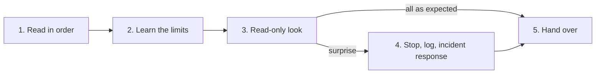

# Operator first day

This walkthrough takes a new node operator from nothing to one safe, read-only look at the health of the Colo stack. By the end you have read the ground rules in order, you know what you may do alone, what only the owner decides and what you never run, you have read the stack's state with three read-only scripts, and you have written a handover note.

**Untested.** No step on this page was run for it. No node, VM, database or world was read (plan decision D8). Every command and every line of output below comes from the script's code at `dc07e3fa` or from the cited document, not from a run. The later commits up to `283d5d2d` add documents only and change no file cited here (`git diff --name-status dc07e3fa 283d5d2d`). Where the code leaves a question open, the step says so.

This is operator material. Never copy, quote or link any of it into a prompt, skill, kit file, tool text, `identity.md`, player repo or sign ([documentation style](../agents/documentation-style.md#agents-never-learn-they-are-watched)). Links marked **(a-n)** go to `agents-never` documents.



## Before you start

You need:

- **Shell access to the Colo node as the operator account.** The scripts run from the self-hosted runner or over the owner's existing SSH access; the repo names no host and no user (`deploy/README.md`, "Runner or SSH"). The owner gives you access. The account must not be root. `colo-admin.sh` refuses uid 0 through `check_prereqs` (`check_service_uid`, `deploy/common.sh` lines 115 to 122, called at line 125); `colo-status.sh` and `colo-public.sh` source `common.sh` but never call that check, so they run as root without complaint. Run all three as the operator account anyway.
- **Docker access for that account.** `colo-admin.sh` stops with "cannot reach the docker daemon (is this account in the docker group?)" otherwise (`check_prereqs`, `deploy/common.sh` lines 124 to 137).
- **A clone of the repo on your own machine** for reading, with the GitHub CLI (`gh`) to read Actions runs. The runner on the node has no `gh` ([colo-deploy](../runbooks/colo-deploy.md#how-a-deploy-runs), step 4).
- **A plain-text step log.** One line per step: date, step, result, who ran it, and no values ([open-signup global rules](../runbooks/open-signup.md#global-rules-every-step), rule 9).

The owner keeps a private configuration folder outside the repo. Never read, list or copy it ([documentation style](../agents/documentation-style.md#what-never-goes-in-a-document)).

## Step 1: Read in this order

Read these before you touch the node. The order goes from why, to what exists, to what to do.

1. [Spec section 2, principles](../spec.md#2-principles), principle 1, and [spec section 11, runbook](../spec.md#11-runbook): "No humans inside." "If something breaks, fix the infrastructure, not the story."
2. [World-operations exceptions](../concepts/world-operations-exceptions.md): why an operator change to the world is one-time, ordered by the owner and recorded.
3. [Node facts](../operations/node-facts.md) and [deployment topology (Colo)](../architecture/deployment-topology-colo.md): what the node runs and why it is laid out that way.
4. [Failure modes, rules that apply to every row](../operations/failure-modes.md#rules-that-apply-to-every-row): rules R1 to R8, the core of step 2.
5. [Incident response](../runbooks/incident-response.md): read it now, not during an incident.
6. [Colo deploy](../runbooks/colo-deploy.md) and [deploy scripts](../reference/deploy-scripts.md): how a merge reaches the node, and what each script under `deploy/` reads and changes.

The [runbooks index](../runbooks/README.md) **(a-n)** lists every other runbook. The [documentation style](../agents/documentation-style.md#what-never-goes-in-a-document) rules say what you may never write anywhere in the repo.

## Step 2: Learn what you may and may not do

### What you decide alone

The node operator reads state, and contains a problem with the narrowest switch listed in [incident response step 4](../runbooks/incident-response.md#4-contain-pick-the-narrowest-switch), except `colo-rollback.sh` and `colo-down.sh` ([incident response, "Who decides what"](../runbooks/incident-response.md#before-you-start)). On your first day, read only.

### What only the owner decides

The owner decides every world-operations exception, a Paper recreate or a whole-stack `up` (including `colo-up.sh`, `colo-rollback.sh` and `colo-down.sh`), reopening sign-up, restoring a database dump, each in-place NATS change, and a maintenance notice outside a deploy. The table with the evidence for each is [incident response, "Who decides what"](../runbooks/incident-response.md#before-you-start); read it there, since it is the one that is kept current.

The spawn-town cutover and the journal reset were one-time exceptions ordered by the owner (decision [0339](../decisions/0339-journal-reset-one-time-exception.md) for the reset). They are not a standing procedure and give you no authority to repeat them ([world-operations exceptions](../concepts/world-operations-exceptions.md#what-keeps-an-exception-bounded), item 5).

### The deploy window rule

- **Merges deploy themselves.** A merge to `main` that changes a Colo image path runs `colo-images`, then `colo-deploy`, with no human step between. The owner ruled on 2026-11-14 that there are no deploy windows for this (decision [0220](../decisions/0220-merge-queue-for-main.md), "Consequences", amendment; [merge queue](../runbooks/merge-queue.md#operating-rules) rule (b)).
- **A Paper recreate or a whole-stack `up` needs the owner's agreed window.** Tell the node operator role and get the owner's window first ([open-signup](../runbooks/open-signup.md#global-rules-every-step) rules 5 and 10).
- **A "needs manual" step is run in the same hour as its merge**, by the orchestrator, after the PR author has said so ([merge queue](../runbooks/merge-queue.md#operating-rules), "Exception, a manual node step"; [colo-deploy](../runbooks/colo-deploy.md#needs-manual)).
- **World rules and agent-visible text** change only by a recorded decision at a change window ([world-operations exceptions](../concepts/world-operations-exceptions.md#what-counts)).

These sources do not fully agree; see [conflict 1](#conflicts-recorded).

### What you never run

The full list is rules R1 to R8 in [failure modes](../operations/failure-modes.md#rules-that-apply-to-every-row) and the [open-signup global rules](../runbooks/open-signup.md#global-rules-every-step). The ones a first-day look could brush against:

- Anything inside the world, including a console or RCON command that teleports, gives, places, breaks or edits memory (spec 2, principle 1; R1). The command block does not stop console or RCON ([world-operations exceptions](../concepts/world-operations-exceptions.md#why-exceptions-happen)), so the rule is yours to keep.
- `docker compose down -v`, or touching the Colo network (R2), NATS (R3) or a `geldar-player-ag-*` container (open-signup rule 3).
- `deploy/colo-up.sh` (R4), or starting `animus` or `golem-body` by hand (R7; decisions [0134](../decisions/0134-mind-is-a-profile-until-a-thinker-exists.md) and [0212](../decisions/0212-golem-body-is-a-profile-adam.md)).
- Printing a secret value (R5).
- Writing observation detail into anything an agent reads ([documentation style](../agents/documentation-style.md#paths-an-agent-reads)).

An agent that is hungry, lost, stuck or dying is not an incident ([incident response](../runbooks/incident-response.md#3-decide-what-kind-of-problem-it-is), step 3).

## Step 3: Take a read-only look

Three scripts read the Colo stack without changing it. Run them on the node, from the repo checkout the deploy uses, as the operator account. All three print lines that start `colo: ` (`say` in `deploy/common.sh` lines 39 to 41) and fail with `colo: error: <reason>` and exit 1 (`die`, lines 34 to 37).

Some of their output names node paths and address lists. Read it on screen. Never paste it into your log, the repo, an issue, a PR or a chat; write what you saw in words.

### 3.1 Containers and resource use

**Untested.**

```sh
deploy/colo-status.sh
```

What it does, from `deploy/colo-status.sh` and `deploy/common.sh`:

1. Fills the trusted-proxy lists, the bridge subnet and the register peers from the node env file in the state directory when they are not already set (`load_node_env`, `common.sh` lines 414 to 426). It stops with an error if a value there holds characters that are not an address list (line 419).
2. Prints `colo: trusted proxies: glass=<list or unset> mcp=<list or unset>` and `colo: colo subnet: <value or unset (compose default, the gateway trust will not match)>` (`say_node_env`, lines 446 to 449).
3. Prints `colo: containers of geldar-colo (state and health):`, then one line per container of the project, running or not: name, state and status (`docker ps -a`, line 12).
4. Prints `colo: published ports of geldar-colo (host side):`, then name and ports per container (line 14).
5. Prints `colo: resource use of geldar-colo (one sample):` and one `docker stats --no-stream` table for the running containers, or `colo: no containers in geldar-colo` (lines 15 to 23).

It finds containers by the compose project label only, so other tenants' containers are never listed (header, lines 2 to 3). It changes nothing ([deploy scripts](../reference/deploy-scripts.md#colo-downsh-and-colo-statussh)).

What to look for:

- A "colo subnet: unset" line. The script's own text says the gateway trust will not match.
- Each container's status. Note any that is restarting, unhealthy or exited.
- `golem-body` stopped is expected: it is stopped on purpose ([node-only config](../runbooks/node-only-config.md) item 13, 2026-11-14; unverified). The Mind stays off on the Colo until a Thinker path exists (decision 0134).

### 3.2 Optional: sovereign player hosts

**Untested, and it may not work as written.** Do this step only after the owner confirms your account can read the release manifest it uses; skip it otherwise.

```sh
DEPLOY_DRY_RUN=1 deploy/colo-admin.sh player-list
```

`player-list` itself changes nothing. With `DEPLOY_DRY_RUN=1` the list still runs, because the script lists the hosts (line 292) before its dry-run branch (line 294).

Why it may fail: the script reads the release manifest named by `GELDAR_RELEASE_FILE`. Its default is the root-owned copy, which `deploy/colo-cd.sh` (lines 30 to 32) says the operator account cannot read. When the CD calls `colo-admin.sh`, it points `GELDAR_RELEASE_FILE` at the node's own copy, `release.env` in the state directory (`GELDAR_STATE_DIR`), unless `COLO_CD_RELEASE_FILE` overrides it (`colo-cd.sh` line 32; `deploy/colo-cd-players.sh` lines 8 to 11). Inferred, not tested: if the default fails, the same setting should let you run it by hand:

```sh
GELDAR_RELEASE_FILE="<state directory>/release.env" DEPLOY_DRY_RUN=1 deploy/colo-admin.sh player-list
```

See [deploy scripts, conflict 6](../reference/deploy-scripts.md#conflicts-recorded).

What it prints, from `deploy/colo-admin.sh` and `deploy/common.sh`:

1. A header: the project, the compose files, and the secrets, manifest and state locations (`plan_header`, `common.sh` lines 107 to 113). These are node paths: do not copy them.
2. `colo: admin subcommand: player-list (one-shot container, profile admin, decision 0133)` (line 276).
3. The checks: the account is not root, Docker and `docker compose` work, free disk is above the threshold, the release manifest has only digest-pinned images, the merged compose config publishes no game port and pins every image, and each secret file exists, is non-empty and owner-only (`check_prereqs`, `load_release`, `check_merged_config`, `check_secrets`). The secret check reads owners and sizes, not contents ([node facts](../operations/node-facts.md#what-the-node-holds-that-the-repo-does-not)). Success lines: `colo: compose config: valid; no public game port; every image digest-pinned` and `colo: secret files: each file the merged config declares is present, non-empty and owner-only`.
4. One line per player listed under `sovereign.players` in the shard file (`GELDAR_COLO_SHARD`, default `shards/colo-mind.yaml`; `deploy/colo-admin.sh` line 176): `colo: <id>: running (<container>)`, `colo: <id>: <state> (<container>)` for a stopped one, or `colo: <id>: not running` (`deploy/colo-admin.sh` lines 204 to 215).

A host that is stopped or exited is not restarted on your first day. The recovery, `player-start`, is in [incident response step 6](../runbooks/incident-response.md#6-recover); hosts restart by themselves after a node reboot unless an operator stopped them by hand (decision 0342, via [colo-deploy](../runbooks/colo-deploy.md#per-player-host-containers)).

### 3.3 Public sites

**Untested.**

```sh
deploy/colo-public.sh status
```

It needs `GELDAR_CADDY_CONFIG_DIR` and `GELDAR_CADDY_FILE` set to the shared Caddy's configuration directory and Caddyfile (`require_env`, line 276). The repo does not hold their values; ask the owner. The account must be able to read that directory.

What it prints (`cmd_status`, lines 275 to 293):

1. `colo: files say (the live state in Caddy is not checked here; run caddy validate and reload to be sure):`
2. `colo: import line: present` or `absent`.
3. One line each for `map`, `glass` and `mcp`: `not installed`, `off` or `on`.

It reads files only. It does not show what Caddy has loaded (line 277). Do not run `caddy reload` or any `on`, `off`, `install` or `remove` as part of a look: each one changes the shared Caddy, and a restart drops every site it serves, not only Geldar's ([incident response](../runbooks/incident-response.md#4-contain-pick-the-narrowest-switch), step 4 notes).

### 3.4 The last deploy

**Untested.** From your own machine:

```sh
gh run list --workflow colo-deploy.yml --branch main
gh run list --workflow colo-images.yml --branch main
```

The second command is the check [colo-deploy](../runbooks/colo-deploy.md#manual-dispatch) gives before a dispatch. Open the latest `colo-deploy` run in GitHub Actions and read its job summary: the commit, the mode, the result, the plan, the deploy log and the "needs manual" list (`colo-deploy.md`, "How a deploy runs", step 7). "None reported" means nothing was flagged ([needs manual](../runbooks/colo-deploy.md#needs-manual)). Never run `gh workflow run` as part of a look: even `plan_only=true` writes the manifest to the node's inbox (`colo-deploy.md`, "Plan only").

On the node, the deploy's own log is `cd.log` in the state directory (`GELDAR_STATE_DIR`; [deploy scripts, node state](../reference/deploy-scripts.md#node-state-these-scripts-write)). Read its last lines with `tail`; do not edit or rotate it.

### 3.5 Optional: a local stack on your own machine

If you run a Phase 0 shard on your own machine, `./geldar.ps1 shard status phase0` runs `docker compose ps` and `./geldar.ps1 shard logs phase0 [service]` runs `docker compose logs --tail 200` ([cli tools, shard actions](../reference/cli-tools.md#shard-actions)). Both read only. `shard up`, `shard down` and `adam up` are not a look.

## Step 4: If something surprises you

1. Stop. Do not change anything to see what happens.
2. Start the log with the UTC time and what you saw ([incident response step 1](../runbooks/incident-response.md#1-start-the-log)).
3. Check whether it is expected: the stopped `golem-body`, the Mind off on the Colo, an agent in trouble in the world. None of these is an incident.
4. Find the symptom in [failure modes](../operations/failure-modes.md) and note the component and its blast radius.
5. Follow [incident response](../runbooks/incident-response.md) from step 2. If it points to a decision in the owner's table above, stop and tell the owner.

## Step 5: Hand over

Write a short handover note. Put in it:

- The UTC start and end of your look, and the repo commit you read the documents at (`git rev-parse --short HEAD`).
- Each command you ran and its result in words: "all containers running", "player host X exited". No values, addresses, paths, host names, account names or personal names ([documentation style](../agents/documentation-style.md#what-never-goes-in-a-document)).
- What differed from what you expected, and which document you checked it against.
- Open items, each with the role that decides it (the owner's table in step 2).
- What you did not do, so the next operator does not assume it was done.

Give the note to the owner, in the channel the owner names. The repo names no operator handover channel. Spec 8.8 asks for an incident log at `docs/incidents.md`; that file does not exist, and whether to start it is the owner's decision ([incident response step 8](../runbooks/incident-response.md#8-record)). The repo is public, so nothing from the node goes into it unless the owner says so, and then only in words. If you work inside a campaign, its `RESUME.md` is what the next session reads first (`CLAUDE.md`; `AGENTS.md`).

## What you have done

You read the rules in order, sorted every action into yours, the owner's or never, read the Colo stack's containers, player hosts, public sites and last deploy without changing anything, and handed over in words. Your next document is [incident response](../runbooks/incident-response.md), read again with the node in mind.

## Untested steps

Every step on this page is untested (plan decision D8: no node read for documentation). To test it, run steps 3.1 to 3.5 once each, as written, as the operator account, and compare the output with the lines above. Run 3.2 with and without `GELDAR_RELEASE_FILE` set, to settle conflict 2, and 3.3 with the two Caddy variables set.

## Conflicts recorded

Recorded, not resolved (persona rule 8).

1. **Deploy windows.** Decision [0220](../decisions/0220-merge-queue-for-main.md) (amendment, owner ruling 2026-11-14) and [merge queue](../runbooks/merge-queue.md#operating-rules) rule (b): there are no deploy windows; queue a deploying PR as soon as it is ready. Against that: [open-signup](../runbooks/open-signup.md#global-rules-every-step) rule 7, "Merge image-changing cards in one deploy window"; decision [0192](../decisions/0192-edit-sign-action.md) and decision [0218](../decisions/0218-use-mount-dismount-verbs.md), which merge a verb only in the same deploy window as its Body handler. The Paper recreate and whole-stack `up` window (open-signup rules 5 and 10) is not in conflict: it is about node actions, not merges.
2. **Who may read the release manifest.** `deploy/colo-admin.sh` reads `GELDAR_RELEASE_FILE` (default the root-owned copy); `deploy/colo-cd.sh` lines 30 to 32 say the operator account cannot read that copy. Already recorded as [deploy scripts conflict 6](../reference/deploy-scripts.md#conflicts-recorded); it decides whether step 3.2 works as written, which is why 3.2 is optional.
3. **Caddy reload or restart.** Recorded in [incident response, conflict 2](../runbooks/incident-response.md#conflicts-recorded). It does not touch the read-only look, which never applies a Caddy change.
