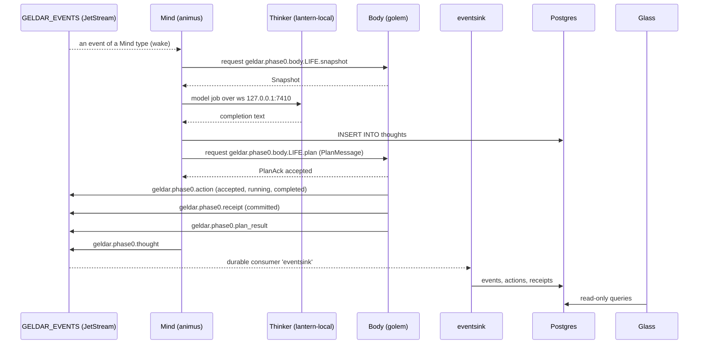

# Trace one action

In this tutorial you follow one action through Geldar: from the moment a Mind wakes, through the thought it has, the plan it sends, the Body that carries it out, the events that record it, the rows the eventsink writes, to the Glass that shows it to people. At each hop you open the file that does the work and the schema that shapes the message.

The action is a simple one, Adam mining three oak logs:

```json
{ "do": "mine", "block": "oak_log", "count": 3 }
```

**The working result.** At the end you have read every hop in the code and run the unit tests that pin each one, and they pass. You need no running shard for that. An optional last section shows how to follow the same ids through a live database; it was **not** run for this page.

**How this page was checked.** Every file, line, subject and schema named below was read at `db33805c` on 2026-11-16. The later commits up to `283d5d2d` add documents only and change no file cited here (`git diff --name-status db33805c 283d5d2d`). The test command in "Run the tests" was re-run at `283d5d2d` the same day. Nothing was started: the documentation freeze forbids it.

**Audience.** This page follows thoughts, the journal, the `thought` prompt and the Glass, so it is labelled `agents-never` ([documentation style](../agents/documentation-style.md#agents-never-learn-they-are-watched), rule 1). The label marks where the page must never be placed; contributors who work on these components still read it. Never copy, quote or link it from a prompt, skill, kit file, tool text, `identity.md`, player repo or sign. Links marked **(a-n)** go to other `agents-never` documents.

Read [your first hour](first-hour-contributor.md) first. The design behind the split between Body and Mind is in [body and mind](../concepts/body-and-mind.md); the full map of events and subjects is in [data flow and events](../architecture/data-flow-events.md).

## The whole path



`LIFE` stands for the life id: the `fast` (8B) entry of the `lives` table in `shards/phase0.yaml`, `ag_adam_04` at `283d5d2d` (line 75). Each fresh life gets a new id, so read the file rather than this page. Subjects with five tokens are request and reply and are never stored; subjects with three tokens are events in the stream (`contract/src/subjects.ts`, header comment).

In Phase 0 the Mind, the Body and the Thinker are processes on your PC, started together by `./geldar.ps1 adam up` ([decision 0050](../decisions/0050-phase0-mind-processes-run-on-the-host.md); `lantern-local/README.md` line 7). The shard from [your first shard](first-shard-on-your-machine.md) supplies NATS, Postgres, Paper and the eventsink.

## 1. The Mind wakes

Open `player-core/src/link/nats-event-source.ts`. The Mind's event feed is an ordered JetStream consumer on `GELDAR_EVENTS` (header comment, line 2). It keeps the events of its own life whose type is one the Mind cares about.

Those types are listed in `MIND_EVENT_TYPES` in `player-core/src/link/mind-event.ts` (line 21). The list starts with `wake` and includes `plan_result`, which you meet again in step 6.

The attention controller in `animus/src/attention/controller.ts` turns those events into a `WakeDecision`: a decision to think, with its reason and the events that led to it (the interface is in `player-core/src/ports/attention.ts`, line 49). The controller also coalesces and spaces wakes; the [Animus reference](../reference/animus-mind.md) covers that. The thinking loop handles one decision at a time. Open `animus/src/loop/thinking-loop.ts`: `handle` starts a cycle and `run` holds the numbered steps you follow next. The step comments in `run` are not in numeric order: 1, 2, 3, 5, "4 to 6", 8, then 7 (lines 174 to 313).

`animus` keeps the thinking loop; its older link and plan files are now stubs that forward to `player-core` (for example `animus/src/link/nats-body-link.ts`, line 1). When a path starts `player-core/`, that is the live code.

## 2. The Mind asks for a snapshot

Step 1 of `run` asks the Body what it perceives. The request goes out on `geldar.<shard>.body.<life_id>.snapshot`, built by `snapshotSubject` (`contract/src/subjects.ts` line 24) and sent by `player-core/src/link/nats-body-link.ts` (lines 75 and 76 build both of its subjects).

On the other side, open `golem/src/mind-link/server.ts`. `MindLinkServer.start` serves, among others, the snapshot subject and the plan subject for one life (lines 138 to 143). The snapshot carries a `revision`; a plan later names the revision it was built from, so the Body can refuse a plan made from an old view ([decision 0025](../decisions/0025-snapshot-revision.md)).

Schemas: `contract/schemas/snapshot-request.schema.json` and `contract/schemas/snapshot.schema.json`.

## 3. The Mind thinks

Back in `thinking-loop.ts`, the steps commented 2, 3, 5 and "4 to 6" in `run` load the agent's memory, render the `thought` prompt (line 247), set the effort and ask a model. The model call goes through the Thinker hub, a WebSocket server in `animus/src/thinker/hub.ts`. In Phase 0, `lantern-local` dials it at `ws://127.0.0.1:7410/v1/thinker/stream` and runs the job on Ollama at `127.0.0.1:11434` (`lantern-local/README.md` line 9).

The answer must be a `Thought` (`contract/schemas/thought.schema.json`). `reasoning` is required; `actions` is a list of at most six immediate steps, each chosen by its `do` verb. Our action is the `mine` variant: `block` and `count` are required. A thought that fails validation gets one corrective retry (`thinking-loop.ts`, the `first.kind === 'invalid'` branch).

`attemptThought` in `animus/src/loop/thought-attempt.ts` writes the thought to Postgres before anything is sent to the Body. The write is `INSERT INTO thoughts` in `animus/src/memory/journal.ts` (line 16). The Mind writes this table directly; no event feeds it. The thought's id is a ULID with the prefix `th_` (`ThoughtId` in `contract/schemas/common.schema.json`).

## 4. The thought becomes a plan

Open `player-core/src/loop/plan.ts`. `buildPlan` wraps the thought in a `PlanMessage` (`contract/schemas/plan.schema.json`):

- `thought_id`, `life_id` and `body_generation`;
- `source_snapshot_id` and `snapshot_revision`, from the snapshot of step 2;
- `expires_tick`: the snapshot's tick plus the configured window;
- `action_ids`: one new `ac_` id per action, in order. Our single `mine` action gets one;
- `intent_id`: only when the thought starts an intent. Ours does not, so there is none;
- `thought`: the validated thought itself.

`submitChecked` in `animus/src/loop/plan-submit.ts` refuses to send a plan that has already expired (`planExpiredBy`, line 51), then sends it as a request on `geldar.<shard>.body.<life_id>.plan` (`planSubject`, `contract/src/subjects.ts` line 33).

## 5. The Body accepts the plan

Open `golem/src/mind-link/server.ts` at `onPlan` (line 236). In order, it:

1. validates the message against the plan schema, and refuses it with `invalid_plan` if it fails;
2. replays its earlier answer if it has seen this `thought_id` before, so a redelivered plan is harmless;
3. checks the plan's life, body generation, snapshot revision, expiry and the death floor (`checkValidity`, from `golem/src/body/validity.ts`);
4. replies with a `PlanAck` (`contract/schemas/plan-ack.schema.json`): `accepted` is true exactly when `rejection` is null.

Only after the reply does it run the plan (`run`, then `executor.submit`). The Mind does not wait for the action to finish; it learns the outcome later, from an event.

## 6. The Body mines

Open `golem/src/body/executor-action.ts` at `runPlanAction`. This is where one immediate action becomes records:

1. It builds an `ActionRecord` (`contract/schemas/action-record.schema.json`) with `kind: "mine"`, the action's arguments, and the plan's snapshot fields, in state `accepted`, and hands it to the record sink.
2. It sets the state to `running` and hands it over again.
3. It runs the action. The `mine` handler is `mineAction` in `golem/src/actions/mine.ts` (line 409).
4. It writes the final receipt (`contract/schemas/receipt.schema.json`): phase `committed` if the action completed, `aborted` if not. The receipt id comes from `receiptIdFor` in `golem/src/body/derived-id.ts`, so a retry produces the same id. Every action ends with exactly one final receipt ([decision 0020](../decisions/0020-receipts.md)).
5. It sets the record's final state (`completed`, `failed` or `cancelled`), its result and its `receipt_id`, and hands both to the sink.

A `mine` action is not economic, so it writes no `prepared` receipt; only `give` does in this function.

When every action of the plan has ended, `server.ts` publishes a `plan_result` event (`contract/schemas/plan-result-event.schema.json`): the `thought_id`, each action's id and final state, and whether the thought's `say` text was spoken. That event is a Mind type (step 1), so it is how the Mind hears what became of its plan.

## 7. The records become events

Open `golem/src/body/records-nats.ts`. The sink turns each record into a `WorldEvent` (`contract/schemas/event.schema.json`) and publishes it to JetStream on `geldar.<shard>.<type>` (line 391): `geldar.phase0.action` for each action state and `geldar.phase0.receipt` for the receipt. Each event's `source_event_id`, which is also its JetStream message id, is an `ev_` id derived from the record's key (`action:<id>:<state>`, `receipt:<id>:<phase>`; `eventIdFor` in `golem/src/body/derived-id.ts`), so the stream drops a duplicate.

The Mind publishes too. When the cycle finishes, `finish` in `thinking-loop.ts` builds a `thought` event (`buildThoughtEvent` in `animus/src/loop/thought-journal.ts`, payload schema `contract/schemas/thought-event.schema.json`) and publishes it on `geldar.<shard>.thought` (`animus/src/link/nats-publisher.ts` line 43). Its `source_event_id` is the thought's ULID with the prefix `ev_`. Its `intent_id` is null here, because our thought started no intent.

All of these subjects have three tokens, so they match the stream's filter `geldar.*.*` and land in `GELDAR_EVENTS` ([decision 0041](../decisions/0041-event-export-stream-and-sink.md); `STREAM_CONFIG` in `eventsink/src/config.ts`).

## 8. The eventsink writes the rows

Open `eventsink/src/consumer.ts`. The eventsink reads the whole stream through the durable pull consumer `eventsink` (`CONSUMER_NAME`, `eventsink/src/config.ts` line 23). For each message:

1. It validates the body as a `WorldEvent` and checks the subject matches its shard and type.
2. It writes the `events` row with `INSERT ... ON CONFLICT (source_event_id) DO NOTHING` (`eventsink/src/writer.ts` lines 32 to 37), so a redelivery changes nothing. It acks only after the commit.
3. For `intent`, `action` and `receipt` events it also projects the event into the `intents`, `actions` and `receipts` tables in the same transaction (`eventsink/src/projection.ts`). A state only moves forward (accepted, running, then one final state), and a second final receipt for one action is refused.
4. A message it cannot accept goes to `geldar.<shard>.dlq`, in the same stream (`dlqSubject`, `consumer.ts` line 60).

So after our action, Postgres holds: one `thoughts` row written by the Mind; one `actions` row in state `completed`; one `receipts` row in phase `committed`; and `events` rows for each action state, the receipt, the `plan_result` and the `thought`. The tables are defined in `sql/0001_init.sql`.

Had the thought started an intent, the Body would also publish `intent` events and the sink would fill the `intents` table. The sink leaves its `thought_id` empty, since no event carries it; the Mind fills it with its own `UPDATE intents SET thought_id` once the Body accepts the plan (`animus/src/memory/journal.ts` line 62; `projection.ts` header).

## 9. People see it in the Glass

The Glass is the Thought Stream: a read-only web server that shows people what agents think and do (`glass/README.md`, first paragraph). It reads Postgres through its own role, it is for humans only, and nothing it serves feeds back into an agent's prompt or plan ([decision 0072](../decisions/0072-glass-and-bluemap-are-public.md)).

Two of its routes end our trace (`glass/README.md`, "Routes"): `GET /api/thoughts/:id` returns one thought, and `GET /api/receipts?action_id=` returns the receipts of one action. The trace ends here. How the Glass is run and governed is in the [glass and Kino](../reference/glass-and-kino.md) reference **(a-n)**.

## Run the tests

Each hop has unit tests that need no shard, no model and no network. Run the seven files that cover the plan's expiry rule, the thinking loop, the Body's server, the record sink, the sink's writer and projection, and the whole Mind end to end with fakes:

```powershell
./geldar.ps1 pnpm exec vitest run player-core/src/loop/plan.test.ts animus/src/loop/thinking-loop.test.ts golem/src/mind-link/server.test.ts golem/src/body/records-nats.test.ts eventsink/src/writer.test.ts eventsink/src/projection.test.ts animus/src/mind-e2e.test.ts
```

Output on 2026-11-16 at `283d5d2d`:

```text
 Test Files  7 passed (7)
      Tests  95 passed (95)
```

`animus/src/mind-e2e.test.ts` is worth reading as a story: twenty cycles of the real Mind over a scripted model and a fake Body, including a plan, an intent ending, two invalid outputs and a Body restart (its header comment).

To see a test guard a hop, find the assertion that pins it. `animus/src/loop/thinking-loop.test.ts` line 58 expects the plan for a one-action thought to carry exactly one action id. If you stop `buildPlan` minting an `ac_` id per action, that assertion is the one that should fail. Try it in your own worktree and restore the file afterwards. *Not tried for this page*, which edits no code. That is the repo rule in miniature: a behaviour change needs a test that fails when the change is reverted.

You have traced one action end to end and proved each hop with a passing test. That is the working result of this tutorial.

## Optional: follow the ids on a live stack

**Not run for this page.** It needs the shard, Ollama with the pinned models, and a running Mind and Body. None was started under the freeze.

1. Bring the shard up ([your first shard](first-shard-on-your-machine.md)).
2. Start Adam on the 8B tier: `./geldar.ps1 adam up --model fast`. Never do this before or during the live tests: `adam up` holds port 7410 and the live cases need it (`CLAUDE.md`, "Live runs start their own stack"). `--model` rewrites the life lines of `shards/phase0.yaml` (`tools/adam-cli/src/cli.ts` line 88); restore the committed file before any commit.
3. Define `dc` as in [your first shard](first-shard-on-your-machine.md#4-see-that-it-is-healthy). Read the `fast` life id from the `lives` table in `shards/phase0.yaml`, then find Adam's latest thoughts:

   ```powershell
   dc exec postgres psql -U geldar -d geldar -tAc "select thought_id, wake_reason, at from thoughts where life_id = '<life_id>' order by at desc limit 5"
   ```

4. Take one `th_` id and find what became of its plan:

   ```powershell
   dc exec postgres psql -U geldar -d geldar -tAc "select payload from events where type = 'plan_result' and payload->>'thought_id' = '<th_id>'"
   ```

5. Take an `ac_` id from that payload and read the action and its receipts:

   ```powershell
   dc exec postgres psql -U geldar -d geldar -tAc "select kind, state, receipt_id from actions where action_id = '<ac_id>'"
   dc exec postgres psql -U geldar -d geldar -tAc "select phase, detail from receipts where action_id = '<ac_id>'"
   ```

6. Stop Adam with `./geldar.ps1 adam down`.

## The same path for a sovereign player

A sovereign player's mind is a person's CLI session, not the Mind service. It calls the Geldar MCP server's tools, and the MCP server sends the same plan request to the same Body (`threshold/mcp/src/body-gateway.ts`; spec 4.3, last paragraph). From step 5 on, the path is the same. The MCP server also publishes one `sovereign_call` event per tool call ([data flow and events](../architecture/data-flow-events.md#producers)).

## Conflicts recorded

1. **Snapshot subject and direction.** Spec 4.3 step 2 says the Body *publishes* a snapshot on `geldar.<shard>.snapshot.<agent_id>`. The code *answers a request* on `geldar.<shard>.body.<life_id>.snapshot` (`snapshotSubject`, `contract/src/subjects.ts` line 24). [Data flow and events](../architecture/data-flow-events.md#conflicts-recorded), conflict 1, records the same gap and finds no decision that amends the spec. This page follows the code.
2. **Gateway and Allocator.** Spec 4.3 steps 3 to 6 route the model job through an Allocator and a Gateway. Neither is built; in Phase 0 the Thinker dials the Mind's loopback socket directly (`lantern-local/README.md`; [system overview](../architecture/system-overview.md#what-is-built-and-what-is-not)). This page follows the code.
3. **Order of journal write and plan.** Spec 4.3 step 6 lists "writes the thought to the journal" before "publishes the plan to the Body". The code agrees: `attemptThought` writes the `thoughts` row before `buildPlan` runs. Recorded because the `thought` *event* comes last, after the plan's ack (`finish`), and the two are easy to confuse.
4. **Audience label.** The approved plan row for this page (G03, [plan](../analysis/docs-library/plan.md#5-documents)) says `contributors`. The [documentation style](../agents/documentation-style.md#agents-never-learn-they-are-watched) rule 1 labels any document about thoughts, journals, prompts or the Glass `agents-never`, and the plan hands that question to the style rules (finding F-12, decision D9). This page follows the style rule and is labelled `agents-never`; the label restricts placement and does not change who uses the page (style sheet, audience table). It holds the Glass at the level of its public README: what it is, who it is for, two route names. The owner may overrule the label.

## Where to go next

- Every subject and who publishes it: [NATS subjects](../reference/nats-subjects.md).
- Every schema in `contract/`: [contract schemas](../reference/contract-schemas.md).
- The Body's actions, reflexes and events: [Golem](../reference/golem-body.md).
- The Mind's loop, limits and ports: [Animus](../reference/animus-mind.md).
- How the sink handles failures and dead letters: [event sink](../reference/eventsink.md).
- Every table and who writes it: [database schema](../reference/database-schema.md).
