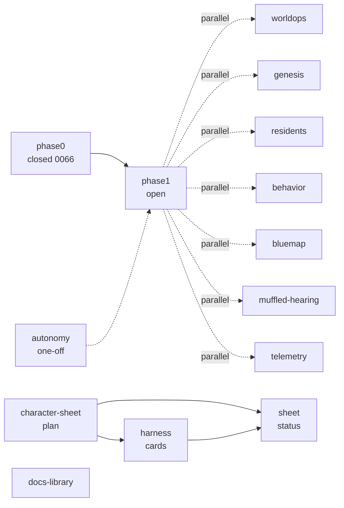

# Campaign index

Every work area under `docs/analysis/`: what it is for, which role runs it, its decision-number block, when it started and was last touched, whether it is open, closed or superseded, its key files, its successor and the decision records it produced. A second table lists the places where `RESUME.md` files, and the files they point to, disagree.

This page lists what the files say. It does not settle a disagreement; it records it. For the story of each phase read the [Phase 0 summary](phase0-summary.md) and the [Phase 1 summary](phase1-summary.md). For decisions by date or topic see the [history index](README.md).

Session labels in the analysis files are replaced here by roles (owner, orchestrator, coordinator), and agent and resident names by roles, under the [documentation style](../agents/documentation-style.md#what-never-goes-in-a-document).

## How the figures were taken

All on 2026-11-16 at `db33805c`, re-run at `dc07e3fa` with the same results, in Git Bash, read-only. Times are UTC.

```bash
export TZ=UTC
for d in docs/analysis/*/; do
  n=$(basename "$d")
  first=$(git log --diff-filter=A --format='%cd %h' --date=format-local:'%Y-%m-%d %H:%MZ' -- "$d" | tail -1)
  last=$(git log -1 --format='%cd %h' --date=format-local:'%Y-%m-%d %H:%MZ' -- "$d")
  r=""; [ -f "$d/RESUME.md" ] && r=$(git log -1 --format='%cd %h' --date=format-local:'%Y-%m-%d %H:%MZ' -- "$d/RESUME.md")
  echo "$n | first $first | last $last | RESUME $r | files $(git ls-files "$d" | wc -l)"
done
```

- "First" is the first commit that added a file in the area; "last" is the last commit that touched it.
- Decision records were counted with `git ls-files docs/decisions`: 187 records, highest number 0366. Gaps in the numbering are allowed ([decisions README](../decisions/README.md) line 5).
- Whether a decision number in a block exists was checked by file name only.

## How status was decided

| Status | Rule used on this page |
|---|---|
Apply the rules top to bottom; the first that matches gives the status.

| Status | Rule used on this page |
|---|---|
| closed | A decision record or the area's own `RESUME.md` says the campaign is closed. |
| one-off | A single report with no `RESUME.md`, no next-action list and no later commit. Counted as closed. |
| superseded | The area's own files list no next actions, and another area's `RESUME.md` carries its state. No area meets this rule on 2026-11-16. |
| open | The `RESUME.md`, ledger or card file lists next actions or open items, and nothing closes it. A qualifier in brackets says what the area is now used for. |
| open (unverified) | No file in the area records its state; the call rests on commit history only. The row says which command. |

An area with no commit for a day or more is still `open` if its last file lists next actions; the row says so. "Date the RESUME states" is the date written inside the RESUME text (a report time, a baseline or a status date), not a commit time. Nothing on this page reads the node, the database or a live service (plan decision D8).

## Summary

14 areas, 336 tracked files (`git ls-files docs/analysis | wc -l`, 2026-11-16). Ten have a `RESUME.md`.

| Area | Files | First commit | Last commit | RESUME last commit | Date the RESUME states | Status |
|---|---|---|---|---|---|---|
| [autonomy](#autonomy) | 1 | 2026-11-14 04:31Z `1e84fa64` | same | none | n/a | one-off (closed) |
| [behavior](#behavior) | 8 | 2026-11-14 21:38Z `f37d878f` | 2026-11-15 04:42Z `e6a63d2b` | 2026-11-15 04:40Z `07fca581` | report 2026-11-15 04Z | open, no commit since |
| [bluemap](#bluemap) | 2 | 2026-11-15 07:59Z `79ed5e7a` | 2026-11-15 13:55Z `bd8845be` | 2026-11-15 13:55Z `bd8845be` | 2026-11-15 14:00Z | open, nothing in flight |
| [character-sheet](#character-sheet) | 6 | 2026-11-14 12:20Z `b1ceb5f1` | same | same | baseline 2026-11-13 | open (plan source for sheet) |
| [docs-library](#docs-library) | 2 | 2026-11-16 07:39Z `1b114276` | 2026-11-16 08:24Z `d82a3368` | 2026-11-16 08:24Z `d82a3368` | 2026-11-16 | open |
| [genesis](#genesis) | 6 | 2026-11-14 16:44Z `54c32e29` | 2026-11-15 06:04Z `7aabc34c` | 2026-11-15 06:04Z `7aabc34c` | 2026-11-15 | open |
| [harness](#harness) | 46 | 2026-11-14 12:20Z `b1ceb5f1` | 2026-11-15 18:55Z `2a360627` | none | n/a | open (card store) |
| [muffled-hearing](#muffled-hearing) | 3 | 2026-11-14 18:07Z `67223c1f` | 2026-11-15 11:33Z `8c5c80fe` | none | n/a | open (unverified) |
| [phase0](#phase0) | 115 | 2026-11-09 00:26Z `8df186a4` | 2026-11-13 14:00Z `92a9ba4e` | 2026-11-11 00:21Z `cae97b5f` | 2026-11-10 | closed |
| [phase1](#phase1) | 114 | 2026-11-10 22:56Z `9ddae278` | 2026-11-15 19:52Z `2f3dee2c` | 2026-11-15 05:30Z `771a1cbd` | 2026-11-14 | open |
| [residents](#residents) | 28 | 2026-11-14 22:58Z `5bd968c6` | 2026-11-15 13:31Z `ba571dc1` | 2026-11-15 04:41Z `24da98d1` | 2026-11-15 | open |
| [sheet](#sheet) | 1 | 2026-11-14 21:58Z `b95ee7d0` | 2026-11-15 18:32Z `f9767031` | 2026-11-15 18:32Z `f9767031` | 2026-11-15 about 16:00Z | open |
| [telemetry](#telemetry) | 3 | 2026-11-16 05:14Z `e6bac767` | 2026-11-16 08:15Z `324d4192` | none | n/a | open |
| [worldops](#worldops) | 1 | 2026-11-15 04:39Z `413e4c56` | same | same | 2026-11-14 and 15 | open |

The plan's own count at `cd4499da` was 333 files and 13 areas, before `docs-library/` was committed ([plan.md](../analysis/docs-library/plan.md) section 2). The 336 above includes the two `docs-library/` files and one more `telemetry/` file.



Solid arrows are a successor or a plan-to-cards-to-status chain named in the files. Dotted arrows mean "ran alongside Phase 1"; the files do not say these areas belong to Phase 1. Many of their branches are named `phase1/...` (git log, 2026-11-16).

## Areas

### autonomy

- **Purpose.** A one-time review of the project and a staged plan for self-directed agents at scale, covering this repo and the kit repo ([review-and-plan-2026-11-14.md](../analysis/autonomy/review-and-plan-2026-11-14.md) lines 1 to 3).
- **Owner role.** Not named. The file says it was produced by read-only reviewers, research topics, interviews with live sessions and the owner, and adversarial checkers (lines 5 to 12).
- **Decision block.** None.
- **Status.** One-off, closed. Decided by: one commit (`1e84fa64`), no `RESUME.md`, no later edit.
- **Key files.** The one report. It says eleven security findings are held back from the public copy (line 14).
- **Successor.** None named.
- **Decisions produced.** None found (grep for `analysis/autonomy` in `docs/decisions/`, 2026-11-16).

### behavior

- **Purpose.** A read-only standing review of what the agents do, with timed reports and findings routed to other coordinators ([RESUME.md](../analysis/behavior/RESUME.md) lines 1 to 3; [findings.md](../analysis/behavior/findings.md)).
- **Owner role.** The behaviour-review coordinator.
- **Decision block.** 0270 to 0279 (RESUME line 1). No record in the block exists.
- **Status.** Open. The RESUME says the next report is overdue (line 4) and lists open findings F1 to F7 (line 7). No commit to the area after 2026-11-15 04:42Z.
- **Key files.** `RESUME.md`, `findings.md`, `timeline.md`, `culture.md`, `proposal-social-tool-facts.md`, `report-<date-hour>.md` (three reports).
- **Successor.** None named.
- **Decisions produced.** None in its block.

### bluemap

- **Purpose.** The public map's live chat panel, follow and freshness features, and day and night that follow the world clock ([RESUME.md](../analysis/bluemap/RESUME.md) lines 5 to 10; [day-night-design.md](../analysis/bluemap/day-night-design.md)).
- **Owner role.** The BlueMap coordinator.
- **Decision block.** 0310 to 0319; 0310 used (RESUME line 3).
- **Status.** Open. "In flight: nothing" (line 29); held and follow-up items remain (lines 31 to 35).
- **Key files.** `RESUME.md`, `day-night-design.md`.
- **Successor.** None named.
- **Decisions produced.** [0310](../decisions/0310-live-chat-panel-on-the-map.md). Related, outside its block: [0187](../decisions/0187-bluemap-skin-provider-in-geldar-core.md) and [0197](../decisions/0197-speech-bubbles-on-the-map.md) (0310 removes the 0197 feature).

### character-sheet

- **Purpose.** The plan to integrate a character-sheet brief: eleven phases, waves W0 to W12, 62 packet candidates AN-00 to AN-61 ([RESUME.md](../analysis/character-sheet/RESUME.md) lines 9 to 10; [README.md](../analysis/character-sheet/README.md)).
- **Owner role.** A planner the files do not name, at the owner's request (README line 3).
- **Decision block.** None of its own. It says 0173 to 0179 and SQL 0024 to 0033 belong to wave C7 (RESUME line 20).
- **Status.** Open, as the plan source for the sheet campaign. Decided by: its own RESUME lists next actions (lines 15 to 19), and [sheet/RESUME.md](../analysis/sheet/RESUME.md) line 3 still names `character-sheet/` as its plans. The execution state lives in the sheet RESUME, which carries merged work dated after this area's only commit; this RESUME's own status lines are stale (row 1 of [the disagreement table](#where-the-resume-files-disagree)). [Decision 0186](../decisions/0186-character-sheet-assumed-answers.md) (Proposed) treats the plan's D-CS answers as the working source.
- **Key files.** `README.md`, `integration-plan.md`, `decisions-before-packets.md`, `work-packets.md`, `codex-adapters.md`.
- **Successor.** None named. Its cards are in [harness](#harness) and its status in [sheet](#sheet).
- **Decisions produced.** [0186](../decisions/0186-character-sheet-assumed-answers.md) records its D-CS answers as assumed (Proposed).

### docs-library

- **Purpose.** This documentation library, pinned to one commit while development is frozen ([plan.md](../analysis/docs-library/plan.md); [RESUME.md](../analysis/docs-library/RESUME.md)).
- **Owner role.** The orchestrator, with writers and a reviewer per wave (RESUME, "Models").
- **Decision block.** Not stated in the RESUME. Records 0360 to 0366 came from it: 0366 was added in `db33805c` ("Docs: operations, runbooks and doc-rules decisions (W3)"), and 0360 to 0365 cite the plan or its decisions.
- **Status.** Open. The RESUME table (lines 19 to 29, last commit `d82a3368`) shows W3 "Next, Not started" and W4 to W7 not started. The RESUME lags the repo: W3 is committed as `db33805c` and merged to `main` as PR #560 (`9f1fd270`); W4 is committed as `dc07e3fa` on branch `docs/lib-w4`, not yet on `main` (`git merge-base --is-ancestor`, 2026-11-16).
- **Key files.** `plan.md`, `RESUME.md`.
- **Successor.** None.
- **Decisions produced.** [0360](../decisions/0360-documentation-metadata-block-and-sources-field.md) to [0365](../decisions/0365-docs-gates-after-the-freeze.md) (Proposed) and [0366](../decisions/0366-open-spec-5-14-watched-wording-versus-0059.md) (Open).

### genesis

- **Purpose.** Stamp a whole Geldar environment from a GitHub Actions workflow: rebuild production from nothing, a second environment and an ephemeral CI stamp ([README.md](../analysis/genesis/README.md) lines 1 to 15; [RESUME.md](../analysis/genesis/RESUME.md) line 13).
- **Owner role.** The genesis coordinator (RESUME line 9). Another coordinator wrote the README (README line 3).
- **Decision block.** 0240 to 0249 (RESUME line 8). No record in the block exists.
- **Status.** Open. Next actions G1-04 to G4 (RESUME lines 39 to 45).
- **Key files.** `README.md`, `plan.md`, `packets.md` (the ledger at its top), `RESUME.md`, `g0-02-runner-spike.md`, `g0-05-literals.md`.
- **Successor.** None.
- **Decisions produced.** [0188](../decisions/0188-genesis-environment-stamp.md), outside its block, still Proposed (RESUME line 8).

### harness

- **Purpose.** The executable cards for one Mind in the player kit with character sheets and local-model support, after the owner froze the in-house Mind on 2026-11-14 ([README.md](../analysis/harness/README.md) lines 1 to 7).
- **Owner role.** The orchestrator, under the owner's delegation (README line 9).
- **Decision block.** None in this repo. Its D-HC decisions are logged as decisions 77 and 78 in the kit repo's own register (README lines 9 and 43 to 52).
- **Status.** Open, as the card store the sheet campaign works from. Decided by: [sheet/RESUME.md](../analysis/sheet/RESUME.md) lines 3 and 14 use its cards, and commits to the area run to 2026-11-15 18:55Z. The README's own status line ("planning. No packet has been dispatched yet", line 9) is stale; see [the disagreement table](#where-the-resume-files-disagree).
- **Key files.** `README.md`, `ledger.md` (generated, 104 cards), the `work-packets-*.md` card files, `retarget-map.md`, `worknotes/`.
- **Successor.** None. Its status lives in [sheet](#sheet).
- **Decisions produced.** [0185](../decisions/0185-per-turn-record-for-kit-minds.md) (per-turn record, cards GX-05 and HC-41) and [0186](../decisions/0186-character-sheet-assumed-answers.md), both Proposed.

### muffled-hearing

- **Purpose.** Speech heard by effective distance through blocks, with a words-free muffled notice beyond it ([packets.md](../analysis/muffled-hearing/packets.md); [mh7-owner-summary.md](../analysis/muffled-hearing/mh7-owner-summary.md)).
- **Owner role.** Split by card across three coordinators and the owner (packets.md lines 47 to 126). No single campaign owner is named.
- **Decision block.** None stated; the record is [0199](../decisions/0199-muffled-hearing.md).
- **Status.** Open (unverified). No file in the area records which cards are done; `packets.md` has no status lines. `git log --grep` on 2026-11-16 finds commits in HEAD's history for MH-7, MH-CH, MH-1, MH-2, MH-3 and MH-8a, and no commit naming MH-5, MH-6 or MH-8b. MH-4 appears only in a card edit (`8c5c80fe`). 0199 is still Proposed.
- **Key files.** `packets.md`, `mh7-owner-summary.md`, `mh-ch-node-step.md`.
- **Successor.** None.
- **Decisions produced.** 0199 (Proposed).

### phase0

- **Purpose.** Phase 0, "Adam": one living agent on one machine (spec section 10; [README.md](../analysis/phase0/README.md) lines 1 to 3).
- **Owner role.** The campaign orchestrator; the owner closed it ([retro/campaign.md](../analysis/phase0/retro/campaign.md) line 3).
- **Decision block.** None as a block: records 0001 to 0068 were written during it (55 files; 0007 to 0019 are unused numbers). Records 0033 to 0036 came from a side track in the kit repo's mock world (README, cross-packet notes).
- **Status.** Closed, by [decision 0066](../decisions/0066-phase0-closed-as-proof-of-life.md) on 2026-11-10 ([RESUME.md](../analysis/phase0/RESUME.md) line 5).
- **Key files.** `RESUME.md`, `README.md` (ledger), `known-gaps.md` (the Phase 1 backlog), `bench-results.md` and `bench-runs/`, `retro/`, `overnight-decisions.md`, `adam-run-*.md`, `worknotes/`.
- **Successor.** [phase1](#phase1) (RESUME line 38; [decision 0070](../decisions/0070-phase1-is-the-colo-first-shard.md)).
- **Decisions produced.** 0001 to 0068, closing with 0066. The story is in the [Phase 0 summary](phase0-summary.md).

### phase1

- **Purpose.** Phase 1 redefined as the colo-first shard: the final Colo environment, reachable from the internet without a VPN, invite-only and not announced ([decision 0070](../decisions/0070-phase1-is-the-colo-first-shard.md); [RESUME.md](../analysis/phase1/RESUME.md) line 7).
- **Owner role.** The orchestrator, which writes no code; coders per packet; ops merges and runs; the owner confirms decisions (RESUME lines 43 to 49).
- **Decision block.** 0081 to 0129 for waves C1 to C4 ([decision-number-registry.md](../analysis/phase1/packets/decision-number-registry.md)); pre-packet 0076 to 0080; "after block" numbers from 0130; 0170 to 0179 for wave C7; 0260 to 0269 an owner block (registry line 167).
- **Status.** Open. No record closes it; the RESUME lists open items (lines 72 to 85).
- **Key files.** `RESUME.md`, `plan.md`, `ledger.md`, `packet-conventions.md`, `phase0-retrospective-for-phase1.md`, `packets/`, `retro/wave-c7-1.md`, `retro/wave-c7-2.md`, `worknotes/`.
- **Successor.** None yet.
- **Decisions produced.** In 0069 to 0129: 30 records. In 0130 to 0179: 41 records. The owner block holds 0260 to 0262. Records 0180 to 0239 (32) and 0330 to 0341 were written in the same period on `phase1/...` branches, but the registry has no row above 0180 (RESUME line 18), so no file attributes them to a campaign. The story is in the [Phase 1 summary](phase1-summary.md).

### residents

- **Purpose.** Add a few residents whose own lives bring needs and pulls into the world without steering other agents ([charter.md](../analysis/residents/charter.md) lines 1 to 7).
- **Owner role.** The residents coordinator.
- **Decision block.** 0300 to 0309 (charter line 3). No record in the block exists.
- **Status.** Open. A standing owner instruction to start each held resident as its Body verb ships ([RESUME.md](../analysis/residents/RESUME.md) line 11).
- **Key files.** `RESUME.md`, `charter.md`, `log.md`, `start-checklist.md`, `capability-gaps.md`, `persona-split.md`, `notes-for-owner.md`, a skins note, `personas/` (ten persona folders).
- **Successor.** None.
- **Decisions produced.** None in its block.

### sheet

- **Purpose.** The execution status of the character-sheet and psyche work: what merged, what is next, what stays inert ([RESUME.md](../analysis/sheet/RESUME.md)).
- **Owner role.** The sheet coordinator (RESUME line 2).
- **Decision block.** 0280 to 0289, then 0320 to 0329; 0280 to 0282 used. SQL 0050 to 0052 used (RESUME line 2).
- **Status.** Open. An owner ruling holds every sheet feature off the live server until the whole campaign is complete (RESUME line 6); next steps at lines 16 to 21.
- **Key files.** `RESUME.md` only; plans in [character-sheet](#character-sheet), cards in [harness](#harness) (line 3).
- **Successor.** None.
- **Decisions produced.** [0280](../decisions/0280-proficiency-contract-and-state-subjects.md), [0281](../decisions/0281-psyche-package-boundary.md), [0282](../decisions/0282-sheet-erasure-covers-dead-lives.md).

### telemetry

- **Purpose.** The design of the telemetry collector and its ingest route. Operator-only, at the level of [decision 0350](../decisions/0350-telemetry-scope-and-full-capture.md) ([decision 0361](../decisions/0361-agents-never-placement-and-public-detail.md) point 3).
- **Owner role.** Not named in the area's files. Owner rulings are relayed by a coordinator ([caddy-ingest-route.md](../analysis/telemetry/caddy-ingest-route.md) lines 3 and 5).
- **Decision block.** None stated; records 0350 to 0352.
- **Status.** Open. [collector-design.md](../analysis/telemetry/collector-design.md) lists items "Still open, for the owner" (line 231). Its line 3, "design only ... Nothing here is built, merged or switched on", covers the collector only: the top-level `telemetry/` package (29 tracked files) merged as PR #551 (`6cf3c957`, 2026-11-16 06:08Z). See [other conflicts](#other-conflicts-found-while-indexing), row 5.
- **Key files.** `collector-design.md`, `collector-options.md`, `caddy-ingest-route.md`.
- **Successor.** None.
- **Decisions produced.** [0350](../decisions/0350-telemetry-scope-and-full-capture.md) (Accepted), [0351](../decisions/0351-paper-telemetry-plugin-scope.md) (Proposed), [0352](../decisions/0352-telemetry-dedicated-clickhouse-database.md) (Accepted). The [telemetry pipeline](../architecture/telemetry-pipeline.md) page covers the design.

### worldops

- **Purpose.** Live Colo shard operations and measurement; docs and tools only in the repo ([RESUME.md](../analysis/worldops/RESUME.md) line 3).
- **Owner role.** The world-operations coordinator, working through ops agents (lines 3 and 6).
- **Decision block.** 0250 to 0259; 0250 used (line 3).
- **Status.** Open. Six open items and two items parked for the owner (lines 22 to 32).
- **Key files.** `RESUME.md` only. Its runbooks live in `docs/runbooks/` (line 17).
- **Successor.** None.
- **Decisions produced.** [0250](../decisions/0250-skin-upload-visibility-and-export.md). [0339](../decisions/0339-journal-reset-one-time-exception.md) records a one-time step the world-operations session ran under the owner's order (0339, decision text); see [world-operations exceptions](../concepts/world-operations-exceptions.md).

## Where the RESUME files disagree

Each row cites both sides. "Later" means the later commit by the dates above. A later file is not proof that it is right.

| # | Topic | One side | Other side | Note |
|---|---|---|---|---|
| 1 | Has the sheet work started? | [character-sheet/RESUME.md](../analysis/character-sheet/RESUME.md) line 4: "no dispatch"; line 12: no product code changed (2026-11-14 12:20Z). [harness/README.md](../analysis/harness/README.md) line 9: "No packet has been dispatched yet" (last commit 2026-11-14 14:35Z, `b2d022c1`) | [sheet/RESUME.md](../analysis/sheet/RESUME.md) lines 9 to 13: AN-02a to AN-11b and others merged (2026-11-15 18:32Z) | The sheet RESUME is later. The two earlier status lines were never updated. |
| 2 | Review once per packet or once per wave | [character-sheet/RESUME.md](../analysis/character-sheet/RESUME.md) line 31: current AGENTS requires each packet reviewed; [AGENTS.md](../../AGENTS.md) line 23 says the same | [phase0/RESUME.md](../analysis/phase0/RESUME.md) line 34: "reviews and live tests once per wave at its end" (owner ruling in force) | The character-sheet RESUME names the conflict and leaves it to AN-00. No record settles it. |
| 3 | Is the Phase 0 retro written? | [phase1/RESUME.md](../analysis/phase1/RESUME.md) line 85: phase0 RESUME "still says the campaign retro is pending" | [phase0/RESUME.md](../analysis/phase0/RESUME.md) line 7: "The campaign retro is written" | The Phase 1 line is stale; the retro exists (`retro/campaign.md`). |
| 4 | Next free decision number | [phase0/RESUME.md](../analysis/phase0/RESUME.md) line 38: 0130 | [phase1/RESUME.md](../analysis/phase1/RESUME.md) line 18: 0199, checked 2026-11-14; its line 38 says "next free 0147" was true on 2026-11-11 only | Both are stale: the highest record at `dc07e3fa` is 0366. Numbers are now reserved per coordinator block (rows above). |
| 5 | Which commit passed the 20 TPS benchmark last | [phase0/RESUME.md](../analysis/phase0/RESUME.md) line 7: "last full pass 403a9cc and 98d5394" | [bench-results.md](../analysis/phase0/bench-results.md) has no row for either; the retro and a worknote name other commits | Four accounts in all. The commit-by-commit table is in the [Phase 0 summary](phase0-summary.md#passes-reported-but-not-recorded-in-the-table). |
| 6 | Which residents may start | [residents/RESUME.md](../analysis/residents/RESUME.md) line 9: hold every resident except the first two | [worldops/RESUME.md](../analysis/worldops/RESUME.md) line 19 and [behavior/RESUME.md](../analysis/behavior/RESUME.md) line 4: two more residents' Bodies and Minds started 2026-11-15 between 03:41Z and 03:50Z. [residents/log.md](../analysis/residents/log.md) line 33: those two were released once their verbs were live, and a further resident started on 2026-11-15 | The log (last commit 13:31Z) is later than the residents RESUME (04:41Z). The RESUME was not updated. |
| 7 | Deploy windows | [genesis/RESUME.md](../analysis/genesis/RESUME.md) line 28: nothing reaches the live node outside a coordinator's deploy window | [worldops/RESUME.md](../analysis/worldops/RESUME.md) line 26: "no deploy windows"; [runbooks/merge-queue.md](../runbooks/merge-queue.md) line 144: "There are no deploy windows (owner ruling" | Unresolved here. [Decision 0220](../decisions/0220-merge-queue-for-main.md) (Proposed) covers the merge queue. |
| 8 | Which phase is current | [CLAUDE.md](../../CLAUDE.md) line 3: "Current work is Phase 0 ... read its `RESUME.md` first"; [AGENTS.md](../../AGENTS.md) line 8 points at the Phase 0 RESUME | [phase0/RESUME.md](../analysis/phase0/RESUME.md) line 5: closed by 0066; [phase1/RESUME.md](../analysis/phase1/RESUME.md) lines 7 to 12 | Also recorded in [time, shards and phases](../concepts/time-shards-and-phases.md). |
| 9 | When Phase 1 ends | [Decision 0070](../decisions/0070-phase1-is-the-colo-first-shard.md) point 4: "The phase closes at wave C2's exit" | [phase1/RESUME.md](../analysis/phase1/RESUME.md) line 7: "Phase 1 ends when the exit run in the plan passes"; [plan.md](../analysis/phase1/plan.md) section (e): C4's exit check is the spec's Phase 1 exit | Not a RESUME-to-RESUME conflict, but the RESUME and its decision disagree. |
| 10 | Owner and agent caps | [phase0/RESUME.md](../analysis/phase0/RESUME.md) line 14: 3 in the spec against 20 in [0052](../decisions/0052-per-owner-sovereign-player-cap-raised-to-20.md) | [phase1/RESUME.md](../analysis/phase1/RESUME.md) line 73: per-owner cap 3 on auto-roster, global cap 40 ([0261](../decisions/0261-open-signup-player-host-bodies-and-auto-roster.md)). [worldops/RESUME.md](../analysis/worldops/RESUME.md) line 18: owner cap raised 9 to 15. [residents/RESUME.md](../analysis/residents/RESUME.md) lines 5 and 9: "cap 15, 11 used"; "cap about 20" needed | The files do not say whether these are the same cap. Unresolved here. |
| 11 | Wave C2 progress | [phase1/RESUME.md](../analysis/phase1/RESUME.md) line 27: C2-00 to C2-06 and others merged (PRs #79 to #99) | [phase1/ledger.md](../analysis/phase1/ledger.md): C2 rows read "planned" or "in progress (2026-11-11)"; header "Status as of 2026-11-11" (last commit 2026-11-15 19:26Z, `4a13e8e4`) | The ledger's C2 rows were not updated when the RESUME was. |
| 12 | Soak length | [phase1/RESUME.md](../analysis/phase1/RESUME.md) line 84: the C3 cards and the plan disagree; O-soak listed as open (file last committed 2026-11-15 05:30Z) | [Decision 0130](../decisions/0130-phase1-owner-rulings-for-c1.md) line 29 (Accepted, 2026-11-10): one 7-day soak at the end of the phase, the 72-hour gate withdrawn. [c3-packets.md](../analysis/phase1/packets/c3-packets.md) lines 116 and 433 and [c4-packets.md](../analysis/phase1/packets/c4-packets.md) line 459 agree with 0130 | The RESUME line is stale against 0130 and the cards. |

## Other conflicts found while indexing

| # | Conflict | Evidence |
|---|---|---|
| 1 | The spec was edited for muffled hearing while 0073 says agents never edit it. | Commit `66f3f196` (2026-11-14 20:29Z, "MH-7 spec amendment for muffled hearing (proposed, owner approval)"), merged as PR #371 (`06836991`). [Decision 0073](../decisions/0073-spec-is-never-edited.md) point 1. [0199](../decisions/0199-muffled-hearing.md) is still Proposed. The repo does not show who approved the merge. |
| 2 | The spec describes public map speech bubbles; 0310 removed them. | `docs/spec.md` line 666 (after `66f3f196`): "The public map's speech bubbles show all speech to human observers by design". [bluemap/RESUME.md](../analysis/bluemap/RESUME.md) line 6: "Bubbles removed"; [0310](../decisions/0310-live-chat-panel-on-the-map.md). The BlueMap RESUME lists the spec and 0199 wording as "Not ours" (line 35). |
| 3 | The Phase 0 campaign retro says `known-gaps.md` does not exist yet. | [retro/campaign.md](../analysis/phase0/retro/campaign.md) line 117. `known-gaps.md` was added in `ac508760` at 2026-11-10 19:04Z, the same minute as the retro's first commit `81e68976`. |
| 4 | Three decision blocks have no records. | Genesis 0240 to 0249, behaviour 0270 to 0279, residents 0300 to 0309 (file names, 2026-11-16). Genesis's own record is 0188, outside its block. |
| 5 | The telemetry design says nothing is built or merged; a telemetry package is merged. | [collector-design.md](../analysis/telemetry/collector-design.md) line 3 (written 2026-11-15, aligned 2026-11-16). `git ls-files telemetry` lists 29 files; PR #551 (`6cf3c957`, branch `phase1/telemetry-t03-package`) merged them 2026-11-16 06:08Z (`git log --first-parent --grep=telemetry`). The design's sentence may mean the collector only; the file does not say. |

## Areas without a RESUME

`autonomy`, `harness`, `muffled-hearing` and `telemetry` have no `RESUME.md`. [plan.md](../analysis/docs-library/plan.md) finding F-9 says nine areas had one at `cd4499da`; with `docs-library/` committed there are ten (`git ls-files docs/analysis | grep RESUME.md`, 2026-11-16).

## Related

- [Phase 0 summary](phase0-summary.md), [Phase 1 summary](phase1-summary.md).
- [Decisions index](../decisions/README.md); by date: [decision timeline](decision-timeline.md); by topic: [decisions by topic](../reference/decisions-by-topic.md).
- [World-operations exceptions](../concepts/world-operations-exceptions.md), for 0339 and the 2026-11-15 cutover.
- The [doc-update map](../agents/doc-update-map.md) row "A campaign opens or closes" points here.
