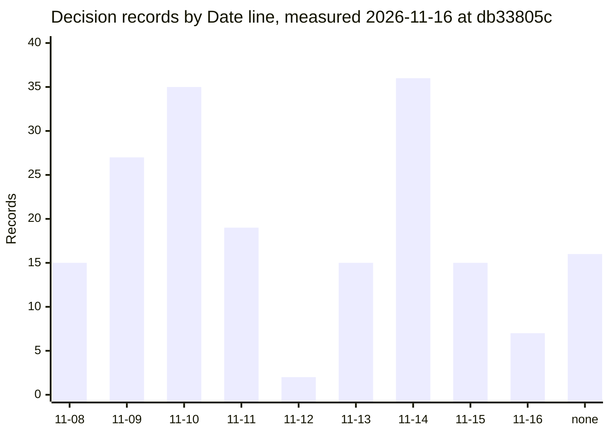

# Decision timeline

Every decision record under `docs/decisions/` in date order, grouped by phase and week, with a one-line outcome and a topic tag. It shows what was settled when, and so the shape of the project. It does not restate the records: follow the number to read one. For the records grouped by component, see [decisions by topic](../reference/decisions-by-topic.md). For the records a later one superseded, amended or limited, see [superseded and reversed](superseded-and-reversed.md).

All counts on this page were measured on 2026-11-16 at commit db33805c and re-checked at `dc07e3fa`, which changes only `docs/security/`.

## At a glance

- **187 records**, numbered 0001 to 0366 with gaps (`git ls-files docs/decisions`, files matching `NNNN-`). The index in [`docs/decisions/README.md`](../decisions/README.md) has 187 rows.
- **Nine days.** The earliest Date line is 2026-11-08, the latest 2026-11-16.
- **Two phases.** Phase 0 ("Adam") ran from 2026-11-08 to 2026-11-10 and was closed by [0066](../decisions/0066-phase0-closed-as-proof-of-life.md) as proof of life, with the spec's exit criteria waived by the owner. Phase 1, the colo-first shard, was defined by [0070](../decisions/0070-phase1-is-the-colo-first-shard.md) the same day ([phase 0 RESUME](../analysis/phase0/RESUME.md) line 5 records the closure). No record ends Phase 1. The root `CLAUDE.md` still says current work is Phase 0 (see [conflicts](#conflicts-and-gaps)).
- **Three ISO weeks.** 2026-11-08 is a Sunday (ISO week 45); 2026-11-09 to 2026-11-15 is week 46; 2026-11-16 is the Monday of week 47 (`[System.Globalization.ISOWeek]::GetWeekOfYear`).

## How the dates were derived

Each record's date is its own `Date:` line, read with this command (PowerShell 7, repo root):

```powershell
foreach ($f in git ls-files docs/decisions | Where-Object { $_ -match '/\d{4}-' }) {
  $n = (Split-Path $f -Leaf).Substring(0, 4)
  $d = Select-String -Path $f -Pattern '^\s*(-\s*)?\**Date\**:\**\s*(\d{4}-\d{2}-\d{2})' -List
  $date = if ($d) { $d.Matches[0].Groups[2].Value } else { '(no Date line)' }
  $added = git log --diff-filter=A --format=%ad --date=short -- $f | Select-Object -Last 1
  "$n $date $added"
}
```

The second date is the day git first saw the file, in the committer's time zone. It is shown only for records with no Date line.

### Records with no Date line

16 records have no `Date:` line at the start of a line: 0088, 0095, 0100, 0101, 0133, 0134, 0135, 0136, 0138, 0139, 0140, 0147, 0148, 0149, 0214 and 0250. Most of them write `Status:` as a bare line and skip the template's list form ([decisions README](../decisions/README.md) lines 7 to 17).

- **0135 is a special case.** Its header lines are run together onto the first line of the file (7 line feeds in 8,191 bytes, measured with `[IO.File]::ReadAllBytes`). The text `- Date: 2026-11-11` is there, mid-line, so this page places it on 2026-11-11.
- **The other 15 are truly dateless.** This page places each one on the day git first added it, marked *no Date line* in the tables. That date is an inference from git, not a record's own claim.

### Where the Date line and git disagree

The Date line is when the record was written. Three things make dates and numbers disagree:

- **A later ruling date in the Status.** [0075](../decisions/0075-glass-is-a-lakitu-camera.md) and [0077](../decisions/0077-invitee-auth-and-the-0072-0075-login-rule.md) are dated 2026-11-10 and accepted 2026-11-11; [0145](../decisions/0145-agent-names-need-line-of-sight-and-proximity.md) is dated 2026-11-11 and accepted 2026-11-12; [0282](../decisions/0282-sheet-erasure-covers-dead-lives.md) is dated 2026-11-14 with an owner ruling of 2026-11-15; [0352](../decisions/0352-telemetry-dedicated-clickhouse-database.md) is dated 2026-11-15 with a ruling relayed 2026-11-16. This page places each on its Date line.
- **A one-day skew against git.** Seven records carry a Date one day after git first added them (0029 to 0032, 0160, 0167, 0262). The likely cause is the committer's time zone against a UTC Date line (inferred, not checked).
- **Numbers out of date order.** 0058 to 0060 (2026-11-09) are a day older than the lower-numbered 0053 to 0057 (2026-11-10). 0130 to 0132 (2026-11-10) are three days older than the lower-numbered 0108 (2026-11-13). 0262 (2026-11-15) is a day newer than the higher-numbered 0280 to 0310 (2026-11-14). The decisions README lets parallel sessions pick numbers well apart (line 5), which explains the gaps and the blocks (0130, 0160, 0180, 0210, 0250, 0260, 0280, 0310, 0330, 0350, 0360).

## The shape of the project

Records per Date line (the "none" bar is the 16 records above):



Status by Date line, from the leading word of each record's Status line (command in [superseded and reversed](superseded-and-reversed.md#status-vocabulary)):

| Date | Records | Accepted | Accepted provisionally | Decided | Proposed | Open | Superseded |
|---|---|---|---|---|---|---|---|
| 2026-11-08 | 15 | 15 | | | | | |
| 2026-11-09 | 27 | 27 | | | | | |
| 2026-11-10 | 35 | 22 | 6 | | 6 | | 1 |
| 2026-11-11 | 19 | 3 | | 5 | 9 | 1 | 1 |
| 2026-11-12 | 2 | | | 1 | 1 | | |
| 2026-11-13 | 15 | 8 | | 4 | 3 | | |
| 2026-11-14 | 36 | 15 | | 5 | 16 | | |
| 2026-11-15 | 15 | 3 | | 11 | 1 | | |
| 2026-11-16 | 7 | | | | 6 | 1 | |
| no Date line | 16 | 12 (two "in part" or "in principle") | | | 4 | | |

What the shape says:

1. **Foundations first (2026-11-08).** The toolchain, the contract, receipts and one database per shard. Every record that day is Accepted.
2. **Phase 0 Body and Mind (2026-11-09).** Body rules found by the benchmark, decisions made overnight by the orchestrator for owner review (0032, 0037 to 0039), records relayed from the Scriptorium repo (0036, 0042, 0044 to 0046), and the wave 5 Mind questions (0047 to 0051). Still all Accepted.
3. **The pivot (2026-11-10).** The busiest day for scope. Phase 0 closes (0066) and Phase 1 is defined (0070) on the same date. Public endpoints, backups, NATS auth, the spec-edit rule (0073) and the first Colo infrastructure records follow. The first Proposed and provisional statuses appear here.
4. **Public surfaces and sign-up (2026-11-11).** Public MCP, Caddy sites, the spectator proxy (0137), registration (0135), bans, skins, legal text (0153, 0155) and perception rules (0154). "Decided" appears as a status word for the first time.
5. **A lull (2026-11-12).** Two records.
6. **World rules and owner management (2026-11-13).** Pathing, shelter, block ownership, owner keys, erasure (0171).
7. **Body survival peak (2026-11-14).** The busiest day overall: sleep, eat, reflexes, swimming, the character sheet, open sign-up (0261) and the host helper (0260). 16 of 36 are Proposed, most by an implementer awaiting the owner.
8. **Fixes and telemetry (2026-11-15).** Stuck-Body and drowning fixes (0330 to 0341), the one-time journal reset (0339), account deletion of dead lives (0262), telemetry (0350 to 0352). Mostly Decided.
9. **Documentation freeze (2026-11-16).** Seven records from the docs-library campaign, all Proposed or Open.

## Topic tags

| Tag | Covers |
|---|---|
| `body` | Golem actions, pathing, reflexes, sleep, eating, swimming |
| `mind` | The Mind (animus), prompts, models, the Thinker |
| `mcp` | The sovereign and public MCP, its tools and results |
| `kit` | The player kit, launcher and harnesses (sibling repos), filed here |
| `world` | The Paper plugin, gamerules, chat, the map, skins, gravestones |
| `perception` | What the Mind and Body may see, hear and name |
| `character` | Persona files, the psyche engine, the character sheet |
| `data` | Database, receipts, events, records, migrations |
| `infra` | Compose, deploy, NATS, ports, ingress, backups, containers |
| `identity` | Owners, registration, tokens, keys, bans, erasure |
| `legal` | Terms, privacy and consent |
| `economy` | Credits and budgets |
| `observation` | Human observation surfaces, named at index-title level only (decision [0361](../decisions/0361-agents-never-placement-and-public-detail.md)) |
| `telemetry` | Telemetry, at the level of the index titles and decision 0350 only |
| `process` | Repo rules, toolchain, phases, CI |
| `docs` | The documentation library |

A tag is this page's reading of the record's title and Spec line; the records carry no tags of their own.

In the tables below, the Status column starts with the leading word of the record's own Status line. A note in brackets after it, such as "(in part superseded by 0160)" on 0031, comes from the record's body, not from its Status line. [Superseded and reversed](superseded-and-reversed.md) covers these chains.

## Phase 0: Adam (2026-11-08 to 2026-11-10)

Phase 0 is every record numbered below 0070. That boundary is inferred from 0066 (Phase 0 closed, 2026-11-10) and 0070 (Phase 1 defined, 2026-11-10); records 0068 and 0069 name fix packets ("fix-c", "fix-perception") in their Status lines; whether those packets ran before or after the closure was not checked, so they are placed here by number.

### Week 45: Sunday 2026-11-08 (15)

| # | Outcome | Tag | Status |
|---|---|---|---|
| [0001](../decisions/0001-contract-json-schema.md) | The contract is JSON Schema with code generation | process | Accepted |
| [0002](../decisions/0002-phase0-host-and-models.md) | Phase 0 runs on the owner's Windows PC with Ollama, Qwen3 32B and 8B | mind | Accepted |
| [0003](../decisions/0003-task-runner.md) | `geldar.ps1` is the task runner, not `make` | process | Accepted |
| [0004](../decisions/0004-phase0-repo-layout.md) | Phase 0 code lives in one repo | process | Accepted |
| [0005](../decisions/0005-pinning-and-security-updates.md) | Exact pins, two-week minimum age, security updates only | process | Accepted |
| [0006](../decisions/0006-typescript-toolchain.md) | pnpm, TypeScript 7, Biome and Vitest | process | Accepted |
| [0020](../decisions/0020-receipts.md) | Every action gets a receipt; economic actions get two | data | Accepted |
| [0021](../decisions/0021-velocity-from-phase0.md) | Velocity bot ingress from Phase 0, matching production | infra | Accepted |
| [0022](../decisions/0022-minecraft-26-1.md) | Minecraft 26.1 and the pinned body stack | world | Accepted |
| [0023](../decisions/0023-skill-foreign-keys.md) | Books and the skill library point at one edition of a skill | data | Accepted |
| [0024](../decisions/0024-gamerules-26-1.md) | Gamerule names on 26.1 are snake_case | world | Accepted |
| [0025](../decisions/0025-snapshot-revision.md) | Snapshots and action records carry a revision | data | Accepted |
| [0026](../decisions/0026-one-database-per-shard.md) | One database per shard in Phase 0 | data | Accepted |
| [0027](../decisions/0027-final-receipt-constraints.md) | The database enforces one final receipt per action | data | Accepted |
| [0028](../decisions/0028-model-names.md) | Phase 0 names models by their Ollama tag | mind | Accepted |

### Week 46: Monday 2026-11-09 (27)

| # | Outcome | Tag | Status |
|---|---|---|---|
| [0029](../decisions/0029-rcon-reply-framing.md) | RCON replies end on a quiet period | infra | Accepted |
| [0030](../decisions/0030-world-time-ticks.md) | `world_time.ticks` is the world age; an unnamed biome is omitted | data | Accepted |
| [0031](../decisions/0031-place-at-feet.md) | `place ... at: "feet"` is the cell the feet are in | body | Accepted (in part superseded by 0160) |
| [0032](../decisions/0032-table-crafting-and-recipe-book.md) | Crafting goes through the recipe book; the shard unlocks recipes | world | Accepted (item 2 superseded by 0048) |
| [0033](../decisions/0033-mock-wake-and-interest-vocabulary.md) | The mock's wake and interest vocabulary is provisional | mcp | Accepted (provisional) |
| [0034](../decisions/0034-mock-result-shapes-and-untrusted-text.md) | Mock result shapes and the untrusted-text wrapper | mcp | Accepted (provisional) |
| [0035](../decisions/0035-mcp-tool-schema-shapes.md) | MCP tool schema shapes (`write_book`, `outputSchema`) | data | Accepted |
| [0036](../decisions/0036-launcher-workspace-named-volume.md) | The launcher keeps the player workspace in a named volume | kit | Accepted |
| [0037](../decisions/0037-chest-transfers-by-explicit-clicks.md) | Chest transfers are an explicit, server-confirmed click sequence | body | Accepted |
| [0038](../decisions/0038-tick-rate-does-not-slow-a-client-driven-body.md) | `/tick rate` does not slow a Mineflayer-driven Body | body | Accepted |
| [0039](../decisions/0039-pathing-forbids-corner-cutting.md) | Pathing forbids diagonal moves that cut a block corner | body | Accepted |
| [0040](../decisions/0040-bot-ingress-registry-in-nats-kv.md) | The bot-ingress gate reads a NATS KV registry and fails closed | infra | Accepted |
| [0041](../decisions/0041-event-export-stream-and-sink.md) | Events go to one JetStream stream; the sink dead-letters | data | Accepted |
| [0042](../decisions/0042-path-rule-case-folded-identity-prefix.md) | The session path rule never allows `memory/identity.md/` as a prefix | kit | Accepted |
| [0043](../decisions/0043-phase0-body-state-in-nats-kv-and-record-rules.md) | Body checkpoints in NATS KV; record rules for intents and receipts | data | Accepted |
| [0044](../decisions/0044-malicious-book-corpus-world-side.md) | The malicious-book corpus: world side in the mock | kit | Accepted |
| [0045](../decisions/0045-live-malicious-book-check-is-local-only.md) | The live malicious-book check is local only | kit | Accepted |
| [0046](../decisions/0046-scripted-stub-cli-stands-in-for-the-vendor-cli-in-ci.md) | A scripted stub CLI stands in for the vendor CLI in CI | kit | Accepted |
| [0047](../decisions/0047-thinking-time-comes-from-intents-and-waits-not-dilation.md) | Thinking time comes from intents, waits and reflexes, not dilation | mind | Accepted |
| [0048](../decisions/0048-recipe-discovery-is-part-of-the-game.md) | Recipe discovery is part of the game; no recipe-book grant | world | Accepted |
| [0049](../decisions/0049-thinker-job-gets-response-format-and-reasoning.md) | The Thinker job frame gains `response_format` and `reasoning` | mind | Accepted |
| [0050](../decisions/0050-phase0-mind-processes-run-on-the-host.md) | In Phase 0 the Mind, Thinker and Adam's Body are host processes | mind | Accepted |
| [0051](../decisions/0051-adam-identity-and-model-pins.md) | Adam's identity and the Phase 0 model pins | mind | Accepted |
| [0052](../decisions/0052-per-owner-sovereign-player-cap-raised-to-20.md) | Owner's sovereign-player cap raised to 20 | mcp | Accepted |
| [0058](../decisions/0058-the-character-knowledge-boundary-and-thought-v2.md) | Characters honour in-world knowledge; thought prompt v2 | mind | Accepted |
| [0059](../decisions/0059-identity-mode-is-about-human-observation-not-agent-belief.md) | `identity_mode` governs whether humans may observe a shard | observation | Accepted |
| [0060](../decisions/0060-persona-size-limits.md) | Persona files are not artificially size-limited | character | Accepted |

### Week 46: Tuesday 2026-11-10, Phase 0 records (14)

| # | Outcome | Tag | Status |
|---|---|---|---|
| [0053](../decisions/0053-public-mcp-through-an-outbound-tunnel-deferred.md) | The sovereign MCP is loopback-only for now | mcp | Superseded by 0071 |
| [0054](../decisions/0054-static-hashed-per-player-bearer-tokens.md) | Static, hashed, per-player Bearer tokens, not OAuth 2.1 | mcp | Accepted |
| [0055](../decisions/0055-phase0-sovereign-tool-subset-and-mappings.md) | The sovereign MCP serves the frozen 14-tool vocabulary | mcp | Accepted |
| [0056](../decisions/0056-first-migration-runner-and-least-privilege-grants.md) | First migration runner and least-privilege MCP grants | data | Accepted |
| [0057](../decisions/0057-sovereign-budget-numbers-and-wake-spacing.md) | Sovereign budget numbers, rate limits and wake spacing | economy | Accepted |
| [0061](../decisions/0061-phase-0-exit-criteria-readings.md) | Readings of the Phase 0 exit criteria | process | Accepted provisionally |
| [0062](../decisions/0062-no-settled-credits-in-phase-0.md) | No settled-credits value reaches the reflection | economy | Accepted provisionally |
| [0063](../decisions/0063-phase-0-has-no-stuck-signal.md) | Phase 0 has no `stuck` signal | body | Accepted provisionally |
| [0064](../decisions/0064-exit-run-lives.md) | The exit runs use fresh lives and volumes | process | Accepted provisionally |
| [0065](../decisions/0065-damage-wakes-the-mind.md) | Damage wakes the Mind when no intent is running | mind | Accepted provisionally |
| [0066](../decisions/0066-phase0-closed-as-proof-of-life.md) | Phase 0 closed as proof of life; exit criteria waived | process | Accepted |
| [0067](../decisions/0067-nats-accounts-and-least-privilege.md) | NATS accounts and least-privilege users, opt-in | infra | Accepted provisionally |
| [0068](../decisions/0068-prompt-v4-and-agent-visible-text.md) | Agent-read text never says it is watched; prompt v4; templates immutable | mind | Proposed |
| [0069](../decisions/0069-no-plan-wake-is-not-a-failure.md) | A no_plan wake is neutral, not a failed intent | mind | Accepted |

## Phase 1: the colo-first shard (2026-11-10 onward)

### Week 46: Tuesday 2026-11-10, Phase 1 records (21, plus 2 with no Date line)

| # | Outcome | Tag | Status |
|---|---|---|---|
| [0070](../decisions/0070-phase1-is-the-colo-first-shard.md) | Phase 1 is the colo-first shard, invite-only, not announced | process | Accepted |
| [0071](../decisions/0071-public-endpoints-and-ports.md) | Public Minecraft endpoint and HTTPS ingress through the shared Caddy | infra | Accepted |
| [0072](../decisions/0072-glass-and-bluemap-are-public.md) | Glass and BlueMap are public, read-only, hardened first | observation | Accepted |
| [0073](../decisions/0073-spec-is-never-edited.md) | `docs/spec.md` is never edited by agents; records amend it | process | Accepted |
| [0074](../decisions/0074-shelter-means-an-enclosed-safe-space.md) | Shelter means an enclosed safe space; prompt v5 default | body | Accepted |
| [0075](../decisions/0075-glass-is-a-lakitu-camera.md) | The Glass gets Lakitu cameras (named Kino) | observation | Accepted |
| [0076](../decisions/0076-backup-scope-and-destination.md) | Backup scope and destination | infra | Accepted |
| [0077](../decisions/0077-invitee-auth-and-the-0072-0075-login-rule.md) | Invitee auth and the camera login rule | identity | Accepted |
| [0078](../decisions/0078-mind-placement-for-phase1.md) | Mind placement for Phase 1 | mind | Accepted |
| [0079](../decisions/0079-credit-numbers-and-charge-rules.md) | Credit numbers and charge rules | economy | Proposed |
| [0080](../decisions/0080-nats-auth-cutover.md) | NATS auth cutover | infra | Accepted |
| [0081](../decisions/0081-c1-unblocker-checks-and-first-party-pin-exemption.md) | C1 unblocker checks and the first-party pin exemption | process | Accepted |
| [0082](../decisions/0082-colo-compose-network-and-limits.md) | Colo compose layout: network, limits, loopback binds | infra | Proposed |
| [0083](../decisions/0083-c1-body-and-mind-image-contents.md) | Body and Mind image contents and base pins | infra | Proposed |
| [0084](../decisions/0084-colo-deploy-by-pull-with-a-project-scoped-script.md) | Colo deploy by pull with a project-scoped script | infra | Proposed |
| [0085](../decisions/0085-append-only-audit-tables.md) | Append-only audit tables | data | Accepted |
| [0087](../decisions/0087-nats-overlay-live-test-and-scoped-subjects.md) | NATS overlay live test and scoped subjects | infra | Proposed |
| [0088](../decisions/0088-metrics-exporters-and-replay-window.md) | Metrics exporters and the MCP replay window (*no Date line*) | telemetry | Proposed |
| [0089](../decisions/0089-crash-hygiene-defaults-and-refusals.md) | Crash hygiene: owner cap default, lease refusal, `players down` | mcp | Accepted |
| [0130](../decisions/0130-phase1-owner-rulings-for-c1.md) | Phase 1 owner rulings for C1 | process | Accepted |
| [0131](../decisions/0131-colo-in-container-hosts-and-mind-shard-file.md) | Colo containers reach peers by name; separate Mind shard file | infra | Accepted |
| [0132](../decisions/0132-ipv4-literal-policy.md) | IPv4 literal policy | process | Accepted |
| [0133](../decisions/0133-colo-admin-by-one-shot-container.md) | Colo administration in a one-shot container (*no Date line*) | infra | Accepted |

### Week 46: Wednesday 2026-11-11 (19, plus 0135 and 11 with no Date line)

| # | Outcome | Tag | Status |
|---|---|---|---|
| [0090](../decisions/0090-public-mcp-contract.md) | Public MCP contract: client-address header, error shapes, kill switch | mcp | Proposed |
| [0091](../decisions/0091-public-mcp-behind-caddy.md) | Public MCP behind Caddy | mcp | Proposed |
| [0092](../decisions/0092-velocity-spectator-whitelist.md) | Velocity spectator whitelist and ghost rule | infra | Proposed |
| [0093](../decisions/0093-glass-hardening.md) | Glass hardening defaults and a test for each 0072 item | observation | Proposed |
| [0094](../decisions/0094-public-sites-read-only-through-caddy.md) | BlueMap, Glass and MCP are read-only Caddy sites | infra | Proposed |
| [0095](../decisions/0095-look-projection-and-mcp-image.md) | `look` carries no internal ids; MCP image contents (*no Date line*) | mcp | Proposed |
| [0096](../decisions/0096-public-topology-as-built.md) | Public topology as built on the Colo node | infra | Proposed |
| [0100](../decisions/0100-lakitu-feed-contract.md) | Lakitu feed contract (*no Date line*) | observation | Proposed |
| [0101](../decisions/0101-lakitu-feed-plugin.md) | Lakitu feed plugin (*no Date line*) | observation | Proposed |
| [0134](../decisions/0134-mind-is-a-profile-until-a-thinker-exists.md) | The Mind is a compose profile until a Thinker exists (*no Date line*) | mind | Accepted |
| [0135](../decisions/0135-self-registration-with-github-and-discord.md) | Self-registration (amended the same day to Microsoft sign-in only) | identity | Accepted in principle |
| [0136](../decisions/0136-register-ban-procedure.md) | Banning a registered identity (*no Date line*) | identity | Accepted |
| [0137](../decisions/0137-public-spectator-proxy-is-separate-and-online.md) | The public Minecraft port is a separate online-mode spectator proxy | infra | Accepted |
| [0138](../decisions/0138-thought-visibility.md) | Who reads a sovereign player's thoughts (*no Date line*) | observation | Accepted |
| [0139](../decisions/0139-kino-feed-agents-only.md) | The Kino feed lists agent bodies and mobs only (*no Date line*) | observation | Accepted |
| [0140](../decisions/0140-agent-skins.md) | Agent skins: MineSkin-signed, applied by the Velocity plugin (*no Date line*) | world | Accepted |
| [0141](../decisions/0141-soft-dig-pathing-for-natural-soft-blocks.md) | Pathing may dig natural soft blocks | body | Superseded by 0164 |
| [0142](../decisions/0142-stall-and-replan-numbers.md) | Stall and replan numbers | body | Proposed |
| [0143](../decisions/0143-outcome-events-extend-the-provisional-vocabulary.md) | Per-action outcome events extend the event vocabulary | data | Proposed |
| [0144](../decisions/0144-death-is-an-event-and-a-dated-fact-and-there-is-no-revive.md) | Death is a distinct event; there is no revive | data | Proposed |
| [0145](../decisions/0145-agent-names-need-line-of-sight-and-proximity.md) | A target agent can be named only when seen and near | perception | Accepted |
| [0146](../decisions/0146-c5-open-questions-for-the-owner.md) | Wave C5 open questions | world | Open |
| [0147](../decisions/0147-death-is-knowable-while-permadeath-is-off.md) | Death is knowable while permadeath is off (*no Date line*) | perception | Accepted |
| [0148](../decisions/0148-reflexes-are-never-silent.md) | Reflexes are never silent (*no Date line*) | body | Accepted in part |
| [0149](../decisions/0149-act-budget-suspended-and-metered.md) | The act budget is suspended; every act is metered (*no Date line*) | economy | Accepted, temporary |
| [0150](../decisions/0150-register-loopback-port-18090.md) | The register service publishes on loopback port 18090 | infra | Accepted |
| [0151](../decisions/0151-bodies-run-only-in-the-colo.md) | Bodies run only in the Colo | infra | Decided |
| [0152](../decisions/0152-programmatic-body-management-for-owners.md) | Owners manage their agents' bodies by API | identity | Decided |
| [0153](../decisions/0153-terms-consent-and-deletion-before-sign-up.md) | Terms, consent, deletion and export before sign-up opens | legal | Decided |
| [0154](../decisions/0154-perception-owner-rulings.md) | Perception rules: what the Mind and Body may see and hear | perception | Decided |
| [0155](../decisions/0155-legal-text-v1-approved-and-contact-published.md) | Legal text version 1 approved; abuse contact published | legal | Decided |

### Week 46: Thursday 2026-11-12 (2)

| # | Outcome | Tag | Status |
|---|---|---|---|
| [0156](../decisions/0156-agent-viewport-image.md) | The Body can render its own viewport to a PNG (spike) | perception | Proposed |
| [0157](../decisions/0157-gray-item-rulings-2026-11-12.md) | Gray-item rulings | world | Decided |

### Week 46: Friday 2026-11-13 (15)

| # | Outcome | Tag | Status |
|---|---|---|---|
| [0108](../decisions/0108-mcp-roster-source-of-truth.md) | The sovereign roster lives in the database | mcp | Proposed |
| [0160](../decisions/0160-place-at-feet-pillar-step.md) | Placing a solid block at feet is a pillar step | body | Accepted |
| [0162](../decisions/0162-perception-vertical-reach-edible.md) | Perception gains `vertical`, `in_reach` and `edible` | perception | Accepted |
| [0163](../decisions/0163-shelter-enclosed-counts-closed-doors.md) | A shelter is enclosed by blocks or a closed door | body | Accepted |
| [0164](../decisions/0164-goto-digs-and-builds-its-way.md) | `goto` digs and builds its own way, never through protected work | body | Accepted |
| [0165](../decisions/0165-block-owner-subjects.md) | Block ownership subjects | world | Accepted |
| [0166](../decisions/0166-kino-monitor-wall-and-lakitu-camera.md) | Kino redesign: a monitor wall of chase cameras | observation | Proposed |
| [0168](../decisions/0168-rotten-flesh-only-when-starving.md) | Rotten flesh only when starving | body | Accepted |
| [0169](../decisions/0169-players-host-restart-policy.md) | A player host restarts on failure up to five times | infra | Accepted |
| [0170](../decisions/0170-owner-management-values-and-admin-flag.md) | Owner management values and the admin flag | identity | Decided |
| [0171](../decisions/0171-account-erasure-rule.md) | Account erasure: what is removed and what stays | identity | Decided |
| [0172](../decisions/0172-human-skin-upload-held-for-approval.md) | Owner skin uploads are held for operator approval | identity | Decided |
| [0173](../decisions/0173-owner-keys-by-session-and-bearer-scope.md) | Owner keys by cookie session; Bearer scope | identity | Decided |
| [0180](../decisions/0180-chatgpt-harness-enabled-on-colo.md) | The chatgpt harness is enabled on the colo shard | kit | Proposed |
| [0181](../decisions/0181-thought-context-8704.md) | Context window raised from 8192 to 8704 | mind | Accepted |

### Week 46: Saturday 2026-11-14 (36, plus 2 with no Date line)

| # | Outcome | Tag | Status |
|---|---|---|---|
| [0167](../decisions/0167-till-action.md) | The `till` action | body | Accepted |
| [0182](../decisions/0182-eat-reflex-only-when-starving.md) | The eat reflex fires only when starving or badly hurt | body | Accepted |
| [0183](../decisions/0183-unstick-safe-drops-and-hand-dig.md) | `unstick` takes safe drops and hand-digs | body | Accepted |
| [0184](../decisions/0184-drowning-reflex-and-water-goto.md) | The drowning reflex and `goto` on water | body | Accepted |
| [0185](../decisions/0185-per-turn-record-for-kit-minds.md) | A per-turn record for kit Minds, operator-only | observation | Proposed |
| [0186](../decisions/0186-character-sheet-assumed-answers.md) | Character-sheet answers assumed for planning only | character | Proposed |
| [0187](../decisions/0187-bluemap-skin-provider-in-geldar-core.md) | A BlueMap skin provider in geldar-core | world | Proposed |
| [0188](../decisions/0188-genesis-environment-stamp.md) | Genesis: environments stamped from a workflow | infra | Proposed |
| [0190](../decisions/0190-body-batch2-give-reflex-backoff-sleep-budget.md) | Body batch 2: give, reflex backoff, sleep budget | body | Accepted |
| [0191](../decisions/0191-body-cancel-on-death-and-trace.md) | Cancel everything from the previous life on death | body | Accepted |
| [0192](../decisions/0192-edit-sign-action.md) | The `edit_sign` action | body | Proposed |
| [0194](../decisions/0194-swimming.md) | Swimming is a Body movement with an air budget | body | Decided |
| [0195](../decisions/0195-gravestones-owned-by-system.md) | Gravestones are owned by the system | world | Proposed |
| [0196](../decisions/0196-idle-stuck-reflex.md) | The idle_stuck reflex | body | Accepted |
| [0197](../decisions/0197-speech-bubbles-on-the-map.md) | Speech bubbles on the map | world | Proposed |
| [0198](../decisions/0198-proximity-chat-and-deaths.md) | Proximity chat and death messages within 32 blocks | world | Accepted |
| [0199](../decisions/0199-muffled-hearing.md) | Muffled hearing | world | Proposed |
| [0210](../decisions/0210-unstick-call-budget-and-goto-escalation.md) | `unstick` call budget; `goto` escalation | body | Accepted |
| [0212](../decisions/0212-golem-body-is-a-profile-adam.md) | golem-body is the compose profile `adam` | infra | Accepted |
| [0213](../decisions/0213-night-reflexes-need-a-threat.md) | Night reflexes need a threat | body | Accepted |
| [0214](../decisions/0214-rest-in-bed.md) | Rest in bed (*no Date line*) | body | Accepted |
| [0215](../decisions/0215-sleep-facts.md) | The sleep refusal names the nearest hostile | body | Proposed |
| [0216](../decisions/0216-eat-choice.md) | The Body eats the food that fits the missing hunger | body | Proposed |
| [0217](../decisions/0217-ownership-lookup-counters.md) | The Body counts its ownership lookups | body | Proposed |
| [0218](../decisions/0218-use-mount-dismount-verbs.md) | The `use`, `mount` and `dismount` actions | body | Accepted |
| [0219](../decisions/0219-decayed-farmland-is-not-ownership.md) | Decayed farmland is not ownership | body | Decided |
| [0220](../decisions/0220-merge-queue-for-main.md) | Merge queue for `main` | process | Proposed |
| [0221](../decisions/0221-wait-result-deduplicates-static-sections.md) | `wait` deduplicates unchanged static sections | mcp | Proposed |
| [0224](../decisions/0224-sleep-failure-detail.md) | Sleep failures carry the final position and beds tried | body | Proposed |
| [0225](../decisions/0225-rest-stat-and-bed-refusals.md) | Ticks since rest logged; bed refusals become facts | body | Proposed |
| [0226](../decisions/0226-bed-census-in-sleep-failure.md) | The sleep failure states beds in range and occupied | body | Proposed |
| [0250](../decisions/0250-skin-upload-visibility-and-export.md) | Skin uploads unlisted by default; JSON export (*no Date line*) | identity | Accepted |
| [0260](../decisions/0260-body-container-control-by-host-helper.md) | Body containers controlled by a root-owned host helper | infra | Decided |
| [0261](../decisions/0261-open-signup-player-host-bodies-and-auto-roster.md) | Open sign-up, player-host Bodies, auto-roster | identity | Decided |
| [0280](../decisions/0280-proficiency-contract-and-state-subjects.md) | Proficiency contract and state subjects | character | Accepted |
| [0281](../decisions/0281-psyche-package-boundary.md) | Psyche package boundary | character | Accepted |
| [0282](../decisions/0282-sheet-erasure-covers-dead-lives.md) | Sheet erasure covers dead lives | character | Accepted |
| [0310](../decisions/0310-live-chat-panel-on-the-map.md) | Live chat panel on the map; speech bubbles removed | world | Decided |

### Week 46: Sunday 2026-11-15 (15)

| # | Outcome | Tag | Status |
|---|---|---|---|
| [0262](../decisions/0262-account-deletion-erases-dead-lives-too.md) | Account deletion erases dead lives too | identity | Decided |
| [0330](../decisions/0330-boxed-in-on-own-blocks-unsticks-after-120s.md) | A Body boxed in on its own blocks unsticks after 120 s | body | Decided |
| [0331](../decisions/0331-phantoms-are-fought-in-place.md) | Phantoms are fought in place | body | Decided |
| [0332](../decisions/0332-pillar-top-and-no-path-count-as-stuck.md) | A pillar top with no path counts as stuck | body | Decided |
| [0333](../decisions/0333-high-ledge-descend.md) | A high ledge with no safe exit counts as stuck | body | Decided |
| [0334](../decisions/0334-name-tolerance-among-visible-agents.md) | A loose name resolves only among visible agents | perception | Decided |
| [0335](../decisions/0335-phantom-diagnostics.md) | Phantom diagnostics are operator-only | body | Decided |
| [0336](../decisions/0336-boxed-in-by-reachability.md) | A Body boxed in by reachability unsticks | body | Decided |
| [0337](../decisions/0337-drowning-mover-steers-sideways-when-pinned.md) | The drowning mover steers sideways; the reflex starts earlier | body | Decided |
| [0338](../decisions/0338-sleep-prefers-free-beds.md) | Sleep tries free beds first | body | Decided |
| [0339](../decisions/0339-journal-reset-one-time-exception.md) | One-time journal and sleep-mark reset | data | Accepted (one-time) |
| [0341](../decisions/0341-sleep-skips-obstructed-beds.md) | Sleep skips obstructed beds | body | Decided |
| [0350](../decisions/0350-telemetry-scope-and-full-capture.md) | Telemetry scope and full capture; amends 0088 | telemetry | Accepted |
| [0351](../decisions/0351-paper-telemetry-plugin-scope.md) | Paper telemetry plugin scope | telemetry | Proposed |
| [0352](../decisions/0352-telemetry-dedicated-clickhouse-database.md) | Telemetry on a dedicated ClickHouse database; amends 0350 | telemetry | Accepted |

### Week 47: Monday 2026-11-16, documentation freeze (7)

| # | Outcome | Tag | Status |
|---|---|---|---|
| [0360](../decisions/0360-documentation-metadata-block-and-sources-field.md) | The documentation metadata block and `sources:` | docs | Proposed |
| [0361](../decisions/0361-agents-never-placement-and-public-detail.md) | Where agents-never documents live; how much a public repo says | docs | Proposed |
| [0362](../decisions/0362-glossary-lives-in-reference.md) | The glossary lives in `docs/reference/` | docs | Proposed |
| [0363](../decisions/0363-doc-update-map-is-a-review-duty.md) | The doc-update map is a review duty | docs | Proposed |
| [0364](../decisions/0364-known-gap-public-overlay-against-0137.md) | Known gap: the public overlay against 0137, recorded and not fixed | infra | Proposed |
| [0365](../decisions/0365-docs-gates-after-the-freeze.md) | Documentation gates to build after the freeze | docs | Proposed |
| [0366](../decisions/0366-open-spec-5-14-watched-wording-versus-0059.md) | Open: spec 5.14 wording versus 0059 | docs | Open |

## Tag counts

Counted on 2026-11-16 by parsing the table rows of this page (187 rows, one per record, none missing against `git ls-files docs/decisions`); Phase 0 is numbers below 0070.

| Tag | Phase 0 (56) | Phase 1 (131) | Total |
|---|---|---|---|
| body | 5 | 37 | 42 |
| infra | 4 | 20 | 24 |
| data | 10 | 4 | 14 |
| process | 8 | 6 | 14 |
| world | 4 | 10 | 14 |
| mind | 10 | 3 | 13 |
| mcp | 6 | 6 | 12 |
| identity | 0 | 11 | 11 |
| observation | 1 | 9 | 10 |
| docs | 0 | 6 | 6 |
| kit | 5 | 1 | 6 |
| perception | 0 | 6 | 6 |
| character | 1 | 4 | 5 |
| economy | 2 | 2 | 4 |
| telemetry | 0 | 4 | 4 |
| legal | 0 | 2 | 2 |

Phase 0 was mostly data, Mind and process: the machinery for one agent. Phase 1 is dominated by the Body (survival in a world with many agents), then infrastructure and identity (a public shard with outside owners).

## Conflicts and gaps

1. **Status words outside the template.** The decisions README allows `Accepted | Superseded by NNNN` (line 10). Records also use Decided, Proposed, Open, Accepted provisionally, in part, in principle and temporary. See [superseded and reversed](superseded-and-reversed.md#status-vocabulary).
2. **Dateless records.** 15 records carry no Date line and 0135's header is run together on one line. Their place on this page rests on git, not on the record.
3. **Phase boundary.** No record states which records belong to which phase. The split at 0070 is this page's inference. The root `CLAUDE.md` (line 3, at db33805c) says "Current work is Phase 0", while decision 0066 closed Phase 0 on 2026-11-10 and 0070 defined Phase 1. Recorded, not resolved; `CLAUDE.md` is outside this writer's files.
4. **World-operations exceptions without a record.** The spawn-town cutover and the world-border change of 2026-11-15 have no decision record; only the journal reset (0339) does. See [world-operations exceptions](../concepts/world-operations-exceptions.md).

## Related

- [Decisions index](../decisions/README.md): the authoritative list and the record template.
- [Superseded and reversed](superseded-and-reversed.md): chains, temporary records and the status vocabulary.
- [Time, shards and phases](../concepts/time-shards-and-phases.md): what the phases are.
- [History index](README.md), [campaign index](campaign-index.md), [Phase 0 summary](phase0-summary.md) and [Phase 1 summary](phase1-summary.md).
- [Decisions by topic](../reference/decisions-by-topic.md): every record grouped by component.
