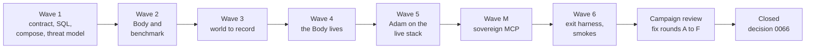

# Phase 0 summary

Phase 0 ("Adam") set out to prove that one agent could live in the world on one machine. It ran from 2026-11-08 to 2026-11-10 and closed as **proof of life**: the mechanisms ran against the real server, Body and model, and the owner waived the exit criteria rather than meeting them ([decision 0066](../decisions/0066-phase0-closed-as-proof-of-life.md)).

This page tells that story for the owner, from the campaign's own files. Every figure names its file. A figure that a file marks as coming from a session record, and that the repo does not hold, is marked **unverified**. The campaign's files are listed in the [campaign index](campaign-index.md#phase0).

## What Phase 0 set out to do

[Spec section 10](../spec.md#10-rollout-plan), "Phase 0 — Adam (one weekend, one machine)", lines 1404 to 1410:

- **Run on one box** with `docker compose up`: Paper, Postgres, NATS, the Mind, one Body and a model. No gateway, no Velocity, no DMZ yet. The Thinker protocol exists as a plain local WebSocket.
- **Benchmark the Body first**, before any model: wood to stone tools, food, shelter, bed, chest deposit and withdraw, recovery from a blocked path, at 20 TPS and then 10 and 5. Record success rate and p50 and p95 latency.
- **Build** Geldar-Core with event export and the bot ingress; the Body with reflexes and container actions; the Mind loop with intents, attention, memory and reflection; Thought Stream v0.
- **Write** `docs/threat-model.md`.
- **Run Adam** on a strong model, then on an 8B, and compare.
- **Exit (system acceptance):** five in-game days survived and 24 real hours across restarts, with a bed, food and stone tools; three durable intents completed without a model call; a receipt for every action; a Body restart mid-intent resumed from checkpoint; the model floor and inference calls per useful minute recorded; thought latency under 15 s.

The campaign ledger restates the goal and exit ([phase0/README.md](../analysis/phase0/README.md) lines 1 to 14).

## How it ran

The work ran as a campaign of packets: an orchestrator wrote packets, one coder per packet worked in its own worktree, read-only reviewers checked each wave, and the orchestrator ran live tests ([retro/campaign.md](../analysis/phase0/retro/campaign.md) section 2; the `campaign-packet` skill). Owner rulings during the campaign set the rhythm: reviews and live tests once per wave at its end, a process packet after each retro, and small unblocking packets first ([phase0/RESUME.md](../analysis/phase0/RESUME.md) line 34; [retro/wave-3.md](../analysis/phase0/retro/wave-3.md) line 10).

The campaign retro's numbers ([retro/campaign.md](../analysis/phase0/retro/campaign.md) lines 29 to 36, "session record unless marked"), re-checked on 2026-11-16:

| Retro figure | Re-check |
|---|---|
| 83 packet rows in the ledger (session record) | **Unverified.** 80 rows start with P0, WM or W6 in [phase0/README.md](../analysis/phase0/README.md), 85 with the W1 to W5 process rows (PowerShell row count by prefix, last ledger commit `cae97b5f`) |
| "56 files in `docs/decisions/`, numbered up to 0068" | Checked: `git ls-tree --name-only 6825b944 docs/decisions/` lists 56 entries, 55 records plus the README |
| 1302 commits on `phase0/integration`, 189 merges (repository count) | Checked at `83b0922`, the fix F commit the retro cites (line 130): `git rev-list --count` gives 1302; with `--merges`, 189. The branch tip today, `2441a46e` (2026-11-10 19:27Z), has 1338, so the retro counted before its last commits |
| 432 tracked test files (repository count) | Not reproduced by a file pattern; left as the retro states it |
| About 4000 tests (session record) | **Unverified** |

## What happened, wave by wave

Dates are as the retros give them ("All dates are 2026-11", [retro/campaign.md](../analysis/phase0/retro/campaign.md) line 41). They agree with the commit times in UTC: the first commit is 2026-11-08 21:08Z and decision 0066 was added 2026-11-10 17:41Z.

| Wave | When | What shipped | What the reviews and live runs found | Record |
|---|---|---|---|---|
| 1 | 11-08 to 11-09 | Contract package and generator, SQL schema, compose stack behind Velocity, threat model. Seven packets, PR #4 | Tests that passed for the wrong reason; spec gamerule names wrong on the pinned version; doc claims ahead of the code. Coders ran out of context before committing | [wave-1.md](../analysis/phase0/retro/wave-1.md) |
| 2 | 11-08 to 11-09 | The Golem (Body): connection, snapshot, nine actions, the benchmark harness and six scenarios; a live lane of 58 tests; PR #16 | Four real Body bugs found only against the live 26.1.2 server: table crafting in Mineflayer 4.39.0, chest transfers that lost items, corner-cutting paths, and `/tick rate` not slowing a client ([0038](../decisions/0038-tick-rate-does-not-slow-a-client-driven-body.md)) | [wave-2.md](../analysis/phase0/retro/wave-2.md) |
| 3 | 11-09 | Geldar-Core plugin with event export to JetStream, the event sink, the Velocity identity gate | A poison message wedged the sink; a dead-letter cap then dropped events after about 7.5 minutes of Postgres downtime; the identity gate failed open if its plugin did not load | [wave-3.md](../analysis/phase0/retro/wave-3.md) |
| 4 | 11-09 | Runtime, seven reflexes, the intent executor, five programs with checkpoints, receipts and restart with resume | Real Body bugs found only live (a craft count that made 16 sticks; a burrow that dug the wrong cells); three review rounds of 33, 16 and 6 findings | [wave-4.md](../analysis/phase0/retro/wave-4.md) |
| 5 | 11-09 | Adam, a sovereign player, on the live stack: Body in the server, Mind and local Thinker on the host, real Ollama models | Round 1 had 49 findings; fix packets R4a to R4f followed. 8B live cases green | [wave-5.md](../analysis/phase0/retro/wave-5.md) |
| M | 11-10 | The sovereign MCP front door (WM-01 to WM-13): tokens, stores, gateway to the Body, player host, container | Round 1 found high-severity defects (revoke listener never started, rate limits ignored, and others). Live runs L1 to L5 followed, with fixes `697f555`, `cfbaa0b`, `80cc758` | [wave-m.md](../analysis/phase0/retro/wave-m.md), [wm-live-findings.md](../analysis/phase0/worknotes/wm-live-findings.md) |
| 6 | 11-10 | Mind review fixes, Glass, the `adam-run` harness and protocols, smoke runs, damage wakes ([0065](../decisions/0065-damage-wakes-the-mind.md)), life-ended handling | The harness failed on its own bugs at first live use; the 8B smoke life died about six minutes in and the harness treated the death as a stall. No wave 6 retro file exists (0066) | worknotes `w6-01` to `w6-26` |
| Review | 11-10 | Adversarial review by nine reviewers, then fix rounds A to F | Issues that had sat in the code for several waves (retro section 5) | [fix-a1.md](../analysis/phase0/worknotes/fix-a1.md) to [fix-f.md](../analysis/phase0/worknotes/fix-f.md) |
| Close | 11-10 | Decision 0066, added at 17:41Z (`ba3690f2`) | | [RESUME.md](../analysis/phase0/RESUME.md) |

The fix round reached `main` as PR #33 ([phase1/plan.md](../analysis/phase1/plan.md) section (b)).

## Body benchmark

The spec calls the benchmark "the floor everything stands on". The owner set its gate at 100% of runs at 20 TPS; the 10 and 5 TPS rows are findings only ([decision 0038](../decisions/0038-tick-rate-does-not-slow-a-client-driven-body.md); [bench-results.md](../analysis/phase0/bench-results.md) line 43). At 10 and 5 TPS the server slows but the client does not, so those rows measure an unslowed client against a slowed server (bench-results line 44).

### Recorded runs

These four runs are in [bench-results.md](../analysis/phase0/bench-results.md), with raw JSON in [bench-runs/](../analysis/phase0/bench-runs/). All were on Minecraft 26.1.2, Paper build 74, Mineflayer 4.39.0, on a shared desktop host. All six scenarios passed every run.

| Run id (raw file) | Date | Commit | TPS | Runs per scenario | Result | Note in the table |
|---|---|---|---|---|---|---|
| `20261109T130949Z-5aa8a83` | 2026-11-09 | `5aa8a83` | 20 | 10 | 60 of 60 | Wave 2 first recorded run |
| `20261109T133512Z-8934be9` | 2026-11-09 | `8934be9` | 10 and 5 | 5 each | 60 of 60 | Findings rows |
| `20261109T181829Z-93d6640` | 2026-11-09 | `93d6640` | 20 | 10 | 60 of 60 | Wave 4 gate run |
| `20261109T195841Z-251ff8d` | 2026-11-09 | `251ff8d` | 20 | 10 | 60 of 60 | Wave 4 final commit |

Latency on the last recorded 20 TPS run, `251ff8d` (milliseconds over completed actions, bench-results lines 31 to 36):

| Scenario | p50 | p95 | Actions completed |
|---|---|---|---|
| wood-to-stone-tools | 499 | 23162 | 80 of 80 |
| food | 1646 | 2668 | 20 of 20 |
| shelter | 563 | 1063 | 100 of 100 |
| bed | 312 | 1103 | 30 of 30 |
| chest | 9 | 437 | 30 of 30 |
| blocked-path | 6200 | 6445 | 5 of 10 |

Two limits stand: the `chest` scenario checks no receipt, and the TPS floor in the abort criteria is not enforced (bench-results line 41; decision 0066).

### Passes reported but not recorded in the table

| Commit | Where it is claimed | What the repo holds |
|---|---|---|
| `35e16c0` | [wave5-adam-smoke-2.md](../analysis/phase0/worknotes/wave5-adam-smoke-2.md) line 18: "GATE: PASS. All 18 rows 5/5", with p50 and p95 per scenario | The worknote. The raw file it names, `bench-results/20261109T233614Z-35e16c0.json`, is not in the repo |
| `898b9b9` | [retro/wave-5.md](../analysis/phase0/retro/wave-5.md) line 13: the gate pass is attributed to it | No row and no raw file (`bench-results/20261110T024026Z-898b9b9.json` is not tracked) |
| `403a9cc`, `98d5394` | [RESUME.md](../analysis/phase0/RESUME.md) line 7 and [README.md](../analysis/phase0/README.md) line 131: "last full pass", citing `bench-results.md` | No row and no raw file. Both commits exist (wave 6 merges, 2026-11-10) |
| `57576f6` | Same lines: "the final clean rebench ... was stopped by the owner" | No result, as stated |

These claims are **unverified** here. Raw files were checked with `git ls-files | grep -E '898b9b9|35e16c0|bench-results/'` (no output, 2026-11-16). The same conflict is row 5 of the [campaign index disagreement table](campaign-index.md#where-the-resume-files-disagree).

## Exit criteria and results

Every spec exit criterion is "waived for Phase 0 by the owner, deferred" ([decision 0066](../decisions/0066-phase0-closed-as-proof-of-life.md), "What was not demonstrated").

| Spec criterion | Result | Evidence |
|---|---|---|
| Five in-game days survived, with bed, food and stone tools | Not run. Waived | 0066 |
| 24 real hours across restarts | Not run. Waived | 0066 |
| Three durable intents completed without a model call | Not run as a recorded exit. Waived | 0066; retro section 1 |
| Every action has a receipt | Not met: no `aborted` receipt for an abandoned action, no `prepared` receipt. Waived | 0066; [known-gaps.md](../analysis/phase0/known-gaps.md), "Data integrity" |
| Body restart mid-intent resumes from checkpoint | Built in wave 4; not run as an exit. Waived | 0066; [wave-4.md](../analysis/phase0/retro/wave-4.md) line 7 |
| Model floor recorded | Not recorded. Waived | 0066 item 4: "Nothing in this decision sets the model floor" |
| Inference calls per useful autonomous minute | Not recorded. Waived | 0066 |
| Thought latency under 15 s | 0.8 to 2.4 s on the 8B in the wave 5 smoke. The 32B p95 target was not run. Waived | [wave5-adam-smoke-2.md](../analysis/phase0/worknotes/wave5-adam-smoke-2.md) line 6; 0066 |

What 0066 does count as shown: the benchmark at 20 TPS at three commits; the sovereign MCP reaching the real Body in live runs L1 to L5; the 8B Mind thinking on the local model; and the harness finding and fixing its own faults.

Figures from session records only:

- A 32B run of 8 minutes with 10 thoughts, p50 3728 ms and 0 invalid. The wave 5 retro says "no worknote holds its raw output" ([wave-5.md](../analysis/phase0/retro/wave-5.md) line 12). **Unverified.**
- Thought latency of 0.6 to 7.7 s across the wave 6 runs. Decision 0066 says "the figures are not in the repo's worknotes". **Unverified.**

## Why it closed the way it did

The long exit runs were never performed. The harness for them was built in wave 6, and its first live use showed harness bugs rather than system results: missing secrets in a new worktree, Windows process probes, a report shape mismatch, and a death handled as a hang ([retro/campaign.md](../analysis/phase0/retro/campaign.md) section 4.4). The owner then chose to stop at proof of life and move to scaling: up to 20 agents per player, sovereign players and rangers (0066, "Context"). The two exit-run lives and the smoke life set aside for the exit stay unused ([0064](../decisions/0064-exit-run-lives.md); 0066, "Consequences"). The protocols stay in the repo, documented and not exercised ([adam-run-32b.md](../analysis/phase0/adam-run-32b.md), [adam-run-8b.md](../analysis/phase0/adam-run-8b.md)).

The spec's own words cover this case only partly: "If no model passes, stop and fix the Body/Mind split" (line 1410). No model was run to the exit, so that rule never fired (inferred: no record or retro reports an exit run, and 0066 lists the runs as not performed).

## What carried into Phase 1

- **The backlog.** [known-gaps.md](../analysis/phase0/known-gaps.md), "Status as of 2026-11-10", groups the open items under admission and identity, data integrity, scale to 20 agents per player, harness, knowledge boundary, ops and CI, and docs and spec. The Phase 1 plan picks the most important ones ([phase1/plan.md](../analysis/phase1/plan.md) section (b)).
- **Open Body issues.** No `aborted` receipt and no `prepared` receipt ([0020](../decisions/0020-receipts.md)); partial crash reconciliation; no wake reason for cancelled or interrupted ([RESUME.md](../analysis/phase0/RESUME.md) lines 10 to 15).
- **Untested security pieces.** The NATS auth overlay ([0067](../decisions/0067-nats-accounts-and-least-privilege.md)) untested against a live server; per-component NATS credentials not done (RESUME line 15; known-gaps).
- **Owner items.** MineSkin upload; the public MCP topology ([0053](../decisions/0053-public-mcp-through-an-outbound-tunnel-deferred.md), superseded by [0071](../decisions/0071-public-endpoints-and-ports.md) on 2026-11-10, the day Phase 0 closed; see [superseded and reversed](superseded-and-reversed.md)); spec edits including the owner cap (3 in spec 5.15.6 against 20 in [0052](../decisions/0052-per-owner-sovereign-player-cap-raised-to-20.md)) and the observers sentence ([0068](../decisions/0068-prompt-v4-and-agent-visible-text.md)); journal deletion in a live test against the append-only rule of [0064](../decisions/0064-exit-run-lives.md) (RESUME lines 21 to 32).
- **Process rules.** Thirteen rules for Phase 1, among them: coders write all code and ops runs merges and checks; packets of about two hours; a mandatory revert check; decision numbers assigned in the brief; adversarial review of security code every wave ([retro/campaign.md](../analysis/phase0/retro/campaign.md) section 7). The Phase 1 conventions take these up ([phase1/packet-conventions.md](../analysis/phase1/packet-conventions.md)).
- **The direction.** Scaling: more agents per player, sovereign players and rangers (RESUME line 17). [Decision 0070](../decisions/0070-phase1-is-the-colo-first-shard.md) then redefined Phase 1 as the colo-first shard; see the [Phase 1 summary](phase1-summary.md).

## Decisions

Phase 0 wrote records 0001 to 0068 (55 files; numbers 0007 to 0019 are unused, `git ls-files docs/decisions`, 2026-11-16). The ones that shaped how Phase 0 ended:

| Record | What it settles |
|---|---|
| [0038](../decisions/0038-tick-rate-does-not-slow-a-client-driven-body.md) | Tick rate does not slow a client-driven Body; the benchmark gate is the 20 TPS row |
| [0047](../decisions/0047-thinking-time-comes-from-intents-and-waits-not-dilation.md) | No time dilation |
| [0048](../decisions/0048-recipe-discovery-is-part-of-the-game.md) | Recipes are discovered in play |
| [0050](../decisions/0050-phase0-mind-processes-run-on-the-host.md) | Phase 0 Mind processes run on the host |
| [0051](../decisions/0051-adam-identity-and-model-pins.md) | Adam's identity and model pins |
| [0052](../decisions/0052-per-owner-sovereign-player-cap-raised-to-20.md) | Owner cap raised to 20 |
| [0053](../decisions/0053-public-mcp-through-an-outbound-tunnel-deferred.md) to [0055](../decisions/0055-phase0-sovereign-tool-subset-and-mappings.md) | Public MCP deferred (0053, superseded by [0071](../decisions/0071-public-endpoints-and-ports.md)); static hashed bearer tokens; the sovereign tool subset |
| [0058](../decisions/0058-the-character-knowledge-boundary-and-thought-v2.md), [0059](../decisions/0059-identity-mode-is-about-human-observation-not-agent-belief.md), [0068](../decisions/0068-prompt-v4-and-agent-visible-text.md) | The character knowledge boundary; identity mode is about human observation, not agent belief; prompt v4 and agent-visible text |
| [0060](../decisions/0060-persona-size-limits.md) | Persona files not artificially limited |
| [0061](../decisions/0061-phase-0-exit-criteria-readings.md), [0064](../decisions/0064-exit-run-lives.md) | How the exit runs would be read; the exit-run lives |
| [0065](../decisions/0065-damage-wakes-the-mind.md) | Damage wakes the Mind |
| [0066](../decisions/0066-phase0-closed-as-proof-of-life.md) | Phase 0 closed as proof of life; exit criteria waived |
| [0067](../decisions/0067-nats-accounts-and-least-privilege.md) | NATS accounts and least privilege |

Owner rulings made while the owner was away are logged in [overnight-decisions.md](../analysis/phase0/overnight-decisions.md). The full list is the [decisions index](../decisions/README.md); a dated view is the [decision timeline](decision-timeline.md).

## Conflicts recorded

1. **Benchmark attribution.** Four different accounts of which commit passed last (section [Body benchmark](#body-benchmark)). Not resolved here.
2. **Current phase.** [CLAUDE.md](../../CLAUDE.md) line 3 still says "Current work is Phase 0" and points to its RESUME; decision 0066 closed it.
3. **Retro and backlog file.** [retro/campaign.md](../analysis/phase0/retro/campaign.md) line 117 says there is no `known-gaps.md` yet; it was added in the same minute (`ac508760`, 2026-11-10 19:04Z).
4. **Spec "one weekend".** The spec plans one weekend (line 1404). The campaign ran 2026-11-08 to 2026-11-10 by the retros' dates and closed without an exit. This is a fact, not a contradiction; the spec's "Rough effort" paragraph allows "a bad week" (line 1444).
