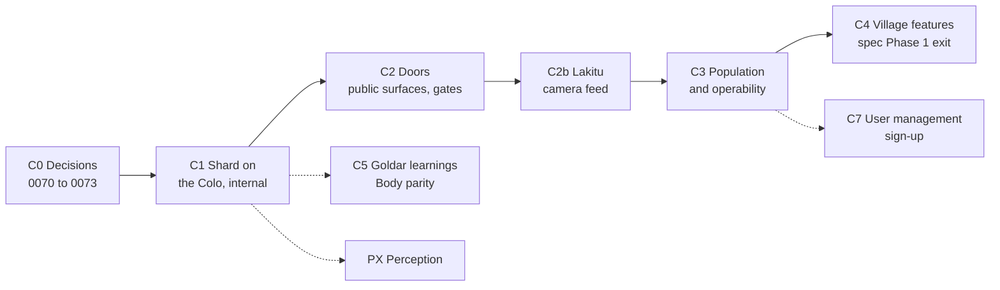

# Phase 1 summary

Phase 1 is the shard in its final Colo environment, reachable from the internet without a VPN, invite-only and not announced ([decision 0070](../decisions/0070-phase1-is-the-colo-first-shard.md)). This replaces the spec's "Village (LAN only)". Phase 1 is open: no record closes it.

This page tells the owner what Phase 1 planned, how its waves went, where its resume card left it, and what is open. The resume card is [phase1/RESUME.md](../analysis/phase1/RESUME.md), last committed at 2026-11-15 05:30Z (`771a1cbd`); its latest dated section is "C7 status (2026-11-14, after window B)". **Anything after that commit is marked unverified.** The campaign's files are listed in the [campaign index](campaign-index.md#phase1).

## Why Phase 1 changed shape

[Spec section 10](../spec.md#10-rollout-plan), lines 1412 to 1419, plans Phase 1 as a village of 10 to 15 agents on the LAN, with no internet exposure and an explicit list of exclusions: "no permadeath, no Shrine, no lineage, no governance, no sovereign players, no time dilation, no spectator proxy". Its exit is a mechanism demo (a procedure learned only from a book), a `give` trade with receipts, a death and a birth, a bounded shrine pool, fewer than one model wakeup per agent per real minute, a Thinker offline for an hour with zero deaths, and 7 real days of operation.

On 2026-11-10 the owner redefined it ([decision 0070](../decisions/0070-phase1-is-the-colo-first-shard.md)):

- **Pulled forward from spec Phase 2:** the public MCP endpoint with static bearer tokens ([0054](../decisions/0054-static-hashed-per-player-bearer-tokens.md)), the public Velocity endpoint ([0071](../decisions/0071-public-endpoints-and-ports.md)), Glass and BlueMap public ([0072](../decisions/0072-glass-and-bluemap-are-public.md)), backups with a tested restore, and deployment on the Colo.
- **Moved to later waves on the Colo:** the spec's own Phase 1 content (proximity chat, books and skills, sleep reflection, hibernation, credits, the Shrine and birth, the Thinker pool, 10 to 15 agents, the 7-day soak).
- **Invitations wait for the gates.** The eight gates of spec Phase 2 are the bar for any invitee (0070 point 3).

Why: Phase 0 had closed as proof of life ([0066](../decisions/0066-phase0-closed-as-proof-of-life.md)); building a LAN village and then moving it to the Colo would move and soak the same state twice; and real endpoints test security work better than mocks (0070, "Why"). The full list of divergences from the spec, with the record that settles each, is [plan.md](../analysis/phase1/plan.md) section (c).

0070 also notes that the spec's Phase 1 contradicts itself: it excludes the Shrine and permadeath (line 1414) but its exit needs a shrine and a death and birth (line 1418). 0070 settles sequencing only; the Shrine and birth go in wave C4. The spec text is not edited ([0073](../decisions/0073-spec-is-never-edited.md)).

## The plan and its waves

The plan of 2026-11-10 ([plan.md](../analysis/phase1/plan.md) section (e), lines 88 to 95) has six waves, C0 to C4 with C2b; C0 was the decisions themselves. Later work added three more (RESUME lines 38 to 41).

| Wave | What it builds (plan or ledger) | Exit check (plan column "Exit check", or the card file for later waves) |
|---|---|---|
| C0 Decisions | Decisions 0070 to 0073 and the plan | Decisions indexed; `check` passes |
| C1 Shard on the Colo, internal | Colo compose with limits, Body-host image, Linux deploy tooling, root-only secret env files, metrics, BlueMap, first ranger over loopback or a tunnel | The first ranger finishes a session; no other node service degrades |
| C2 Doors | Public MCP through Caddy, NATS accounts overlay live-tested, Velocity on its own port, public Glass and BlueMap with hardening, external port scan, security review | "The gate check (below); invitations wait for these gates" (plan line 92) |
| C2b Lakitu | The Glass camera of [0075](../decisions/0075-glass-is-a-lakitu-camera.md), an owner and admin viewing surface; its policy is in 0075 | The checks in plan section (e), C2b |
| C3 Population and operability | Roster and cap in the database, N-bot benchmark tooling, runbooks, chaos-day and 7-day soak tooling, sovereign intent persistence, shelter intent ([0074](../decisions/0074-shelter-means-an-enclosed-safe-space.md)) | Short tests pass; soak and chaos day run at campaign end |
| C4 Village features on the Colo | The spec's Phase 1 content, a Thinker gateway | The spec's Phase 1 exit, with test agents |
| C5 Goldar learnings | Body parity and the unavailable tools, from a review of another repo; records 0141 to 0146 | Cards in [c5-goldar-packets.md](../analysis/phase1/packets/c5-goldar-packets.md) |
| PX Perception | What a player could see or hear, from the first ranger's play record; owner rulings in [0154](../decisions/0154-perception-owner-rulings.md) | Cards in [px-perception-packets.md](../analysis/phase1/packets/px-perception-packets.md) |
| C7 User management | Roster, admin flag, supervisor, owner keys, account page, deletion and export, sign-up gate; migrations 0024 to 0033 | Plan in [c7-wave-plan.md](../analysis/phase1/packets/c7-wave-plan.md) |

[Decision 0130](../decisions/0130-phase1-owner-rulings-for-c1.md) (owner, 2026-11-10) moved the long tests (the 7-day soak, the chaos day, the long benchmarks, the restore test, the 20-minute smoke) to the end of the campaign, deferred backups, and sent metrics to the node's SigNoz.

The campaign rules come from the Phase 0 retro: the orchestrator writes no code, one coder per packet, ops merges and runs, and at most about six agents at once (RESUME lines 43 to 49; [packet-conventions.md](../analysis/phase1/packet-conventions.md)). Gates run per packet, per wave and per campaign (RESUME lines 51 to 55).

## State as of the RESUME

All from [phase1/RESUME.md](../analysis/phase1/RESUME.md) at `771a1cbd`. The section dates inside it run from 2026-11-11 to 2026-11-14.

- **Phase 0 behind it.** Closed by 0066. "The first ranger (a real client, operated by a person) has played on the Phase 0 shard" (line 11). Line 26 adds that the ranger is a sovereign player agent whose Claude Code session runs under the owner's login.
- **C1 (2026-11-11).** Code merged. Open: C1-10, the owner's run on the node; the C1-01 leftovers (lines 26 and 27). The [ledger](../analysis/phase1/ledger.md) shows C1-01 partial and C1-05b deferred by 0130.
- **C2 (2026-11-11).** Desktop work merged, C2-00 to C2-06 and others (PRs #79 to #99); some packets in flight; review round 1 under way with fix slices (lines 27 to 33). The ledger's C2 rows were not updated to match (see [conflicts](#conflicts-recorded)).
- **Self-registration** ([0135](../decisions/0135-self-registration-with-github-and-discord.md)) designed; turning it on waits for the C2 gates and per-player Body lifecycle (line 34).
- **C2b (2026-11-11).** C2b-00 and C2b-01 merged; the load test, relay and renderer next (line 35).
- **C5 and PX (drafted 2026-11-11).** Cards ready except where an owner decision blocks (lines 38 and 40).
- **C7 (2026-11-14, after window B).** Waves 1 to 4 merged and deployed; C7-04c2 and C7-14b merged in window B. Unbuilt: retire, account items, supervisor compose, account Body controls, rename, deletion and export, operator console, the sign-up gate, skin upload (lines 69 to 72).
- **Owner rulings of 2026-11-14** ([0261](../decisions/0261-open-signup-player-host-bodies-and-auto-roster.md)): sign-up open to everyone, unannounced, once milestone M1 is ready; auto-roster on registration with a per-owner cap of 3; a global cap of 40 running Bodies, alert and review at 30 (line 73).
- **The public Minecraft port stays closed** until C2-02c merges (RESUME lines 20 to 22; policy in [0137](../decisions/0137-public-spectator-proxy-is-separate-and-online.md); the gap is recorded in [0364](../decisions/0364-known-gap-public-overlay-against-0137.md)).

The two C7 retros record the cost: five review passes in C7-1, four in C7-2, every pass finding a real defect; about half the coders hit their context cap; a scratch Postgres recipe still not committed ([wave-c7-1.md](../analysis/phase1/retro/wave-c7-1.md); [wave-c7-2.md](../analysis/phase1/retro/wave-c7-2.md)).

## What is open

As listed at `771a1cbd`, unless marked.

1. **The exit.** None of the spec's Phase 1 exit items is recorded as passed. The soak, chaos day and long benchmarks are scheduled for campaign end (0130).
2. **Before outside users.** Deletion and export (C7-09) and the sign-up gate (C7-11), per [0153](../decisions/0153-terms-consent-and-deletion-before-sign-up.md); `__Host-` cookie prefix recommended before sign-up (RESUME lines 72 and 74).
3. **Owner items** (RESUME line 37; plan section (f)): the C1-10 run; the OAuth apps; the C2b questions (texture licence, audit retention, feed load budget); credits ([0079](../decisions/0079-credit-numbers-and-charge-rules.md), Proposed); the Glass privacy item; the naming question for the rangers; identifiers in the public history; spec amendments listed in 0073.
4. **For the owner** (RESUME lines 76 to 80): real names on kept agent rows; erasure of the deleted identity's audit rows on deletion; cleanup of accounts deleted before migration 0040, under migration 0039 (card C7-09c; [0262](../decisions/0262-account-deletion-erases-dead-lives-too.md) calls 0039 "the first deletion migration").
5. **Contradictions the RESUME names** (lines 82 to 85): soak length (C3 cards against the plan) and a stale line about the Phase 0 retro. Both RESUME lines are themselves stale; see conflicts 5 and 6 below.
6. **Carried from Phase 0:** the [known-gaps](../analysis/phase0/known-gaps.md) backlog, which the plan triages in section (b).

## After the RESUME (unverified)

The RESUME was not rewritten after 2026-11-15 05:30Z. `git log --first-parent --since=2026-11-15T05:31Z dc07e3fa`, filtered on "Merge pull request", lists 100 merged pull requests on 2026-11-16 (99 at `db33805c`; the difference is PR #560, this library's W3). Their branch names point at work that touches Phase 1, but no Phase 1 file records what they changed in the plan, so every line below is **unverified** as Phase 1 state:

- C7 branches: `c7-03b5-supervisor-entry`, `c7-03c5-helper-bundle`, `c7-09a2`, `c7-09b-export`, `c7-09b-route`, `roster-auto`, `signup-runbook`, and four `bh-*` body-helper branches. A sign-up runbook exists ([open-signup.md](../runbooks/open-signup.md)); whether sign-up is open is not recorded.
- Parallel campaigns, each with its own files: character sheet (`an-*`, `gx-*`, `sheet-*`), muffled hearing (`mh*`), telemetry (`telemetry-*`), BlueMap (`bm-*`, `bluemap/*`), genesis (`gn-*`) and Body survival fixes (sleep, mining, swimming, drowning, boxed-in). See the [campaign index](campaign-index.md).
- World operations on 2026-11-15: a branch `ops/border-9500`, the spawn-town cutover and a one-time journal reset under [0339](../decisions/0339-journal-reset-one-time-exception.md). [World-operations exceptions](../concepts/world-operations-exceptions.md) covers these and their bounds.
- [Decision 0364](../decisions/0364-known-gap-public-overlay-against-0137.md) (2026-11-16, Proposed) records the public overlay as a known gap against 0137, not fixed during the documentation freeze.
- The root [README.md](../../README.md) line 57 says "Phase 1 is in progress".

## Decisions

| Range | What | Evidence |
|---|---|---|
| 0069 to 0075 | A no_plan wake with no intent is not a failed intent (0069), the C0 decisions (0070 to 0073), shelter (0074), Lakitu (0075) | File names |
| 0076 to 0080 | Pre-packet owner decisions: backups, invitee auth, Mind placement, credits, NATS cutover | [decision-number-registry.md](../analysis/phase1/packets/decision-number-registry.md) |
| 0081 to 0129 | Blocks for C1 to C4; 30 records exist in 0069 to 0129 | Registry; `git ls-files docs/decisions` |
| 0130 onward | Owner and orchestrator rulings after the blocks (0130, 0131, 0134, 0135, 0137 and others); C5 0141 to 0146; PX 0154; C7 0151 to 0153, 0155, 0170 to 0173 | Registry; ledger section "Wave C7" |
| 0260 to 0262 | The owner's block: Body container control, open sign-up, deletion of dead lives | Registry line 167 |

Records 0180 to 0239 and 0330 to 0341 were written on `phase1/...` branches in the same days, mostly Body fixes, but no Phase 1 file assigns them; the registry has no row above 0180 (RESUME line 18). A dated view is the [decision timeline](decision-timeline.md); grouped by component, [decisions by topic](../reference/decisions-by-topic.md).

## Conflicts recorded

1. **When Phase 1 ends.** [0070](../decisions/0070-phase1-is-the-colo-first-shard.md) point 4: "The phase closes at wave C2's exit". RESUME line 7: "Phase 1 ends when the exit run in the plan passes". [plan.md](../analysis/phase1/plan.md) section (e): C4's exit check is the spec's Phase 1 exit. Not resolved here.
2. **Internet exposure.** Spec line 1398: nothing exposed until Phase 2. 0070 exposes the shard in Phase 1 and says it amends sequencing only.
3. **Wave C2 status.** RESUME line 27 says C2-00 to C2-06 merged; the [ledger](../analysis/phase1/ledger.md) rows say "planned" or "in progress (2026-11-11)".
4. **Next free decision number.** RESUME line 18: 0199, checked 2026-11-14. The highest record at `dc07e3fa` is 0366.
5. **Soak length.** Three sources: [0130](../decisions/0130-phase1-owner-rulings-for-c1.md) line 29 (Accepted, 2026-11-10) settles one 7-day soak at the end of the phase and withdraws the 72-hour gate of the C3 cards; the [C3 cards](../analysis/phase1/packets/c3-packets.md) (lines 116 and 433) and the [C4 cards](../analysis/phase1/packets/c4-packets.md) (line 459) now say the same; RESUME line 84 (section undated, file last committed 2026-11-15) still lists O-soak as open. The RESUME line is stale against 0130.
6. **Stale cross-reference.** RESUME line 85 says the Phase 0 RESUME still calls the retro pending; it does not ([phase0/RESUME.md](../analysis/phase0/RESUME.md) line 7).
7. **Current phase in the agent instructions.** [CLAUDE.md](../../CLAUDE.md) line 3 says current work is Phase 0.

Conflicts 1, 3, 4, 5, 6 and 7 are also rows in the [campaign index disagreement table](campaign-index.md#where-the-resume-files-disagree); conflict 2 is a spec-against-decision difference and is only here.
