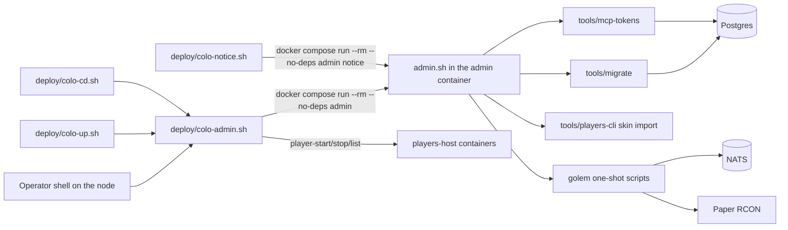

# Admin service

The Colo admin service: a one-shot container, `admin`, that runs one administration CLI against the Colo database, NATS or Paper and exits. It has three parts:

| Part | File | Role |
|---|---|---|
| Compose service | `admin` in `compose/colo.yml` | Container definition under the profile `admin`. |
| Image entrypoint | `tools/admin/admin.sh` (in the image built from `tools/admin/Dockerfile`) | Maps one subcommand to one existing CLI. |
| Node wrapper | `deploy/colo-admin.sh` | Checks arguments, prerequisites and secrets on the node, then runs the container with `run --rm --no-deps`. Also manages per-player host containers. |

Decision [0133](../decisions/0133-colo-admin-by-one-shot-container.md) (Accepted, 2026-11-10) chose this design: the node has no Node or pnpm, and Postgres is not published, so the CLIs run inside the compose network. For the deploy scripts as a whole see the [deploy-scripts](deploy-scripts.md) reference; for the compose stacks, the [compose-stacks](compose-stacks.md) reference. For step-by-step use see [colo-deploy](../runbooks/colo-deploy.md) and [mcp-tokens](../runbooks/mcp-tokens.md).

Everything below was read from the files at commit `1b114276` on 2026-11-16. No node, VM or database was read (plan decision D8).

## Data flow

## Compose service `admin`

From `compose/colo.yml` (service `admin`, around lines 642 to 690).

| Key | Value | Note |
|---|---|---|
| `profiles` | `["admin"]` | Never started by `shard up colo` or a plain `up`. |
| `restart` | `"no"` | Started only with `run --rm`. |
| CPU, memory | `${GELDAR_COLO_ADMIN_CPUS:-0.5}`, `${GELDAR_COLO_ADMIN_MEM:-512m}`; `memswap_limit` equal to memory (no swap) | |
| PIDs | `pids: 128`, `pids_limit: 128` | |
| `image` | `${GELDAR_ADMIN_IMAGE:-geldar-admin:c1}` | On the node the release manifest supplies a digest-pinned `GELDAR_ADMIN_IMAGE` (see [preconditions](#preconditions-checked-by-colo-adminsh)). |
| `build` | context `..`, dockerfile `tools/admin/Dockerfile` | `check_merged_config` refuses a service built on the node without a pinned image. |
| `user` | `${GELDAR_SERVICE_UID:-1000}` for uid and gid | |
| Hardening | `read_only: true`, `tmpfs: /tmp`, `cap_drop: [ALL]`, `no-new-privileges:true` | |
| Network | `colo` | Publishes no port. |
| `depends_on` | `postgres` healthy | `run --rm --no-deps` starts only the admin container and does not start Postgres. `colo-admin.sh` refuses, with nothing changed, when Postgres is not running; `colo-up.sh` starts it first. Removes nothing (`deploy/README.md`). |
| Volume | `shards/colo-mind.yaml` read-only, at the path `GELDAR_SHARD_FILE` names | The Mind's shard file, which carries the `sovereign` block. |

### Environment (names only)

| Variable | Role |
|---|---|
| `GELDAR_SHARD_FILE` | Shard file the CLIs read for owner caps, harness rules and persona limits. |
| `GELDAR_ADMIN_PG_PASSWORD_FILE` | Path of the Postgres superuser password file; `admin.sh` reads it into `PGPASSWORD` for its own process. |
| `PGHOST` | `postgres`. `admin.sh` defaults `PGUSER` and `PGDATABASE` to `geldar`. |
| `GELDAR_NATS_URL`, `GELDAR_NATS_USER`, `GELDAR_NATS_PASSWORD_FILE` | NATS as the `body` user, for `ensure-skins-bucket`. |
| `GELDAR_IN_NETWORK_HOSTS` | Allows compose service names instead of loopback, for `whitelist-house-body`. |
| `GELDAR_RCON_HOST`, `GELDAR_RCON_PORT`, `GELDAR_RCON_PASSWORD_FILE` | Paper RCON, for `whitelist-house-body`. |

`deploy/colo-notice.sh` also passes `GELDAR_NATS_USER=deploy`, `GELDAR_NATS_PASSWORD_FILE` and `GELDAR_NOTICE_SHARD` with `-e` for the `notice` subcommand.

### Secrets (by role)

The service mounts these secrets as compose secrets; their ids are in `compose/colo.yml` (`secrets:` of `admin`). Values and node locations are held by the operator.

| Secret (by role) | Used by |
|---|---|
| Postgres superuser password | All database subcommands. |
| Paper RCON password | `whitelist-house-body`. |
| Login passwords of the `geldar_mcp`, `geldar_glass` and `geldar_register` roles | `migrate --set-role-password`, which sets them. |
| NATS `body` user password | `ensure-skins-bucket`. |
| MCP token pepper | `token-mint`, which hashes with it. |
| NATS `deploy` user password | The `notice` subcommand. Added only by the overlay `compose/colo-notice.yml`, which `deploy/colo-notice.sh` merges when the file exists; no other admin subcommand merges it. |

## Image `geldar-admin`

From `tools/admin/Dockerfile`.

| Item | Value |
|---|---|
| Base | `node:22.23.2-trixie-slim`, pinned by digest, both stages (`deps`, `admin`) |
| pnpm | From corepack, checked against `packageManager` in `package.json` |
| Copied | `package.json`, `pnpm-workspace.yaml`, `pnpm-lock.yaml`, `contract`, `psyche`, `animus`, `player-core`, `threshold`, `tools/repo-checks`, `tools/migrate`, `tools/mcp-tokens`, `tools/players-cli`, `sql`, `tools/admin/admin.sh`, `golem/package.json`, `golem/src` |
| Install | `pnpm install --frozen-lockfile --prod --ignore-scripts` filtered to `@geldar/mcp-tokens...`, `@geldar/migrate...`, `@geldar/players-cli...`, `@geldar/golem...` |
| User | `1000:1000` |
| Entrypoint | `sh /opt/geldar/tools/admin/admin.sh` |
| Secrets in image | None; `Dockerfile.dockerignore` excludes `.env*`, `*.env`, `node_modules`, `secrets`, `.git`, `*.log` |

Build: job `admin` in `.github/workflows/colo-images.yml` (runs only in the upstream repository) pushes the `geldar-admin` image to the GitHub container registry with the tags `main` and the 12-character commit sha, with no provenance or SBOM. Local build, from the Dockerfile header: `docker build -f tools/admin/Dockerfile -t geldar-admin:c1 .`

## Subcommands of `admin.sh`

One subcommand per run. `admin.sh` uses `exec`, so the container's exit code is the CLI's. Re-derive the list: `grep -n "exec node" tools/admin/admin.sh`.

| Subcommand | Runs | Needs Postgres password |
|---|---|---|
| `migrate [args]` | `tools/migrate/src/cli.ts` | Yes |
| `owner-add <id> [--cap N]` | `mcp-tokens owner add` | Yes |
| `owner-set-cap <id> <N>` | `mcp-tokens owner set-cap` | Yes |
| `owner-admin set\|unset <owner>`, `owner-admin list` | `mcp-tokens owner admin` | Yes |
| `player-add <id> --owner <o> --life <l> --name <n> --harness <h> [...]` | `mcp-tokens player add` | Yes |
| `player-flags <player-id> [--public-camera on\|off] [--thoughts-delayed-public on\|off]` | `mcp-tokens player flags` | Yes |
| `player-set-owner <player-id> <owner-id>` | `mcp-tokens player set-owner` | Yes |
| `token-mint <player> --out <file>` | `mcp-tokens token mint` | Yes |
| `token-revoke <tk_id>` | `mcp-tokens token revoke` | Yes |
| `players-status [--player <id>]` | `mcp-tokens token list` (no hashes or values) | Yes |
| `roster add <name> --owner <o>`, `roster list [--owner <o>]` | `mcp-tokens roster` | Yes |
| `skin-import <player-id> <file under /run/skins>` | `tools/players-cli/src/cli.ts skin import` | Yes |
| `ensure-skins-bucket` | `golem/src/ensure-skins-bucket.ts`: creates the `geldar-skins` KV bucket if missing | Yes (checked, though the script uses NATS) |
| `whitelist-house-body` | `golem/src/whitelist-house-body.ts`: adds the house Body and every `sovereign.players[].life_id` to Paper's whitelist over RCON | Yes (checked, though the script uses RCON) |
| `notice <payload-json>` | `golem/src/publish-maintenance-notice.ts` as the NATS `deploy` user | No: dispatched before the password check |

Argument checks in `admin.sh` before the password file is read: `roster` takes only `add` or `list`; `owner-admin` takes `set <owner>`, `unset <owner>` or `list` and nothing else. Every other argument passes through unchanged to the CLI, which validates it.

The `mcp-tokens` verbs `init`, `identity`, `admin grant|revoke`, `player set-model|pause|resume|retire`, `roster remove|seed`, `persona` and `token rotate` (`tools/mcp-tokens/src/cli.ts`, `USAGE`) have no `admin.sh` subcommand.

### `migrate` flags

From `tools/migrate/src/cli.ts`.

| Flag | Meaning |
|---|---|
| (none) | Apply every `sql/NNNN_*.sql` not yet in `schema_migrations`. |
| `--dry-run` | Report without applying. |
| `--sql-dir <dir>` | Another migrations folder. |
| `--set-role-password <role> --password-file <file>` | Set a role's login password. Five roles are accepted: `geldar_mcp`, `geldar_glass`, `geldar_register`, `geldar_helper` and `geldar_supervisor` (`PASSWORD_ROLES` in `tools/migrate/src/migrate.ts` lines 137 to 143, read 2026-11-16). Through this service, `colo-up.sh` sets the first three; `deploy/install-body-helper.sh` sets `geldar_helper` by running the CLI on the host, and no deploy script names `geldar_supervisor` (`git grep geldar_supervisor -- deploy`, no hits). Each flag needs the other. |

## Subcommands of `deploy/colo-admin.sh`

Re-derive the list: the first `case $cmd` in `deploy/colo-admin.sh` (around line 254). Any other word, or none, fails with `unknown subcommand`.

| Subcommand | Container call | Checks on the node before any container starts |
|---|---|---|
| `migrate [args]` | `admin migrate` | none beyond the common ones |
| `owner-add <args>` | `admin owner-add` | none |
| `owner-set-cap <owner> <N>` | `admin owner-set-cap` | owner id 1 to 63 of `a-z 0-9 -`, not starting `-`; `N` a whole number 0 to 50, no leading zero |
| `owner-admin set\|unset <owner>` or `list` | `admin owner-admin` | the same owner id rule; exact argument count |
| `player-add <args>` | `admin player-add` | none |
| `player-flags <player-id> <flags>` | `admin player-flags` | at least two arguments; id `ag-` then 1 to 40 of `a-z 0-9 -` |
| `player-set-owner <player-id> <owner-id>` | `admin player-set-owner` | two arguments; player id as `player-flags`; owner id lower-case (checked by the CLI); refuses a retired player, a full owner and a roster name shared with another live player |
| `token-mint <player> [--out /run/tokens/<name>.token]` | `admin token-mint` with a tokens overlay | see [token-mint](#token-mint) |
| `token-revoke <args>` | `admin token-revoke` | none |
| `players-status <args>` | `admin players-status` | none |
| `roster-add <name> --owner <owner>` | `admin roster add` | name 1 to 16 of `A-Z a-z 0-9 _`; owner id rule |
| `roster-list [--owner <owner>]` | `admin roster list` | owner id rule when given |
| `skin-import <player-id> --file /run/skins/<name>.json` | `admin skin-import` with a read-only skins overlay | see [skin-import](#skin-import) |
| `ensure-skins-bucket` | `admin ensure-skins-bucket` | none |
| `whitelist-house-body` | `admin whitelist-house-body` | none |
| `player-start <player-id>` | `compose --profile sovereign run -d --no-deps --name <project>-players-host-<id> players-host --player <id>`, then `docker update --restart unless-stopped` | see [per-player hosts](#per-player-hosts) |
| `player-stop <player-id>` | `docker stop`, then `docker rm` | the same |
| `player-list` | `docker ps` per listed player | no arguments |

`deploy/colo-admin.sh` has no `notice` subcommand: `deploy/colo-notice.sh` calls the container directly. `roster-add` and `roster-list` are the wrapper's names for `admin roster add|list`.

### Preconditions checked by `colo-admin.sh`

In order, after the argument checks (`deploy/colo-admin.sh` lines 274 to 291; functions in `deploy/common.sh`):

1. A compose project name is set (`GELDAR_PROJECT`, default `geldar-colo`).
2. `check_prereqs`: `GELDAR_SERVICE_UID` is a number and not 0; the caller is not root; Docker and Compose v2 work; the compose file, the secrets overlay and the NATS overlay exist; free disk is at least `GELDAR_MIN_FREE_KB`.
3. `load_release`: the release manifest (`GELDAR_RELEASE_FILE`) parses as `*_IMAGE=name@sha256:<64 hex>` lines; a tag or `latest` is refused.
4. `GELDAR_ADMIN_IMAGE` is in the manifest (not needed for `player-start`, `player-stop`, `player-list`).
5. For `token-mint` and `skin-import`, the host directory checks below.
6. `check_merged_config`: the merged config publishes neither 25565 nor 25566 (decision 0082), every image is digest-pinned, and no service is built on the node. The check looks at published port numbers only; see [known gap 7](#conflicts-and-gaps-recorded) on the public overlay.
7. `check_secrets`: every secret file the merged config declares exists, resolves inside an allowed directory, is non-empty, mode 0600 or 0400, and owned by `GELDAR_SERVICE_UID`. Contents are never read.

Every compose call names the project with `-p` and merges `compose/colo.yml`, `compose/nats-auth.yml`, `deploy/compose.secrets.yml`, and `GELDAR_COLO_EXTRA_OVERLAY` when set.

### `token-mint`

- Player id: `^[A-Za-z0-9_-]+$`.
- `--out` defaults to `/run/tokens/<player>.token`; it must be under `/run/tokens`, contain no `..`, and name one `<name>.token` file.
- `GELDAR_TOKENS_DIR` must be set, a directory, outside the repo checkout, made of `A-Z a-z 0-9 / . _ : -`, and mode 0700.
- The wrapper writes a mode-0600 overlay into the state directory (`GELDAR_STATE_DIR`) that binds the directory at `/run/tokens`, and removes it on exit.
- After the run it checks the token file exists, is non-empty and mode 0600, and prints only its path and byte length. The value is never printed.

### `skin-import`

- Exactly `<player-id> --file /run/skins/<name>.json`; id `^ag-[a-z0-9-]{1,40}$`; the file name `^[A-Za-z0-9_-][A-Za-z0-9_.-]*\.json$`, no `..`.
- `GELDAR_SKINS_DIR` follows the `GELDAR_TOKENS_DIR` rules; the file must exist there and be non-empty.
- The overlay binds the directory read-only at `/run/skins`. The signed value is never an argument or printed. See [skins](../runbooks/skins.md).

### Per-player hosts

Decision [0169](../decisions/0169-players-host-restart-policy.md); `deploy/colo-admin.sh` lines 171 to 251.

- The id must match `^ag-[a-z0-9-]{1,40}$` and appear as `player_id:` in the shard file (`GELDAR_COLO_SHARD`, default `shards/colo-mind.yaml`).
- Container name: `<project>-players-host-<player-id>`. Only containers with that exact name and the project's compose label are listed, started or stopped.
- `player-start` leaves a running host alone (exit 0), removes a stopped leftover with `rm -f`, starts the host detached, then sets `unless-stopped` (decision 0342). When `docker update` fails it still exits 0 and says the restart policy is missing, so the CD does not treat a healthy host as failed.
- `player-stop` exits 0 when the container does not exist.
- `player-list` prints `<id>: running`, `<id>: <docker state>` or `<id>: not running` for each listed id.
- `deploy/colo-cd-players.sh` calls these through `host_admin`, which points `GELDAR_RELEASE_FILE` at `HOST_MANIFEST` when set.

## Dry run

`DEPLOY_DRY_RUN=1` runs only the read-only checks and `config --quiet`, prints the container command it would run, and starts nothing. For `token-mint` and `skin-import` it also names the overlay it would write. For `player-start` and `player-stop` it prints the Docker commands and exits 0 before the image check.

## Callers

Re-derive: `git grep -n "colo-admin.sh\|admin notice" -- deploy/*.sh`.

| Caller | Subcommands |
|---|---|
| `deploy/colo-up.sh` (after Postgres and NATS are up) | `migrate`; `migrate --set-role-password` for `geldar_mcp`, `geldar_glass`, `geldar_register`; `ensure-skins-bucket`; after Paper is healthy, `whitelist-house-body` |
| `deploy/colo-cd.sh` | `migrate`, after a `pg_dump` into the state directory; a failure aborts the CD untouched |
| `deploy/colo-cd-players.sh` | `player-list`, `player-start`, `player-stop` |
| `deploy/colo-notice.sh` | `admin notice <payload>` directly through compose, with the notice overlay |
| Operator | Any subcommand; examples in `deploy/README.md` section (f) |

## Database role and grants

`admin.sh` connects as `PGUSER` (default `geldar`) with the superuser password. Decision 0133 records this: "Postgres roles are still the superuser `geldar` for admin work. Least-privilege admin roles are C2." No least-privilege admin role exists in this checkout (`git grep -n "PGUSER" -- tools/admin compose/colo.yml` shows only the default). Decision [0170](../decisions/0170-owner-management-values-and-admin-flag.md) item 5 requires that only the operator CLI writes `mcp_owners.is_admin`; `owner-admin` is that path (`tools/mcp-tokens/src/owner-admin.ts`, one audit row per change). For tables and roles see the [database-schema](database-schema.md) reference; for who may do what, the [authn-authz-map](../security/authn-authz-map.md).

## Exit codes

| Layer | Code | Meaning |
|---|---|---|
| `deploy/colo-admin.sh` | 0 | Done, dry run done, host already running, or host already absent |
| | 1 | Any refusal or failure (`die` in `deploy/common.sh`), including a failed container run. The CLI's own code is not passed through. |
| `tools/admin/admin.sh` | 2 | Unknown subcommand, or a bad `roster` or `owner-admin` form (usage on stderr) |
| | 1 | Postgres password file missing or empty |
| | other | The CLI's exit code |
| `mcp-tokens` CLI | 0, 1, 2 | Done, error (message on stderr), usage (`tools/mcp-tokens/src/cli.ts`) |
| `mcp-tokens player flags` | 0, 1, 2, 3, 4 | Set; unexpected; no flag given; wait and retry; unknown or retired player (`OUTCOMES` in `tools/mcp-tokens/src/player-flags.ts`) |
| `migrate` CLI | 0, 1 | Done; error (`process.exitCode = 1`) |

## Security properties

- The image holds no credential; passwords arrive as mounted files (decision 0133; Dockerfile comments).
- The Postgres password is exported only in `admin.sh`'s own process; no subcommand prints a secret value (`admin.sh` header; `deploy/test/colo-admin.test.ts`, "never shows its value").
- The wrapper never runs `down -v` and touches no volume (test "names the geldar-colo project in every docker call, and never runs down -v").
- Host directories are mounted only for `token-mint` (read-write) and `skin-import` (read-only), through a temporary 0600 overlay.
- `player-flags` changes a player's visibility flags; what they control is operator material, covered by the [glass-and-kino](glass-and-kino.md) reference (`agents-never`).

## Tests

Counts from `grep -cE "^\s*it\(" <file>` at `1b114276`, 2026-11-16.

| File | `it` cases | Covers |
|---|---|---|
| `deploy/test/colo-admin.test.ts` | 25 | Wrapper: refusals, token-mint, project scoping, dry run, manifest, owner-set-cap, roster, per-player hosts |
| `deploy/test/admin-entrypoint.test.ts` | 8 | `admin.sh` dispatch of `roster`, `owner-admin`, `player-flags`, `player-set-owner`, `owner-set-cap` |
| `deploy/test/colo-admin-skin.test.ts` | 6 | `skin-import` |
| `deploy/test/colo-admin-flags.test.ts` | 2 | `owner-admin` and `player-flags` refusals |
| `tools/repo-checks/src/admin-image.test.ts` | 4 | The Dockerfile copies every golem file the `mcp-tokens` CLI imports |

`tools/repo-checks/src/colo-images.test.ts` also lists the `admin` job and `GELDAR_ADMIN_IMAGE`. Run them with `./geldar.ps1 pnpm test deploy` and `./geldar.ps1 pnpm test repo-checks`.

## Conflicts and gaps recorded

1. **Decision 0133 scope versus the image.** Decision 0133 describes an image with `tools/migrate`, `tools/mcp-tokens`, their closure and `sql/`, and one role password (`geldar_mcp`). The Dockerfile also copies `tools/players-cli`, `animus`, `golem/src` and more, and `migrate` accepts five role passwords (three set through this service by `colo-up.sh`). Later work cards (C2-07j, C2-07k, C7-12, CD-1d, named in comments) extended it; no superseding decision was found (`git grep -n "0133" -- docs/decisions`).
2. **Usage text.** The `admin.sh` usage lists neither `ensure-skins-bucket` nor `whitelist-house-body`, which its `case` accepts. The `migrate` usage names only `geldar_mcp`; the code accepts five roles.
3. **Image default.** `compose/colo.yml` defaults the image to the tag `geldar-admin:c1`; `check_merged_config` refuses any image not pinned by digest, so on the node the release manifest must override it.
4. **Superuser password default.** `admin.sh` and `compose/colo.yml` give `GELDAR_ADMIN_PG_PASSWORD_FILE` different defaults for the Postgres superuser password secret; `deploy/README.md` (around line 263) agrees with `admin.sh`. Which one the node uses is unverified (D8).
5. **Roster verbs.** `mcp-tokens roster remove` and `roster seed` exist but cannot be run through the admin container.
6. **Decision status.** Decisions 0084 and 0108, which this service implements, are Proposed in their headers.
7. **Public bot ingress (known gap against decision 0137).** Decision [0137](../decisions/0137-public-spectator-proxy-is-separate-and-online.md) is authoritative: the offline-mode bot ingress "is reachable only on the compose network, and is never published" (item 1). `compose/colo-public.yml` adds one publish, `"${GELDAR_MC_BIND:?}:${GELDAR_MC_PORT:?}:25565"`, on the `velocity` service, which decision 0137 (Context) names as the bot ingress. `deploy/common.sh` merges that overlay into the config that `check_merged_config` reads when both variables are set (`public_overlay` and `dc`; `adm` in `deploy/colo-admin.sh` does not add it to the admin run itself), and `check_merged_config` passes it because it refuses only a published 25565 or 25566. Node state: unchecked (D8). Not fixed here.
