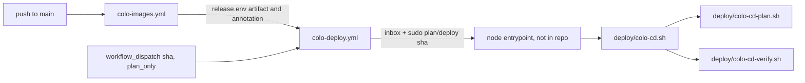

# CI workflows

The six GitHub Actions workflows in `.github/workflows/`, Dependabot, and the repo checks that read workflow files: triggers, permissions, jobs, the commands that gate a merge, and what each one publishes. For how to add a PR to the merge queue, read the [merge-queue runbook](../runbooks/merge-queue.md). For the scripts the deploy workflow ends in, read [deploy scripts](deploy-scripts.md). For every repo check, read the [repo checks](repo-checks.md) reference.

All facts were read from the files at commit `1b114276` on 2026-11-16. No workflow was run and no GitHub setting was read: repository rulesets, branch protection, environments and package visibility live in GitHub, not in the repo, and are unverified here.

## Workflow index

Re-derive with `git ls-files .github/workflows` (6 files at `1b114276`) and, for each, read its `on:` block.

| Workflow | Triggers | Top-level permissions | Concurrency group (cancel in progress) | Purpose |
|---|---|---|---|---|
| `ci.yml` | `pull_request` (no paths filter); `merge_group` `checks_requested`; `push` to `main`; `workflow_dispatch` | `contents: read` | `ci-<ref>` (yes for pull requests only) | The required gate: lint, typecheck, tests, repo checks, contract drift, compose, Caddy, SQL, images, integration |
| `colo-images.yml` | `push` to `main` with a paths filter; `workflow_dispatch` | `contents: read` | `colo-images-<ref>` (no) | Builds and pushes the Colo images and the supervisor image to GHCR; writes the release manifest |
| `colo-deploy.yml` | `workflow_run` of `colo-images` `completed`; `workflow_dispatch` with inputs `sha` and `plan_only` | none (`{}`) | job-level `colo-deploy` (no) | Deploys one main commit to the Colo node through a self-hosted runner |
| `mcp-mock-image.yml` | `pull_request` and `push` to `main`, both with a paths filter; `workflow_dispatch` | `contents: read` | `mcp-mock-image-<ref>` (no) | Builds and tests the mock MCP image; publishes it from `main` |
| `plugin-jars.yml` | `push` to `main` with paths `plugin/**` and itself; `workflow_dispatch` | `contents: read` | `plugin-jars-<ref>` (no) | Builds both plugin jars and publishes them as an artifact |
| `body-helper-bundle.yml` | `push` to `main` with a paths filter; `workflow_dispatch` | `contents: read` | `body-helper-bundle-<ref>` (no) | Builds the body helper bundle and checks the pinned Node tarball |

Every job runs on `ubuntu-24.04` except `colo-deploy`, which runs on a self-hosted runner with the label `geldar-colo-deploy` (`colo-deploy.yml` line 39). Every job of `colo-images` (lines 47, 89, 131, 173, 215, 257, 299, 343, 386), `plugin-jars` (line 26) and `body-helper-bundle` (line 30) carries `if: github.repository == '<upstream>'`, so a fork does not run them. The exception is `mcp-mock-image.yml`: its `publish` job (`packages: write`, line 84) has no repository guard and is gated only by `github.event_name != 'pull_request' && github.ref == 'refs/heads/main'` (line 79). Re-derive with `git grep -n 'github.repository ==' -- .github/workflows` (2026-11-16: 11 lines, none in `mcp-mock-image.yml`). What that job does when it runs on a fork's `main` was not tested; see [documentation debt](#documentation-debt).

## ci.yml

Header, lines 1 to 6: runs on every PR, on `main`, and on every merge queue entry; `main` requires one check, `ci gate`.

Re-derive the jobs with `git grep -nE '^  [a-z]+:$' -- .github/workflows/ci.yml`. It prints 8 lines: the first, `push:` on line 13, is a trigger under `on:`, so the 7 jobs start at line 25.

| Job (check name) | Timeout | Gating steps (commands) |
|---|---|---|
| `typescript` | 15 min | `pnpm install --frozen-lockfile`; `pnpm lint` (Biome); `pnpm typecheck`; `pnpm test` (Vitest); `pnpm check:repo`; `pnpm check:generated` (contract drift); `pwsh -NoProfile -File ./geldar.ps1 pnpm --version` (the task runner runs on Linux) |
| `plugin` | 20 min | When `plugin/build.gradle.kts` exists: Java from `plugin/.java-version` (Temurin), Gradle, then `./gradlew build --no-daemon` in `plugin/` |
| `compose` | 10 min | `./geldar.ps1 shard secrets phase0`; `docker compose config --quiet` on every `compose/*.yml` that is not an overlay, then on fixed chains: `colo.yml` + `nats-auth.yml` + `colo-public.yml` (dummy bind and port), `colo.yml` + `colo-kino.yml`, `colo.yml` + `colo-kino.yml` + `colo-kino-session.yml`, `colo.yml` + `nats-auth.yml` + `colo-notice.yml` (dummy password file in the runner's temp directory), `phase0.yml` + `rcon-host.yml`, `phase0.yml` + `mcp.yml` + `nats-auth.yml` + `nats-auth-mcp.yml`; `bash deploy/caddy/validate.sh`; `vitest run src/caddy-adapt.test.ts` in `@geldar/repo-checks` with `GELDAR_REQUIRE_DOCKER=1` |
| `sql` | 10 min | A digest-pinned pgvector Postgres service; every `sql/[0-9]*.sql` applied in name order with `psql -v ON_ERROR_STOP=1`; then `sql/test/check-schema.sql` and 22 more `sql/test/check-schema-*.sql` files in one `psql` call (line 178) |
| `images` | 25 min | Builds `eventsink/Dockerfile` and `threshold/mcp/Dockerfile` with Buildx, not pushed |
| `integration` | 20 min | Postgres service and a digest-pinned NATS JetStream container on `127.0.0.1`; migrations applied; a CI-only password file; the eventsink started and waited for; then `pnpm vitest run` over 20 named `*.it.test.ts` files with `GELDAR_IT=1` and `GELDAR_IT_ALLOW_SHARED_DB=1`; then `eventsink/test/xp-outbox.it.test.ts` alone (it must not run beside `xp.it.test.ts`, lines 315 to 320) |
| `gate` (`ci gate`) | 2 min | `if: always()`, `needs` every other job; fails unless every result is `success` (lines 329 to 346) |

A job whose part of the repo does not exist yet says so and passes (header, lines 3 to 5; for example the `plugin` job's first step). The test `tools/repo-checks/src/workflow-jobs.test.ts` fails when a job is missing from the gate's `needs` or `needs` names a job that does not exist. `tools/repo-checks/src/ci-schema-wiring.test.ts` fails when a `sql/test/check-schema*.sql` file is not named in a live line of `ci.yml`. `tools/repo-checks/src/nats-auth.test.ts` (lines 132 to 140) fails when either the overlay skip list in the `compose` job or the one in `geldar.ps1` leaves out one of the four overlays in `OVERLAYS` (`tools/repo-checks/src/nats-auth-fixtures.ts` line 15: `rcon-host.yml`, `nats-auth.yml`, `nats-auth-mcp.yml`, `colo-public.yml`). Both lists name seven overlays; a difference in the other three (`colo-kino.yml`, `colo-kino-session.yml`, `colo-notice.yml`) does not fail it (four versus seven, as in [repo checks](repo-checks.md) and [CLI tools](cli-tools.md)).

### Compared with `./geldar.ps1 check`

`Invoke-Check` in `geldar.ps1` runs, in order: a read of `shards/colo.yaml`, Biome, typecheck, Vitest, `check:repo`, `check:generated`, `docker compose config` on each non-overlay file and on the chains above plus `colo.yml` + `nats-auth.yml` alone, and the Gradle build when `plugin/build.gradle.kts` exists. It does not run the `sql`, `images` or `integration` jobs, `deploy/caddy/validate.sh`, or the Caddy adapt test. See [conflict 2](#conflicts-recorded).

## Merge queue

Decision [0220](../decisions/0220-merge-queue-for-main.md): `main` uses GitHub's merge queue through a repository ruleset named "main merge queue". The workflow side is in the repo: `ci.yml` runs on `merge_group` with type `checks_requested` and has no paths filter, so the queue always runs the whole suite and `ci gate` exists for every entry (lines 1 to 3, 11 to 12). The ruleset itself (required check `ci gate`, merge method `MERGE`, up to 5 entries built and merged, grouping `ALLGREEN`) is defined as JSON in the [merge-queue runbook](../runbooks/merge-queue.md); whether it is active on GitHub is unverified from the repo.

## colo-images.yml

Header, lines 1 to 7. Pull requests and forks never publish. Tags `:main` and `:<12-char commit>` are for people; the deploy pins digests. Images are pushed unsigned, with no SBOM and no provenance attestation.

**Paths filter** (lines 12 to 34): `golem/**`, `animus/**`, `player-core/**`, `eventsink/**`, `threshold/mcp/**`, `tools/admin/**`, `glass/**`, `threshold/register/**`, `supervisor/**`, `tools/mcp-tokens/**`, `tools/players-cli/**`, `tools/migrate/**`, `golem/src/players/**`, `sql/**`, `shards/phase0.yaml`, `tools/repo-checks/src/identity-mode.ts`, `contract/**`, `package.json`, `pnpm-workspace.yaml`, `pnpm-lock.yaml`, the workflow itself.

Re-derive the image jobs with `git grep -nE '^\s+file: ' -- .github/workflows/colo-images.yml`.

| Job | Dockerfile | GHCR package | Release manifest key |
|---|---|---|---|
| `body` | `golem/Dockerfile` | `geldar-body` | `GELDAR_BODY_IMAGE` |
| `eventsink` | `eventsink/Dockerfile` | `geldar-eventsink` | `GELDAR_EVENTSINK_IMAGE` |
| `mcp` | `threshold/mcp/Dockerfile` | `geldar-mcp` | `GELDAR_MCP_IMAGE` |
| `admin` | `tools/admin/Dockerfile` | `geldar-admin` | `GELDAR_ADMIN_IMAGE` |
| `glass` | `glass/Dockerfile` | `geldar-glass` | `GELDAR_GLASS_IMAGE` |
| `register` | `threshold/register/Dockerfile` | `geldar-register` | `GELDAR_REGISTER_IMAGE` |
| `supervisor` | `supervisor/Dockerfile` | `geldar-supervisor` | none: pushed, not in the manifest yet (header line 4) |

Each image job holds `packages: write`, logs in to GHCR with the workflow's own token, builds with Buildx, pushes, sets the label `org.opencontainers.image.revision` to the commit sha, and exposes the pushed digest as a job output. The `release manifest` job `needs` the seven Colo image jobs, refuses any digest that is not `sha256:<64 hex>`, writes `release.env` (a comment line with the commit, then seven `*_IMAGE=<ref>@<digest>` lines), writes the job summary, publishes the same file as a check-run annotation titled `release.env` (the fallback the deploy reads), and uploads it as the artifact `release.env` (lines 383 to 452).

Tests on this file: `tools/repo-checks/src/colo-images.test.ts` (triggers, paths, SHA pins, only the workflow token, permissions, Dockerfiles digest-pinned and non-root, tags, seven digests, the example manifest in step) and `tools/repo-checks/src/supervisor-image.test.ts`.

## colo-deploy.yml

Header, lines 1 to 6. CD-2b under decision [0084](../decisions/0084-colo-deploy-by-pull-with-a-project-scoped-script.md). The job checks out no repository code. Its one privileged action is a `sudo -n` call to a root-owned entrypoint on the node, with `plan` or `deploy` and the sha. Per the header, the entrypoint refuses a sha not reachable from `main`, reads the manifest from an inbox, fetches `main` itself and runs `deploy/colo-cd.sh` from its own verified export. The entrypoint is not in this repo; that behaviour is unverified here.

- **Job condition** (lines 31 to 38): a `workflow_run` that succeeded, on `main`, triggered by `push` or `workflow_dispatch`, from this repository and not a fork; or a manual dispatch.
- **Runner, environment, concurrency:** the self-hosted runner label, the GitHub environment `colo`, one serial group `colo-deploy` with no cancel. Job permissions `contents: read`, `actions: read`, `checks: read`; timeout 30 minutes.
- **Token:** only the workflow's own token, sent in an `Authorization` header to the GitHub REST API with `curl` and read with `jq` (the runner has no GitHub CLI).

| Step | What it does |
|---|---|
| resolve the commit | For `workflow_run`, the triggering sha and run id. For dispatch, the input sha or the head of `main`; refuses a sha that is not 40 hex or not on `main` (compare status `identical` or `behind`), and refuses when there is no successful `colo-images` run for it. |
| download the release manifest | Fetches the `release.env` artifact with time limits and retries, checks the archive digest the API reports, and on any other failure falls back to the `release.env` annotation of the `release manifest` job. A digest mismatch is fatal with no fallback. Tested by `deploy/test/colo-fetch-manifest.test.ts`. |
| write into the inbox | Writes the manifest atomically, mode 0600, into the node's deploy inbox. |
| plan | `sudo -n <entrypoint> plan <sha>`, output saved |
| deploy | Same with `deploy`, skipped when `plan_only` is true |
| job summary | Commit, mode, result, the lines that say `needs manual`, the plan and the deploy log (`if: always()`) |

Tests on this file: `tools/repo-checks/src/colo-deploy-workflow.test.ts` (exactly the two triggers, the `workflow_run` gate, runner label, environment and serial group, read-only permissions and a timeout, no checkout, no `gh` command, SHA pins).

How the parts fit:

## mcp-mock-image.yml

Header, lines 1 to 6. **Paths filter** for both `pull_request` and `push`: `threshold/mcp-mock/**`, `contract/**`, `package.json`, `pnpm-workspace.yaml`, `pnpm-lock.yaml`, `.nvmrc`, the workflow itself.

| Job | Runs on | Steps |
|---|---|---|
| `image` | every trigger | Builds `threshold/mcp-mock/Dockerfile` loaded locally (not pushed), installs, runs `pnpm vitest run threshold/mcp-mock/src/image.test.ts` with `GELDAR_IMAGE_TESTS=1`. No `packages` permission. |
| `publish` | not a pull request and ref `main`; `needs: image` | `packages: write`; repeats build and image test on its own loaded image, then pushes `geldar-mcp-mock:main` and `:sha-<commit>` and writes the digest to the summary |

`tools/repo-checks/src/workflow-jobs.test.ts` fails when `packages: write` is granted to a job that can run on a pull request, or when `publish` does not need `image`.

## plugin-jars.yml

Header, lines 1 to 5: deploys nothing, writes no release manifest, needs no secrets and no node access. One job: Java and Gradle setup, `./gradlew build --no-daemon` in `plugin/`, copy `geldar-core.jar` and `geldar-velocity-identity.jar` into `plugin-jars/`, write `plugin-jars.sha256` (a commit comment and one sha256 line per jar), self-check with `sh deploy/genesis/verify-plugin-jars.sh plugin-jars`, upload the artifact `plugin-jars` (kept 30 days).

## body-helper-bundle.yml

Header, lines 1 to 5: build-only; no deploy, no node access, no secret reads. **Paths filter:** `body-helper/**`, `contract/**`, `pnpm-lock.yaml`, `pnpm-workspace.yaml`, `deploy/body-helper-node.env`, the workflow itself.

Steps: Node set to the pinned helper runtime (`node-version: 22.23.4`, not `.nvmrc`); download the Node tarball named in `deploy/body-helper-node.env` and check it with `sha256sum --check`; `pnpm install --frozen-lockfile --filter @geldar/body-helper...`; `pnpm --filter @geldar/body-helper build`; check `dist/main.js` against `dist/main.js.sha256`; upload the artifact `body-helper-bundle` (kept 30 days). `deploy/test/body-helper-artifacts.test.ts` checks the pins, the read-only permission, the paths and the steps.

## Artifacts and images

| Output | Kind | Made by | Consumed by |
|---|---|---|---|
| `geldar-body`, `-mind`, `-eventsink`, `-mcp`, `-admin`, `-glass`, `-register` | GHCR images, tags `:main` and `:<12-char sha>` | `colo-images.yml` | The Colo node by digest (`deploy/colo-up.sh`, `deploy/colo-cd.sh`) |
| `geldar-supervisor` | GHCR image | `colo-images.yml` | Not in the release manifest yet |
| `release.env` | Artifact and check-run annotation | `colo-images.yml` `release manifest` job | `colo-deploy.yml`; operators for a first deploy (`deploy/release.env.example`) |
| `geldar-mcp-mock` | GHCR image, tags `:main` and `:sha-<sha>` | `mcp-mock-image.yml` `publish` | Mock MCP users |
| `plugin-jars` | Artifact, 30 days | `plugin-jars.yml` | Operators; `deploy/genesis/verify-plugin-jars.sh` |
| `body-helper-bundle` | Artifact, 30 days | `body-helper-bundle.yml` | `deploy/install-body-helper.sh` on the node |

New GHCR packages are created private; making them public is an owner action (`colo-images.yml` lines 6 to 7, `mcp-mock-image.yml` lines 4 to 5).

## Secrets and credentials by role

Re-derive with `git grep -nE 'secrets\.|github\.token' -- .github/workflows`.

| Credential | Used by | Role |
|---|---|---|
| The workflow's own token (`GITHUB_TOKEN`) | Every image job and `mcp-mock-image` `publish` | GHCR login to push images |
| The workflow's own token (`github.token`) | `colo-deploy.yml` | Read the REST API: commits, compare, workflow runs, artifacts, check-run annotations |

No other repository secret is referenced. `ci.yml` writes throwaway values (`ci`) for its Postgres service and a dummy NATS deploy password file; these are not secrets. The `colo` GitHub environment's protection rules, if any, live in GitHub and are unverified.

## Action pins and workflow checks

| Check | Runs in | What it fails |
|---|---|---|
| `checkWorkflowYaml` (`tools/repo-checks/src/workflow-yaml.ts`) | `pnpm check:repo` (`run-checks.ts` lines 168 to 173) | A YAML syntax error, a duplicate mapping key, or more than one YAML document in a workflow file |
| `checkActionPins` (`tools/repo-checks/src/pin-rules.ts` lines 142 to 166), through `checkPins` | `pnpm check:repo` (`run-checks.ts` lines 175 to 180) | A `uses:` that is not a local `./` path, a `docker://` image pinned by digest, or `owner/repo@<40-hex commit>` |
| Per-workflow tests | `pnpm test` | See each section above |

Release age (the 14-day floor of decision [0005](../decisions/0005-pinning-and-security-updates.md)) is checked by `release-age.ts` for npm, Maven, Gradle and Docker pins; its `extractPins` imports no workflow rule, so action pins are checked for form, not age (`release-age.ts` lines 12, 43 to 44).

Re-derive the actions in use with `git grep -hoE 'uses: [^ ]+' -- .github/workflows | sort -u`. At `1b114276`: `actions/checkout`, `actions/setup-node`, `actions/setup-java`, `actions/upload-artifact`, `pnpm/action-setup`, `gradle/actions/setup-gradle`, `docker/setup-buildx-action`, `docker/build-push-action`, `docker/login-action`, each at a full commit SHA.

## Dependabot

`.github/dependabot.yml`: security updates only. Every entry sets `open-pull-requests-limit: 0`, so routine version PRs are off; security PRs (enabled in repository settings, unverified here) get the prefix `chore(security)` and the labels `dependencies` and `security`. Ecosystems, all weekly: `npm` at `/`, `github-actions` at `/`, `docker` at `/compose`, `/threshold/mcp`, `/threshold/mcp-mock` and `/eventsink`, `docker-compose` at `/compose`, `gradle` at `/plugin`. The file notes that the `docker-compose` ecosystem reads only files named `docker-compose.yml` or `compose.yml`, so `compose/phase0.yml` digests are not updated.

## Other files in .github

`.github/pull_request_template.md` and `.github/ISSUE_TEMPLATE/` (`bug.md`, `feature.md`, `question.md`, `config.yml`) are templates, not workflows (`git ls-files .github`).

## Conflicts recorded

Each conflict is recorded, not resolved.

1. **Node version.** `.nvmrc` pins `22.23.2`, which `ci.yml` and `mcp-mock-image.yml` use. `body-helper-bundle.yml` sets `22.23.4` to match `deploy/body-helper-node.env`, and `deploy/test/body-helper-artifacts.test.ts` requires that string, "not .nvmrc". The two pins differ by design of that test; no decision record names the split.
2. **What `./geldar.ps1 check` covers.** `CLAUDE.md` calls it "everything CI runs", and [repo layout](repo-layout.md) says the same. The `ci.yml` header says it mirrors `check` "except the `sql` job". `Invoke-Check` in `geldar.ps1` also leaves out the `images` and `integration` jobs, `deploy/caddy/validate.sh` and the Caddy adapt test; and `check` runs a `colo.yml` + `nats-auth.yml` chain and a `shards/colo.yaml` read that CI does not. The `compose` job's own comment (`ci.yml` line 94) says it runs "the same chains as ./geldar.ps1 check"; its chains (lines 101 to 120) have no `colo.yml` + `nats-auth.yml` merge alone (`geldar.ps1` line 157). See also [compose stacks conflict 5](compose-stacks.md#conflicts-recorded).
3. **"Runs on every push."** [Repo layout](repo-layout.md) says `.github/` CI "runs on every push". `ci.yml` runs on pull requests, merge queue entries, pushes to `main` and manual dispatch; a push to another branch without a PR does not trigger it.
4. **The deploy workflow's runbook.** `docs/runbooks/colo-deploy.md` says `deploy/colo-cd.sh` "is not in this repository yet". It is tracked at `1b114276`. See [deploy scripts](deploy-scripts.md#conflicts-recorded).

## Documentation debt

- The `colo-deploy.yml` header names the runner's local account and the entrypoint's path on the node, and the image jobs name the upstream organisation in their `if:` guards. This page does not copy the account or the path. Moving them out of a public file is a code-side change.
- `mcp-mock-image.yml` `publish` is the one publishing job without an upstream-repository guard (line 79), unlike the header rule of `colo-images.yml` line 2 ("pull requests and forks never publish"). Adding the guard is a code-side change.
- The repository ruleset, the `colo` environment, Dependabot security settings and package visibility are GitHub settings with no copy in the repo; a reader cannot verify them from here.
