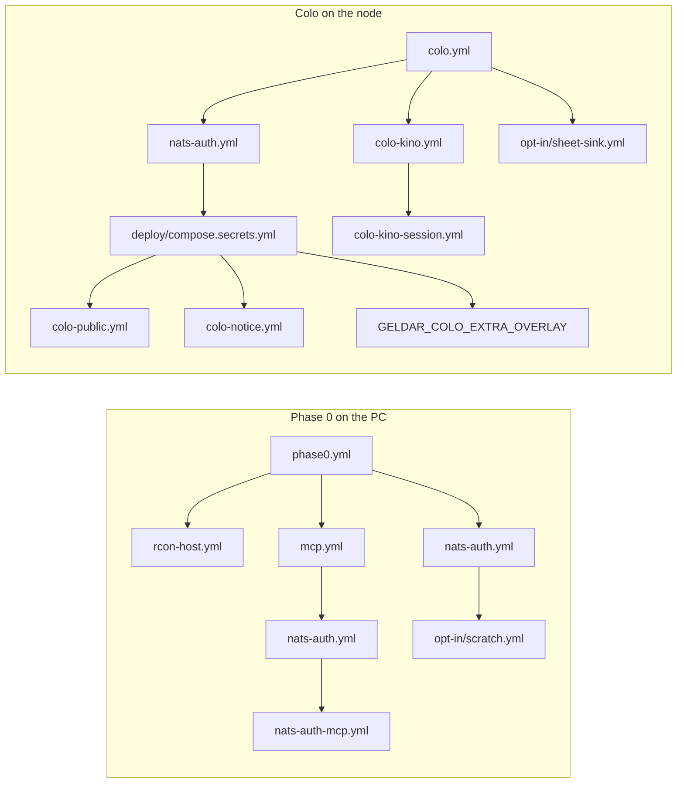

# Compose stacks

Every Docker Compose file under `compose/`, `compose/opt-in/` and `deploy/`, plus the one example file outside them ([below](#example-outside-compose)): what it is for, the services it defines, how the overlays stack, and each service's image, profile, published ports, volumes, healthcheck and start order. For the keys of the shard files these stacks mount, see [shard config](shard-config.md). For environment variable names, see [environment variables](environment-variables.md). For the scripts that run the Colo stack on the node, see the [deploy scripts](deploy-scripts.md) reference.

All facts were read from the files at commit `1b114276` on 2026-11-16. Nothing was started; no node, VM or container was read.

This page names the Glass, Kino and map services only as services with ports, mounts and budgets. How they behave is in [Glass and Kino](glass-and-kino.md) (`agents-never`); do not copy that detail here.

## The files

| File | Role | Project name | Services it defines or changes | Evidence |
|---|---|---|---|---|
| `compose/phase0.yml` | Base. The Phase 0 shard on the development PC. | `geldar-phase0` | `postgres`, `nats`, `paper`, `velocity`, `eventsink` | Header lines 1 to 6 |
| `compose/rcon-host.yml` | Overlay on `phase0.yml`. Publishes Paper's RCON to host loopback for host-run tools. | (base's) | `paper` (adds one port) | Header |
| `compose/mcp.yml` | Overlay on `phase0.yml`. The MCP server in a hardened container. Also valid alone. | (base's) | `geldar-mcp` | Header lines 1 to 5 |
| `compose/nats-auth.yml` | Overlay on `phase0.yml` or `colo.yml`. Per-service NATS users (decisions 0067, 0080). | (base's) | `nats`, `paper`, `velocity`, `eventsink` | Header lines 1 to 12 |
| `compose/nats-auth-mcp.yml` | Overlay on `phase0.yml` + `mcp.yml` + `nats-auth.yml`. The MCP's NATS user. Not used on Colo. | (base's) | `geldar-mcp` | Header |
| `compose/colo.yml` | Base. The Colo production stack for the shared node (decision [0082](../decisions/0082-colo-compose-network-and-limits.md)). Standalone. | `${GELDAR_PROJECT:-geldar-colo}` | 14 services (below) | Header lines 1 to 8 |
| `compose/colo-public.yml` | Overlay on `colo.yml` + `nats-auth.yml`. The one public Minecraft publish (decision 0096). It publishes the offline-mode bot ingress; see [known gaps](#known-gaps). | (base's) | `velocity` (adds one port) | Header lines 1 to 5 |
| `compose/colo-kino.yml` | Overlay on `colo.yml`. Gives Glass a NATS connection for Kino (decision 0075); merged only when the owner enables Kino. | (base's) | `glass` | Header lines 1 to 3 |
| `compose/colo-kino-session.yml` | Overlay after `colo-kino.yml`. Gives Glass a session key secret. | (base's) | `glass` | Header lines 1 to 6 |
| `compose/colo-notice.yml` | Overlay on `colo.yml` + `nats-auth.yml`, before the secrets overlay. The deploy's NATS password for the maintenance notice. | (base's) | `admin` | Header |
| `compose/signcheck.yml` | Standalone throwaway shard for sign-fact checks, on its own VM. | `geldar-signcheck` | `paper`, `nats` (profile `core`), `paper-core` (profile `core`), `paper-rcon` (profile `rcon`) | Header lines 1 to 8; [signcheck runbook](../runbooks/signcheck-shard.md) |
| `compose/opt-in/scratch.yml` | Overlay on `phase0.yml` (and `nats-auth.yml`). Throwaway scratch stack; use only through `deploy/scratch/scratch.sh`. | `scratch-<suffix>` | `postgres`, `nats`, `paper`, `velocity`, `eventsink` | Header lines 1 to 8; [scratch-stack runbook](../runbooks/scratch-stack.md) |
| `compose/opt-in/sheet-sink.yml` | Overlay on `colo.yml`. Passes the eventsink's sheet, XP and proficiency variables through. | (base's) | `eventsink` | Header lines 1 to 7 |
| `deploy/compose.secrets.yml` | Overlay for the Colo node (decision 0084). Points each secret at the node's secrets directory. The local stack does not use it. | (base's) | none (secrets only) | Header lines 1 to 4 |

Supporting files in `compose/` that are not compose files:

| File | Purpose | Evidence |
|---|---|---|
| `compose/.env.example` | Non-secret settings for `phase0.yml`; CI and `shard up` copy it to the gitignored `compose/.env`. One key: `PAPER_MEMORY`. | File |
| `compose/paper/paper-entrypoint.sh` | Paper entrypoint: writes the Velocity forwarding secret from its Docker secret into `paper-global.yml` (or changes only the secret line of an existing file), checks the written forwarding block and refuses to start Paper if it does not enable forwarding with the current secret, writes the bundled profiler's config on every start, then starts the image. Refuses an empty secret or one outside `[A-Za-z0-9_-]`. | File, all 73 lines |
| `compose/velocity/velocity.toml` | Velocity bot ingress config: `online-mode = false` (line 9), modern forwarding (line 12), the forwarding secret from its Docker secret, Paper as the only server. | Header lines 1 to 23 (file is 48 lines) |
| `compose/bluemap-web/Caddyfile` | The map web server config: GET and HEAD only (others get 405); static tiles and textures read-only, with gzip handling for tile files; only the live player JSON proxied (through `bluemap-alias`); also serves one stylesheet, two scripts and a chat-feed file. | File, all 93 lines |
| `compose/cloudflared/config.example.yml` | Template for a public tunnel (decision 0053, deferred). Nothing runs it. | Header lines 1 to 3 (file is 12 lines) |
| `compose/probe/login-probe.mjs` | Manual login probe for the forwarding wall (spec 5.1). CI and `check` do not run it. | Header lines 1 to 8 (file is 214 lines) |

Re-derive the file list:

```powershell
git ls-files compose deploy/compose.secrets.yml
```

### Example outside `compose/`

`threshold/mcp-mock/compose.example.yml` is the only other tracked compose file (`git ls-files | Select-String -Pattern 'compose[^/]*\.ya?ml$'`, 2026-11-16, returns it and `deploy/compose.secrets.yml`). It is an example for people who run the [MCP mock](mcp-tools.md) themselves: one service, `geldar-mcp-mock`, from the GHCR image pinned by digest, published on `127.0.0.1:8787`, with a tokens file bind-mounted read-only from outside the repo, a read-only root, all capabilities dropped and `no-new-privileges` (lines 5 to 17). No script, CI job or gate runs it, and it is outside the `loopback-ports` file pattern. Its host port is the same as the Colo `glass` port in [host loopback ports](#host-loopback-ports), so the two cannot run on one host at the same time with these defaults.

## How the files stack

Later files override earlier ones by key; Compose merges secrets by name. The order matters for the secrets overlay: `deploy/common.sh` lines 10 to 13 merge `nats-auth.yml` before `deploy/compose.secrets.yml` so the secrets overlay, merged last, points every NATS secret at the node's secrets directory.



| Who runs it | `-f` order | Evidence |
|---|---|---|
| `./geldar.ps1 shard up\|down\|status\|logs <shard>` | `compose/<shard>.yml`; `+ rcon-host.yml` with `--rcon-host` (refused for `colo`); `+ nats-auth.yml` for `shard up colo`. Project `geldar-<shard>`. | `geldar.ps1` lines 432 to 441 |
| `./geldar.ps1 mcp ...` | `phase0.yml`, `mcp.yml`; project `geldar-phase0` | `geldar.ps1` line 492 |
| Phase 0 with NATS auth and the MCP | `phase0.yml`, `mcp.yml`, `nats-auth.yml`, `nats-auth-mcp.yml` | `compose/nats-auth.yml` line 8 |
| Colo deploy (`dc` in `deploy/common.sh`) | `colo.yml`, `nats-auth.yml`, `deploy/compose.secrets.yml`, then `colo-public.yml` when both `GELDAR_MC_BIND` and `GELDAR_MC_PORT` are set, then `GELDAR_COLO_EXTRA_OVERLAY` when set. Project `${GELDAR_PROJECT:-geldar-colo}`. | `deploy/common.sh` lines 57 to 69 |
| `deploy/colo-notice.sh` | `colo.yml`, `nats-auth.yml`, `deploy/compose.secrets.yml`, `colo-notice.yml`, profile `admin` | `deploy/colo-notice.sh` line 85 |
| `deploy/colo-admin.sh` | `colo.yml`, `nats-auth.yml`, `deploy/compose.secrets.yml`, the extra overlay if set, then a generated token or skins overlay (mode 0600, removed after the run); profile `admin` or `sovereign` | `deploy/colo-admin.sh` lines 18 to 27, 147 to 158, 195 to 198 |
| `deploy/scratch/scratch.sh` | `phase0.yml`, `nats-auth.yml` and a generated NATS override when NATS auth is on; else `phase0.yml`, `opt-in/scratch.yml`. Needs Compose 2.24.4 or newer for `!override`. | `deploy/scratch/scratch.sh` lines 16, 141 to 146 |
| Kino on Colo | `colo.yml`, `colo-kino.yml`, then `colo-kino-session.yml` when the key file exists | `compose/colo-kino.yml` lines 1 to 3; `compose/colo-kino-session.yml` lines 1 to 6 |
| Sheet sink | `colo.yml`, `opt-in/sheet-sink.yml`, `up -d eventsink` | `compose/opt-in/sheet-sink.yml` line 3 |

Which file the node passes in `GELDAR_COLO_EXTRA_OVERLAY` is node state and is not in the repo (unverified; plan decision D8).

## Phase 0 stack: `compose/phase0.yml`

All host ports bind `127.0.0.1`. Images are pinned by digest.

| Service | Image | Host ports | Volumes and mounts | Healthcheck | Depends on |
|---|---|---|---|---|---|
| `postgres` | `pgvector/pgvector` 0.8.6-pg16, pinned by digest | 5432 | `postgres-data`; `../sql` read-only as the init folder (applied on a fresh volume only) | `pg_isready` on `127.0.0.1`, every 5 s, 30 retries | none |
| `nats` | `nats` 2.15.1-alpine, pinned by digest; JetStream on, monitor on 8222 | 4222, 8222 | `nats-data` | `wget` of `/healthz?js-enabled-only=true` on the monitor | none |
| `paper` | `itzg/minecraft-server` (Paper 26.1.2 build 74), pinned by digest; custom entrypoint | none (game port and RCON stay on the compose network) | `paper-data` (name from `GELDAR_WORLD_VOLUME`, default `geldar-phase0_paper-data`); the entrypoint script; the Geldar-Core jar from `plugin/core/build/libs`, read-only | `mc-health` and the Geldar-Core ready marker matching the live process; 10 min start period | none |
| `velocity` | `itzg/mc-proxy` (Velocity 3.5.1 build 615), pinned by digest | 25565 (the bot ingress) | `velocity.toml` read-only; `velocity-data`; the velocity-identity jar, read-only | Identity plugin ready marker matching the live process, and the port open | `paper` healthy, `nats` healthy |
| `eventsink` | Built from `eventsink/Dockerfile` (context: repo root) | none | none | none | `postgres` healthy, `nats` healthy |

Secrets (by compose name and role): `postgres` (database superuser password), `rcon` (Paper RCON password), `velocity-forwarding` (the Velocity forwarding secret). `./geldar.ps1 shard secrets phase0` creates any missing one and never overwrites (`geldar.ps1` line 14).

Paper's world settings (`SEED`, whitelist, view distance, the world border and gamerules run at start by `RCON_CMDS_STARTUP`) are literals in the file (`compose/phase0.yml` lines 58 to 85).

## Colo stack: `compose/colo.yml`

Standalone, on its own network `colo` (name `${GELDAR_NETWORK:-geldar-colo}`, subnet from `GELDAR_COLO_SUBNET`; the repo default is an RFC 5737 documentation range and the node sets a private one, `compose/colo.yml` lines 697 to 704). Every service has a CPU and memory budget as `${GELDAR_COLO_<SERVICE>_CPUS:-x}` and `${GELDAR_COLO_<SERVICE>_MEM:-y}`, `memswap_limit` equal to memory (no swap), a pids limit, json-file log rotation (10 MiB, 3 files) and the labels `com.centurylinklabs.watchtower.enable: "false"` and `com.geldar.stack: colo` (lines 16 to 27). `shards/colo.yaml` holds the total (see [shard config](shard-config.md#shardscoloyaml)). The repo's own images take their reference from a deploy variable (`GELDAR_<NAME>_IMAGE`) with a local tag as the offline default; the third-party images are pinned by digest.

| Service | Profile | Budget (CPU, memory, pids) | Image | Host ports (127.0.0.1) | Volumes and mounts | Healthcheck | Depends on |
|---|---|---|---|---|---|---|---|
| `postgres` | default | 1, 2048m, 256 | pgvector, digest | none | `postgres-data`; `../sql` init | `pg_isready` | none |
| `nats` | default | 0.5, 512m, 256 | nats, digest; JetStream, no monitor port | none | `nats-data` | `nc -z 127.0.0.1 4222` (TCP probe; never the monitor) | none |
| `paper` | default | 8, 15360m, 512; heap 10G | itzg/minecraft-server, digest | none | `paper-data`; entrypoint; Geldar-Core jar; the BlueMap, Chunky and CoreProtect jars from the node state directory (`GELDAR_STATE_DIR`), read-only; `../plugins/bluemap/config` read-only; agent skin PNGs read-only, never created by compose | `mc-health` and the Geldar-Core ready marker | none |
| `velocity` | default | 0.5, 1024m, 256 | itzg/mc-proxy, digest | `${GELDAR_PORT_BOT:-25567}` to 25565 | `velocity.toml`; `velocity-data`; velocity-identity jar | Identity ready marker and port open | `paper`, `nats` healthy |
| `eventsink` | default | 0.5, 512m, 256 | `GELDAR_EVENTSINK_IMAGE` | none | none | none | `postgres`, `nats` healthy |
| `golem-body` | `adam` | 1, 2048m, 256 | `GELDAR_BODY_IMAGE`; entry `src/adam/main.ts` | none | `shards/colo-mind.yaml` read-only as `/opt/geldar/shards/colo.yaml` | none | `nats` healthy |
| `geldar-mcp` | default | 0.5, 512m, 128 | `GELDAR_MCP_IMAGE` | `${GELDAR_PORT_MCP:-8788}` | Mind shard file; read-only root, `/tmp` tmpfs | Node TCP connect to 8788 | `postgres`, `nats` healthy |
| `register` | `register` | 0.25, 128m, 64 | `GELDAR_REGISTER_IMAGE` | `${GELDAR_PORT_REGISTER:-18090}` to 8090 | read-only root, `/tmp` tmpfs | HTTP GET `/` returns 200 or 503 | `postgres` healthy |
| `glass` | default | 0.5, 256m, 128 | `GELDAR_GLASS_IMAGE` | `${GELDAR_PORT_GLASS:-8787}` | The node's alias directory, read-only; read-only root | none | `postgres` healthy |
| `bluemap-alias` | default | 0.1, 64m, 32 | `node` 22, digest; runs `alias-proxy.ts` mounted read-only | none | The node's alias directory, read-only | none | none |
| `bluemap-web` | default | 0.25, 64m, 64 | `caddy`, digest | `${GELDAR_PORT_BLUEMAP:-8100}` | `paper-data` subpath `bluemap/web` read-only (Compose 2.30+ / Engine 26+); Caddyfile and the three map web files read-only | none | `paper` healthy, `bluemap-alias` started |
| `players-host` | `sovereign` | 1, 2048m, 256 | `GELDAR_BODY_IMAGE`; entry `src/players/main.ts --player ${GELDAR_PLAYER_ID}` | none | Mind shard file | none | `paper`, `nats` healthy |
| `admin` | `admin` | 0.5, 512m, 128 | `GELDAR_ADMIN_IMAGE` (decision [0133](../decisions/0133-colo-admin-by-one-shot-container.md)); `restart: "no"` | none | Mind shard file at the path `GELDAR_SHARD_FILE` names | none | `postgres` healthy |

Re-derive the services, profiles and published ports:

```powershell
Select-String -Path compose/colo.yml -Pattern '^  [a-z][a-z0-9-]+:$|profiles:|"127\.0\.0\.1:'
```

Notes from the file:

- `animus` is under the `mind` profile until a Thinker path exists (decision 0134; line 282). `golem-body` is under `adam` (decision 0212; line 235). `register` is off by default (profile `register`, `REGISTER_KILL_SWITCH` true; line 391). `players-host` is under `sovereign`; `deploy/colo-admin.sh` starts one per player with `compose run` and sets `restart unless-stopped` itself (decision 0342; lines 592 to 640).
- `geldar-mcp`, `register`, `glass`, `bluemap-alias`, `bluemap-web` and `admin` run read-only as the service uid (`GELDAR_SERVICE_UID`, default 1000) with all capabilities dropped and `no-new-privileges`. `bluemap-web` adds back `NET_BIND_SERVICE` so the Caddy binary can exec (lines 580 to 582).
- The Colo file never publishes 25565 or 25566: the node also runs a production game server (line 7; decision 0082).
- Secrets (compose name, role): `postgres` (superuser), `rcon`, `velocity-forwarding`, `nats-body`, `nats-mind`, `nats-mcp` (NATS passwords), `postgres-mcp.txt`, `postgres-glass.txt`, `postgres-register.txt` (role passwords), `mcp-token-pepper.txt` (token hashing pepper), `register-pepper`, `register-ms-secret` (the Entra client secret, owner-provided), `register-session-key` (session cookie key, shared with Glass). Their files are created by `./geldar.ps1 shard secrets colo`, `shard nats-auth colo`, `mcp-tokens init` and, on the node, `deploy/gen-secrets.sh` (lines 706 to 738).

Volumes: `postgres-data`, `nats-data`, `paper-data`, `velocity-data` (lines 740 to 744).

## Overlays in detail

| Overlay | What it adds or changes |
|---|---|
| `rcon-host.yml` | `paper` publishes `127.0.0.1:25575`. |
| `mcp.yml` | `geldar-mcp` built from `threshold/mcp/Dockerfile`, tag `geldar-mcp:local`; publishes `127.0.0.1:8788`; uid 1000, read-only root, `cap_drop: ALL`, `mem_limit 512m`, `pids_limit 128`; TCP healthcheck; secrets `postgres-mcp.txt` and `mcp-token-pepper.txt`. A commented `cloudflared` service shows the deferred public tunnel (decision 0053). |
| `nats-auth.yml` | `nats` runs with the generated server config (secret `nats-auth.conf`); `paper`, `velocity` and `eventsink` get `GELDAR_NATS_USER` and a password file. Adds no service. The base's healthcheck stays. |
| `nats-auth-mcp.yml` | `geldar-mcp` gets the `mcp` NATS user and its password file. On Colo the same wiring is in `colo.yml` itself (line 358). |
| `colo-public.yml` | `velocity` publishes `${GELDAR_MC_BIND:?}:${GELDAR_MC_PORT:?}` to 25565: the node's own interface address and a public port set by the operator. No value is in the repo. `deploy/common.sh` refuses a wildcard bind, a non-IPv4 bind, only one of the two variables, and port 25565 or 25566 (lines 72 to 105). This `velocity` is the offline-mode bot ingress; see [known gaps](#known-gaps). |
| `colo-kino.yml` | `glass` gets a NATS connection as the `kino` user, the allowed origin list (required), the shard name and a read-only skins mount. Repeats the Glass limits and logging because the gate checks every `colo*.yml` as a base file. |
| `colo-kino-session.yml` | `glass` gets the session key secret. |
| `colo-notice.yml` | `admin` gets the `nats-deploy` secret from the node's secrets directory. |
| `deploy/compose.secrets.yml` | Repoints 17 secret names at `${GELDAR_SECRETS_DIR}`. |
| `opt-in/scratch.yml` | Replaces every published port with a loopback port from `SCRATCH_*_PORT` (defaults 15432, 14222, 18222, 35565); caps memory and CPU on every service; `restart: "no"`; label `geldar.scratch=true`; secrets and the world volume from the script's state directory. |
| `opt-in/sheet-sink.yml` | `eventsink` gets `GELDAR_SHEET_SHARD`, `GELDAR_XP` and `GELDAR_PROFICIENCY_THRESHOLDS` from the host when set. `colo.yml` passes the same three through already (empty when unset), so colo needs no overlay: see the node env file note in [colo deploy](../runbooks/colo-deploy.md). |

## Signcheck stack: `compose/signcheck.yml`

| Service | Profile | Host ports (127.0.0.1) | Notes |
|---|---|---|---|
| `paper` | default | 25570 | Vanilla Paper, no plugins, no secrets, RCON off, whitelist off, `mem_limit 3g`, `restart: "no"`. |
| `nats` | `core` | none | JetStream, monitor healthcheck. |
| `paper-core` | `core` | 25571 | Paper with Geldar-Core (`GELDAR_CORE_JAR`), RCON on, depends on `nats` healthy. |
| `paper-rcon` | `rcon` | 25570, 25575 | Paper with RCON on, for the edit-sign live fixture only. |

The three Paper services share the `paper-data` world volume (name from `GELDAR_WORLD_VOLUME`): run one at a time (lines 57 to 58, 96). The RCON secret file is named by `GELDAR_RCON_FILE`.

## Host loopback ports

| Port | Stack | Service | Evidence |
|---|---|---|---|
| 4222, 8222 | phase0 | `nats` client and monitor | `compose/phase0.yml` lines 43 to 45 |
| 5432 | phase0 | `postgres` | line 27 |
| 8100 | colo | `bluemap-web` | `compose/colo.yml` line 574 |
| 8787 | colo; mcp-mock example | `glass`; `geldar-mcp-mock` | line 494; `threshold/mcp-mock/compose.example.yml` line 8 |
| 8788 | phase0 + mcp, colo | `geldar-mcp` | `compose/mcp.yml` line 26; `compose/colo.yml` line 368 |
| 18090 | colo | `register` | line 442 |
| 25565 | phase0 | `velocity` bot ingress | `compose/phase0.yml` line 121 |
| 25567 | colo | `velocity` bot ingress | `compose/colo.yml` line 187 |
| 25570, 25571 | signcheck | `paper`, `paper-rcon`; `paper-core` | `compose/signcheck.yml` lines 35, 83, 117 |
| 25575 | phase0 + rcon-host, signcheck | Paper RCON | `compose/rcon-host.yml`; `compose/signcheck.yml` line 118 |
| 14222, 15432, 18222, 35565 | scratch (defaults) | `nats`, `postgres`, `nats` monitor, `velocity` | `compose/opt-in/scratch.yml` |

The only publish that is not on loopback is the `colo-public.yml` entry, bound to an operator-set node address.

Re-derive:

```powershell
git grep -nE '"127\.0\.0\.1:|GELDAR_MC_BIND' -- compose
```

## Gates

| Gate | What it checks | Evidence |
|---|---|---|
| `loopback-ports` in `pnpm check:repo` | Every service in `compose/*.yml` (top-level files only; `compose/opt-in/` and `deploy/compose.secrets.yml` are outside its file pattern) publishes on `127.0.0.1` only. Interpolated host ports pass only in the form `127.0.0.1:${GELDAR_PORT_<NAME>:-<default>}:<port>` with `NAME` and default on an allowlist (`BOT` 25567, `MCP` 8788, `REGISTER` 18090, `GLASS` 8787, `BLUEMAP` 8100). The one public exception is the `velocity` entry in `colo-public.yml`. For `colo*.yml` files it also requires limits and logging on every service, forbids `privileged`, `pid`, `ipc`, `userns_mode`, `devices` and `sysctls`, and allows only listed bind sources. | `tools/repo-checks/src/loopback-ports.ts` lines 1 to 6, 27 to 29, 54 to 66, 136 to 162 |
| `docker compose config --quiet` in `./geldar.ps1 check` | Each `compose/*.yml` that is not an overlay, alone; then the merges `colo + nats-auth`, `colo + nats-auth + colo-public` (dummy bind and port), `colo + colo-kino`, `colo + colo-kino + colo-kino-session`, `colo + nats-auth + colo-notice` (dummy secrets directory), `phase0 + rcon-host`, `phase0 + mcp + nats-auth + nats-auth-mcp`. | `geldar.ps1` lines 153 to 183 |
| CI job `compose` | The same standalone files (same seven-overlay skip list, line 96) and every merge above except `colo + nats-auth` alone, after copying `compose/.env.example` to `compose/.env`. Its chains start at `colo + nats-auth + colo-public`. See [conflict 5](#conflicts-recorded). | `.github/workflows/ci.yml` lines 71 to 120 |
| `colo-services.test.ts` | The 14 Colo services, their budgets, labels, profiles, images, mounts, secrets and published ports. | `tools/repo-checks/src/colo-services.test.ts` |
| `mcp-overlay.test.ts` | The MCP secret names match the files `mcp-tokens init` writes. | `compose/mcp.yml` lines 59 to 61 |
| `Read-ColoConfig` | `shards/colo.yaml` total is at least the sum of the per-service budgets. | [shard config](shard-config.md#shardscoloyaml) |

## Conflicts recorded

Recorded, not resolved (persona rule 8).

1. **Port comments versus the gate.** Comments in `compose/colo.yml` (lines 185 to 186, 367, 441, 493, 573) say a published port must be literal because "the loopback rule rejects interpolation". Each of those lines uses `${GELDAR_PORT_<NAME>:-<default>}`, which `tools/repo-checks/src/loopback-ports.ts` lines 54 to 66 now allow (the parameterised form decision 0188 called for). `colo-services.test.ts` line 193 still names the MCP port "a literal".
2. **Register secrets in the node overlay.** `deploy/compose.secrets.yml` repoints `register-github-secret` and `register-discord-secret`, which `compose/colo.yml` does not declare. `compose/colo.yml` declares `register-ms-secret` and `register-session-key` with their own `GELDAR_SECRETS_DIR` path (falling back to the repo's git-ignored dev secrets folder) instead (lines 735 to 738). The register service is Microsoft sign-in only (line 418). See also [glossary conflict 6](glossary.md#conflicts-recorded) on GitHub and Discord wording.
3. **MCP on Colo.** `compose/nats-auth-mcp.yml` line 4 says "Colo does not include the MCP service", and `compose/nats-auth.yml` line 6 says only the Phase 0 MCP stack needs the MCP entry. `compose/colo.yml` defines `geldar-mcp` (line 324) and wires its NATS user itself (line 358).
4. **Monitor port.** `compose/phase0.yml` publishes the NATS monitor on 8222 and checks health through it. `compose/colo.yml` lines 77 to 79 say the monitor lists subjects and subscriptions and must never be probed; it has no monitor port. Both are deliberate per their comments; the two stacks differ.
5. **"The same chains" in CI.** The comment on `.github/workflows/ci.yml` line 94 says the `compose` job checks "the same chains as ./geldar.ps1 check". `geldar.ps1` line 157 runs `colo.yml` + `nats-auth.yml` alone (the merge `shard up colo` starts); `ci.yml` lines 101 to 120 have no such step. [CI workflows conflict 2](ci-workflows.md#conflicts-recorded) and [CLI tools](cli-tools.md#conflicts-recorded) record the same gap.

## Known gaps

One known gap, open and not fixed: the public overlay against decision [0137](../decisions/0137-public-spectator-proxy-is-separate-and-online.md), recorded in decision [0364](../decisions/0364-known-gap-public-overlay-against-0137.md). Node state is unchecked (plan decision D8).
