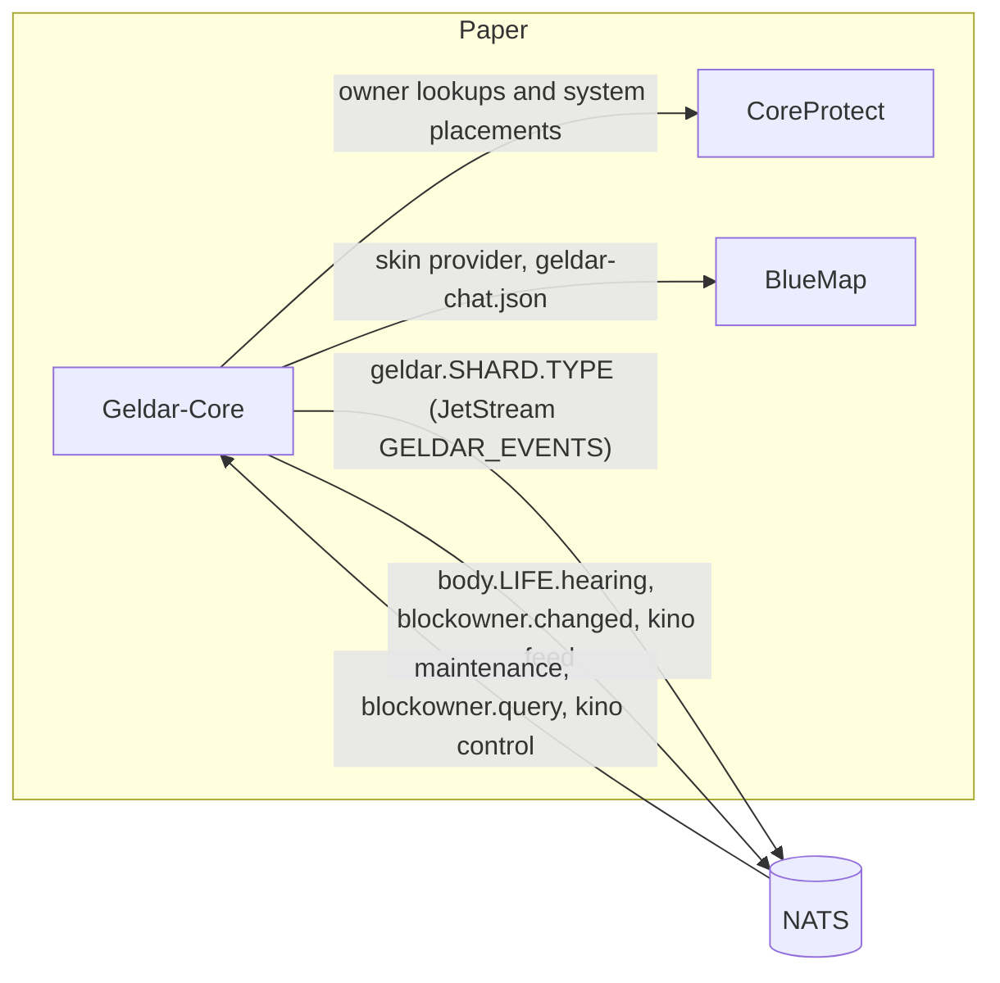

# Geldar-Core plugin

Geldar-Core is the Paper plugin in `plugin/core`. It exports world events to NATS, blocks typed commands, holds ghosts in spectator, places gravestones, answers block-owner queries, gates chat by distance, relays maintenance notices, feeds the public map's chat panel and skins, and carries the world side of the Kino and Lakitu camera feeds. Spec Appendix F lists what the spec asks of it; [Spec Appendix F against the code](#spec-appendix-f-against-the-code) says what exists.

Everything below was read from the files in `sources:` at commit `1b114276` on 2026-11-16. Nothing was read from a running server (plan decision D8).

Related: the [Velocity identity plugin](velocity-identity-plugin.md), the [third-party plugins](third-party-plugins.md) it works with, for the camera side [Glass and Kino](glass-and-kino.md) (`agents-never`), [nats-subjects](nats-subjects.md) and [identity-and-ingress](../concepts/identity-and-ingress.md). One known gap, against decision 0137, is under [Known gaps](#known-gaps). This page is `agents-never`: it covers the world side of the camera feeds (decision [0361](../decisions/0361-agents-never-placement-and-public-detail.md)).

## Identity

| Field | Value | Evidence |
|---|---|---|
| Plugin name | `GeldarCore` | `plugin.yml` |
| Main class | `dev.geldar.core.GeldarCore` | `plugin.yml` |
| Paper API | `api-version: "26.1"`; built against `paper-api` `26.1.2.build.74-stable` | `plugin.yml`, `plugin/gradle/libs.versions.toml` |
| Soft dependencies | `CoreProtect`, `BlueMap` | `plugin.yml` |
| Java | 25 | `plugin/.java-version`, toolchain in `plugin/core/build.gradle.kts` |
| Bundled library | `jnats` 2.26.4 (the only `implementation` dependency) | `plugin/core/build.gradle.kts` |
| Compile-only | Paper API, Gson 2.14.0, CoreProtect 24.1, BlueMap API 2.8.2, flow-math 1.0.3 | `plugin/core/build.gradle.kts`, `libs.versions.toml` |
| Jar | `plugin/core/build/libs/geldar-core.jar` | `tasks.jar` in `plugin/core/build.gradle.kts` |
| Sources | 87 main and 71 test Java files | `git ls-files plugin/core/src/main/java \| wc -l` and the same for `src/test`, 2026-11-16 at 1b114276 |
| Owner | Not named in the code or the plan. Plan decision D3 asks for a campaign or coordinator role; none is assigned yet. | `docs/analysis/docs-library/plan.md` sections 7 and 12 |
| Database | None. The plugin has no JDBC dependency and no SQL. Block owners come from CoreProtect's own store. | `grep -rn 'jdbc\|java.sql' plugin/core/src/main plugin/core-common/src/main` finds nothing; `build.gradle.kts` |

This corrects the plan's risk R9 ("the plugin's use of Postgres", inferred): the plugin uses no Postgres.

## How it fits



## Enable and disable

`GeldarCore.enable()` runs these steps in order. Any `RuntimeException` releases what started and stops the server (`enableOrStop`): "A server that runs on without the command block and the export is worse than one that stops."

1. Load `config.yml` and the environment (`CoreConfig.load`). A shard name that does not match `^[a-z][a-z0-9-]{1,31}$` fails the enable.
2. Start the NATS event publisher and the exporter.
3. Register the exporter, the recipe grant (only when `recipes.grant_on_join` is true), the command block and the ghost handling.
4. Register Lakitu only when `lakitu.enabled` is true.
5. Register Kino always; it starts killed unless `kino.enabled` is true.
6. Register maintenance notices, then block ownership.
7. Register gravestones (after block ownership, so each gravestone is recorded as owned by the system) and the `geldar-backfill-graves` command.
8. Register proximity chat with muffled hearing, and the death-line listener.
9. Register the BlueMap skin provider and the chat feed. Each is wrapped: a failure logs one warning and leaves that feature off.
10. Schedule the 5-second config reload (every 100 ticks) and the wall-clock `server_tps` timer.
11. Write the readiness marker `/tmp/geldar-core.ready` (pid and start time) and log `Geldar-Core enabled for shard <shard>`.

`onDisable` stops the TPS timer, closes block ownership, the hearing sink and the publisher (which flushes for up to two seconds, `plugin/README.md`), and removes the readiness marker. The Paper healthcheck in `compose/phase0.yml` and `compose/colo.yml` compares the marker with `/proc/<pid>/stat`, so a plugin that failed to load is never healthy.

## Features

| Feature | Package or class | What it does | Switch | Decisions |
|---|---|---|---|---|
| Event export | `EventExporter`, `NatsEventPublisher`, `BoundedEventQueue`, `EventEnvelope` | Publishes `server_tps` (wall-clock timer), `damage`, `death`, `sleep` to `geldar.<shard>.<type>` in JetStream stream `GELDAR_EVENTS` (created if missing: subjects `geldar.*.*`, file storage, 30-day retention). `Nats-Msg-Id` is the `source_event_id`. Publishing only enqueues; a bounded queue drops the oldest event when full. Type `dlq` is rejected. | none | [0041](../decisions/0041-event-export-stream-and-sink.md) |
| Command block | `CommandBlockListener` | Cancels and logs every command a player types (`HIGHEST` priority), operators included. Console and RCON are not affected. Log text is truncated and rate-limited. | none | spec Appendix F |
| Ghosts | `GhostListener` | Holds non-agent joiners in spectator (spec 8.4). | none | [0092](../decisions/0092-velocity-spectator-whitelist.md), [0137](../decisions/0137-public-spectator-proxy-is-separate-and-online.md) |
| Recipes | `RecipeGrantListener` | Grants every recipe on join, only for a test shard. Off by default: recipes unlock through play. | `recipes.grant_on_join` | [0048](../decisions/0048-recipe-discovery-is-part-of-the-game.md) (reverses [0032](../decisions/0032-table-crafting-and-recipe-book.md)) |
| Gravestones | `Gravestone`, `GravestoneListener` | Places a stone-brick block and a sign where an agent character (`ag_*`) dies; no loot. Each is recorded as owned by the system through CoreProtect. | `gravestones.enabled`, `gravestones.max_per_chunk` | [0195](../decisions/0195-gravestones-owned-by-system.md), [0147](../decisions/0147-death-is-knowable-while-permadeath-is-off.md) |
| Grave backfill | `GraveBackfillCommand`, `GraveBackfill` | Records gravestones already standing in loaded chunks as owned by the system. | console command | [0195](../decisions/0195-gravestones-owned-by-system.md) |
| Block owner | `blockowner/` | Answers who placed the block that is there now, from CoreProtect, per chunk; publishes owner changes. Without CoreProtect (or with its API older than 12) every query answers unknown. | `blockowner.enabled`, `blockowner.lookup_timeout_ms`, `blockowner.debug` | [0165](../decisions/0165-block-owner-subjects.md), [0164](../decisions/0164-goto-digs-and-builds-its-way.md), [0219](../decisions/0219-decayed-farmland-is-not-ownership.md) |
| Maintenance notices | `maintenance/` | Subscribes to `geldar.<shard>.maintenance` and broadcasts valid notices as server lines to online players. | `maintenance.broadcast` | runbook [maintenance-notice](../runbooks/maintenance-notice.md) |
| Proximity chat and deaths | `proximity/ProximityChatListener`, `ProximityDeathListener`, `ProximityRule` | Chat reaches players within the clear tier; the death line goes only to players within 32 blocks (`HEARING_RADIUS_BLOCKS`) and the console. | `chat.muffle.*` | [0198](../decisions/0198-proximity-chat-and-deaths.md), spec 5.8 and 5.9 |
| Muffled hearing | `proximity/` (`Absorption`, `ChatHearing`, `NatsHearingSink`) | Walls and sealed rooms add effective distance; a listener in the muffled tier gets no words and a `heard_muffled` notice on `geldar.<shard>.body.<life_id>.hearing`. | `chat.muffle.*` | [0199](../decisions/0199-muffled-hearing.md) |
| Agent skins on the map | `skins/` | Registers a BlueMap skin provider that reads `<agent_id>.png` from `GELDAR_AGENT_SKINS_DIR` (default `/data/skins`) and never returns an empty skin. Off when BlueMap is not enabled. | none (BlueMap presence) | [0187](../decisions/0187-bluemap-skin-provider-in-geldar-core.md), [0140](../decisions/0140-agent-skins.md) |
| Map chat feed | `speech/` | Keeps the last 100 agent chat lines (`ChatRing.CAPACITY`) and writes `geldar-chat.json` (UUID and plain text, plus a world clock) into the BlueMap web root about once a second when changed. Off when BlueMap is not enabled. | none (BlueMap presence) | [0310](../decisions/0310-live-chat-panel-on-the-map.md) (removes the bubbles of [0197](../decisions/0197-speech-bubbles-on-the-map.md)) |
| Kino feed | `kino/` | World side of the Kino camera feed for Glass. Always registered; publishes nothing while killed. Detail: [Glass and Kino](glass-and-kino.md). | `kino.enabled` (default `false`) | [0075](../decisions/0075-glass-is-a-lakitu-camera.md), [0139](../decisions/0139-kino-feed-agents-only.md), [0166](../decisions/0166-kino-monitor-wall-and-lakitu-camera.md) |
| Lakitu feed | `lakitu/` | Registered only when enabled. See [Lakitu wiring](#lakitu-wiring). | `lakitu.enabled` (default `false`) | [0100](../decisions/0100-lakitu-feed-contract.md), [0101](../decisions/0101-lakitu-feed-plugin.md) |

Every row is from the class named and from `GeldarCore.java`. Gravestone and command-block details beyond this table are in `plugin/README.md`.

### Lakitu wiring

`LakituFeed.register` adds a block-update listener that fills an `UpdateQueue` and returns the queue. `GeldarCore` discards the return value, and no class outside `lakitu/` refers to `UpdateQueue`, `ChunkReader`, `PaneRegistry` or `AgentRegistry` (`grep -rn` over `plugin/core/src/main/java`, 2026-11-16). So with `lakitu.enabled: true` the listener fills a queue that nothing drains. Inferred: the Lakitu frame builder is not wired in this commit, and Kino (the `kino/` package) is the feed in use.

## Commands and permissions

| Command | Who may run it | What it does | Evidence |
|---|---|---|---|
| `/geldar-backfill-graves` | Server console or RCON only. A player, even an operator, is refused. | Scans signs in loaded chunks, looks up owners off the server thread, records unowned gravestones as owned by the system, and replies with a tally. A second run while one is going is refused. | `plugin.yml`; `GraveBackfillCommand.isOperatorSender` |

- `plugin.yml` declares no permissions.
- No player command works: `CommandBlockListener` cancels every typed command, operators included. Debugging in game goes through RCON or the console (`plugin/README.md`).
- Spec 5.1 lists LuckPerms for permissions. No LuckPerms jar, lock or config exists in the repo (`grep -rni luckperms plugins compose` finds nothing, 2026-11-16).

## Configuration

`config.yml` is copied to `plugins/GeldarCore/config.yml` on first start (`saveDefaultConfig`). "Reload" means the 5-second reload in `GeldarCore.enable()` applies the key without a restart; "enable" means it is read once at start.

| Key | Default | Read | Notes |
|---|---|---|---|
| `nats.url` | `nats://nats:4222` | enable | `GELDAR_NATS_URL` overrides it. |
| `shard` | `phase0` | enable | `GELDAR_SHARD` overrides it. Must match `^[a-z][a-z0-9-]{1,31}$` or the plugin fails to enable. |
| `queue.capacity` | `10000` | enable | Event queue size; at least 1. |
| `tps_interval_seconds` | `20` | enable | `server_tps` period; at least 1. |
| `recipes.grant_on_join` | `false` | enable | Test shards only (decision 0048). |
| `gravestones.enabled` | `true` | enable | |
| `gravestones.max_per_chunk` | `4` | enable | At least 1; extras are skipped, older ones never removed. |
| `lakitu.enabled` | `false` | enable | Other `lakitu.*` keys: withheld (decision 0361). |
| `kino.enabled` | `false` | reload | The Kino kill switch. Other `kino.*` keys: withheld (decision 0361). |
| `maintenance.broadcast` | `true` | reload | `false` stops the broadcast; the subscription stays. |
| `blockowner.enabled` | `true` | reload | `false` stops the change listener and the query replies. |
| `blockowner.lookup_timeout_ms` | `2000` | reload | Clamped to 100 to 60000 (`BlockOwnerSetup`). A slower lookup answers an empty list with `truncated: true`. |
| `blockowner.debug` | `false` | reload | Extra INFO lines per lookup, rate-limited, no player names. |
| `provenance.enabled` | `false` | reload | Added by AN-28c (merged, #817). Read in `BlockOwnerSetup`, reloaded with the `blockowner.*` keys on the 5 s timer; no `config.yml` default (absent reads as false). On only when `blockowner.enabled` is also true. With this key and `blockowner.enabled` both true, the plugin publishes break, pickup, take and combat provenance messages; all four are inert while it is false. Paper-only: do not enable on NeoForge until the human-handling question is decided. |
| `chat.muffle.margin` | `8.0` | enable | Below 0 becomes 0; not finite becomes 8. |
| `chat.muffle.sealed_penalty` | `4.0` | enable | Below 0 becomes 0; not finite becomes 4.0. |
| `chat.muffle.per_line_cap` | `512` | enable | At least 1. |
| `chat.muffle.per_ray_cap` | `64` | enable | At least 1. |
| `chat.muffle.bench_log` | `false` | enable | Bench shard only; must stay `false` in production and every Colo config (`config.yml` comment). |

Re-derive: `git grep -n -E 'getConfig\(\)\.get|config\.get|file\.get' -- plugin/core/src/main plugin/core-common/src/main` lists every key read.

### Environment

| Variable | Read by | Notes |
|---|---|---|
| `GELDAR_NATS_URL` | `CoreConfig` | Overrides `nats.url`. |
| `GELDAR_SHARD` | `CoreConfig` | Overrides `shard`. `compose/colo.yml` sets `colo`; `compose/phase0.yml` sets `phase0`. |
| `GELDAR_NATS_USER`, `GELDAR_NATS_PASSWORD_FILE` | Every NATS connection in the plugin | Optional; set together or not at all (decision [0067](../decisions/0067-nats-accounts-and-least-privilege.md)). `compose/nats-auth.yml` sets the user to `paper`. The password stays in a file held by the operator; it is never in the repo. |
| `GELDAR_AGENT_SKINS_DIR` | `AgentSkinSetup` | Directory of agent skin PNGs; default `/data/skins`, a read-only mount in `compose/colo.yml`. |

## Interfaces

### Bukkit events handled

Listed from every `@EventHandler` under `plugin/core/src/main/java` except `GhostListener`, whose handlers are not listed (decision 0361) (re-derive: `git grep -n -A2 '@EventHandler' -- plugin/core/src/main plugin/core-common/src/main`).

| Event | Class | Priority |
|---|---|---|
| `PlayerCommandPreprocessEvent` | `CommandBlockListener` | HIGHEST |
| `PlayerJoinEvent` | `RecipeGrantListener` (only when enabled) | as listed |
| `AsyncChatEvent` | `ProximityChatListener` (HIGH), `SpeechChatListener` (MONITOR) | as listed |
| `PlayerDeathEvent` | `ProximityDeathListener` (HIGH), `EventExporter` (MONITOR), `GravestoneListener` (MONITOR) | as listed |
| `EntityDamageEvent` | `EventExporter` | MONITOR |
| `PlayerBedEnterEvent` | `EventExporter` | MONITOR |
| `BlockPlaceEvent`, `BlockBreakEvent` | `blockowner/BlockChangeListener`, `kino/KinoBlockListener`, `lakitu/BlockUpdateListener` | MONITOR |

### NATS subjects

| Subject | Direction | Payload | Class |
|---|---|---|---|
| `geldar.<shard>.<type>` (stream `GELDAR_EVENTS`) | publish (JetStream) | `contract/schemas/event.schema.json` | `NatsEventPublisher`, `EventEnvelope` |
| `geldar.<shard>.body.<life_id>.hearing` | publish (core NATS) | `heard-muffled-event.schema.json` | `NatsHearingSink` |
| `geldar.<shard>.blockowner.query` | subscribe, reply on the request inbox | `block-owner.schema.json` | `NatsBlockOwnerLink` |
| `geldar.<shard>.blockowner.changed` | publish | `block-owner.schema.json` | `NatsBlockOwnerLink` |
| `geldar.<shard>.maintenance` | subscribe | `maintenance-notice.schema.json` | `NatsMaintenanceSubscriber` |
| Kino subjects (decision 0075) | subscribe (control), publish (feed, core NATS) | `kino-control.schema.json`, `kino-feed.schema.json` | `kino/` |

Re-derive: `git grep -n '"geldar\.' -- plugin/core/src/main plugin/core-common/src/main`. Core-NATS publishers drop a message when there is no connection; only the event export queues.

The NATS user `paper` (generator in `geldar.ps1`, line 403 at 1b114276) may publish `geldar.<shard>.>` and the JetStream API, is denied publishing Kino subjects, `blockowner.query`, `ctl.body.>`, `helper.body.>` and `state.*.level`, and may subscribe to Kino subjects, `maintenance`, `blockowner.query` and its inbox.

### Plugin channels and files

| Interface | Direction | Notes |
|---|---|---|
| `/tmp/geldar-core.ready` | written on enable, removed on disable | pid and start time, read by the compose healthcheck. |
| `geldar-chat.json` in the BlueMap web root | written | Written atomically (temp file and move) by `ChatFeedWriter`. |
| CoreProtect API | read; write for system placements | `CoreProtectApi`; only when CoreProtect is loaded with API 12 or newer. |

## Build and test

```powershell
cd plugin; ./gradlew build   # compiles both plugins, runs the JUnit tests, writes the jars
```

- Tests are JUnit 6 and need no server. Envelopes are validated against `contract/schemas/event.schema.json` (`tasks.test` passes the schema folder as `geldar.schemas`). MockBukkit has no Paper 26.1 release, so listener tests use hand-written doubles (`ListenerDoubles`) (`plugin/README.md`).
- Dependencies are exact pins in `plugin/gradle/libs.versions.toml`, locked in `*.lockfile` and checksummed in `plugin/gradle/verification-metadata.xml`.
- CI: the `plugin` job in `.github/workflows/ci.yml` runs `./gradlew build --no-daemon`. `./geldar.ps1 check` runs the Gradle build locally.
- `.github/workflows/plugin-jars.yml` builds and publishes the `plugin-jars` artifact with a `plugin-jars.sha256` file on pushes to `main` that touch its paths.

## Deploy and rollback

- Compose mounts the built jar read-only at `/plugins/geldar-core.jar` (`compose/phase0.yml`, `compose/colo.yml`). Compose does not build it; `./geldar.ps1 shard up phase0` refuses to start without both jars and then checks the logs for `Geldar-Core enabled` (`plugin/README.md`, `CLAUDE.md`).
- On the Colo, the plugin ships through the manual plugin deploy (`plugin/README.md`, gravestones bullet: "needs-manual in colo-cd"). Steps: [colo-deploy](../runbooks/colo-deploy.md). The jar checks are in the [deploy-scripts](deploy-scripts.md) reference.
- Rollback is the previous jar and a Paper restart. Keys marked "enable" in the configuration table also need a restart; keys marked "reload" do not.

## Operate

| Task | Runbook |
|---|---|
| Block owner queries, debug logging | [block-owner](../runbooks/block-owner.md), [coreprotect](../runbooks/coreprotect.md) |
| Maintenance notice | [maintenance-notice](../runbooks/maintenance-notice.md) |
| Agent skins on the map | [skins](../runbooks/skins.md) |
| Map chat panel | [map-chat-panel](../runbooks/map-chat-panel.md) |
| Kino switch | [kino](../runbooks/kino.md) (`agents-never`) |

## Failure modes

| Symptom or cause | Behaviour | Evidence |
|---|---|---|
| Enable throws (bad shard name, unwritable readiness marker, any `RuntimeException`) | The server stops. | `enableOrStop` |
| NATS down | Events queue up to `queue.capacity`, then the oldest is dropped and counted; `server_tps` carries `dropped` and `connected`. Core-NATS messages (hearing, Kino, owner changes) are dropped. Subscribers reconnect forever. | `plugin/README.md`; class comments in `NatsHearingSink`, `NatsBlockOwnerLink`, `NatsMaintenanceSubscriber` |
| CoreProtect absent or API older than 12 | Owner queries answer unknown; system placements are not recorded. One warning at enable. | `BlockOwnerSetup.sourceFor` |
| BlueMap absent | Skin provider and chat feed are off; one INFO line each. | `AgentSkinSetup`, `SpeechSetup` |
| Server-thread hop for hearing fails | Every other player is silenced for that line (the safe side). | `ProximityChatListener` comment |

## Security and privacy

- Agents can never type their way into anything: every typed command is cancelled (spec Appendix F; `CommandBlockListener`). Command text in the log is truncated and control characters are replaced.
- The gravestone sign carries a cause word, never a killer's name (`plugin/README.md`).
- `blockowner.debug` logs no player names; the muffle cap logs counts, never words (`config.yml` comments).
- The chat feed carries a UUID and the text, no coordinates field and no names (decision 0310).
- Principle 1: the only command is console- or RCON-only, and it records ownership; it does not change blocks (`GraveBackfillCommand`).

## Retirement and reset

- The event stream keeps 30 days (`plugin/README.md`); the event sink copies events to Postgres (decision 0041).
- Gravestones are ordinary blocks; removing the plugin leaves them in the world. Their ownership record lives in CoreProtect.
- The plugin keeps no other state outside `plugins/GeldarCore/config.yml`, the readiness marker and the chat feed file.

## Spec Appendix F against the code

| Appendix F area | In `plugin/core` at 1b114276 |
|---|---|
| Event export ("Everything") | Partial: `server_tps`, `damage`, `death`, `sleep` only (`EventExporter`). |
| Ghosts | In `GhostListener` (decisions 0092, 0137). Detail is not published (decision 0361). |
| Command block | Implemented, for every player (`CommandBlockListener`). |
| Bot ingress identity | In the Velocity plugin: [velocity-identity-plugin](velocity-identity-plugin.md). |
| Proximity chat | Implemented with muffled hearing (decisions 0198, 0199). No `speech` event is published (see conflict 3). |
| Shrine, Books, Cradle, Governance | Not found (`grep -rniE 'shrine|lodestone|cradle|propose|governance|book_read|EditBook'` over `plugin/core/src/main plugin/core-common/src/main` finds nothing). |
| Death and birth | `death` exported; no `birth`. |
| Tick rate | Not set by the plugin (same grep for `setTickRate` finds nothing). The Appendix F row itself says 20 on every shard, citing decision 0047. |
| Metrics (Prometheus) | No Prometheus endpoint; TPS and player count go out as the `server_tps` event. |
| `geldar:cmd` channel (verify every mechanic message) | No `geldar:cmd` handler in `plugin/core` (`git grep -n 'geldar:cmd' -- plugin/core` finds nothing). Velocity drops it from connections that were not admitted. |

## Conflicts recorded

1. **Ghost handling.** `plugin/README.md` says "Ghosts. Out of scope: Phase 0 has no ghosts, so there is no ghost handling here." Decision [0198](../decisions/0198-proximity-chat-and-deaths.md) says "ghost enforcement not built". Code: `GhostListener.java` exists and is registered in `GeldarCore.listeners`, citing decisions 0092 and 0137. Three accounts: README, 0198 and code. The README and 0198 predate or omit the code.
2. **Event export scope.** Spec Appendix F: export "Everything". Spec section 7 lists 17 event types. Code exports four (`EventExporter`). `plugin/README.md` agrees with the code.
3. **Speech event.** Spec Appendix F: proximity chat publishes a `speech` event with recipients. Code: `ProximityChatListener` publishes only `heard_muffled` notices; no `speech` event. `contract/schemas/speech-event.schema.json` exists; who publishes it was not checked for this page.
4. **Permissions plugin.** Spec 5.1 names LuckPerms; the repo ships none. The command block covers the "zero command permissions" goal by cancelling every typed command.
5. **Lakitu.** Decision 0101 describes a Lakitu feed plugin; the code registers only the update listener (see [Lakitu wiring](#lakitu-wiring)). `config.yml` says Lakitu stays off "until the owner confirms decisions 0075 and 0077".

## Known gaps

One gap, open and not fixed: the public overlay against decision [0137](../decisions/0137-public-spectator-proxy-is-separate-and-online.md), recorded in decision [0364](../decisions/0364-known-gap-public-overlay-against-0137.md). It concerns the compose overlay, not this plugin's code.

## Detail withheld, owner decision D9

Further detail on ghost handling, Kino and Lakitu is withheld under decision [0361](../decisions/0361-agents-never-placement-and-public-detail.md). The only Kino and Lakitu settings this page names are the two switches, `kino.enabled` and `lakitu.enabled`.

## Re-derive

```powershell
git ls-files plugin/core/src/main/java | Measure-Object -Line   # 87 at 1b114276
git ls-files plugin/core/src/test | Measure-Object -Line        # 71 at 1b114276
git grep -n '"geldar\.' -- plugin/core/src/main plugin/core-common/src/main                  # NATS subjects
git grep -n -A2 '@EventHandler' -- plugin/core/src/main plugin/core-common/src/main           # events handled
git grep -n 'getConfig()' -- plugin/core/src/main plugin/core-common/src/main                 # config keys read in GeldarCore
```
