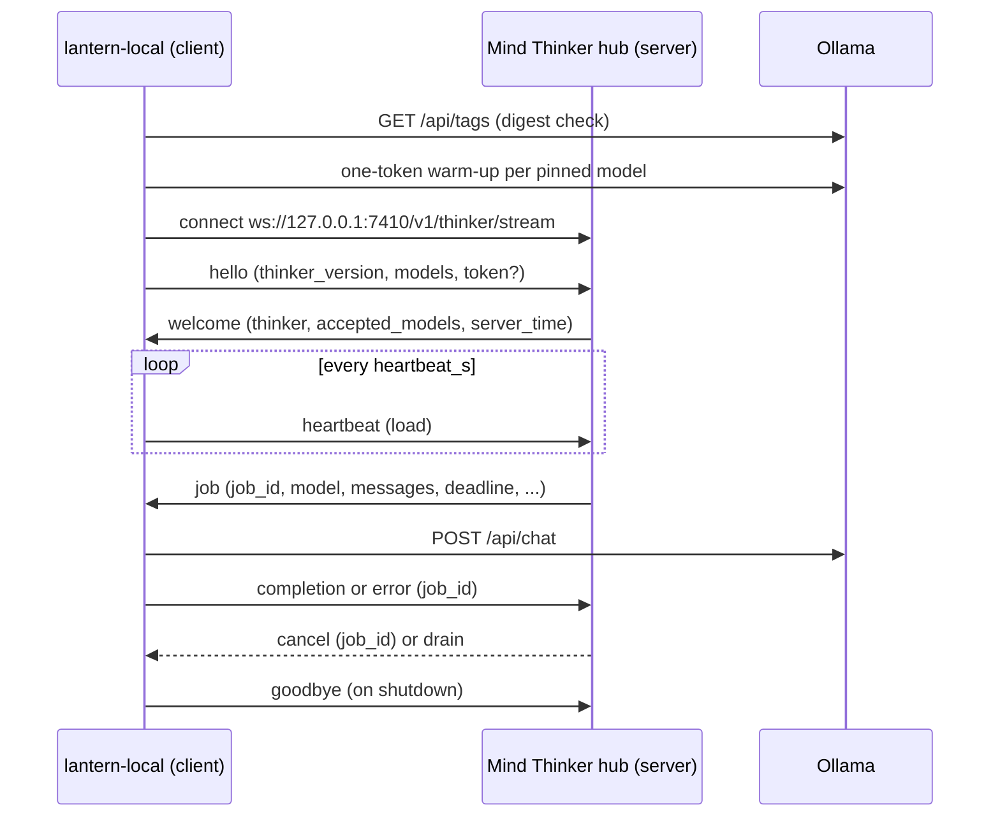

# Lantern Thinker protocol

The protocol between a Thinker (the software that runs a model) and the Mind that sends it jobs: spec Appendix H, its contract schema, the Phase 0 server in `animus` (the Thinker hub) and the Phase 0 client `lantern-local`. For the Mind as a whole see the [animus-mind](animus-mind.md) reference; for every schema, the [contract-schemas](contract-schemas.md) reference; for why the Mind and the Thinker are separate, the [body-and-mind](../concepts/body-and-mind.md) explanation.

Read from the files at commit `1b114276` on 2026-11-16. Nothing was run against Ollama or a live Mind.

## Parts

| Part | Where | Role |
|---|---|---|
| Spec | `docs/spec.md` Appendix H ("Gateway Protocol (Thinker ↔ Colo)"), sections 6.3, 8.2, 8.3 | Target design: one mutually authenticated WebSocket per Thinker to an internet Gateway. |
| Contract | `contract/schemas/thinker-frame.schema.json`; `JobId` in `contract/schemas/common.schema.json`; `validateThinkerFrame`, `MAX_FRAME_BYTES`, `MAX_COMPLETION_TEXT`, `MAX_RESPONSE_FORMAT_BYTES` in `contract/src/index.ts`; `contract/src/thinker-token.ts` | The nine frames, their limits and the optional shared token. Generated types in `contract/src/generated/`. |
| Server (Phase 0) | `animus/src/thinker/hub.ts`, `session.ts`, `jobs.ts`, `local-client.ts` | The Mind's Thinker hub. Listens; sends jobs. |
| Client (Phase 0) | `lantern-local/src/` (package `@geldar/lantern-local` 0.1.0) | The local Thinker. Dials the hub; runs jobs on Ollama. |
| Config | `mind.thinker`, `mind.run_tier`, `models`, `model_pins`, `embedding` in `shards/phase0.yaml` | Address, name, timers, pinned models. |

## Transport

| Item | Spec Appendix H, 8.2, 8.3 | Phase 0 code |
|---|---|---|
| URL | `wss://gw.geldar.<domain>/v1/thinker/stream` | `ws://<mind.thinker.host>:<mind.thinker.port>/v1/thinker/stream`; `shards/phase0.yaml` gives `127.0.0.1` and `7410` (`THINKER_PATH` in `hub.ts`; `loadConfig` in `lantern-local/src/config.ts`) |
| Who listens | The Gateway in the DMZ | The Mind (`ThinkerHub.start`) |
| Encryption and identity | TLS 1.3, mutual TLS with 24-hour certificates; identity is the certificate SAN `spiffe://geldar/<shard>/thinker/<name>` | No TLS. Identity is the connection: the hub names each socket `local-<n>` (`hub.ts`). Optional shared token in `hello` (below). |
| Address rule | Outbound 443 from the Patron | Both sides refuse a non-loopback host: `requireLoopback` in `lantern-local/src/config.ts` (`127.0.0.1`, `localhost`, `[::1]`), `loopbackHost` in `animus/src/config.ts` |
| Browser guard | Not stated | The hub refuses any connection that sends an `Origin` header (`verifyClient` in `hub.ts`) |
| Connections | One stream per identity (8.3) | At most 8 welcomed Thinkers, 16 sessions in all; extra sockets close with code 1013 (`maxConnections` in `hub.ts`) |
| Frame cap | 1 MiB | `MAX_PAYLOAD` 1 MiB in the hub's `ws` server; `MAX_FRAME_BYTES` 1048576 checked by both sides |
| Format | JSON, schema-validated, unknown fields rejected | Text frames only; binary dropped. `validateThinkerFrame` on every inbound and outbound frame; an invalid outbound frame is not sent |

## Frames

Re-derive the list: `git grep -n '"const": "' -- contract/schemas/thinker-frame.schema.json`. On 2026-11-16 at 1b114276 it prints 10 lines for the nine frames: line 195 is `response_format.type`, `json_schema`, not a frame. All frames have `additionalProperties: false`. `job_id` is `JobId`: `^jb_[0-9A-HJKMNP-TV-Z]{26}$` (`common.schema.json`).

### Thinker to Mind

| `type` | Required fields | Optional fields | Limits |
|---|---|---|---|
| `hello` | `thinker_version` (SemVer), `models` (array of `{name, max_concurrent, max_tokens}`) | `token` | 1 to 16 models; `name` 1 to 128 chars; `max_concurrent` 1 to 256; `max_tokens` 1 to 32768; `token` 1 to 256 chars. Sent once per connection. |
| `heartbeat` | `load` (model name to jobs in flight, integer at least 0) | | |
| `completion` | `job_id`, `text` | `usage_reported` `{prompt_tokens, completion_tokens}` | `text` at most 32768 characters in the schema |
| `error` | `job_id`, `code`, `message` | | `code` one of `model_unavailable`, `timeout`, `internal`; `message` at most 200 chars |
| `goodbye` | `reason` | | `schedule` or `shutdown` |

### Mind to Thinker

| `type` | Required fields | Optional fields | Limits |
|---|---|---|---|
| `welcome` | `thinker`, `accepted_models`, `server_time` (date-time) | | `thinker` 1 to 64 chars; `accepted_models` unique |
| `job` | `job_id`, `model`, `messages`, `max_tokens`, `temperature`, `stop`, `deadline` (date-time) | `cache_hint` `{stable_prefix_chars}`, `response_format` `{type: "json_schema", schema}`, `reasoning` (`off` or `on`) | 1 to 64 messages, role `system`, `user` or `assistant`; `max_tokens` 1 to 32768; `temperature` 0 to 2; `stop` string array or null; `response_format` serialized at most 65536 bytes (`MAX_RESPONSE_FORMAT_BYTES`) |
| `cancel` | `job_id` | | |
| `drain` | `reconnect_after_seconds` | | 0 to 86400 |

`response_format` and `reasoning` come from decision [0049](../decisions/0049-thinker-job-gets-response-format-and-reasoning.md). `token` comes from commit `55492499` ("optional Thinker hello token") and the threat model's "Local Thinker WebSocket" row; no decision record names it (`git grep -l -i "thinker token\|THINKER_TOKEN" -- docs/decisions` finds only decision 0080, which mentions the token file).

## Handshake and session rules (hub)

From `animus/src/thinker/session.ts` and `hub.ts`.

| Rule | Behaviour |
|---|---|
| Hello timeout | No `hello` within 10 s: close 1008 `hello timeout` (`helloTimeoutMs` default 10000). |
| Frame before hello | Dropped and counted. |
| Token | When the hub has a token, a `hello` without the matching token closes 1008 `unauthorized`. The comparison hashes both sides with SHA-256 and uses `timingSafeEqual` (`tokenMatches`). Neither token is logged. |
| Model acceptance | Only offered models that are keys of `model_pins` are accepted; `welcome.accepted_models` lists them. `welcome.thinker` is `mind.thinker.name`. |
| Second hello | Dropped, then close 1008 `second hello`. |
| Liveness | `hello` and `heartbeat` set the last-seen time. A session silent for more than 45 s is not given jobs (`staleAfterMs` default 45000). |
| Job pick | `pick(model)`: a welcomed, live, not-leaving session that accepted the model and has fewer jobs in flight than its `max_concurrent`; the least loaded wins. |
| Job size | `submit` throws `ModelError('internal')` starting `bad_request` when `max_tokens` exceeds the model's offered `max_tokens`. |
| Job fields | The hub always sends `stop: null` and `cache_hint`; `response_format` and `reasoning` only when the job carries them. |
| Answer acceptance | `JobLedger.claim`: only `accepted` (issued on this connection, open, before its deadline) passes. `unknown`, `answered` and `late` are dropped and counted as anomalies; `cancelled` is counted separately as crossed with a cancel. Entries are kept 10 minutes past their deadline (`jobs.ts`). |
| Completion size | Text over 32768 UTF-8 bytes is rejected as `internal` and counted as an anomaly. |
| `goodbye` | The session takes no more jobs. |
| Hub stop | Sends `drain` with `reconnect_after_seconds` 5 to each session, then closes 1001. |
| Client deadline | `LocalThinkerClient` cancels a job 2 s after its deadline (`graceMs`) with `timeout`, fails at once with `no_thinker` when no session can take the model, and with `cancelled` when the caller aborts. |

## Client behaviour (`lantern-local`)

From `lantern-local/src/`.

| Topic | Behaviour |
|---|---|
| Start | `discoverModels` asks Ollama `GET /api/tags` and keeps each pin whose digest equals the recorded `model_pins.<name>.digest` (decision [0051](../decisions/0051-adam-identity-and-model-pins.md)). None left: exit 1. |
| Pin format | `sha256:` and 64 hex digits. The placeholder `sha256:RECORD_AT_DISPATCH` is refused outside tests. |
| Warm-up | Before the first dial, a one-token `POST /api/chat` per model in warm order, each within `mind.thinker.warm_timeout_s` (180 s in `shards/phase0.yaml`). Warm order: the `mind.run_tier` tier's models; else, when only one chat tier is configured, that tier's models; else none, with a logged warning (`warmOrder`, `keepWarmSet`). A complete warm-up is not repeated in the same process. |
| Re-check | Before every dial, the digests are checked again; only warmed models that still match are advertised. |
| `hello` | Advertises each model with its pinned `max_concurrent` and `max_tokens` 2048 (`ADVERTISED_MAX_TOKENS`), and `token` when one is configured. |
| Welcome timeout | No `welcome` within 10 s: close and reconnect. |
| Heartbeat | Every `mind.thinker.heartbeat_s` (15 s), the count of jobs in flight per advertised model. |
| Reconnect | Backoff from 250 ms doubling to 5 s, each delay cut by up to half at random; reset on `welcome`. A `drain` sets the next delay to `reconnect_after_seconds`. |
| Job refusals | `model_unavailable` for a model not accepted; `internal` with `bad_request` for `max_tokens` over 2048; `internal` `duplicate job id`; `internal` `busy` at `max_concurrent`; `timeout` when the deadline has passed. |
| Job timeout | Aborts 500 ms before the deadline (`TIMEOUT_MARGIN_MS`) and sends `timeout`. |
| `cancel` | Aborts the job; no frame is sent for it. |
| Output | Over 32768 UTF-8 bytes: `internal` `output too large`. Otherwise `completion` with `usage_reported` from Ollama's counts. |
| Shutdown | On SIGINT or SIGTERM: `goodbye` `shutdown`, close 1000, exit 0. |
| Keep-alive | Every `mind.thinker.keep_alive_ping_s` (default 600 s), a one-token call to each idle model in the keep-warm set, and a `POST /api/embed` to the `embedding.model` with `keep_alive` 30m. A job of at least 5 s on a model idle at least 10 minutes triggers a re-warm. |
| Frames from the Mind | Same validation as the hub; anything but `welcome` before welcome, or a Thinker-side frame after, is dropped and counted. |
| Logs | One line per event with ids, lengths and timings; prompt and completion text are never logged (`log` option in `thinker.ts`; `lantern-local/README.md`). |

### Ollama calls

From `lantern-local/src/ollama.ts` and `models.ts`.

| Call | Body or use |
|---|---|
| `GET /api/tags` | Digest check at start and before each dial. |
| `POST /api/chat` | `model`, `messages`, `stream: false`, `think` (from `reasoning`), `keep_alive` (pin), `options` `{num_ctx, temperature, num_predict, stop?}`, `format` (the `response_format` schema). An empty answer with `think` on is retried once with `think` off; still empty is `internal`. `prompt_eval_count` at or above `num_ctx` is `internal` `context overflow`. |
| `POST /api/embed` | Keep-alive for the embedder; `options.num_gpu: 0` when `embedding.on_cpu` is true. |

| Ollama outcome | Error code sent |
|---|---|
| Not reachable | `model_unavailable` |
| HTTP 404 | `model_unavailable` |
| Other non-OK status | `internal` |

## Configuration

Names only. `shards/phase0.yaml` at `1b114276`.

| Key or variable | Read by | Value or default |
|---|---|---|
| `mind.thinker.host`, `mind.thinker.port` | hub, client | `127.0.0.1`, `7410` |
| `mind.thinker.name` | hub (`welcome.thinker`) | `local` |
| `mind.thinker.heartbeat_s` | client; hub config | 15 |
| `mind.thinker.warm_timeout_s` | client | 180 |
| `mind.thinker.keep_alive_ping_s` | client | not set; code default 600 |
| `mind.thinker_wait_s` | Mind loop | 20 |
| `mind.run_tier`, `models` | client warm and keep-warm sets | `strong`; `strong: ["qwen3:32b"]`, `fast: ["qwen3:8b"]` |
| `model_pins.<tag>` | both (`digest`, `num_ctx`, `keep_alive`, `max_concurrent`) | two pins, `num_ctx` 8704 (decision [0181](../decisions/0181-thought-context-8704.md)), `keep_alive` 30m, `max_concurrent` 1 |
| `embedding.model`, `embedding.on_cpu` | client keep-alive | `nomic-embed-text`, true |
| `GELDAR_MIND_WS_URL` | client | overrides the hub URL; must be `ws:` and loopback |
| `OLLAMA_URL` | client | default `http://127.0.0.1:11434`; must be `http:` and loopback |
| `GELDAR_THINKER_TOKEN_FILE` | both (`thinkerToken`) | unset means no token is required or sent |

The token file is created when missing by `Initialize-NatsAuth` in `geldar.ps1` (`./geldar.ps1 shard nats-auth`), owner-only. Nothing in `geldar.ps1` sets `GELDAR_THINKER_TOKEN_FILE` (`git grep -n GELDAR_THINKER_TOKEN_FILE -- geldar.ps1` finds only a comment and a message), so by default the hub is open to any local process (threat model, "Local Thinker WebSocket" row).

`./geldar.ps1 adam up` starts `lantern-local` with the Mind (`lantern-local/README.md`; decision [0050](../decisions/0050-phase0-mind-processes-run-on-the-host.md)). By hand: `./geldar.ps1 pnpm --filter @geldar/lantern-local start`.

## On the Colo

`shards/colo-mind.yaml` sets `mind.thinker.host` to `127.0.0.1`, port 7410 and the name `unreachable-placeholder`, marked as placeholders: "no Thinker can reach it yet". Decision [0134](../decisions/0134-mind-is-a-profile-until-a-thinker-exists.md) keeps `animus` behind the compose profile `mind` until a Thinker path exists. Decision [0078](../decisions/0078-mind-placement-for-phase1.md) places the Mind on the Colo and Thinkers on home GPUs behind a gateway; decision [0080](../decisions/0080-nats-auth-cutover.md) lists per-Thinker NATS users (T-1) and Gateway mTLS (T-2, Phase 2). No gateway code exists in this repo (`git grep -n -i "thinker/stream" -- '*.ts'` finds only the hub and the client).

## Tests

Counts from `grep -cE "^\s*(it|test)\(" <file>` at `1b114276`, 2026-11-16.

| File | Cases |
|---|---|
| `lantern-local/test/config-models.test.ts` | 13 |
| `lantern-local/test/thinker.test.ts` | 14 |
| `lantern-local/test/thinker.jobs.test.ts` | 16 |
| `lantern-local/test/thinker.warmup.test.ts` | 20 |
| `lantern-local/test/ollama.it.test.ts` | 1 (skipped unless `GELDAR_IT=1` and `GELDAR_OLLAMA=1`; needs Ollama with `qwen3:8b`) |
| `animus/src/thinker/hub.test.ts` | 21 |
| `animus/src/thinker/jobs.test.ts` | 6 |
| `animus/src/thinker/local-client.test.ts` | 18 |
| `animus/src/thinker/lantern-interop.test.ts` | 5 (the real client against the real hub) |
| `contract/test/thinker-frame.test.ts` | 12 |
| `contract/src/thinker-token.test.ts` | 5 |

Run: `./geldar.ps1 pnpm test lantern-local`, `./geldar.ps1 pnpm test animus/src/thinker`, `./geldar.ps1 pnpm test thinker`.

## Conflicts recorded

Recorded, not resolved.

1. **Transport and identity.** Spec Appendix H, 8.2 and 8.3: an internet Gateway with mutual TLS and certificate-SAN identity, Envoy in front. Phase 0 code: a plaintext loopback WebSocket served by the Mind, identity by connection, optional shared token. Decision 0050 accepts the loopback socket for Phase 0; the hub's header says "the later mTLS wrapper changes the transport and not the messages". Decision 0078 moves to a gateway; none is built.
2. **Schema location.** Spec Appendix H: frames validated against `schemas/gateway/*.json`. Code: one file, `contract/schemas/thinker-frame.schema.json`.
3. **`job` fields.** Decision 0049 adds `response_format` and `reasoning` and says "Spec Appendix H gains the two fields". The `job` example in spec Appendix H at `1b114276` has neither.
4. **`hello.token`.** In the schema and code; not in spec Appendix H. Decision 0080 names the Thinker token only in passing (line 9: the generator "writes ... the Thinker token"); no decision defines the field.
5. **Completion cap.** Spec: `text` at most 32 KiB. Schema: at most 32768 characters. Both code sides enforce 32768 UTF-8 bytes, the stricter reading (comments in `session.ts` and `thinker.ts`).
6. **`num_ctx`.** Decision 0051 item 3: 8192. `shards/phase0.yaml`: 8704, citing decision 0181.
7. **Warm-up with no run tier.** `lantern-local/README.md`: "with no run tier it loads every pin, the strong tier's model last". Code (`warmOrder` in `config.ts`): never every pin; only the single configured chat tier, or none with a warning.
8. **Secrets.** `lantern-local/README.md` "Needs": "No database, no NATS, no secrets." Code: `lantern-local/src/main.ts` reads the optional token through `thinkerToken()`.

## Observation

Spec Appendix H notes that prompts carry an agent's in-world name and memory, so a Thinker can tell whom it thinks for, and that "the Thought Stream shows the same thing to watchers". The Mind's use of completions after a job is outside this protocol; see the [animus-mind](animus-mind.md) reference and, for operators, the `agents-never` [observation-and-privacy](../concepts/observation-and-privacy.md) explanation.
