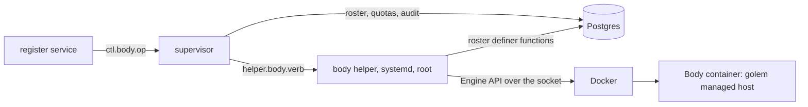

# Supervisor and body helper

Two services start and stop Body containers when an owner asks through the register service:

- **The supervisor** (`supervisor/`, package `@geldar/supervisor`) answers a shard's body control subjects. It checks that the owner holds the agent, applies the start quotas, writes the audit, and asks the body helper for every container action. It holds no Docker socket (decision [0260](../decisions/0260-body-container-control-by-host-helper.md)).
- **The body helper** (`body-helper/`, package `@geldar/body-helper`) is a root-owned systemd service on the Colo node, not in a container. It is the only process that touches the Docker socket. It serves four fixed verbs and builds the Body container from a fixed template.

Neither package has a README at `1b114276`. The node install is the [body helper node steps](../runbooks/body-helper-node-steps.md) runbook; this page is the reference behind it.



## How this page was measured

Commit `1b114276`, 2026-11-16 (UTC), read-only. Purposes come from file header comments; numbers from constants in the files named. Re-derive:

```powershell
git ls-files supervisor body-helper
Select-String -Path supervisor/src/*.ts, body-helper/src/*.ts -Pattern 'export const [A-Z_]+ = ' | Select-String -NotMatch '\.test\.ts'
Select-String -Path geldar.ps1 -Pattern '^\s+(supervisor|helper|register) = '
git grep -n -i supervisor -- compose deploy
```

| Count | supervisor | body-helper |
|---|---|---|
| Tracked files | 27 | 33 |
| Test files | 10 | 17 |

## Supervisor

### Purpose

`supervisor/src/main.ts` loads its config, connects to Postgres as `geldar_supervisor` (pool of 4) and to NATS as `geldar-supervisor`, and hands both to `runSupervisor` (`run.ts`), "which serves the control subjects of its shard and runs the policy in service.ts. Bodies are reached only through the host body helper over NATS. It holds no Docker socket (decision 0260)." Confirmed from the entry point and `run.ts`, `service.ts`, `helper-client.ts`.

### Files

| File | Holds |
|---|---|
| `main.ts` | Process entry; SIGTERM and SIGINT call `run.stop()` |
| `config.ts` | Environment and the one secret file |
| `run.ts` | Run loop and shutdown order: drain the subscription, settle in-flight answers, drain NATS, end the pool (`SHUTDOWN_TIMEOUT_MS` 8 s, then exit 1) |
| `nats.ts` | Serves `geldar.<shard>.ctl.body.*`; at most `CTL_IN_FLIGHT_CAP` 16 answers at once, more are answered busy |
| `service.ts` | The policy: owner check, quotas, one request in flight, audit, bounded helper calls (`RUNTIME_TIMEOUT_MS` 25 s backstop) |
| `helper-client.ts` | The body runtime over the helper: one NATS request per verb, `HELPER_TIMEOUT_MS` 20 s, never retried |
| `quotas.ts` | The quota numbers (below) |
| `limits.ts` | The Body budget the tests compare with `compose/colo.yml`: 1 CPU, 2048 MiB, 256 pids |
| `pg-ports.ts` | SQL adapters |
| `ports.ts` | `OPS`, request, reply and refusal types |
| `composition.ts`, `fakes.ts` | Wiring and test fakes |

### Control surface

| Item | Value | Evidence |
|---|---|---|
| Subject | `geldar.<shard>.ctl.body.<op>` | `ctlBodySubject`, `contract/src/subjects.ts` |
| Ops | `start`, `stop`, `restart`, `status`, `logtail` | `OPS` in `supervisor/src/ports.ts`; `CTL_BODY_OPS` in the contract (a test keeps them equal) |
| Caller | The register service (`threshold/register/src/nats-ctl.ts`) | decision [0152](../decisions/0152-programmatic-body-management-for-owners.md) item 3 |
| Reply codes | `started`, `restarted`, `stopped`, `running`, `idle`, `logs` | `ReplyCode`, `ports.ts` |
| Refusals | `invalid`, `unknown`, `quota`, `error`, `busy`, `login_name` | `Refusal`, `ports.ts` |
| Audit | Every start, stop and restart attempt, refusals included; `status` and `logtail` are not audited | `service.ts` header; decision 0085 |

### Quotas

From `supervisor/src/quotas.ts`, matching decision [0170](../decisions/0170-owner-management-values-and-admin-flag.md) points 3 to 5:

| Rule | Value |
|---|---|
| Running Bodies per agent | 1 |
| Starts per agent per hour | 3 |
| Starts per owner per day | 10 |
| Log tail | at most 200 entries, from the last 7 days (`LOG_TAIL_LIMIT`, `LOG_TAIL_WINDOW_MS`) |
| Admins | exempt from the two start counters only; the one-running rule and the owner check always apply |

A start or restart that the supervisor accepts counts; stop, status, log and refused requests do not (decision 0170 point 3). Counters look back from now; a start exactly one hour ago no longer counts.

### Data

The supervisor role may `SELECT` on `mcp_roster` and `body_ops`, `INSERT` on `body_ops` and `register_audit`, and `EXECUTE` `supervisor_is_admin`; no `UPDATE` and no `DELETE` (`supervisor/src/pg-ports.ts` header, citing migrations [0024](../../sql/0024_mcp_roster.sql), [0025](../../sql/0025_admin_flag_and_register_audit.sql) and [0027](../../sql/0027_body_ops.sql); `pg-ports.test.ts` checks the SQL text). `body_ops` is append-only and holds the quota counters. Table detail is in [database-schema](database-schema.md).

### Configuration

Names only; values and secret locations are never in the repo.

| Name | Role |
|---|---|
| `SUPERVISOR_SHARD` | Shard id, `^[a-z][a-z0-9-]{0,31}$` |
| `SUPERVISOR_NATS_URL` | NATS servers |
| `SUPERVISOR_DB_PASSWORD_FILE` | Names the file holding the supervisor database password, the only secret it reads itself |
| `POSTGRES_HOST`, `POSTGRES_PORT`, `POSTGRES_DB` | Defaults `127.0.0.1`, `5432`, `geldar` |
| `GELDAR_NATS_USER`, `GELDAR_NATS_PASSWORD_FILE` | NATS credentials, read by the contract's connect |

A configuration error names the variable or path, never a value (`config.ts` header).

### Build and deploy

| Task | Value | Evidence |
|---|---|---|
| Tests | `./geldar.ps1 pnpm --filter @geldar/supervisor test` | `supervisor/package.json` |
| Image | `supervisor/Dockerfile` (no Docker client, CLI or socket path); CI job `supervisor` in `.github/workflows/colo-images.yml` pushes it | Dockerfile header; workflow |
| Release | Not in `release.env` yet ("C7-03b2 adds it") | `colo-images.yml` header comment |
| Compose | No `supervisor` service in any file under `compose/` at `1b114276` | `git grep -n -i supervisor -- compose` finds nothing |
| Shard switch | `supervisor_enabled: false` in the example genesis environment | `envs/test.example.yaml` |

## Body helper

### Purpose

`body-helper/src/main.ts` reads the config (environment names and root-only secret files), connects to NATS as the `helper` user, serves the four body subjects, runs the report-only stray sweep, and shuts down on SIGTERM or SIGINT. It logs names and counts only. Every attempt writes one audit line (verb, name, outcome, a fixed reason), never the request body, a template or a secret (`service.ts` header).

### Files

| File | Holds |
|---|---|
| `main.ts` | Entry point |
| `helperConfig.ts`, `config.ts` | Config; secret files must be owned by root and unreadable by group and others; the global cap |
| `listener.ts` | Subscribes the four exact subjects; transport only |
| `requests.ts` | The accepted request: a verb, a roster name and the owner; any other field is refused, so a caller cannot pass an image, mount, env value, flag or command |
| `service.ts` | The four verbs; start and stop run one at a time so the cap count is never stale |
| `roster.ts` | Two definer-function calls: `supervisor_player_display_name` and `supervisor_player_life_id` (role `geldar_helper`, [sql/0038](../../sql/0038_body_helper_role.sql); [sql/0033](../../sql/0033_supervisor_display_name.sql), [sql/0063](../../sql/0063_body_host_roles.sql)) |
| `template.ts` | The house Body template and the Body label `geldar.player` |
| `managed-template.ts` | The managed Body template (entry `golem/src/players/managed-main.ts`, label `geldar.life`, no RCON secret, no Docker socket) and the admit one-shot (entry `golem/src/admit-life.ts`, label `geldar.admit`, not counted by the cap) |
| `engine.ts` | Docker Engine API over the unix socket with `node:http`; no Docker CLI; `ENGINE_TIMEOUT_MS` 30 s |
| `sweep.ts` | Lists Body containers and logs each one not on the roster; never stops or removes |
| `shutdown.ts` | End subscriptions, await in-flight answers (`SHUTDOWN_WAIT_MS` 10 s), close NATS, end the pool |

### Verbs and subjects

| Item | Value | Evidence |
|---|---|---|
| Subjects | `geldar.<shard>.helper.body.<verb>` | `listener.ts` |
| Verbs | `start`, `stop`, `status`, `logtail` (`HELPER_VERBS`) | `listener.ts`; decision 0260 point 2 |
| Caller | The supervisor only; the helper checks roster, global cap and name itself | `supervisor/src/helper-client.ts` header |
| Named refusals | `already running`, `not your body`, `name in use by another owner's body` | `service.ts` constants |
| Audit outcomes | `accepted`, `refused`, `failed`, `timeout`; reasons include `already_running`, `capacity`, `managed_off`, `not_on_roster`, `not_your_body`, `other_owner`, `name_taken`, `not_running`, `admit_failed` | string literals in `service.ts` (re-derive with `Select-String "'[a-z_]+'" body-helper/src/service.ts`) |
| Verb deadline | `REQUEST_DEADLINE_MS` 120 s per start or stop (`GELDAR_BODY_HELPER_DEADLINE_MS`) | `service.ts`; `helperConfig.ts` |

A start is refused before any roster or Engine call while managed Bodies are off. `GELDAR_MANAGED_BODIES` is off when unset, empty or `0`; turning it on requires the managed database wiring and the RCON file to be set (`helperConfig.ts`, `service.ts`).

### Global cap

| Item | Value | Evidence |
|---|---|---|
| Cap on running Bodies | 40 by default, from `GELDAR_GLOBAL_BODY_CAP` only; a caller cannot pass one; zero, negative, text or empty fails the start of the helper | `body-helper/src/config.ts`; decision [0261](../decisions/0261-open-signup-player-host-bodies-and-auto-roster.md) point 3d |
| Alert | One log line when the count first reaches 30 (`CAP_ALERT_AT`) | `service.ts`; decision 0261 point 3e |
| Counted | Containers with the Body label; the admit one-shot is not counted | `managed-template.ts` |

### NATS permissions

From the generator in `geldar.ps1` (lines 408 to 413 at `1b114276`); the gate `tools/repo-checks/src/nats-auth-runbook.test.ts` keeps the [node steps runbook](../runbooks/body-helper-node-steps.md) equal to it.

| User | Publish | Subscribe |
|---|---|---|
| `register` | `geldar.<s>.ctl.body.>` | `_INBOX.>` |
| `supervisor` | `_INBOX.>`, `geldar.<s>.helper.body.{start,stop,status,logtail}` | `geldar.<s>.ctl.body.>`, `_INBOX.>` |
| `helper` | `_INBOX.>` | `geldar.<s>.helper.body.{start,stop,status,logtail}` |
| `body`, `paper` | deny `geldar.<s>.ctl.body.>` and `geldar.<s>.helper.body.>` | n/a |

The full NATS user table belongs to [nats-topology](../architecture/nats-topology.md) and the planned [authn-authz-map](../security/authn-authz-map.md) (*planned*, W4).

### Configuration

Names only (`helperConfig.ts`, `config.ts`); re-derive with `Select-String "'(GELDAR|BODY)[A-Z_]*'" body-helper/src/helperConfig.ts`.

| Group | Names |
|---|---|
| Shard and NATS | `GELDAR_SHARD`, `GELDAR_NATS_URL`, `GELDAR_NATS_USER`, `GELDAR_NATS_PASSWORD_FILE` |
| Database (roster) | `GELDAR_PG_HOST`, `GELDAR_PG_PORT`, `GELDAR_PG_DATABASE`, `GELDAR_PG_USER`, `GELDAR_PG_PASSWORD_FILE` |
| Docker | `GELDAR_DOCKER_SOCKET`, `GELDAR_NETWORK`, `GELDAR_STACK` |
| Body template | `GELDAR_BODY_IMAGE`, `GELDAR_BODY_NANO_CPUS`, `GELDAR_BODY_MEMORY_BYTES`, `GELDAR_BODY_PIDS_LIMIT`, `GELDAR_BODY_SHARD_HOST_PATH`, `GELDAR_BODY_NATS_SECRET_HOST_PATH`, `GELDAR_MC_HOST`, `GELDAR_MC_PORT`, `GELDAR_SERVICE_UID` (the user and group id Body containers run as; digits only, default 1000; `helperConfig.ts` line 158, `User` in `managed-template.ts`) |
| Managed Bodies | `GELDAR_MANAGED_BODIES`, `GELDAR_MANAGED_PG_HOST`, `GELDAR_MANAGED_PG_PORT`, `GELDAR_MANAGED_PG_ROLE`, `GELDAR_MANAGED_DB_SECRET_HOST_PATH`, `GELDAR_RCON_SECRET_HOST_PATH` |
| Limits | `GELDAR_GLOBAL_BODY_CAP`, `GELDAR_BODY_HELPER_DEADLINE_MS`, `GELDAR_SWEEP_MINUTES` (default 10) |

The secrets it reads (its NATS password, its database password) are held by the operator in root-only files on the node; the `*_HOST_PATH` names point the Body containers at their own secret files. Values and locations stay out of the repo (see the planned [secrets-by-role](../security/secrets-by-role.md), *planned*, W4).

### Build, ship and install

What each piece is; the install steps are in the runbooks only.

| Item | Value | Evidence |
|---|---|---|
| Tests | `./geldar.ps1 pnpm --filter @geldar/body-helper test` | `body-helper/package.json` |
| Bundle | `./geldar.ps1 pnpm --filter @geldar/body-helper build`: esbuild bundles `src/main.ts` into `dist/main.js` (ESM, `node22`) and writes `dist/main.js.sha256` | `body-helper/scripts/bundle.mjs` |
| CI | Workflow `body-helper-bundle.yml` builds the bundle on a push to `main` that changes the helper, publishes the artifact `body-helper-bundle` (kept 30 days) and checks the pinned Node tarball digest; build only, no deploy | workflow header |
| Node | A pinned Node tarball whose digest is in `deploy/body-helper-node.env`; never from a package manager | runbook step 0a |
| Install | `deploy/install-body-helper.sh`: dry run with no flag, `--apply` to change anything; checks the bundle digest before any write; writes a systemd unit with `User=root` | `deploy/install-body-helper.sh` |
| Procedure | [Body helper node steps](../runbooks/body-helper-node-steps.md) and [nats-auth-inplace](../runbooks/nats-auth-inplace.md) | runbooks |

## Operate, fail and retire

| Topic | Fact | Evidence |
|---|---|---|
| Stray Bodies | The sweep only reports Body containers not on the roster; an operator reap path is a later card (C7-03c4) | `sweep.ts` |
| Timed-out start | The supervisor's 20 s bound answers `timeout` and records no row; the helper may still land the start within its 120 s deadline and removes what it made on its own timeout; the register's retry must read `status` first | `supervisor/src/helper-client.ts` header |
| Restart of the services | Both drain in-flight replies before closing NATS (shutdown orders above) | `run.ts`, `shutdown.ts` |
| Retiring an agent | Decision 0152 item 1: retire stops the Body, revokes tokens and keeps the row; the planned [retire-an-agent](../runbooks/retire-an-agent.md) runbook (*planned*, W3) will hold the steps | decision 0152 |
| Failure table | The planned [failure-modes](../operations/failure-modes.md) (*planned*, W3) | |

## Conflicts recorded

Recorded, not resolved.

1. **Supervisor deployment.** Decision 0260 point 3 says "the supervisor compose service has no host mounts except its secret files", and `supervisor/Dockerfile` says its config comes from the secret files mounted into the container by `compose/colo.yml`. At `1b114276` no compose file defines a supervisor service, and `colo-images.yml` says the image is not in `release.env` yet. How the supervisor runs on the Colo is not recorded in the repo.
2. **"0027 (supervisor package)".** Decision 0260's related list names "0027 (supervisor package)". Decision record 0027 is `0027-final-receipt-constraints.md`; migration `sql/0027_body_ops.sql` creates the supervisor's `body_ops` table. Which one is meant is unverified.
3. **House template.** `body-helper/src/template.ts` still sets the house Adam entry (`src/adam/main.ts`) and says "BODY-HOST changes it for sign-up agents". The `start` verb builds the managed template (`managed-template.ts`, `golem/src/players/managed-main.ts`). Decision 0261 point 2 names a third path, `golem/src/players/main.ts`. Code, comment and decision differ (also listed in [golem-body](golem-body.md#conflicts-recorded)).
4. **Decision 0152 item 3.** It says the supervisor is the only process that holds the Docker socket. Decision 0260 supersedes that part; the code follows 0260.

## See also

- [Body helper node steps](../runbooks/body-helper-node-steps.md) and [NATS auth in place](../runbooks/nats-auth-inplace.md): the install procedure.
- [Open sign-up](../runbooks/open-signup.md): the sign-up flow that creates rostered agents.
- [register-service](register-service.md): the owner API that sends `ctl.body.*`.
- [golem-body](golem-body.md): the managed host and admit one-shot the helper runs.
