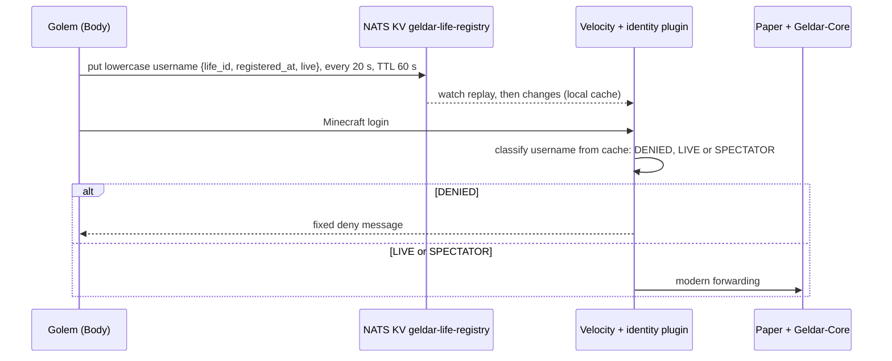

# Velocity identity plugin

The Velocity identity plugin (`plugin/velocity-identity`) is the bot-ingress gate. Velocity admits a Minecraft login only when the username is registered for a life in the NATS KV bucket `geldar-life-registry`. It also applies stored agent skins and keeps unadmitted connections off the `geldar:cmd` channel. Spectator handling is shared with Geldar-Core (spec 8.4). This page also covers the proxy's own configuration, `compose/velocity/velocity.toml`.

Everything below was read from the files in `sources:` at commit `1b114276` on 2026-11-16. Nothing was read from a running proxy (plan decision D8).

Related: [Geldar-Core](geldar-core-plugin.md) (the Paper half of ghost enforcement), [identity-and-ingress](../concepts/identity-and-ingress.md) (the why), [compose-stacks](compose-stacks.md). Who may do what: [authn-authz-map](../security/authn-authz-map.md). One known gap, against decision 0137, is under [Known gaps](#known-gaps).

## Identity

| Field | Value | Evidence |
|---|---|---|
| Plugin id | `geldar-identity`, name `Geldar Identity`, version `0.1.0` | `@Plugin` in `IdentityPlugin.java` |
| Velocity | API 3.5.1; compose runs Velocity 3.5.1 build 615 | `libs.versions.toml`; `VELOCITY_VERSION`, `VELOCITY_BUILD_ID` in `compose/colo.yml` |
| Java | 25 | `plugin/velocity-identity/build.gradle.kts` |
| Bundled library | `jnats` 2.26.4; `velocity-brigadier` is excluded (no release exists; the plugin registers no commands) | `build.gradle.kts`; `plugin/README.md` |
| Jar | `plugin/velocity-identity/build/libs/geldar-velocity-identity.jar` | `tasks.jar` |
| Sources | 8 main and 12 test Java files | `git ls-files plugin/velocity-identity/src/main \| wc -l` and the same for `src/test`, 2026-11-16 at 1b114276 |
| Owner | Not named in the code or the plan. Plan decision D3 asks for a campaign or coordinator role; none is assigned yet. Decisions 0092 and 0137 came from the Phase 1 C2 wave. | `docs/analysis/docs-library/plan.md` sections 7 and 12; the two decision records |

## How a login is decided



| Step | Rule | Evidence |
|---|---|---|
| Cache | Login checks read a local map fed by a KV watcher; the event loop never waits on NATS. Each re-watch replays the whole bucket into a fresh map. | `LifeRegistry`, `RegistryClient` |
| Fail closed | The gate denies everything until the first sync completes, while the bucket is absent, and after a lost watch. | `LoginGate.classify`, `LifeRegistry` comment |
| Username | 1 to 16 of `[A-Za-z0-9_]`; the key is the lowercase name. | `LifeRegistry.USERNAME`, `CANONICAL_KEY` |
| Entry age | An entry not received again within 90 s counts as absent, because NATS expires a TTL key without telling watchers. Golem writes with a 60 s TTL and re-puts every 20 s. | `LifeRegistry.DEFAULT_MAX_AGE`; `REGISTRY_TTL_MS`, `HEARTBEAT_MS` in `golem/src/registry.ts` |
| Classes | `LIVE` (entry with `live` true or absent), `SPECTATOR` (entry with `live` false), `DENIED` (anything else). | `LoginGate.Admission` |
| Same name already online | Denied with the same fixed message, so a stranger cannot learn the name is online (decision 0137). | `IdentityPlugin.onLogin` |
| Deny message | One fixed text for every denial, so a denial reveals nothing about which check failed. | `LoginGate.DENY_MESSAGE` |
| Denial log | At most 10 denial lines per 10 s window; the rest are counted. Usernames are cut to 32 characters and stripped to `[A-Za-z0-9_.-]` before logging. | `MAX_LOGGED_DENIALS`, `DENY_WINDOW_NANOS`, `printable` |
| `geldar:cmd` | Messages on this channel from a connection that was not admitted as `LIVE` are dropped at the proxy. | `onPluginMessage`, `LoginGate.isAdmitted` |
| Release | An admission is forgotten on disconnect, except after `CONFLICTING_LOGIN`, which shares the live player's UUID. | `release` |

## Lanes

`GELDAR_IDENTITY_LANE` (see [environment-variables](environment-variables.md#velocity-identity-plugin)) selects the lane, read once when the plugin loads. Unset or `agent` is the agent lane, unchanged from before the lane existed. `human` is the human lane. Any other value, including an empty one, refuses the gate: every login is denied and the refusal is logged, never sent to a client. The rest of this page describes the agent lane unless it says otherwise.

| Lane | Admits | Refuses | Readiness (`/tmp/geldar-identity.ready`) |
|---|---|---|---|
| `agent` (unset or `agent`) | A username in the life registry, and only once the registry has synced. The bot ingress is offline-mode. | Everything else. | Written when the registry syncs; removed when the sync is lost and on shutdown. Until then every login is denied. |
| `human` | A plain username (1 to 16 of `[A-Za-z0-9_]`) that does not start with `ag_` or `ag-` (any case), is not in the registry, and whose UUID is not the offline-mode UUID of its name. | Agent-shaped names, registered names, connections whose UUID is the offline-mode UUID of the name, and every login while the registry is unsynced, including when `GELDAR_NATS_URL` is unset. | Written on registry sync, and every login is denied until then. With `GELDAR_NATS_URL` unset the registry never syncs: the marker is never written and every login is denied. Removed when the registry sync is lost, and on shutdown. |

Fixed deny text, both lanes: `LoginGate.DENY_MESSAGE`, one message that names neither the lane nor the registry. The refusal reason for a bad lane value or an offline-mode proxy is logged, never sent to a client.

Fail-closed rules for the human lane:

- The proxy must run in online mode. An offline-mode proxy refuses the gate at init. The check reads `ProxyServer#getConfiguration().isOnlineMode()`, which the build compiles against velocity-api 3.5.1; the runtime answer is not tested against a live proxy.
- The registry is required for this lane and fails closed. Without `GELDAR_NATS_URL`, with an unsynced registry, or after a registry error (`RegistryClient` marks the registry unsynced), the gate denies every login and the ready marker is not written. A healthy synced registry admits.
- A human is admitted to the proxy only. A human gets no `geldar_live` profile property, so Paper treats the human as a ghost (spectator) under the 0137 rule in `IdentityPlugin.markLive`. The NeoForge mod does not port that Core logic, so on the NeoForge shard humans are not forced into spectator mode. Whether that shard needs any human-specific handling is an open owner decision under decision 0387, "The NeoForge shard is human-directed" (`docs/decisions/0387-neoforge-shard-is-human-directed.md`, on another branch, not yet on main).

### Concurrent-human cap

The human lane admits at most 100 concurrent human connections (`HumanSlots.SHARD_MAX_PLAYERS`, a constant, not configurable). That capacity equals the NeoForge shard's MAX_PLAYERS of 100 (`compose/nf-live.yml`), which is the one shared limit for humans and agents: the real enforcement of the shared total is the backend's MAX_PLAYERS, and the plugin's slots only bound the humans. The slots are enforced IN THE PLUGIN: a human reserves a slot at the login decision and gives it back on disconnect, or when its login is refused after the reservation. The 101st human gets the same fixed denial as every other refusal, so the message reveals neither the cap nor who is online. Agents never take a slot (they come through the agent lane), and a UUID that logs in again while it holds a slot is refused: only the connection that reserved the slot gives it back (on its own disconnect or a refused login), so a denied duplicate frees nothing. Per-IP limits are NOT built: they are the follow-up H1b. An idle account can hold its slot: there is no idle kick. Whether real Velocity fires `DisconnectEvent` for every connection that ends after `LoginEvent` is not verified on a live proxy.

## Skins

On `GameProfileRequestEvent` the plugin looks the life up and, when the `geldar-skins` bucket holds a valid record for it, replaces the profile's `textures` property with the stored signed texture. A record is valid only when its life id equals its key and its texture URL is on the Mojang texture host. The lookup is in memory; any failure keeps the default profile, and the skin never changes admission (`IdentityPlugin.onGameProfile`, `SkinRegistry`). Skins are written by `tools/players-cli skin set` (`SkinRegistry` comment). Decision [0140](../decisions/0140-agent-skins.md); runbook [skins](../runbooks/skins.md).

## NATS

| Item | Value | Evidence |
|---|---|---|
| URL | `GELDAR_NATS_URL` (environment, else a system property of the same name). Unset: every login is denied, logged once. | `IdentityPlugin`, `RegistryClient.setting` |
| Credentials | `GELDAR_NATS_USER` and `GELDAR_NATS_PASSWORD_FILE`, set together or not at all (decision [0067](../decisions/0067-nats-accounts-and-least-privilege.md)). `compose/nats-auth.yml` sets the user to `velocity`. The password stays in a file held by the operator. | `RegistryClient.withCredentials`; `compose/nats-auth.yml` |
| Buckets read | `geldar-life-registry` (`RegistryClient.BUCKET`), `geldar-skins` (`SkinRegistry.BUCKET`). Golem creates the registry bucket. | source; `plugin/README.md` |
| Permissions of user `velocity` | JetStream API calls to read and watch the two KV streams only (`STREAM.INFO`, `CONSUMER.CREATE`, `CONSUMER.INFO`, `CONSUMER.DELETE`), flow control and its inbox; no KV publish. | `geldar.ps1` line 397 at 1b114276 |
| Reconnect | Backoff from 500 ms to 5 s; the bucket identity is checked every 30 s, so a deleted or recreated bucket is noticed within that time. | `RegistryClient` constants; `plugin/README.md` |

`GELDAR_NATS_INBOX_PREFIX` sets the inbox prefix of both registry clients (read from the environment, else a system property of the same name; the NATS URL, `GELDAR_NATS_URL`, is read from the environment only), so the human lane's NATS user can be granted its own inbox instead of the shared `_INBOX.>`. The accepted shape is `_INBOX.` followed by one or more tokens of letters, digits, `_` or `-`, each ending in a dot, for example `_INBOX.human.` (the value `compose/nf-live-human.yml` sets). Unset or blank on the human lane, the lane is refused: not ready, every login denied, and one log line naming the setting. The agent lane's clients keep the library default prefix when it is unset. A malformed value (a wildcard, a space, a missing trailing dot, or no token) refuses the lane before any client starts; the error names the setting `GELDAR_NATS_INBOX_PREFIX` and never the value. The prefix is an inbox name, not a secret. Its live behaviour is unverified until a run against a live NATS server.

## Readiness and health

- The plugin writes `/tmp/geldar-identity.ready` (pid and start time) only while the life registry is synced, and removes it at once when the sync is lost and on shutdown (`ReadinessFeed`).
- The compose healthcheck compares the marker with `/proc/<pid>/stat` and then opens the proxy port (`compose/phase0.yml`, `compose/colo.yml`). `./geldar.ps1 shard up phase0` also checks the log for `Geldar identity enabled` (`plugin/README.md`).

## Proxy configuration (`compose/velocity/velocity.toml`)

Mounted read-only at `/config/velocity.toml` by `compose/phase0.yml` and `compose/colo.yml`. Reasons are the file's own comments unless marked.

| Setting | Value | Why |
|---|---|---|
| `online-mode` | `false` | Bots connect in offline mode (header comment; decision [0021](../decisions/0021-velocity-from-phase0.md)). |
| `player-info-forwarding-mode` | `modern` | Forward to Paper with a shared secret. |
| `forwarding-secret-file` | a Docker secret file | The forwarding secret, shared with Paper's config; held by the operator, never in the repo. |
| `bind` | the container's own interface, port 25565 | `compose/colo.yml` publishes it on `127.0.0.1` (`127.0.0.1:${GELDAR_PORT_BOT:-25567}:25565`, line 187). `compose/colo-public.yml` adds a second publish: see [Known gaps](#known-gaps). |
| `[servers]` | one backend, `paper`, reachable on the compose network only | |
| `login-ratelimit` | `0` | Every bot connects from one source address, so a per-address limit would throttle the whole shard. |
| `ping-passthrough`, `sample-players-in-ping` | `DISABLED`, `false` | Not commented in the file. |
| `show-max-players` | `400` | Not commented; matches `MAX_PLAYERS` for Paper in `compose/colo.yml`. |
| `kick-existing-players` | `false` | Not commented. The plugin also denies a second login of an online name. |
| `enable-player-address-logging`, `log-player-connections` | `true`, `true` | Not commented. Connection addresses go to the proxy log. |
| `[query] enabled` | `false` | Not commented. |
| `accepts-transfers` | `false` | Not commented. |

Re-derive: `Get-Content compose/velocity/velocity.toml`.

## Build and test

```powershell
cd plugin; ./gradlew build   # writes velocity-identity/build/libs/geldar-velocity-identity.jar and runs the JUnit tests
```

The tests need no proxy: gate, registry, readiness, denial limiter, skins, ghost wiring and spectator admission each have a test class (`LoginGateTest`, `LifeRegistryTest`, `ReadinessFeedTest`, `DenialLimiterTest`, `SkinRegistryTest`, `GhostWiringTest`, `LoginGateSpectatorTest` and five more under `src/test`). CI runs the same build in the `plugin` job of `.github/workflows/ci.yml`; `.github/workflows/plugin-jars.yml` publishes both jars as an artifact.

## Deploy and rollback

- Compose mounts the jar read-only at `/plugins/geldar-velocity-identity.jar` (`compose/phase0.yml`, `compose/colo.yml`); `shard up` refuses to start without it (`plugin/README.md`).
- Rollback is the previous jar and a Velocity restart. Steps for the Colo: [colo-deploy](../runbooks/colo-deploy.md).
- NATS users and their permissions change through the generator in `geldar.ps1`: [nats-auth-inplace](../runbooks/nats-auth-inplace.md).

## Failure modes

| Cause | Behaviour | Evidence |
|---|---|---|
| `GELDAR_NATS_URL` unset | Every login denied; error logged once; no readiness marker, so unhealthy. | `onProxyInitialization`, `ReadinessFeed` |
| NATS down or bucket absent | Gate closed (fail closed); readiness marker removed. | `LifeRegistry`, `ReadinessFeed` |
| Bucket deleted or recreated on a live connection | Noticed within 30 s, not at once. | `plugin/README.md`, `RegistryClient.BUCKET_CHECK_MS` |
| Watch consumer deleted alone | Not detected (jnats 2.26.4 exposes no consumer info). | `plugin/README.md`, known limits |
| Skins bucket missing | Default profile (fail open for skins only). | `SkinRegistry` comment |
| Two logins differing only in case | Not handled; whether Velocity folds case on duplicate detection is unverified. | `plugin/README.md`, known limits |

## Security and privacy

- Two independent checks: this gate and Paper's whitelist (`IdentityPlugin` class comment; spec 8.4 "Two independent enforcement points").
- A denial reveals nothing (one message; same reply for an online name).
- The connection log holds addresses (`enable-player-address-logging = true`). Retention is the proxy log's; not checked for this page.

## Retirement and reset

- A life leaves the gate when its key is deleted or stops being refreshed: Golem unregisters a dead life rather than writing `live: false` (`golem/src/registry.ts` line 152 comment), and an unrefreshed key ages out within 90 s.
- The plugin keeps no state on disk besides the readiness marker.

## Conflicts recorded

1. **Registry value.** `plugin/README.md` describes the value as `{life_id, registered_at}`. Code reads an optional third field `live` (`LifeRegistry.Entry`; decision [0092](../decisions/0092-velocity-spectator-whitelist.md)). No writer in the repo sets `live: false` (`git grep -n 'live: false'` finds only a comment in `golem/src/registry.ts`), and decision 0092 lists who writes a ghost entry as open. So `SPECTATOR` admission exists in code with no writer in this repo.
2. **Readiness marker.** `plugin/README.md` says each plugin writes its marker on enable and removes it on disable. For this plugin the marker exists only while the registry is synced (`ReadinessFeed`).

## Known gaps

One gap, open and not fixed: the public overlay against decision [0137](../decisions/0137-public-spectator-proxy-is-separate-and-online.md), recorded in decision [0364](../decisions/0364-known-gap-public-overlay-against-0137.md).

## Detail withheld, owner decision D9

- Spectator (ghost) handling beyond what spec 8.4 and decision 0137 state is withheld under decision [0361](../decisions/0361-agents-never-placement-and-public-detail.md).

## Re-derive

```powershell
git ls-files plugin/velocity-identity/src/main | Measure-Object -Line   # 8 at 1b114276
git ls-files plugin/velocity-identity/src/test | Measure-Object -Line   # 12 at 1b114276
git grep -n 'BUCKET =' -- plugin/velocity-identity                     # buckets read
git grep -n -E '^\s+velocity = ' -- geldar.ps1                         # NATS permissions of user velocity
```
