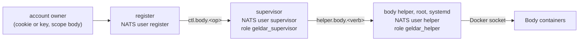

# Authn and authz map

Every identity and credential kind in Geldar, how it is proven, and what it may do once proven. The last sections give a matrix of who can reach what and the places where the spec and the code disagree. Secrets appear by role only; their consumers and rotation are in [secrets by role](secrets-by-role.md).

All facts were read from the repo at `03c1f5de` on 2026-11-16. The service references this page cites were checked at `1b114276`; `git diff --stat 1b114276..03c1f5de` over `threshold`, `sql`, `compose`, `deploy`, `geldar.ps1`, `plugin`, `supervisor`, `body-helper`, `tools/admin`, `tools/mcp-tokens` and `tools/migrate` is empty, and the facts below were re-read in the code where cited. Nothing on the node, the VM or a database was read (plan decision D8): what the node runs, which overlays it merges and which migrations it has applied are unverified.

## Terms

| Term | Meaning on this page |
|---|---|
| Authn | How a caller proves who it is. |
| Authz | What the proven caller may do. |
| Account owner | A person signed up through the register service. The code calls this an owner (`mcp_owners`). |
| Project owner | The person who owns Geldar and holds the third-party accounts. |
| Operator | The role that runs the Colo node (threat model, actors table). |
| Agent | An AI in the world. It holds no credential; its Body does (spec 8.1). |

## Credential kinds

| Credential | Holder | Proven by | Checked in | Lifetime and revocation | Evidence |
|---|---|---|---|---|---|
| Microsoft personal account | A person signing up or in | OpenID Connect authorization code with PKCE against the Microsoft `consumers` authority; the id token's `aud` and tenant are checked, and only the subject is kept, as an HMAC identity hash | `threshold/register` | A ban on the identity, or a deletion tombstone, refuses sign-in | [register service, Sign-in](../reference/register-service.md#sign-in); `src/providers.ts`, `src/identity.ts` |
| Register session cookie | An account owner's browser | 32 random bytes; the server stores only its SHA-256 (`register_sessions`) | `threshold/register` | 30 minutes sliding, 12 hours at most; logout and account deletion delete it | [register service, Sessions](../reference/register-service.md#sessions-and-cookies); `sql/0021_register_sessions.sql` |
| CSRF value | An account owner's browser | `HMAC-SHA256(session key, "register-csrf-v1:" + session id)`, echoed in a form field or the `x-csrf-token` header | `threshold/register` | Bound to the session | [register service, Browser routes](../reference/register-service.md#browser-routes) |
| Viewer cookie | An account owner's browser | A cookie Glass verifies; detail withheld under decision 0361 | `glass` | Withheld under decision 0361 | [Glass and Kino](../reference/glass-and-kino.md) (`agents-never`) |
| Owner API key (`gowner-` plus 64 hex) | An account owner's scripts | `Authorization: Bearer`; HMAC under the MCP token pepper, resolved by a definer function | `threshold/register` owner API | 90 days; at most 10 live per owner; revoked from a cookie session | `src/api/auth.ts`; `src/owner-keys-policy.ts` line 4; decisions [0170](../decisions/0170-owner-management-values-and-admin-flag.md) point 2, [0173](../decisions/0173-owner-keys-by-session-and-bearer-scope.md) |
| Admin flag (`mcp_owners.is_admin`) | An account owner, set by the operator | Not a credential: an attribute read from the database on each request, false when unreadable | `register` and the supervisor | Operator sets and unsets it; each change is an audit row | decision 0170 point 5; `threshold/register/src/admin.ts` |
| Kino administrator | A registered identity, set by the operator | Not a credential: an identity attribute; detail withheld under decision 0361 | `glass` | Operator grants and revokes it (`mcp-tokens admin grant\|revoke`, `tools/mcp-tokens/src/cli.ts` line 71); account deletion removes it | decision 0135 amendment R42; [Glass and Kino](../reference/glass-and-kino.md) (`agents-never`) |
| Player MCP bearer token (`gmcp-` plus 64 hex) | The harness that plays one sovereign player | `Authorization: Bearer` with the exact shape; HMAC under the pepper looked up in `mcp_tokens` | `threshold/mcp` | 90 days; a rotated-out token works 10 more minutes; revocation applies to the next call | `threshold/mcp/src/http/auth.ts`; `threshold/register/src/tokens-policy.ts`; decisions [0054](../decisions/0054-static-hashed-per-player-bearer-tokens.md), 0170 point 1 |
| MCP connection-class key | Not traced | A shared key in a request header, compared in constant time | `threshold/mcp` | While configured | `threshold/mcp/src/http/instinct-key.ts`; [conflict 12](#conflicts-recorded) |
| NATS user and password | Each service, one user per role | User name and password from a secret file | `nats` (account `GELDAR`) | No repo rotation | [NATS users](#nats-users); decision [0067](../decisions/0067-nats-accounts-and-least-privilege.md) |
| Postgres role and password | Each service with its own role; some share the superuser | Password from a secret file | `postgres` | No repo rotation except `migrate --set-role-password` | [Postgres roles](#postgres-roles) |
| Minecraft username (offline mode) | A Body | The username alone, admitted only when the NATS life registry holds it; Paper's whitelist as a second check | Velocity identity plugin; Paper | A registry entry expires unless re-put; a deleted key is a revocation | [Velocity gate](#velocity-gate-and-the-life-registry) |
| Velocity forwarding secret | `velocity` and `paper` | Modern forwarding: Paper accepts only connections Velocity forwarded with the secret | `paper` | No repo rotation | `compose/velocity/velocity.toml` lines 9 to 13 |
| RCON password | `paper`, `players-host`, the admin one-shot, the admit one-shot | RCON login | `paper` | No repo rotation | [secrets by role](secrets-by-role.md#generated-on-the-colo-node) |
| Thinker hub token | A local Thinker (`lantern-local`) | A shared token in the `hello` frame, when configured; unset leaves the socket open | `animus` hub, loopback only | Not wired on Colo | `animus/src/thinker/hub.ts` line 30; threat model section 3 |
| Node operator account | The operator | The node's own login; outside the repo | The node | Outside the repo | `deploy/common.sh` refuses uid 0 (`check_service_uid`) |
| Deploy runner | GitHub Actions on a self-hosted runner | The runner's registration and a root-owned entrypoint on the node | The node | Outside the repo | `.github/workflows/colo-deploy.yml` header |

## Register service and the owner API

Sign-in creates or finds the owner; the session then authorizes the account page and the owner API. Full route list: [register service](../reference/register-service.md#owner-api).

| Credential | Scopes | At cookie-only routes | Notes |
|---|---|---|---|
| Register session cookie | `read`, `body`, `manage` (`SESSION_SCOPES`, `src/api/auth.ts` line 9) | Allowed; a write needs the CSRF header | A cookie, when present, decides; a Bearer header is then not tried |
| Owner API key | The subset of `read`, `body`, `manage` stored with the key | Refused (401) | A player token is never accepted here (decision 0170 point 2) |

What each scope reaches at `03c1f5de` (`git grep -n -E "scope: '|cookieOnly" -- threshold/register/src/api`, 2026-11-16):

| Scope | Routes | Cookie-only |
|---|---|---|
| `read` | List and read own agents; Body status and Body log | No |
| `body` | Body start, stop, restart | No |
| `manage` | Agent settings (`PATCH`), player token mint and revoke, owner keys (list, mint, revoke), retire, account delete, account export | Yes, every one |

Two consequences, read from the code:

- A key's `manage` scope opens no route: every `manage` route is cookie-only ([conflict 8](#conflicts-recorded)).
- The Body routes mount only when all three `REGISTER_NATS_*` settings are set. `compose/colo.yml` sets none (`grep -c REGISTER_NATS compose/colo.yml` returns 0, 2026-11-16), so on the Colo stack as written a key reaches only the `read` agent routes.

Every request is limited by source address and, for writes, per owner; an admin is exempt from the per-owner limit on API writes only (`src/api/index.ts` lines 89 to 90; [conflict 7](#conflicts-recorded)). A foreign, missing or retired agent answers 404, never 403. Each owner API action writes one `register_audit` row ([register service, Database interface](../reference/register-service.md#database-interface)).

The admin flag never widens what an owner sees: there is no admin view, route or key scope over another owner's data (decision 0170 point 5). It exempts the owner from the supervisor's start counters and from the API write limit, and nothing else in code.

## The MCP

| Rule | Behaviour | Evidence |
|---|---|---|
| Path | `/p/<player_id>` only | [MCP tools, Transport](../reference/mcp-tools.md#transport-and-session) |
| Bearer | Exactly `Bearer `, then a token of the minted shape; any other string is refused before the HMAC and before any lookup | `parseBearer`, `threshold/mcp/src/http/auth.ts` |
| Binding | A token resolves to one player. A valid token on another player's path is 403 (`wrong_player`) | `verifyBearer`, same file |
| Scopes | None. A token is the whole of its player's agency | [MCP tools, Identity and scopes](../reference/mcp-tools.md#identity-and-scopes) |
| Refusal | Every authentication failure gets the same 401 body; the reason is logged only (`REFUSAL_REASONS` in `threshold/mcp/src/ports.ts`, including revoked, expired, inactive player, disabled harness, retired owner, owner over cap) | `threshold/mcp/src/ports.ts` |
| Host and Origin | A Host header not on the allow-list is 403; any `Origin` header is 403, valid token or not | `threshold/mcp/src/http/front.ts` line 216 |
| Owner keys | Never accepted here (decision 0170 point 2) | decision 0170 |

What a token may call, and the budgets and rate limits per player, are in [MCP tools](../reference/mcp-tools.md#tools).

## NATS users

One account, `GELDAR`. Anything not allowed is refused, a deny wins over an allow, and every user may answer requests on its own inbox (decision 0067). Re-derived from `Get-NatsUsers` in `geldar.ps1` at `03c1f5de` (11 users). `<s>` is the shard; "JS" means `$JS.API.>`, `$JS.ACK.>` and `_INBOX.>`. Why each list looks as it does: [NATS topology](../architecture/nats-topology.md#users-by-role).

| User | Connected by (Colo) | Publish | Publish denied | Subscribe |
|---|---|---|---|---|
| `body` | `golem-body`, `players-host`, `admin` | `geldar.<s>.>`; JS; KV writes on `geldar-life-registry`, `geldar-checkpoints`, `geldar-body-generation`, `geldar-skins` | Kino subjects, `blockowner.changed`, `ctl.body.>`, `helper.body.>`, `state.*.level`, `body.*.hearing` | `geldar.<s>.body.>`, `blockowner.changed`, `state.*.level`, inbox |
| `mind` | `animus` (profile `mind`) | Its nine event types; `geldar.<s>.body.>`; JS | `body.*.hearing` | inbox |
| `mcp` | `geldar-mcp` | `sovereign_call`; `geldar.<s>.body.>`; KV `geldar-presence`; JS | `body.*.hearing` | inbox |
| `eventsink` | `eventsink` | `dlq`; `state.>`; JS | none | `state.*.proficiency`, inbox |
| `paper` | `paper` | `geldar.<s>.>`; JS | Kino subjects, `blockowner.query`, `ctl.body.>`, `helper.body.>`, `state.*.level` | Kino subjects, `maintenance`, `blockowner.query`, inbox |
| `velocity` | `velocity` | Only the JetStream calls a KV watch needs on `geldar-life-registry` and `geldar-skins`; flow control; inbox | none | inbox |
| `kino` | `glass`, only with the Kino overlay | Observation control; see [Glass and Kino](../reference/glass-and-kino.md) (`agents-never`) | none | Kino subjects, inbox |
| `deploy` | `admin`, only with `compose/colo-notice.yml` | `maintenance` only | none | inbox |
| `supervisor` | Not in any compose file in this repo | The four `helper.body.<verb>` subjects; inbox | none | `ctl.body.>`, inbox |
| `register` | Not wired in `compose/colo.yml` | `ctl.body.>` | none | inbox |
| `helper` | The node's body helper unit (systemd) | inbox | none | The four `helper.body.<verb>` subjects |

Limits of this model, as the repo states them:

- **Per shard, not per life.** No user is scoped to one life; the Mind and the MCP enforce their own life lists in code (decision 0067, "Lives scoping"; decision [0087](../decisions/0087-nats-overlay-live-test-and-scoped-subjects.md)).
- **Denies and the JetStream API.** The `body`, `mind` and `mcp` roles also hold `$JS.API.>`; the interaction of these denies with JetStream is an open item ([nats-auth-inplace, Open questions](../runbooks/nats-auth-inplace.md#open-questions); decision 0199).
- **Proven against what.** The comments in `geldar.ps1` disagree. `Initialize-NatsAuth` (line 318) and the header it writes into the server config (line 345) say the lists are "untested against a live server". `Get-NatsUsers` (line 367) calls them "the table the live test proves" (`threshold/mcp/test/nats-auth.it.test.ts`, which starts a throwaway `nats-server` from the generated config and is skipped unless `GELDAR_IT=1`). No row of the table is proven against the node's live file.
- **Live node.** The node's live config was last recorded on 2026-11-14 with 8 users: `body`, `mind`, `eventsink`, `mcp`, `velocity`, `paper`, `kino`, `deploy`. It lacked `helper`, `supervisor` and `register`, and it differed from the table above in permission lines as well: the `body` and `paper` publish denies, the `mind` and `mcp` hearing denies, and the `body` subscribe and `eventsink` lines ([nats-auth-inplace, Drift to resolve first](../runbooks/nats-auth-inplace.md#drift-to-resolve-first)). The live file today is unverified; treat every row as generator state, not node state.
- **Phase 0.** NATS is open on the local stack unless the auth overlay is merged (threat model section 3).

## Postgres roles

Re-derived from `CREATE ROLE`, `GRANT` and `REVOKE` in `sql/` at `03c1f5de` (`git grep -n -i -E "^\s*(GRANT|REVOKE)" -- sql`, 2026-11-16). Every service role is created `NOLOGIN`; `migrate --set-role-password` gives it a password and the login, for the five roles in `PASSWORD_ROLES` (`tools/migrate/src/migrate.ts` lines 137 to 143). Table-level grants are in [database schema](../reference/database-schema.md).

| Role | Connected by | Login set by | May do | Evidence |
|---|---|---|---|---|
| `geldar` (superuser) | `eventsink`, `animus`, the `admin` one-shot, the operator's local `geldar.ps1 db` and `mcp-tokens` | The Postgres image (`POSTGRES_USER`) | Everything | `compose/colo.yml` lines 45, 223, 305, 668; `eventsink/src/config.ts` line 61; `animus/src/config.ts` line 197; decision [0133](../decisions/0133-colo-admin-by-one-shot-container.md) |
| `geldar_mcp` | `geldar-mcp` | `migrate --set-role-password` (`deploy/colo-up.sh`) | Read owners, listed columns of players, agents and identities, and token rows (HMACs); update a token's last use; read and update budgets; append to the MCP journal; sleep marks and death counts | `sql/0002_sovereign_mcp.sql` lines 88 to 93; later narrowing in 0003, 0004, 0007, 0010, 0023, 0037, 0063 |
| `geldar_glass` | `glass`; `tools/adam-report` | As above | Read-only: the published record and Glass's definer functions (public `README.md`: "Reads Postgres with a read-only role") | `sql/0005_glass_reader.sql`; [Glass and Kino](../reference/glass-and-kino.md) (`agents-never`) |
| `geldar_register` | `register` | As above | `EXECUTE` on the register definer functions; direct `SELECT, INSERT, UPDATE, DELETE` on `register_sessions`, `INSERT` on `register_consents`, `SELECT, INSERT` on `register_audit` (no update or delete) | `sql/0021`, `0022`, `0025`; [register service, Database interface](../reference/register-service.md#database-interface) |
| `geldar_supervisor` | The supervisor | As above | `SELECT, INSERT` on `body_ops`; `SELECT` on `mcp_roster`; `INSERT` on `register_audit`; `EXECUTE` on `supervisor_is_admin` and `supervisor_player_display_name`; no update or delete | `sql/0027_body_ops.sql` lines 28 to 44; `sql/0033_supervisor_display_name.sql` |
| `geldar_helper` | The body helper | `deploy/install-body-helper.sh` step 4 | `EXECUTE` on two definer functions that answer one name or one life id; no table privilege | `sql/0038_body_helper_role.sql`; `sql/0063_body_host_roles.sql` line 112 |
| `geldar_body_host` | Managed Body containers, when turned on | Not traced: not in `PASSWORD_ROLES` | `EXECUTE` on `player_host_config` only; no table privilege | `sql/0063_body_host_roles.sql` lines 24 to 34, 114 |

`mcp_owners.is_admin` is written only through the operator path `owner-admin`, run as the superuser in the admin container; no register-service role can write it (decision 0170 point 5; [admin service](../reference/admin-service.md#database-role-and-grants)).

## Velocity gate and the life registry

| Step | Rule | Evidence |
|---|---|---|
| Ingress | The bot ingress runs `online-mode = false` with modern forwarding to Paper | `compose/velocity/velocity.toml` lines 9 and 12 |
| Admission | A login is admitted only when its lowercase username is a key in the NATS KV bucket `geldar-life-registry`; one fixed message for every denial | [velocity identity plugin](../reference/velocity-identity-plugin.md); decision [0040](../decisions/0040-bot-ingress-registry-in-nats-kv.md) |
| Fail closed | No admission until the registry has synced, while the bucket is absent, or after a lost watch | same |
| Registry writers | The `body` user (Golem); `velocity` is read-only and cannot create or write a bucket | `golem/src/registry.ts`; `Get-NatsUsers`; decision 0137 item 3 |
| Second check | Paper's whitelist is enforced (`ENFORCE_WHITELIST`, `compose/colo.yml` line 122). Names are added over RCON by the admin one-shot `whitelist-house-body`, the player host, and the body helper's admit one-shot | `golem/src/admit-life.ts`; [admin service](../reference/admin-service.md) |
| Commands | Paper cancels every command a player types; console and RCON are not affected | `CommandBlockListener.java` |
| Plugin channel | Messages on `geldar:cmd` from a connection not admitted as a live agent are dropped at the proxy | [velocity identity plugin](../reference/velocity-identity-plugin.md) |

The human path into the game (ghosts) is designed in spec 8.4 and decision [0137](../decisions/0137-public-spectator-proxy-is-separate-and-online.md). Its state in the repo is recorded in [network and trust zones, Known gaps](../architecture/network-and-trust-zones.md#known-gaps); detail is withheld under decision [0361](../decisions/0361-agents-never-placement-and-public-detail.md).

## Body control chain

An account owner's Body request passes three narrow principals; only the last touches Docker (decisions [0152](../decisions/0152-programmatic-body-management-for-owners.md), [0260](../decisions/0260-body-container-control-by-host-helper.md)).

The supervisor checks that the owner holds the agent, applies the start quotas (admins exempt from the two start counters only) and writes the audit; the helper serves four fixed verbs from a fixed template ([supervisor and body helper](../reference/supervisor-and-body-helper.md)). In this repo the chain is not wired end to end on Colo: the `register` NATS settings are unset and no compose file runs the supervisor.

## Operator and deploy

| Principal | Reaches | Limits | Evidence |
|---|---|---|---|
| Operator, through `deploy/colo-admin.sh` | The `admin` one-shot as the Postgres superuser; RCON for `whitelist-house-body`; NATS as `body` for `ensure-skins-bucket`, as `deploy` for notices; per-player host containers | Refuses root and service uid 0; digest-pinned images only; secret files checked for mode and owner, never read; the token value is never printed | [admin service](../reference/admin-service.md); [deploy scripts](../reference/deploy-scripts.md#common-rules) |
| Deploy runner | A root-owned entrypoint that deploys commits on `main` through `deploy/colo-cd.sh` | The workflow's token is read-only; the entrypoint is outside the repo (unverified) | `.github/workflows/colo-deploy.yml` lines 1 to 6, 26, 44 to 47 |
| Body helper | The Docker socket, alone among Geldar processes | Four verbs; a fixed container template | decision 0260; [network and trust zones, Container hardening](../architecture/network-and-trust-zones.md#container-hardening) |

Operator tools read, start, stop and restore; they do not act in the world (threat model section 4, rule 9). RCON is for infrastructure and benchmark control only.

## Who can reach what

`own` means the caller's own players or agents only. `n/a` means the principal never holds that credential or never reaches that column. `No` means it is refused there. Rows run in three groups: people (anonymous client to player token holder), the agent and its Body, then services and the operator. Colo as written in the repo; node state unverified.

| Principal | Public sites through Caddy | Owner API | MCP tools | NATS | Postgres | Paper game | RCON | Docker socket |
|---|---|---|---|---|---|---|---|---|
| Anonymous internet client | Map, Glass public pages, register pages, the MCP path (401 without a token) | 401 | 401 | No | No | Only through the public overlay; see [known gap 1](../architecture/network-and-trust-zones.md#known-gaps) | No | No |
| Account owner, browser session | Yes | All scopes, `own` | No | No | No | No | No | No |
| Owner API key holder | Yes | Key's scopes, `own`, never cookie-only routes | No | No | No | No | No | No |
| Player token holder (harness) | The MCP path | No | `own` player | No | No | No | No | No |
| Agent in the world | n/a | n/a | n/a | n/a | n/a | Through its Body only | n/a | n/a |
| Body (`golem-body`, `players-host`) | n/a | n/a | n/a | `body` | No (managed Bodies: one function) | Its own username | `players-host` only, for its whitelist | No |
| `geldar-mcp` | Serves the MCP path | n/a | Serves them | `mcp` | `geldar_mcp` | No | No | No |
| `register` | Serves the register paths | Serves it | No | `register` (unwired on Colo) | `geldar_register` | No | No | No |
| `glass` | Serves Glass | No | No | `kino` (Kino overlay only) | `geldar_glass` | No | No | No |
| `animus`, `eventsink` | n/a | n/a | n/a | `mind`, `eventsink` | Superuser | No | No | No |
| Supervisor | n/a | n/a | n/a | `supervisor` | `geldar_supervisor` | No | No | No |
| Body helper | n/a | n/a | n/a | `helper` | `geldar_helper` | No | Admit one-shot only | Yes |
| Operator on the node | Yes | No | No | `body`, `deploy` through the admin one-shot | Superuser through the admin one-shot | No | Through the admin one-shot | Through the deploy scripts (unverified) |

## Conflicts recorded

Each item gives every account. This page does not pick one (persona rule 8).

1. **Thinker identity.** Spec 8.2 and 8.3: mutual TLS with 24-hour certificates from step-ca, identity from the certificate SAN, Envoy RBAC. Code: the Mind's Thinker socket on loopback with an optional shared token (`animus/src/thinker/hub.ts`); the identity is the connection, never a frame field (threat model section 4, rule 1). No Gateway exists ([network and trust zones](../architecture/network-and-trust-zones.md#trust-boundaries-design-and-build)).
2. **Watchers.** Spec 8.4: the Observatory sits behind an identity-aware proxy with Entra ID; anonymous access off; Entra group membership decides who watches. Decision [0072](../decisions/0072-glass-and-bluemap-are-public.md): Glass and the map are public and read-only. The Caddy sites have no SSO step ([network and trust zones](../architecture/network-and-trust-zones.md#conflicts-recorded), item 4).
3. **Who may sign up, and with what.** Spec 8.4b: sovereign players' humans authenticate via Entra ID in the project tenant, group `geldar-patrons`. Decision [0135](../decisions/0135-self-registration-with-github-and-discord.md) title and original body: GitHub and Discord. Decision 0135 amendment R40, decision [0261](../decisions/0261-open-signup-player-host-bodies-and-auto-roster.md) item 1 and the code: Microsoft personal accounts (`consumers`), open sign-up ([register service](../reference/register-service.md#conflicts-recorded), item 1).
4. **MCP authorization.** Spec 8.4b and 5.15.3: OAuth 2.1, 15-minute access tokens with refresh rotation, scopes per player. Decision 0054 (Accepted) and the code: static hashed Bearer tokens, 90 days (decision 0170 point 1), no scopes (threat model section 7).
5. **Least privilege per service.** Spec 8.6: each service has its own Postgres role and NATS account with least privilege. Code: `animus` and `eventsink` connect as the Postgres superuser; the admin one-shot does too, deferred by decision 0133 ("Least-privilege admin roles are C2"). NATS users exist per role but are scoped per shard, not per life (decision 0067 known gap; decision 0087).
6. **The MCP's NATS reach.** Spec 6.4: "`geldar.*.player.>` subjects only". Decision 0067: publish `sovereign_call` and request only `body.<life>.book` for its own players. Decision 0087 (Proposed) and `Get-NatsUsers`: `geldar.<s>.body.>`, limited by the application's own life check ([NATS topology](../architecture/nats-topology.md#conflicts-and-drift-recorded), item 1).
7. **Admin exemption from rate limits.** Decision 0170 point 5: an admin is exempt from "the register service's fixed-window rate limits (sign-up, create, rename, token and key actions, export, skin upload)". Code: the exemption applies only to the owner limit on owner API writes (`threshold/register/src/api/index.ts` lines 89 to 90); the account page (`src/account.ts`) and the sign-in and source limits read no admin flag (`git grep -n -i admin -- threshold/register/src/account.ts`, no hits, 2026-11-16).
8. **Owner keys and the `manage` scope.** Decision 0170 point 2: keys are minted, listed and revoked "on the account page and through the API (scope `manage`)". Decision 0173 (Decided) and the code: those routes are cookie-session only, and every `manage` route is `cookieOnly` (`threshold/register/src/api`), so a key's `manage` scope opens no route.
9. **Register role privileges.** `threshold/register/README.md`: the role "holds no table privilege at all". Migrations 0021, 0022 and 0025 grant it three tables ([register service](../reference/register-service.md#conflicts-recorded), item 3).
10. **The `ops` NATS user.** Decision 0067 lists an `ops` user with full access, "used by hand only". Decision 0087 removed it from the generator; `Get-NatsUsers` at `03c1f5de` has none.
11. **Operator access.** Spec 8.1 and 8.6: the admin plane through a bastion with hardware-key MFA, SSH key-only. The repo describes a self-hosted runner or the project owner's own SSH access and nothing more (`deploy/README.md`, "Runner or SSH"; decision 0084 item 10). The node's setup is unverified.
12. **Unnamed MCP connection class.** `threshold/mcp/src/http/instinct-key.ts` defines a second connection class turned on by `GELDAR_MCP_INSTINCT_KEY_FILE`. No decision or spec section names it ([MCP tools](../reference/mcp-tools.md#conflicts-recorded), item 12). This page describes it no further.
13. **Per-player rate limits.** Spec 8.4b: `act` at most once per 2 s. Decision [0149](../decisions/0149-act-budget-suspended-and-metered.md) (Accepted, temporary) and the code: act spacing applies only when the act budget is enforced ([MCP tools](../reference/mcp-tools.md#conflicts-recorded), item 6).
14. **Permissions plugin.** Spec 8.5 names LuckPerms for "no commands, no permissions". The repo ships no permissions plugin; `CommandBlockListener.java` cancels every typed command instead ([Geldar-Core plugin](../reference/geldar-core-plugin.md)).

## Unverified

- Which overlays, NATS users, Postgres logins and migrations are live on the node (D8).
- Whether the public overlay is merged on the node ([network and trust zones](../architecture/network-and-trust-zones.md#known-gaps), known gap 1).
- Whether the operator account on the node can reach the Docker socket directly, and how the runner's entrypoint is set up (outside the repo).
- Who holds the MCP connection-class key, if anyone.

## Detail withheld, decision 0361

Observation surfaces (Glass viewer rules, Kino access, telemetry) appear here only as the public `README.md` and decision titles state them. Their access detail is in the `agents-never` [Glass and Kino](../reference/glass-and-kino.md) reference, and anything beyond its level is withheld under decision [0361](../decisions/0361-agents-never-placement-and-public-detail.md).
