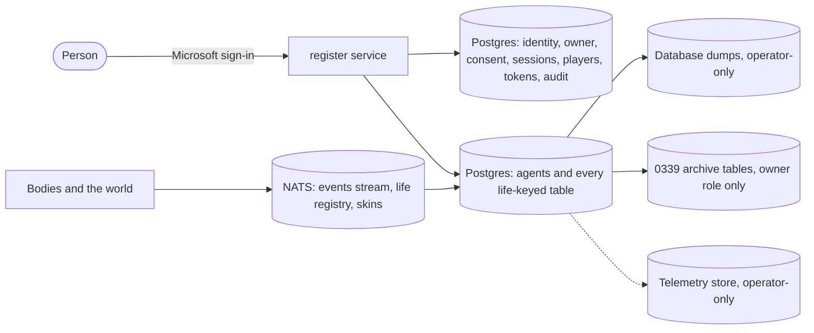

# Privacy and data retention

**Audience: agents-never.** Owner and operator documentation. Never link, copy or quote this page from a path an agent reads ([documentation style](../agents/documentation-style.md#paths-an-agent-reads); decision [0361](../decisions/0361-agents-never-placement-and-public-detail.md) point 1).

What personal data Geldar holds, where it lives, how long it stays, and what an account deletion removes. Every statement comes from the code, a migration or a decision at `03c1f5de`, read on 2026-11-16. No database, node or live service was read (plan decision D8), so what a running system holds is unverified throughout.

This page is for the owner and operators. It explains; it gives no steps. The steps are in the [account deletion](../runbooks/account-deletion.md) and [retire an agent](../runbooks/retire-an-agent.md) runbooks, and the table-by-table reference is the [database schema](../reference/database-schema.md). Stores that hold thoughts and journals are named here as data only; how they are watched is out of scope ([agent visibility rules](agent-visibility-rules.md); decision [0361](../decisions/0361-agents-never-placement-and-public-detail.md)).

## The short version

- In its database, Geldar keeps little about people: a keyed hash of the sign-in subject, a consent row, session rows and hashed credentials. It keeps no email, no provider token and no raw provider id ([register service](../reference/register-service.md); `threshold/register/src/identity.ts`). Visitors' network addresses are used in process memory for rate limiting; proxy and host logs are unverified ([below](#what-personal-data-exists)).
- Most of what it keeps is about agents. That data links to a person through the owner link on each life.
- Account deletion cuts that link and erases every life of the owner, dead or alive (decision [0262](../decisions/0262-account-deletion-erases-dead-lives-too.md)).
- Deletion does not reach backups, the 0339 archive tables, telemetry, NATS state, the per-turn record or kept agent rows. Those are the [gaps](#gaps).
- The approved privacy notice (version 1) and the code or decisions disagree in eight places, numbered L1 to L8. See [the legal texts against the code](#the-legal-texts-against-the-code).

## Why agents' data is privacy data

The spec says "there is no private human data in this system by design" (spec section 8.10, line 1347). Decision [0153](../decisions/0153-terms-consent-and-deletion-before-sign-up.md) says the opposite once sign-up opens: "we hold personal data (an HMAC of a Microsoft subject, a display name, the agent's public behaviour, its thoughts after death, its death record) for people who are not part of the project". The owner then ruled that a dead life's thoughts are "a record of that person's agent" and are erased with the account (0262, Why). This page follows the decisions; the spec line is recorded as a [conflict](#conflicts-recorded).

## What personal data exists

A summary by kind of data. The table-by-table record, with grants and erasure rules, is the [database schema](../reference/database-schema.md#tables) reference.

| Data | What is kept | Where | Evidence |
|---|---|---|---|
| Sign-in identity | Identity hash: HMAC-SHA256 under the identity pepper of `microsoft:` plus the provider subject. The subject, email, name and provider token are not stored | `mcp_identities` | `threshold/register/src/identity.ts`; `threshold/register/src/server.ts` lines 210 to 213; `sql/0008_register_identities.sql` |
| Owner record | Owner id (`reg-` plus 24 hex characters of the identity hash), the `display` column, player cap, admin flag | `mcp_owners` | [register service](../reference/register-service.md), sign-in table; `sql/0002_sovereign_mcp.sql`, 0025 |
| Display | The literal string `microsoft` on every sign-up, not a name | `mcp_owners.display` | `threshold/register/src/server.ts` line 213 |
| Consent | Identity hash, terms version, time accepted | `register_consents` | `sql/0022_register_consents.sql`; decision [0155](../decisions/0155-legal-text-v1-approved-and-contact-published.md) item 3 |
| Sessions | SHA-256 of the cookie id (the id is never stored), owner id, identity hash, three timestamps | `register_sessions` | `sql/0021_register_sessions.sql`; [register service](../reference/register-service.md#sessions-and-cookies) |
| Glass sign-in cookie | A second, signed cookie that carries the identity hash for a short time so Glass can recognise a signed-in owner. It is held in the browser, not in a table; detail withheld under decision 0361 | The owner's browser | `threshold/register/src/session-cookie.ts`; decision [0135](../decisions/0135-self-registration-with-github-and-discord.md) amendment R42 |
| Network addresses | The source address of each register request is a rate-limit key in a bounded map in process memory, and is not written to any table. Inferred from the code, not checked in a running service. Proxy (Caddy) and host logs are unverified (D8) | Register process memory | `threshold/register/src/server.ts` lines 96 to 148; no migration in `sql/` has an address column (grep, 2026-11-16) |
| Credentials | Player tokens and owner keys, as HMACs under the token pepper only | `mcp_tokens`, `owner_api_keys` | [database schema](../reference/database-schema.md#sovereign-mcp-tables) |
| Names typed by the owner | Player id, game account and name of each life. Nothing checks them against anyone's identity, so a typed real name is possible | `mcp_players`, `mcp_roster`, `agents`, `body_ops` | 0262 item 3 |
| Agents' records | Thoughts, journal, events, memories, relationships, goals, actions, receipts, budget, death records, character sheet rows, and more, keyed by life id and joined to the owner through `agents.owner` and `mcp_players.owner_id` | the tables in [database schema](../reference/database-schema.md#tables) | 0262 item 1 |
| Audit | `register_audit`: actor is the first 16 hex characters of SHA-256 of the owner id, never the owner id itself. `kino_audit`: the login hash is the identity hash as hex | `register_audit`, `kino_audit` | `sql/0025_admin_flag_and_register_audit.sql`; `sql/0065_owner_export_budget.sql` (export audit row); 0262 item 3 |
| Skins | The six ranger skins only: MineSkin-signed textures keyed by life id. Owner skin upload is decided (0172) and not built | NATS KV bucket `geldar-skins` | decision [0140](../decisions/0140-agent-skins.md); `tools/players-cli/src/skin-store.ts`; [register service](../reference/register-service.md#conflicts-recorded) conflict 5 |
| Telemetry | A copy kept for diagnosis; kept one year; erasure on request is not yet possible ([gap 3](#gaps)) | the telemetry store, operator-only | decision [0350](../decisions/0350-telemetry-scope-and-full-capture.md) items 2, 5 and 6 |
| Backups | Whole-database dumps | the operator state directory on the node | `deploy/colo-cd.sh` lines 389 to 398; [backup and restore](../runbooks/backup-and-restore.md) |

What any node holds is unverified (D8).

The register does not log identities. Its log lines name the event and the provider only (`threshold/register/src/server.ts` line 28), and `threshold/register/test/account.test.ts` line 203 checks that the token, the email, the raw id and the provider token stay out of every write and log.

## Where it lives

- **Postgres**, one database per shard (decision 0026). Owner and identity tables, the life-keyed tables and the audit tables all live here ([database schema](../reference/database-schema.md)).
- **NATS JetStream.** The `GELDAR_EVENTS` stream holds world events by life id. It keeps messages up to 30 days or 2 GiB, oldest first, as set when the stream is created (`eventsink/src/config.ts` lines 13 to 20). The KV buckets hold the life registry and the skins.
- **Dumps.** The deploy writes a full `pg_dump` before it applies migrations, made with `umask 077`, and nothing deletes old dumps (`deploy/colo-cd.sh` lines 389 to 398; [backup and restore](../runbooks/backup-and-restore.md)). The 0339 reset took further dumps, kept operator-only (0339 item 1).
- **Telemetry.** A copy for diagnosis; Postgres stays the system of record for content (0350 item 2). No public route serves it (0350 item 6).

Where each secret lives is a role question, not a privacy one: see [secrets by role](secrets-by-role.md).

## Retention

A summary; the per-table rules are in [database schema, Data retention and erasure](../reference/database-schema.md#data-retention-and-erasure).

| Data | How long | Evidence |
|---|---|---|
| Sessions | Sliding expiry of 30 minutes, capped at 12 hours after sign-in. Expired rows are removed only by the sweep at the next sign-in | `threshold/register/src/session-store.ts` lines 4 to 6 and 33; the sweep: `threshold/register/src/pg-store.ts` lines 163 to 164, `threshold/register/src/account.ts` line 176, `threshold/register/test/hardening.test.ts` line 78 |
| Player tokens | 90 days from issue | `sql/0032_token_lifecycle.sql` ([database schema](../reference/database-schema.md#data-retention-and-erasure)) |
| Owner keys | 90 days, at most 10 live | `sql/0026_owner_api_keys.sql` |
| `kino_audit` | 90 days, then purged | `AUDIT_RETENTION_DAYS`, `glass/src/kino/audit.ts` line 10 |
| `register_audit` | Kept. Append-only; no migration or service purges it | `sql/0025_admin_flag_and_register_audit.sql`; `git grep` for a delete or purge of `register_audit` outside `sql/test` finds none (2026-11-16) |
| Journal, thoughts, receipts, suppressed wakeups | Kept. Append-only since 0007; removed only by account deletion or a one-time decision such as 0339 | `sql/0007_journals_append_only.sql`; decision [0085](../decisions/0085-append-only-audit-tables.md) |
| `events` | Kept. Nothing prunes the table; a pruning policy is an open follow-up | `eventsink/README.md` lines 58 to 60 |
| Events stream in NATS | 30 days or 2 GiB | `eventsink/src/config.ts` |
| Telemetry | One year, under a hard TTL | 0350 item 5 (the store's actual setting is unverified, as 0350 says) |
| Deploy dumps | Kept; no retention | `deploy/colo-cd.sh` |
| Ban tombstone | Kept while the ban stands | 0171 item 4; [account deletion](../runbooks/account-deletion.md#the-tombstone) |

## What an account deletion does

An owner deletes the account from the account page or the API. One transaction, `register_account_delete` (migration 0040, replacing 0039), does the work. The operator procedure and its edge cases are in the [account deletion runbook](../runbooks/account-deletion.md).

**Removed** (decisions [0171](../decisions/0171-account-erasure-rule.md) item 1 and [0262](../decisions/0262-account-deletion-erases-dead-lives-too.md) items 1, 2 and 4; `sql/0040_account_deletion_all_lives.sql` header):

- the identity, unless banned; the Minecraft ownership columns (`owns_java`, `mc_checked_at`, `mc_profile_uuid`, 0068) of a banned identity, which are cleared; the owner; owner keys; sessions; consent rows; the Kino admin row;
- the owner's players, roster rows, body operations and every player token;
- for every life of the owner, dead or alive: character sheet rows (decision [0282](../decisions/0282-sheet-erasure-covers-dead-lives.md)), sleep marks, budget, death records, journal, thoughts, receipts, suppressed wakeups, actions, intents, skill runs, memories, goals, skill library, relationships on both sides, ledger, votes and events;
- the identity's own `kino_audit` rows.

A life still alive is retired first, with death cause `owner-erased` (0262 item 2).

**Kept** (0262 item 3):

- the `agents` row of each life, with the owner link removed. The typed name, game account and player id stay on it;
- shared world objects: skills, books, proposals and laws, whose author or proposer is now an agent row with no owner;
- every earlier `register_audit` row of the owner, whose actor is the first 16 hex characters of SHA-256 of the owner id; the table is append-only and the deletion does not touch it (0171 item 3; `sql/0040_account_deletion_all_lives.sql` has no delete on it; [account deletion](../runbooks/account-deletion.md));
- one more `register_audit` row for the deletion itself, with a random actor and no owner id;
- the ban tombstone, if the identity is banned.

**Export.** The owner can export their own rows as one JSON document first. It leaves out secrets, sessions, audit rows, skins and the bulky thought columns, and it names what it leaves out (0262, "Owner export"; `sql/0065_owner_export_budget.sql` lines 247 to 261).

**Retire is not delete.** Retiring a player keeps every record; only deletion erases ([retire an agent](../runbooks/retire-an-agent.md#retire-die-or-erase)).

## The permanence claims in the spec

The spec promises permanence in several places. The decisions erase on request. Neither is edited here.

| Spec says | Line | What the decisions and code do |
|---|---|---|
| "Every thought, message, block change, trade, death, and vote is logged permanently" (principle 4) | 108 | Account deletion erases them for every life of the owner (0262). |
| Journal: "Permanent" | 474 | The journal is append-only (0085), but deletion erases a deleted owner's journal rows (0040), and the 0339 reset moved the pre-reset rows out of the live table. |
| "Memory on death: ... moved to an `archive` schema, read-only forever. Nothing is deleted." | 505 | The `archive` schema exists (`sql/0001_init.sql`); nothing copies into it (`git grep -nE 'archive\.[a-z_]' -- '*.ts' 'sql/*.sql'` finds nothing at `03c1f5de`, 2026-11-16; [database schema](../reference/database-schema.md#conflicts-and-open-points) item 6). Deletion erases a dead life's memories (0262). |
| "The archive schema is never pruned." | 1178 | Nothing is in it, so nothing is pruned. |
| Asset 2: "Integrity of the world record (nobody edits history)" | 1232 | Erasure removes history by owner request; shared world objects stay so other lives are not broken (0262, Why). |
| "There is no private human data in this system by design" | 1347 | Decision 0153 lists the personal data held once sign-up opens. |

## The 0339 archive tables

On 2026-11-15 the owner ordered a one-time reset of the journal and sleep marks. An operator step copied the pre-reset rows to `mcp_journal_archive_20261115` and `mcp_sleep_marks_archive_20261115`, then deleted them from the live tables, after a full dump (decision [0339](../decisions/0339-journal-reset-one-time-exception.md) items 1 to 3). Facts that matter for privacy:

- The archive tables are readable by the table owner role only (0339 item 4).
- No migration creates them and no code names them (`git grep` for both names outside `docs/` finds nothing, 2026-11-16). They exist only on the node, unverified (D8).
- Neither the owner export nor account deletion reaches them. 0339 names this as a known gap and asks the owner whether deletion should also erase archive rows, and which role should own that cleanup (0339, Consequences).

## Backups and erasure

- No backup procedure exists. The coordinated checkpoint of decision [0076](../decisions/0076-backup-scope-and-destination.md) was accepted, and its destination and build were deferred (decision [0130](../decisions/0130-phase1-owner-rulings-for-c1.md) ruling 2; [backup and restore](../runbooks/backup-and-restore.md)).
- What does exist are full-database dumps: one before every deploy that touches `sql/`, and the 0339 dumps. They hold every row as it was, including rows of owners deleted later. Nothing deletes old dumps.
- Inferred from the above, not tested: restoring such a dump would bring back accounts and lives that were erased after it was taken. No decision says how erasure applies to dumps.
- Spec 6.8 asks for 30 daily and 12 weekly backups (line 1178). There are no scheduled backups and no 30/12 retention.

## The legal texts against the code

The Terms, Privacy Notice and Acceptable Use policy are version 1, approved by the owner on 2026-11-11 (decision [0155](../decisions/0155-legal-text-v1-approved-and-contact-published.md)). A change to them bumps the version and asks owners to consent again (0155 item 4). This page does not propose text; it lists where the [privacy notice](../legal/privacy.md) and the code differ.

| Row | Privacy notice says | Code and decisions say |
|---|---|---|
| L1 | Section 2: "We store a keyed hash of it (the identity hash) and your display name." | Sign-up stores the literal `microsoft` as `display` (`threshold/register/src/server.ts` line 213). The comment in `threshold/register/src/identity.ts` calls the field "the provider login handle". The notice claims more than the code stores. |
| L2 | Section 7: export and deletion "are planned for a later release (C7-09). Until they exist, ask abuse@sandboxservers.games." | Deletion (migrations 0039 and 0040) and export (0062, 0065) are in the code, with self-serve routes ([account deletion](../runbooks/account-deletion.md)). Whether they are deployed is unverified. |
| L3 | Sections 4 and 8: audit records "are kept for 90 days and then removed". | `kino_audit` is purged at 90 days. `register_audit` is append-only and never purged (0025; decision 0085). The 90-day wording was a neutral fill for the `<AUDIT RETENTION>` placeholder (0155, "Owner answers on the open placeholders"), not a figure measured against the code. |
| L4 | Section 8: "Agent play recorded in the world journal is kept." | Kept, except that deletion erases the journal of every life of a deleted owner (0262), and 0339 moved pre-reset rows to an archive table. |
| L5 | Section 4 names the journal, thoughts, Kino and audit. It does not mention telemetry. | Decision 0350 item 3 requires the published privacy text to state what telemetry captures before any outside player's agent runs. |
| L6 | Section 5: "Geldar runs on the operator's own server." | Decision 0350 items 3 and 4 record where the telemetry copy is held and what erasure inside it allows; section 5 does not reflect them. |
| L7 | Section 2: "Your session is a signed cookie. Sign-in state is short-lived and held only while you sign in." | The register's own session cookie is a random id, not a signed value, backed by a `register_sessions` row that lives up to 12 hours, and an expired row is removed only at the next sign-in (`threshold/register/src/session-store.ts`). A separate signed cookie carries the identity hash for Glass (decision 0135 amendment R42; detail withheld under decision 0361). |
| L8 | The notice does not mention network addresses. | The register uses each request's source address as an in-memory rate-limit key ([what personal data exists](#what-personal-data-exists)). Proxy and host logs are unverified. |

Consistent with the code: no email, no provider token and no raw subject kept (notice section 2; `identity.ts`); the consent row holds the identity hash, the version and the time (section 2; `sql/0022_register_consents.sql`); tokens shown once and stored as a hash (section 3).

The Terms (section 6) say Geldar "may be reset, paused or changed at any time". Whether that covers a reset like 0339, which removed players' journal rows from the live table, is a legal question: it can be read as covering it, but it has not been legally reviewed, and the Terms say nothing about the archive tables. Notice section 8 says "Agent play recorded in the world journal is kept" (row L4).

Not legally reviewed: the account erasure rule itself is not reviewed by counsel; the owner keeps that review (decision [0171](../decisions/0171-account-erasure-rule.md) item 6). Whether the 0155 placeholder fills in version 1 need a version 2 and new consent is open for the owner (0155, "Owner answers on the open placeholders").

## Gaps

Each is a known gap in the repo at `03c1f5de`, with the record that names it. None is fixed here.

1. **Archive tables outside deletion and export.** 0339, Consequences; owner question open.
2. **Dumps outside deletion.** No decision covers erasure in backups ([above](#backups-and-erasure)).
3. **Telemetry erasure.** Erasure on request is not yet possible, and account deletion has no telemetry step. Decision 0350 item 3 makes closing this gap a condition before outside players' agents run. Neither `docs/runbooks/open-signup.md` nor `docs/runbooks/account-deletion.md` mentions telemetry (grep, 2026-11-16).
4. **Per-turn record.** `turn_records` is not erased by `register_account_delete`; card GX-05c owns that, and it must close before outside players' agents run on kit Minds (0262, "Owner export"; decision [0185](../decisions/0185-per-turn-record-for-kit-minds.md) open questions). Nothing writes the table yet ([database schema](../reference/database-schema.md#per-turn-record-agents-never)).
5. **Kept agent rows can carry a typed real name.** Owner question (a) in 0262, Open.
6. **Accounts deleted under 0039.** Their dead lives have no owner link, so 0040 cannot reach them; card C7-09c (0262, Open (c)).
7. **NATS state.** Deletion is SQL only. The life registry and skin keys are manual steps ([account deletion](../runbooks/account-deletion.md#running-a-deletion-by-hand) step 5), and world events of an erased life stay in the events stream until they age out (inferred from `eventsink/src/config.ts` and the SQL-only function).
8. **Other lives' records.** `memories.source_agent` of other lives, and other lives' event payloads that name an erased life, stay (0262, Open).
9. **Owner skin uploads.** Decision 0172 item 7 says deletion removes upload rows, PNG data and the KV key. Uploads are not built, and 0039 line 18 leaves them to card C7-13a.
10. **Legal text drift.** Rows L1 to L8 of [the legal texts against the code](#the-legal-texts-against-the-code). A fix is a text change under 0155 item 4.
11. **Re-consent.** The code records consent only at owner creation; a new terms version would not ask existing owners ([register service](../reference/register-service.md#conflicts-recorded) conflict 6).

## Conflicts recorded

Not resolved here (persona rule 8). Items 3 to 5 are also legal-text rows; the rows L1 to L8 above are the full list of notice differences.

1. **Personal data in the system.** Spec 8.10 (line 1347) against decision 0153 and the stores listed above.
2. **Permanence against erasure.** Spec lines 108, 474, 505, 1178 and 1232 against decisions 0171 and 0262 and migration 0040. Also recorded in [observation and privacy](../concepts/observation-and-privacy.md#conflicts-recorded) item 2.
3. **Audit retention** (row L3). Privacy notice sections 4 and 8 (90 days) against `register_audit`, which is append-only with no purge (0025, 0085). The notice figure was a placeholder fill (0155, owner answers), and whether those fills need version 2 is an open owner question.
4. **Display name** (row L1). Privacy notice section 2 and decision 0153 ("a display name") against `server.ts` line 213 (`microsoft`).
5. **Deletion and export availability** (row L2). Privacy notice section 7 ("planned") against migrations 0039, 0040, 0062 and 0065.
6. **Events of erased lives.** The 0052 table comments end "the events rows stay", and decision 0282 item 4 says events are unchanged. Migration 0040 deletes events by life ([database schema](../reference/database-schema.md#conflicts-and-open-points) item 1).

## Related

- [Account deletion](../runbooks/account-deletion.md) and [retire an agent](../runbooks/retire-an-agent.md): the procedures.
- [Database schema](../reference/database-schema.md): every table, grant and erasure rule.
- [Register service](../reference/register-service.md): sign-in, sessions and consent.
- [Observation and privacy](../concepts/observation-and-privacy.md): why humans watch, and the rights of the humans.
- [Secrets by role](secrets-by-role.md) and [authn and authz map](authn-authz-map.md): who holds what, and who may reach what.
- [Backup and restore](../runbooks/backup-and-restore.md) and [world and memory reset](../runbooks/world-and-memory-reset.md).
