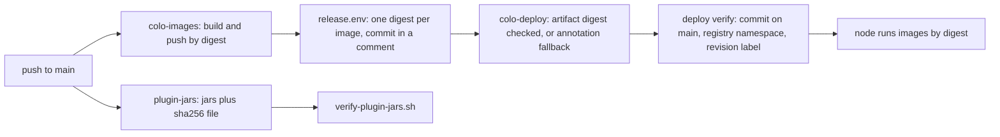

# Supply chain

How Geldar decides which outside code it runs, how it pins and checks that code, how it builds and identifies its own artifacts, and what it does not do yet. Read at `03c1f5de` on 2026-11-16. Nothing on the node was read (plan decision D8), so what the node runs is unverified.

For the pipeline itself (which workflow builds what, and the release manifest) see [build and release](../architecture/build-and-release.md). For each gate's exact rule and failure text see [repo checks](../reference/repo-checks.md).

## Why pin everything

Decision [0005](../decisions/0005-pinning-and-security-updates.md) (Accepted, 2026-11-08) sets three rules. Every dependency is pinned to an exact version. A new pin uses a release at least two weeks old. Dependabot opens security updates only.

The reasons it gives:

- **Behaviour, not only safety.** The spec asks for the whole tested combination to be pinned, because "protocol support alone doesn't prove digging, combat or eating work" (0005, Why; spec section 5.1). A routine bump can change how a Body behaves and spoil benchmark and research comparisons. An upgrade is a deliberate PR that reruns the body benchmark when it touches the body stack (0005, Consequences).
- **Time to notice a bad release.** The 14-day floor gives a compromised or broken release "time to be noticed and pulled" (0005, Decision).

`CLAUDE.md` ("Pin exact versions") repeats both rules for every contributor.

## What is pinned, and what checks it

| Input | Pin | Exact-pin check | Age check |
|---|---|---|---|
| npm packages | Exact versions; `saveExact: true` in `pnpm-workspace.yaml` | Gate 7, `pin-rules.ts` `checkExactDependencies` | Gate 8, and pnpm `minimumReleaseAge` at resolve |
| Lockfile | `pnpm-lock.yaml`; registry tarballs only, no git, URL or file sources; CI installs with `--frozen-lockfile` | Gate 7, `checkLockfileSources`; `ci.yml` lines 36, 130, 237 | Gate 8 reads every lockfile package |
| pnpm | `packageManager` in `package.json` with a `+sha512` hash, so corepack verifies the download | Gate 7, `checkPackageManagerHash` | Gate 8 |
| Node | `.nvmrc` (22.23.2). The body helper's own runtime is a separate pin, 22.23.4, checked by sha256 (`deploy/body-helper-node.env`; `body-helper-bundle.yml` line 46) | None for `.nvmrc` | None; the body-helper file records its own date check in a comment |
| Container images | By `@sha256:` digest in every Dockerfile `FROM` and every compose `image:` | Gate 7, `checkDockerfileFrom`, `checkComposeImageDigests` | Gate 8; first-party images (prefix in `first-party-images.json`) need a digest but no date |
| GitHub Actions | Full 40-character commit SHA, tag in a comment; 69 `uses:` lines in five of the six workflows (`git grep -c 'uses:' -- .github/workflows`, 2026-11-16) | Gate 7, `checkActionPins` | None |
| Gradle | Version catalogue `libs.versions.toml`, lock files, checksums in `verification-metadata.xml`; the wrapper pins `distributionSha256Sum` | Gradle itself (`plugin/README.md` line 3) | Gate 8 reads the wrapper, the catalogue and build files |
| Paper and Velocity | `VERSION`/`PAPER_BUILD` and `VELOCITY_VERSION`/`VELOCITY_BUILD_ID` in compose; the server image downloads them | Review only | None |
| Third-party plugin jars (BlueMap, Chunky, CoreProtect) | `plugins/<name>/<name>.lock.json`: an https URL and a sha256 | `plugins/<name>/test/lock.test.ts`; `deploy/common.sh` stops the deploy on a mismatch and installs nothing | None |
| Geldar's own plugin jars | Built from source in this repo | `plugin-jars.yml`; `deploy/genesis/verify-plugin-jars.sh` | Not applicable |

Gate 7 is `tools/repo-checks/src/pin-rules.ts`; gate 8 is `tools/repo-checks/src/release-age.ts`. Both run in `pnpm check:repo`, and CI runs that ([repo checks](../reference/repo-checks.md)).

Decision 0005 also names Ollama model tags. They were not examined for this page.

## How the age floor works

Two layers enforce it.

1. **At resolve time.** `pnpm-workspace.yaml` sets `minimumReleaseAge: 20160` (minutes; 14 days), so pnpm does not pull a fresh release into the lockfile.
2. **At check time.** Gate 8 reads every third-party pin from manifests, the lockfile, Dockerfiles, compose files and Gradle files. It looks up each pin's publish time in the committed `tools/repo-checks/src/release-dates.json` and fails a pin with no date or one less than 14 days old (`MIN_AGE_DAYS`). It makes no network call; whoever adds a pin adds its publish time in the same change ([repo checks, gate 8](../reference/repo-checks.md#8-release-age)).

A transitive dependency that is too young is held back with `overrides` in `pnpm-workspace.yaml` to the newest older release (0005, Consequences). The same block also lifts a vulnerable transitive: its `uuid` entry cites a Dependabot alert. 14 overrides at `03c1f5de` (counted 2026-11-16).

Gate 8 covers neither GitHub Actions, nor the plugin lock files, nor the Paper and Velocity builds, nor `.nvmrc` (`extractPins`, `release-age.ts` lines 43 to 52). Their age is a reviewer's check.

## Security updates

`.github/dependabot.yml` sets `open-pull-requests-limit: 0` on every entry, so Dependabot opens no version-update PRs. Security updates are enabled in the repository settings, according to the file's header comment. The settings cannot be read from the repo, so that is unverified; the `uuid` override comment in `pnpm-workspace.yaml` ("Dependabot alert 1") shows alerts have reached the project at least once.

Entries at `03c1f5de`:

| Ecosystem | Directory |
|---|---|
| npm | `/` |
| github-actions | `/` |
| gradle | `/plugin` |
| docker | `/compose`, `/threshold/mcp`, `/threshold/mcp-mock`, `/eventsink` |
| docker-compose | `/compose` |

Whether these entries cover every image and compose file is an owner item; it is not compared here.

## Building and identifying Geldar's own artifacts

Each artifact Geldar ships names the commit it came from, and the deploy checks that name. The details, with line numbers, are in [build and release, Release identity](../architecture/build-and-release.md#release-identity).

- **Images.** `colo-images.yml` runs only on a push to `main` or a manual dispatch in the upstream repository; pull requests and forks never publish (header, lines 1 to 2). Its `manifest` job (line 383) writes `release.env` with one digest reference per image. Before anything changes on the node, `deploy/colo-cd-verify.sh` refuses an image outside the project's registry namespace or one whose OCI revision label differs from the release commit (lines 1 to 8).
- **The release manifest in transit.** `colo-deploy.yml` downloads the `release.env` artifact and compares the download with the artifact's sha256; a mismatch is fatal, with no fallback (step at line 113; lines 114 to 116, 183 and 218). When the download itself fails (not on a mismatch), the job falls back to the check-run annotation of the same run's manifest job. That path checks only that the manifest is well formed (`valid_manifest`), with no sha256 comparison (lines 205 to 226). The workflow comment notes that both sources are the same run under the same token (line 116); after either path, the deploy entrypoint still checks that the commit is on `main`, the image prefix and the revision labels ([build and release](../architecture/build-and-release.md) line 82 records the fallback). The deploy runs only commits reachable from `main` (header, lines 1 to 6). The deploy runner itself is described in the [colo deploy runbook](../runbooks/colo-deploy.md).
- **Plugin jars.** `plugin-jars.yml` builds both jars and writes `plugin-jars.sha256` with the commit and each jar's hash; `deploy/genesis/verify-plugin-jars.sh` checks them. Whether the node uses this artifact or jars built from its own checkout (`compose/colo.yml` mounts `../plugin/.../build/libs`) is unverified ([build and release](../architecture/build-and-release.md#conflicts-recorded) item 2).
- **Body helper bundle.** `body-helper-bundle.yml` publishes `main.js` with `main.js.sha256` and checks the pinned Node tarball.

## Signing, scanning and attestation

Spec 8.6 and 8.7 ask for signed images, SBOMs, a CI scan and a weekly update window. The two image workflows record the owner's choice: "Unsigned, no SBOM, no provenance attestation (owner ruling)" (`mcp-mock-image.yml` line 6; `colo-images.yml` lines 5 to 6). No decision record holds that ruling. Which spec 8.7 items are built is an owner item and is not listed here. Report a security problem as `SECURITY.md` says, never in a public issue.

## Conflicts recorded

Not resolved here (persona rule 8).

1. **Signing and attestation.** Spec 6.5 (line 1117) and 8.6 (line 1317) against the image workflows, which cite an owner ruling that has no decision record.
2. **Update tool.** Spec 8.7 (line 1324) names Renovate with a weekly window; decision 0005 (Accepted) chose Dependabot security-only, with version updates off.
3. **Release age is "manual".** The header of `pin-rules.ts` (lines 7 to 8) says the 14-day age "stays a manual step". `release-age.ts` checks it in `pnpm check:repo`; only adding the dates is manual ([repo checks](../reference/repo-checks.md) conflict 3).
4. **Two Node versions.** `.nvmrc` pins 22.23.2; the body helper's runtime pins 22.23.4 (`deploy/body-helper-node.env`). Both are deliberate pins; no record says whether they should match.

## Follow-ups

- A decision record for the unsigned-images ruling (owner).
- Correct the `pin-rules.ts` header comment (code change, not a writer's).

## Related

- [Build and release](../architecture/build-and-release.md): the pipeline and release identity.
- [Repo checks](../reference/repo-checks.md): gates 7 and 8.
- [CI workflows](../reference/ci-workflows.md) and [third-party plugins](../reference/third-party-plugins.md).
- [Secrets by role](secrets-by-role.md) and [authn and authz map](authn-authz-map.md).
- [Threat model](../threat-model.md).
