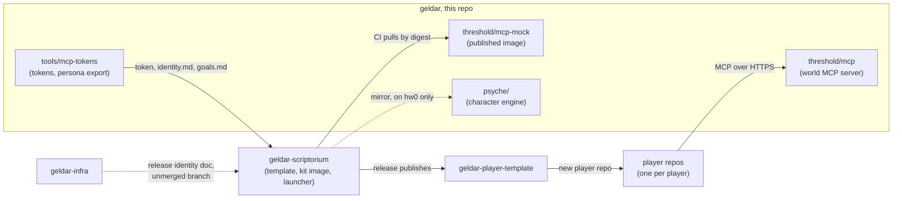

# Sibling repositories

A map of the seven repositories next to this one: what each is for, what it holds today, which documents it keeps, how it touches this repo, and whether an agent in the world reads it. This folder summarises them; it never copies their files (plan decision D2, [plan.md](../analysis/docs-library/plan.md#12-risks-and-owner-decisions)). Kit, prompt, skill, identity and template text is read by agents, so this page describes it and does not quote it.

## How this page was checked

- Each sibling was read on 2026-11-16 from its local clone, read-only, with `git -C <repo> log -1 --format=%h <ref>`, `git -C <repo> ls-tree` and `git -C <repo> show <ref>:<path>`. Nothing was fetched, so a remote-tracking ref (`origin/...`) is as old as the clone's last fetch, which is unknown.
- Where a clone's checked-out branch is older than its remote-tracking `main`, this page uses the newer ref and says so.
- Claims about this repo were checked at db33805c. The later commits up to 283d5d2d only add documents under `docs/history/`, `docs/security/` and `docs/reference/decisions-by-topic.md` and change no file this folder cites (`git diff --name-status db33805c 283d5d2d`, 2026-11-16).

## The map

"Agent-read" means read by Geldar's agents in the world (their Minds), as listed in [paths an agent reads](../agents/documentation-style.md#paths-an-agent-reads). Coding agents that change code are not counted.

| Repo | Purpose | State (ref read, date) | Docs it holds | How it relates to this repo | 1-hop interface | Who reads it | Agent-read |
|---|---|---|---|---|---|---|---|
| `geldar-scriptorium` | Builds the sovereign-player kit: the player-facing template, the kit container image and the `geldar-play` launcher (its `README.md`) | Active. `origin/main` 8c4d1ff (2026-11-15), 563 tracked files. Integration branch `scriptorium/hw0` 673d756 (2026-11-15), not merged. The clone's own checkout is older ([scriptorium](scriptorium.md)) | Architecture, onboarding, troubleshooting, release, CI, threat model, launcher hardening, ChatGPT setup, three analysis areas | On `main`: consumes this repo's MCP server and mock, and takes persona files exported here. On `scriptorium/hw0` only: mirrors `psyche/`. Its decisions that touch the spec are filed in this repo's `docs/decisions/` | MCP (to `threshold/mcp`, tested against `threshold/mcp-mock`); per-player MCP tokens; psyche mirror, `hw0` only (decision 0281). No NATS, no contract package import | Developers, the owner, coding agents; the published template is read by agents | **Yes**, for `template/`: it is copied into every player repo (spec 5.15.4). Inferred, not checked file by file: the image settings and the tool text in `packages/` also reach a session. See [scriptorium](scriptorium.md#agent-read-surfaces) |
| `geldar-player-template` | The template each player repo is created from (spec 2a and 6.6) | Populated by releases. `origin/main` 88223ba (2026-11-14), 40 files, tag `kit-v0.1.0-rc20`; 18 tags, all prereleases. Local `main` is the initial commit cd7815c | A player-facing `README.md` (the Patron guide) | Published from `geldar-scriptorium`; never edited by hand (scriptorium `docs/release.md`) | Its `.mcp.json` points a player's CLI at the Geldar MCP server; `player.json` names the shard, MCP URL, harness and kit pins | The person who runs a player; every player's CLI session | **Yes**: every file is copied into a player repo (spec 5.15.4). See [infra, lantern, template](infra-lantern-template.md#geldar-player-template) |
| `geldar-infra` | Infrastructure that spec 6.6 puts under `infra/` in this repo | `origin/main` 9f06cd7 (2026-11-08): a title-only `README.md`. Branch `docs/release-identity` bafe5e7 adds one document | One unmerged document on the release identity of the kit's publish workflow | None in code. Decision 0004 keeps Phase 0 infrastructure in this repo | None | Operators (inferred) | No (only scriptorium campaign notes under `docs/analysis/` name it; the template does not; `git grep -i geldar-infra`, 2026-11-16) |
| `geldar-lantern` | The Patron's Thinker bundle that spec 6.6 puts under `lantern/` | Empty: one 16-byte `README.md`, 77ac776 (2026-11-08) | None | Phase 0 has `lantern-local/` in this repo instead (decision 0004) | None | Nobody yet | No |
| `geldar-experiments` | Not described by the spec (spec 6.6 puts `experiments/` under `docs/` in this repo) | Empty: one 20-byte `README.md`, a8c1b2e (2026-11-08) | None | None | None | Nobody yet | No |
| `agent-board` | A Discourse forum and its CLI and MCP launcher, where coding sessions across the organisation's projects talk to each other and to people (its `README.md`) | `main` b394720 (2026-10-04); the clone is checked out on another branch | Usage guide, operations guide; Geldar's how-to is [developer agent board](../agents/board.md) | Not a runtime dependency. Geldar uses it for developer coordination only (decision [0436](../decisions/0436-developer-agent-board.md)); nothing from it reaches the game. Spec 5.12 plans a Historian that posts to a Discourse board; nothing is built | Developer accounts per operator and agent role (`main-session`, `ops`, packet and documentation agents); keys in Key Vault only | Coding agents and people on other projects, and Geldar's developers | No, for the game. Developer use only. See [agent-board and agentcraft](agent-board-and-agentcraft.md) |
| `agentcraft` | A Minecraft (Fabric) studio in which a team of coding agents works on a person's repo (its `README.md`) | `origin/main` 015b4c1 (2026-10-04); clone has uncommitted changes | Its own spec, protocol, QA and multiplayer plan | None: agentcraft does not name Geldar, and this repo names agentcraft nowhere outside `docs/`. AgentCraft is one of agent-board's users (agent-board `README.md`) | None | Its own users and coding agents | No. See [agent-board and agentcraft](agent-board-and-agentcraft.md) |

## How they connect

Dashed lines are not on a `main` branch.

## Interfaces in detail

| Interface | This repo's side | Sibling side | Evidence |
|---|---|---|---|
| World MCP | `threshold/mcp` serves one player per URL with a bearer token | The template's `.mcp.json` declares three servers: one world server, `geldar`, over HTTP, and two local kit servers for memory and git; `player.json` holds the world server's URL | [sovereign players](../concepts/sovereign-players.md); template `origin/main` 88223ba |
| Mock world | `.github/workflows/mcp-mock-image.yml` pushes the mock image to GitHub's container registry | Scriptorium `tests/e2e/world.ts` line 27 pins that image by digest | Decision [0046](../decisions/0046-scripted-stub-cli-stands-in-for-the-vendor-cli-in-ci.md); scriptorium 8c4d1ff |
| `wait` limit | `threshold/mcp/src/tools/wait.ts` lines 26 and 27: 240 s, "the Scriptorium constraint" | The kit sessions call `wait` | spec 5.15.3 |
| Psyche mirror | `psyche/src`, `psyche/RELEASE.json`, tag `psyche-v<version>` | `packages/psyche` with a mirror test, present on `scriptorium/hw0` 673d756, absent from `origin/main` 8c4d1ff | `psyche/README.md` line 3; decision [0281](../decisions/0281-psyche-package-boundary.md) |
| Persona | `tools/mcp-tokens/src/persona-export.ts` writes `memory/identity.md` and `memory/goals.md` | The launcher's `new --persona-dir` reads them (scriptorium `launcher/README.md`) | Decision [0060](../decisions/0060-persona-size-limits.md) |
| Register and roster | `threshold/register` writes a roster row on sign-up (decision 0261) | Scriptorium's fleet campaign plans a dispatch "from the registration side" when a roster entry changes (`docs/analysis/fleet/README.md`, design rule 7) | Planned only: `git grep -i -E 'workflow_dispatch|fleet' -- threshold/register` found nothing on 2026-11-16 |
| NATS | Bodies and Minds use NATS | None: `git grep -i nats` over scriptorium `origin/main` (excluding `docs/analysis`) and over `packages`, `launcher` and `image` on `scriptorium/hw0` found nothing | Command run 2026-11-16 |
| Contract | `contract/schemas/mcp-*` | No package in scriptorium imports `@geldar/contract` (`git grep '@geldar/contract'` over its `package.json` files found nothing) | Command run 2026-11-16 |

## Documents in this folder

| Doc | Type | What it covers |
|---|---|---|
| [scriptorium.md](scriptorium.md) | explanation | The kit repo: outputs, packages, how a sovereign player reaches Geldar, interfaces, build and release, known gaps |
| [infra-lantern-template.md](infra-lantern-template.md) | reference | `geldar-infra`, `geldar-lantern`, `geldar-player-template` and `geldar-experiments`: what exists and what is empty |
| [agent-board-and-agentcraft.md](agent-board-and-agentcraft.md) | explanation | A boundary note: what the two repos are, and how each relates to Geldar (agent-board is developer-only) |

## Conflicts recorded

1. **Repo layout.** Spec 6.6 puts `lantern/` and `infra/` inside this repo and names only `geldar-player-template` as a separate repo. The organisation also has `geldar-scriptorium`, `geldar-infra`, `geldar-lantern` and `geldar-experiments`. Decision [0004](../decisions/0004-phase0-repo-layout.md) keeps Phase 0 in this repo and defers the move to Phase 2. No decision on `main` here creates `geldar-scriptorium` (see [scriptorium, conflicts](scriptorium.md#conflicts-recorded)).
2. **"Near-empty" template.** The plan row for X03 and the repo memory note of 2026-11-08 call `geldar-player-template` an empty README stub. Its `origin/main` holds 40 files at 88223ba (2026-11-14).
3. **Which name is Scriptorium.** Spec 2a names Scriptorium as `geldar-player-template`. The kit is built in `geldar-scriptorium` and only published to the template (scriptorium `README.md`; its `CLAUDE.md` and `docs/decisions.md` cite geldar decision 0014 for this, a record not on `main` here, see [scriptorium, conflict 1](scriptorium.md#conflicts-recorded)).

## Debt

- Closed in W7 (2026-11-16): the [docs index](../README.md) lists `siblings/` as written, and [sovereign players](../concepts/sovereign-players.md) links [scriptorium](scriptorium.md) without a *planned* mark. The [spec section map](../reference/spec-section-map.md) lists the page in its "Planned doc" column, which needs no change.
- The [paths an agent reads](../agents/documentation-style.md#paths-an-agent-reads) table says the kit repos were "not checked in those repos for this page" and does not name the kit image settings or the tool text in `packages/`. This folder has now read both repos; the table's owner updates the row.
- The [doc-update map](../agents/doc-update-map.md) has no row for "a sibling repo changes its interface to this repo".
- No gate checks sibling repos for operator material. The [agents-never placement](../agents/doc-verification.md#agents-never-placement) grep covers this repo only.
